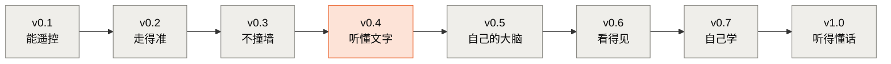

# roots-ai · 扎根 AI

[](https://github.com/OGGIoao/roots-ai/actions/workflows/ci.yml)
[](LICENSE)

> 扎根家族: **roots-ai** (AI 全栈) · [roots-modeling](https://github.com/OGGIoao/roots-modeling) (统计学习与数学建模; 暂未公开)

> **从根上自己搭一套 AI 知识库: 每个知识点都自己写讲义、自己实现、自己实测; 再用真实的作品把它们串成跑得通的链路。第一个作品是一台听得懂话的小车。**
>
> *A from-scratch AI curriculum: every concept gets its own tutorial, a minimal implementation and measured numbers, and real projects tie them together — starting with a small car that understands commands. Everything measured on one 8 GB laptop. (Docs are in Chinese.)*

**现在的状态 (早期)**: 整体规划已定 (见 [FRAMEWORK.md](FRAMEWORK.md)), 内容按顺序在写。

<!-- status:start -->
| 知识库单元 | 个数 | 哪些 |
|---|---|---|
| ✅ 写完了 | 7 | [bpe](library/llm/bpe/TUTORIAL.md) · [minigpt](library/llm/minigpt/TUTORIAL.md) · [attention](library/llm/attention/TUTORIAL.md) · [chat-template](library/llm/chat-template/TUTORIAL.md) · [decoding](library/llm/decoding/TUTORIAL.md) · [structured-output](library/llm/structured-output/TUTORIAL.md) · [bandit](library/rl/bandit/TUTORIAL.md) |
| 🟡 有内容, 待补 | 6 | [electronics](library/hardware/electronics/TUTORIAL.md) · [llm-tree](library/llm/llm-tree/README.md) · [modern-small-model](library/llm/modern-small-model/TUTORIAL.md) · [agent-loop](library/agent/agent-loop/TUTORIAL.md) · [agent-frameworks](library/agent/agent-frameworks/README.md) · [tool-finetune](library/post-training/tool-finetune/README.md) |
| ⬜ 规划中 | 179 | 见 [知识库总目录](library/README.md) |
<!-- status:end -->

---

## 这个仓库是什么

三层, 由下往上:

| 层 | 是什么 | 现在 |
|---|---|---|
| **[知识库](library/README.md)** | 一个知识点一份讲义, 分 8 个领域: 基础、硬件、大语言模型、Agent、强化学习、后训练、具身智能、多模态。每份讲义带参考实现、实测数据、三级练习 (填空 → 只给接口 → 白纸, 测试判对错) | 见上面的状态; 完整目录 (含规划中的) 在 [library/README.md](library/README.md) |
| **[基座线 roots-lm](base/README.md)** | 自己从零训一个小模型: 笔记本跑通全流程 → 上云放大 → 装前沿部件 → 长眼睛和耳朵 | 未开始 |
| **[项目](projects/README.md)** | 把知识做成作品: ① 小车 ② 学习助教 ③ 推理服务 | 小车 v0.4 (仿真版) 可以跑 |

项目不重讲原理, 只讲 "这一步做了什么、实测结果如何", 原理链接到知识库; 知识库可以单独按领域学。

## 学习顺序 (只列已经写好的)

**主线: 从 "模型怎么工作" 到 "让模型开车"**

| 步 | 读 | 学完能做到 | 需要 |
|---|---|---|---|
| 1 | [分词 BPE](library/llm/bpe/TUTORIAL.md) | 说清文字怎么变成整数、中文为什么费 token; 自己写出 BPE | 只要 Python |
| 2 | [miniGPT](library/llm/minigpt/TUTORIAL.md) | 从零写一个 GPT 并训练、生成; PyTorch 在这里边用边讲 | CPU 可以, 有显卡更快 |
| 3 | [注意力与推理延迟](library/llm/attention/TUTORIAL.md) | 说清 MHA / GQA / MLA 的区别, 为什么提示越长越慢 | CPU 可以 |
| 4 | [对话模板](library/llm/chat-template/TUTORIAL.md) | 看懂一段对话和工具调用最后变成了什么文字 | 只要 Python |
| 5 | [解码与采样](library/llm/decoding/TUTORIAL.md) | 说清贪心、温度、top-p、重复惩罚各自的脾气, 以及它们怎么影响小车 | 只要 Python |
| 6 | [结构化输出](library/llm/structured-output/TUTORIAL.md) | 让模型只能写出合法的工具调用 | 只要 Python |
| 7 | [Agent 循环](library/agent/agent-loop/TUTORIAL.md) | 写出 "模型 → 工具 → 结果 → 模型" 的循环, 加安全层, 会评测 | 只要 Python |
| 8 | [小车 v0.4 听懂文字](projects/car/v0.4-text-commands/TUTORIAL.md) | 用真实的小模型开仿真小车, 自己跑出 30 个任务的成功率 | 显卡 (8 GB 够) 或 Colab 或云端 API |

**两条副线** (和主线无关, 累了可以换着学): 强化学习从 [老虎机](library/rl/bandit/TUTORIAL.md) 开始 (只要 Python); 硬件从 [电路与 ESP32 入门](library/hardware/electronics/TUTORIAL.md) 开始 (只要浏览器, 不用买板子)。

**先跳过的**: [现代小模型](library/llm/modern-small-model/TUTORIAL.md) 还没精简完, 第 3 步之后读主干即可; [工具调用微调](library/post-training/tool-finetune/README.md) 还是通用演示, 等改造完再读。

**基础不够怎么办**: 基础领域 (数学、PyTorch、自动求导等) 正在写。在那之前, 第 2 步的 miniGPT 讲义会边用边讲需要的 PyTorch 和数学。

每个单元的学法一样: 读讲义同时跑代码 → 做三级练习 (测试通过才算做对) → 对照单元 README 末尾的 "掌握程度自测"。没有显卡: bpe、minigpt、attention 和小车 v0.4 都有 Colab 笔记本 (各自 README 顶部的按钮)。

**最快看一眼**: 只要有 Python, 运行 `python library/agent/agent-loop/demo_minimal.py --seed 1`, 一秒内看到一个假模型怎么一步步把仿真小车开到红杯子跟前。

## 项目 ① 小车

**终点 demo** (建设中): 你对小车说 "去找那个红色杯子"。芯片上自己训练的唤醒词模型听到指令 → 笔记本上**自己微调的小模型**把这句话拆成工具调用 → 小车转身、前进、用摄像头确认、避开障碍 → 停在杯子前, 用语音回答 "找到了"。



<sub>橙色: 这一站已经可以跑 (仿真版); 灰色: 还没开始。真车还没有造出来, 当前**软件先行**: 先在仿真里把大模型、Agent、强化学习打通, 再造真车。</sub>

每一站多什么本事、要先学哪些单元, 见 [小车项目首页](projects/car/README.md); 验收标准、工具接口、安全规则和预算见 [PRODUCT.md](projects/car/PRODUCT.md)。

---

## 适合谁

| 你是 | 你能从这里得到 |
|---|---|
| 会写 Python 的学生 (计算机、自动化、电子……) | 一套自己能读懂、能复现的 AI 知识, 加上从软件到硬件都自己做出来的作品, 课程设计、竞赛、求职都拿得出手 |
| 想练微调、推理优化、Agent 落地、物理 AI 的工程师 | 每项技能都有对应的单元和作品 (见 [FRAMEWORK.md](FRAMEWORK.md) 第 6 节技能地图) |
| 想转向具身智能 / AI 硬件的软件工程师 | 不用先补一整套电子学: 硬件从浏览器仿真开始, 每一步都和你熟悉的代码、测试连在一起 |
| 想带课、带社团的老师和组织者 | 现成的单元与分站课程: 讲义、实测数据、三级练习和自动判分的测试 |

**前置要求**: 会写 Python 的函数, 会用命令行。不需要电子基础, 不需要深度学习基础, 起步也不需要 GPU。

---

## 为什么这样做

大模型、Agent、强化学习、嵌入式, 每个方向的资料都很多, 但散落各处, 很难自己串起来; 硬件这一侧门槛又高, 很多人停在"跑通别人的代码"。

| 原则 | 具体是什么 |
|---|---|
| 知识完整, 写作按需 | 知识库按完整体系规划; 但不按领域一口气写完, 项目和基座线走到哪, 先补那里要用的单元 |
| 亲手写最小实现 | 不调包了事: BPE、GPT、注意力变体、对话模板、消抖、Agent 循环……都从零写一遍, 再和成熟方案逐字节、逐数字对照 |
| 数字全部实测 | 讲义里没有示意值; 每个数字都能用仓库里的脚本重新算出来, 回归测试会检查。没测过的明确写 "没有数据" |
| 前沿要核实 | 新技术先登记进前沿雷达, 用技术报告、模型配置、源码核实后才写进单元 |
| 先仿真, 再上真板 | 硬件先在浏览器仿真器里跑通, 小车先在 Python 仿真里跑通; 仿真和真车哪里不同, 讲义里专门列出 |

和同类项目的区别: [nanoGPT](https://github.com/karpathy/nanoGPT) 把一个模型做到底, 各类课程讲得广, 生产框架追求好用; 本仓库做的是**一整套连起来的链**, 而且明确是玩具规模, 追求每一环都能自己写出来。

---

## 安装

需要 Python 3.10+。只想看最小演示、做不需要模型的练习, 有 Python 和 `pip install pytest` 就够了。完整环境推荐用 conda 建一个独立环境:

```bash
conda create -n roots-ai python=3.10 pip -y
conda activate roots-ai

# torch 三件套必须用同一条命令一起装。cu128 适用于 RTX 50 系;
# 老显卡换成对应的 CUDA 索引, 没有 GPU 就去掉 --index-url 装 CPU 版
pip install torch torchvision torchaudio --index-url https://download.pytorch.org/whl/cu128

pip install -r requirements.txt
pip install -e . --no-deps    # 仓库自带的共享包 common/ (可编辑安装, 在仓库根目录执行)
python verify_env.py --full   # 环境自检, 会告诉你缺什么、该敲什么命令
```

> **同一个环境里不要混用 conda 和 pip 装 torch 系包**: conda 装的 CUDA 版很容易被 pip 装的 CPU 版覆盖, 最后留下一个 ABI 不匹配、import 就报错的 torchaudio。
>
> 国内网络下载 PyPI / Hugging Face 失败时, `verify_env.py` 会检测出网情况并给出建议; 下载模型的镜像办法见 [v0.4 讲义第 1 节](projects/car/v0.4-text-commands/TUTORIAL.md#1-准备环境)。

硬件单元在浏览器里跑, 不需要安装, 步骤见 [电路与 ESP32 入门 第 0 节](library/hardware/electronics/TUTORIAL.md#0-怎么跑起来)。

## 快速开始

以下命令都从仓库根目录执行:

```bash
python -m pytest tests -q                                       # 全部回归测试, CPU 上也能跑
python library/agent/agent-loop/demo_minimal.py --seed 1        # Agent 循环的最小演示, 只用标准库, 一秒内
python library/llm/chat-template/chat_template.py               # 看一段对话被模板拼成什么样, 只用标准库
python library/llm/bpe/train.py                                 # 训练 BPE 分词器, 约 15 秒
python library/rl/bandit/experiments/greedy_fails.py           # 老虎机: 看贪心怎么失败, 约 15 秒
python library/llm/minigpt/train.py --config nano               # 训练 miniGPT 并生成文本, GPU 上约 40 秒
```

(耗时在下面的测量平台上实测; miniGPT 的 checkpoint 写到当前目录的 `checkpoints/`, 不入库。)

## 测量平台

| 用途 | 平台 |
|---|---|
| 软件部分的数字 | Windows 11 笔记本, RTX 5060 Laptop 8GB (Blackwell sm_120), 16 GB 内存, Python 3.10, torch 2.11 + CUDA 12.8 |
| 硬件部分的数字 | [Wokwi](https://wokwi.com) 网页版仿真, ESP32-S3-DevKitC-1, MicroPython v1.28.0 (真板对照会单独标出) |
| 持续集成 | GitHub Actions, Ubuntu + CPU 版 torch, 跑全部回归测试 |

在其它机器上跑, 训练速度和显存数字会不同, 但同种子下的结论应当一致。笔记本撑不住的部分 (基座线阶段 2 起) 上云, 云上的数字会单独标出。

---

## 项目结构

```
roots-ai/
├── library/                   # 知识库: 8 个领域, 一个知识点一份讲义 (总目录 library/README.md)
│   ├── foundations/           #   基础: 工具、数学、机器学习、计算机系统、研究方法
│   ├── hardware/              #   硬件: electronics ……
│   ├── llm/                   #   大语言模型: bpe  minigpt  attention  chat-template  decoding  llm-tree ……
│   ├── agent/                 #   Agent: agent-loop  agent-frameworks ……
│   ├── rl/                    #   强化学习: bandit ……
│   ├── post-training/         #   后训练: tool-finetune ……
│   ├── embodied/              #   具身智能 (规划中)
│   ├── multimodal/            #   多模态 (规划中)
│   ├── frontier/              #   前沿: 厂商档案卡、前沿雷达、解剖台
│   └── safety.md              #   安全线索引
├── base/                      # 基座线 roots-lm: 自己从零训的小模型 (规划中)
├── projects/                  # 项目
│   ├── car/                   #   ① 小车: 各站、PRODUCT.md、hardware/ (开发板选型、引脚、物料清单)
│   ├── tutor/                 #   ② 学习助教 (规划中)
│   └── serving/               #   ③ 推理服务 (规划中)
├── electives/                 # 选修: 四足机器人
├── sim/                       # 仿真小车 (和真车同一套工具接口)
├── common/                    # 多个单元共享: 语料定位、字符级分词、对照实验框架、SVG 作图
├── templates/llm-client/      # LLM API 统一客户端
├── tools/                     # 生成 Colab 笔记本、知识库目录的脚本
├── tests/                     # 回归测试 (CI 每次提交都跑)
├── FRAMEWORK.md               # 总框架设计: 三层、8 个领域、基座线、项目、前沿、技能地图
├── ROADMAP.md                 # 当前进度与推进顺序
├── CONTRIBUTING.md            # 讲义与练习的写作规范
├── NOTICE.md                  # 第三方内容与致谢
├── verify_env.py              # 环境健康检查
└── requirements.txt           # 全仓库唯一依赖清单
```

仓库重构过两次 (2026-10-27、2026-10-28), 新旧路径对照见 [小车项目首页](projects/car/README.md#旧路径对照)。

---

## 常见问题

**要买硬件吗?** 现在不用。硬件单元目前全部在浏览器里完成, 小车也先在 Python 仿真里跑。造真车需要一套硬件, 预算目标是小车加工具 600 元以内, 清单见 [PRODUCT.md](projects/car/PRODUCT.md#6-预算-粗估); 具体型号会在硬件各站开始前定下。端侧 AI 的单板电脑是可选的, 不进小车预算。

**要 GPU 吗?** 不是必须的。回归测试、Agent 循环的演示与练习、分词 BPE、对话模板、电路入门、老虎机只用 CPU; miniGPT 的 nano 配置在 CPU 上实测 105 秒训完 (GPU 约 40 秒), 注意力的对照实验在 CPU 上也能跑, 只是慢。v0.4 的本地模型评测和微调需要 NVIDIA 显卡 (v0.4 用 1.5B 模型, 作者的 8 GB 显卡足够)。没有显卡可以用 Colab 的免费 GPU, 或 v0.4 的云端 API 路线。

**支持什么系统?** 讲义是在 Windows 上实测的; 回归测试在 Linux (GitHub Actions) 上每次提交都跑。macOS 没有测过。

**为什么芯片上用 MicroPython 而不是 C++?** 先把注意力放在电路上, 控制逻辑也能在电脑上用 pytest 测。到摄像头和芯片上的唤醒词 (v0.6、v1.0) 性能不够时再换 C++, 换的时候会实测两者的差距。

**讲义是什么语言?** 中文。代码注释和提交信息也以中文为主。

---

## 参与

项目还在早期, 欢迎:

- **提 issue**: 讲义里看不懂的地方、跑不通的命令、数字对不上、来源或许可写错了;
- **补数据**: 小车 v0.4 讲义第 7 节列了作者还没跑的实验 (更大的模型、云端 API、改提示词), 每个只需要一条命令;
- **在真板上复现**: 电路入门讲义里标了 ⏳ 的"真板对照", 如果你手上有 ESP32-S3 开发板, 欢迎把实测结果提交上来;
- **贡献知识库单元或练习**: 先读 [CONTRIBUTING.md](CONTRIBUTING.md) (讲义规范、三级练习的标准、"数字全部实测"的要求), 开 issue 讨论之后再动手。规划中的单元见 [知识库总目录](library/README.md)。

提交前请跑 `python -m pytest tests -q`。

## 致谢与许可证

本仓库参考或使用了一些外部项目和数据, 见 [NOTICE.md](NOTICE.md)。

代码、讲义和图以 [MIT 许可](LICENSE) 发布。
