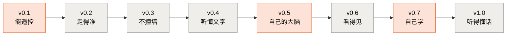

# roots-car · 根系

[](https://github.com/OGGIoao/roots-car/actions/workflows/ci.yml)
[](LICENSE)

> **造一台听得懂话的小车, 把大模型、Agent、强化学习和硬件连成一条链, 一起打通。**
>
> *Build a small car that understands spoken commands — learning LLMs, agents, reinforcement learning and embedded hardware as one connected chain, on a single 8 GB laptop and a few hundred RMB of parts. (Docs are in Chinese.)*

**终点 demo** (建设中): 你对小车说"去找那个红色杯子"。芯片上自己训练的唤醒词模型听到指令 → 笔记本上**自己微调的小模型**把这句话拆成工具调用 → 小车转身、前进、用摄像头确认、避开障碍 → 停在杯子前, 用语音回答"找到了"。

---

## 主线: 跟着一台小车, 一站一站长出本事

不是把大模型、强化学习、嵌入式分开学, 而是**每学完一站, 小车就多一项本事**。每一站结束时, 你手里都有一台能演示的车。



<sub>橙色: 这一站已经有章节可以学; 灰色: 还没开始。项目处于**早期阶段**, 小车本身还没有造出来。</sub>

| 站 | 小车多了什么本事 | 你会亲手做出来的 | 章节 |
|---|---|---|---|
| **v0.1 能遥控** | 手机网页遥控前后左右 | 点灯、读按钮、消抖、硬件 PWM、ADC、非阻塞循环 (先在浏览器仿真) → 驱动电机、WiFi 网页遥控 | [B1 电子入门](mainline/B1-electronics/TUTORIAL.md) ✅ · B2 电机与遥控 ⬜ |
| **v0.2 走得准** | 执行"走 1 米""转 90 度", 误差 < 5 cm | 编码器测速、PID 速度闭环 | B3 ⬜ |
| **v0.3 不撞墙** | 自己避障; 断网 0.5 秒内自动停车 | 测距、状态机、看门狗与急停 | B4 ⬜ |
| **v0.4 听懂文字** | 打字指挥, 大模型把一句话拆成 `walk` / `turn` / `stop` | Agent 循环与工具调用, 先驱动仿真小车再上真车 | C1 🟡 |
| **v0.5 自己的大脑** | 换成**自己微调的小模型**, 在笔记本上本地运行 | 从零写分词器、GPT、注意力 → 微调 0.5B 模型只输出工具调用 → 本地推理服务 → 成功率评测 | [A1](mainline/A1-bpe/TUTORIAL.md) ✅ [A2](mainline/A2-minigpt/TUTORIAL.md) ✅ [A3](mainline/A3-attention/TUTORIAL.md) ✅ [A4](mainline/A4-modern-small-model) 🟡 [C2](mainline/C2-tool-finetune) 🟡 · C3 C4 ⬜ |
| **v0.6 看得见** | 用摄像头找到红杯子 | 摄像头、小模型检测、int8 量化 (芯片上跑 vs 笔记本上跑) | D1 D2 ⬜ |
| **v0.7 自己学** | 仿真里用强化学习训练的策略上真车 | 老虎机 → Q-learning → 策略梯度 → PPO → 仿真到真车 (sim2real) | [E1](mainline/E1-bandit/TUTORIAL.md) ✅ · E2–E5 ⬜ |
| **v1.0 听得懂话** | 一句话指挥小车完成任务 | 芯片上的唤醒词 (自己训练、量化、手写推理), 全链路评测 | F1 F2 ⬜ |

表里 "误差 < 5 cm""0.5 秒内停车" 这类数字是还没造出来的站的**目标值**, 做到那一站时实测后再定。每一站的验收标准、小车的工具接口、安全规则和预算见 [PRODUCT.md](PRODUCT.md); 章节的完整规划见 [ROADMAP.md](ROADMAP.md)。

### 从这里开始

**跟着主线走, 第一站是 [B1 电子入门](mainline/B1-electronics/TUTORIAL.md)**: 只需要浏览器, 不用买任何东西。你会在仿真器里点亮 LED、处理按钮弹跳、用 PWM 调亮度, 并用逻辑分析仪亲眼看到信号。这些都是 v0.1 驱动电机要用的。

项目当前**软件先行**: 先在仿真里把大模型、Agent、强化学习打通, 再造真车 (顺序见 [ROADMAP.md](ROADMAP.md))。正在做的是 [C1 Agent 循环](mainline/C1-agent-loop/TUTORIAL.md) (讲义初稿): 让大模型用工具调用驱动仿真小车, 实测小模型自己开车几乎全失败, 只让它选目标则能完成大部分任务。已经写好、可以先学的:

- **大模型**: [A1 BPE 分词器](mainline/A1-bpe/TUTORIAL.md) → [A2 miniGPT](mainline/A2-minigpt/TUTORIAL.md) → [A3 注意力与推理延迟](mainline/A3-attention/TUTORIAL.md);
- **强化学习**: [E1 老虎机](mainline/E1-bandit/TUTORIAL.md)。

没有显卡、不想在自己电脑上装环境: A1、A2、A3 都有 Colab 笔记本, 点各章 README 顶部的 "Open in Colab" 按钮, 在浏览器里直接运行。

每章都是同样的结构: 讲义 `TUTORIAL.md`、参考实现、实验脚本、三级练习 (填空 → 只给接口 → 白纸, 由测试判对错)。

### 不想动手的时候: 选修

主线只走小车用得到的内容; 其余放在 [选修](electives/README.md) 里, 全部保留, 当作可以慢慢读的详细文档: LLM 架构生长树 (位置编码、MoE、Mamba 等)、解剖台 (读 20 多个真实开源模型的配置)、四足机器人、后训练 (DPO / GRPO)、规模化与上云。

---

## 适合谁

| 你是 | 你能从这里得到 |
|---|---|
| 会写 Python 的学生 (计算机、自动化、电子……) | 一个从软件到硬件都自己做出来的完整作品, 课程设计、竞赛、求职都拿得出手 |
| 想转向具身智能 / AI 硬件的软件工程师 | 不用先补一整套电子学: 硬件从浏览器仿真开始, 每一步都和你熟悉的代码、测试连在一起 |
| 喜欢动手的硬件爱好者 | 给自己的作品接上大模型和 Agent 的一条可复现路线 |
| 想带课、带社团的老师和组织者 | 现成的分站课程: 讲义、实测数据、三级练习和自动判分的测试, 硬件预算 600 元以内 |

**前置要求**: 会写 Python 的函数和类, 会用命令行。不需要电子基础, 不需要深度学习基础, 起步也不需要 GPU。

---

## 为什么这样做

大模型、Agent、强化学习、嵌入式, 每个方向的资料都很多, 但散落各处, 很难自己串起来; 硬件这一侧门槛又高, 很多人停在"跑通别人的代码"。

| 原则 | 具体是什么 |
|---|---|
| 目标导向 | 每一章都回答"小车的哪个版本需要它"; 答不上来的内容放进选修, 不删除 |
| 亲手写最小实现 | 不调包了事: BPE、GPT、注意力变体、消抖、PID……都从零写一遍, 再和成熟方案对照 |
| 数字全部实测 | 讲义里没有示意值; 每个数字都能用仓库里的脚本重新算出来, 回归测试会检查 |
| 先仿真, 再上真板 | 硬件章节先在浏览器仿真器里跑通; 仿真和真板哪里不同, 讲义里专门列出 |
| 产品具体, 原理通用 | 车是具体的, 原理讲成通用的: PID 换到机械臂上也成立, 工具调用的安全设计换到别的设备上也成立 |

和同类项目的区别: [nanoGPT](https://github.com/karpathy/nanoGPT) 把一个模型做到底, 各类课程讲得广, 生产框架追求好用; 本仓库做的是**一条链**, 而且明确是玩具规模, 追求每一环都能自己写出来。

---

## 安装

需要 Python 3.10+。推荐用 conda 建一个独立环境:

```bash
conda create -n roots-car python=3.10 pip -y
conda activate roots-car

# torch 三件套必须用同一条命令一起装。cu128 适用于 RTX 50 系;
# 老显卡换成对应的 CUDA 索引, 没有 GPU 就去掉 --index-url 装 CPU 版
pip install torch torchvision torchaudio --index-url https://download.pytorch.org/whl/cu128

pip install -r requirements.txt
pip install -e . --no-deps    # 仓库自带的共享包 common/ (可编辑安装, 在仓库根目录执行)
python verify_env.py --full   # 环境自检, 会告诉你缺什么、该敲什么命令
```

> **同一个环境里不要混用 conda 和 pip 装 torch 系包**: conda 装的 CUDA 版很容易被 pip 装的 CPU 版覆盖, 最后留下一个 ABI 不匹配、import 就报错的 torchaudio。
>
> 国内网络下载 PyPI / Hugging Face 失败时, `verify_env.py` 会检测出网情况并给出建议。

B1 等硬件章节在浏览器里跑, 不需要安装, 步骤见 [B1 讲义第 0 节](mainline/B1-electronics/TUTORIAL.md#0-怎么跑起来)。

## 快速开始

以下命令都从仓库根目录执行:

```bash
python -m pytest tests -q                                   # 全部回归测试, CPU 上也能跑
python mainline/A1-bpe/train.py                             # 训练 BPE 分词器, 约 15 秒
python mainline/E1-bandit/experiments/greedy_fails.py       # 老虎机: 看贪心怎么失败, 约 15 秒
python mainline/A2-minigpt/train.py --config nano           # 训练 miniGPT 并生成文本, GPU 上约 40 秒
```

(耗时在下面的测量平台上实测; miniGPT 的 checkpoint 写到当前目录的 `checkpoints/`, 不入库。)

## 测量平台

| 用途 | 平台 |
|---|---|
| 软件章节的数字 | Windows 11 笔记本, RTX 5060 Laptop 8GB (Blackwell sm_120), Python 3.10, torch 2.11 + CUDA 12.8 |
| 硬件章节的数字 | [Wokwi](https://wokwi.com) 网页版仿真, ESP32-S3-DevKitC-1, MicroPython v1.28.0 (真板对照会单独标出) |
| 持续集成 | GitHub Actions, Ubuntu + CPU 版 torch, 跑全部回归测试 |

在其它机器上跑, 训练速度和显存数字会不同, 但同种子下的结论应当一致。

---

## 项目结构

```
roots-car/
├── mainline/                  # 主线: 按章节编号, 每章服务于小车的某一站
│   ├── A1-bpe/  A2-minigpt/  A3-attention/  A4-modern-small-model/     # A 看懂模型
│   ├── B1-electronics/                                                 # B 让车听话
│   ├── C2-tool-finetune/                                               # C 让模型成为小车专家
│   └── E1-bandit/                                                      # E 让车自己学
├── electives/                 # 选修: 更大的地图, 当作详细的阅读文档
├── common/                    # 多章共享: 语料定位、字符级分词、对照实验框架、SVG 作图
├── templates/llm-client/      # LLM API 统一客户端
├── hardware/                  # 开发板选型、引脚分配、物料清单 (硬件章节开始前补全)
├── tests/                     # 回归测试 (CI 每次提交都跑)
├── PRODUCT.md                 # 产品规格书: 每一站的验收标准、工具接口、安全规则、预算
├── ROADMAP.md                 # 主线章节与选修总图
├── CONTRIBUTING.md            # 讲义与练习的写作规范
├── NOTICE.md                  # 第三方内容与致谢
├── verify_env.py              # 环境健康检查
└── requirements.txt           # 全仓库唯一依赖清单
```

每一章的结构相同: `TUTORIAL.md` (讲义)、参考实现、`experiments/` (实验脚本, 讲义里的数字都出自这里)、`results/` (实测数据)、`figures/` (图和生成脚本)、`exercises/` (三级练习和测试)。

---

## 常见问题

**要买硬件吗?** 现在不用。B1 全部在浏览器里完成。造小车 (B2 起) 需要一套硬件, 预算目标是小车加工具 600 元以内, 清单见 [PRODUCT.md](PRODUCT.md#6-预算-粗估); 具体型号会在 B2 开始前定下。

**要 GPU 吗?** 不是必须的。回归测试、A1、B1、E1 只用 CPU; A2 的 nano 配置在 CPU 上实测 105 秒训完 (GPU 约 40 秒), A3 的对照实验在 CPU 上也能跑, 只是慢。微调 (C2) 需要一张 6~8 GB 显存的 NVIDIA 显卡。没有显卡的话, A1~A3 可以用 Colab 的免费 GPU 运行 (各章 README 顶部有按钮)。

**支持什么系统?** 讲义是在 Windows 上实测的; 回归测试在 Linux (GitHub Actions) 上每次提交都跑。macOS 没有测过。

**为什么芯片上用 MicroPython 而不是 C++?** 先把注意力放在电路上, 控制逻辑也能在电脑上用 pytest 测。到摄像头和芯片上的唤醒词 (v0.6、v1.0) 性能不够时再换 C++, 换的时候会实测两者的差距。

**讲义是什么语言?** 中文。代码注释和提交信息也以中文为主。

---

## 参与

项目还在早期, 欢迎:

- **提 issue**: 讲义里看不懂的地方、跑不通的命令、数字对不上、来源或许可写错了;
- **在真板上复现**: B1 讲义里标了 ⏳ 的"真板对照", 如果你手上有 ESP32-S3 开发板, 欢迎把实测结果提交上来;
- **贡献章节或练习**: 先读 [CONTRIBUTING.md](CONTRIBUTING.md) (讲义规范、三级练习的标准、"数字全部实测"的要求), 开 issue 讨论之后再动手。

提交前请跑 `python -m pytest tests -q`。

## 致谢与许可证

本仓库参考或使用了一些外部项目和数据, 见 [NOTICE.md](NOTICE.md)。

代码、讲义和图以 [MIT 许可](LICENSE) 发布。
