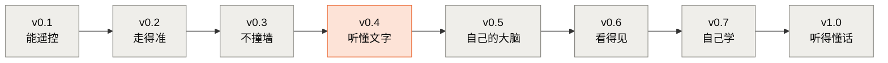

# roots-car · 根系

[](https://github.com/OGGIoao/roots-car/actions/workflows/ci.yml)
[](LICENSE)

> **造一台听得懂话的小车, 把大模型、Agent、强化学习和硬件连成一条链, 一起打通。**
>
> *Build a small car that understands spoken commands — learning LLMs, agents, reinforcement learning and embedded hardware as one connected chain, on a single 8 GB laptop and a few hundred RMB of parts. (Docs are in Chinese.)*

**终点 demo** (建设中): 你对小车说"去找那个红色杯子"。芯片上自己训练的唤醒词模型听到指令 → 笔记本上**自己微调的小模型**把这句话拆成工具调用 → 小车转身、前进、用摄像头确认、避开障碍 → 停在杯子前, 用语音回答"找到了"。

---

## 两层: 主线造车, 知识库打底

| 层 | 是什么 | 怎么用 |
|---|---|---|
| **[主线](mainline/README.md)** | 一站一站造小车 (v0.1 → v1.0)。每站结束, 小车多一项本事 | 跟着走, 亲手把整条链跑通 |
| **[知识库](library/README.md)** | 造车要用到的每个知识点, 一个单元一份完整讲义: 硬件、大语言模型、Agent、强化学习、后训练、具身智能 | 主线遇到不懂的概念, 链接到这里补; 也可以单独按领域系统地学 |
| **[选修](electives/README.md)** | 不在造车路上、但值得深入的内容: 四足机器人、规模化上云、LLM 架构全景、Agent 框架 | 想扩展视野时读 |

主线不重讲原理, 只讲 "这一步在车上做什么、实测结果如何"; 原理都在知识库里, 每个单元讲透一个知识点 (颗粒度参照 [分词 BPE](library/llm/bpe/TUTORIAL.md)), 带参考实现、实测数据和三级练习。**零基础的同学顺着主线的链接下去补, 补完回来接着造。**

## 主线: 跟着一台小车, 一站一站长出本事



<sub>橙色: 这一站已经可以跑 (仿真版); 灰色: 还没开始。项目处于**早期阶段**, 真车还没有造出来。</sub>

| 站 | 小车多了什么本事 | 要用到的知识库单元 (已有的) | 本站 |
|---|---|---|---|
| **v0.1 能遥控** | 手机网页遥控前后左右 | [电路与 ESP32 入门](library/hardware/electronics/TUTORIAL.md) 🟡 | ⬜ |
| **v0.2 走得准** | 执行"走 1 米""转 90 度" | (编码器、PID 待写) | ⬜ |
| **v0.3 不撞墙** | 自己避障; 断网自动停车 | (传感器、看门狗待写) | ⬜ |
| **v0.4 听懂文字** | 打一句话, 大模型调用工具把车开过去 | [Agent 循环](library/agent/agent-loop/TUTORIAL.md) 🟡 | [仿真版](mainline/v0.4-text-commands/TUTORIAL.md) 🟡 |
| **v0.5 自己的大脑** | 换成**自己微调的小模型**, 在笔记本上本地运行 | [分词 BPE](library/llm/bpe/TUTORIAL.md) ✅ · [miniGPT](library/llm/minigpt/TUTORIAL.md) ✅ · [注意力与推理延迟](library/llm/attention/TUTORIAL.md) ✅ · [现代小模型](library/llm/modern-small-model/TUTORIAL.md) 🟡 · [工具调用微调](library/post-training/tool-finetune/README.md) 🟡 | ⬜ |
| **v0.6 看得见** | 用摄像头找到红杯子 | (摄像头、量化待写) | ⬜ |
| **v0.7 自己学** | 仿真里用强化学习训练的策略上真车 | [老虎机](library/rl/bandit/TUTORIAL.md) ✅ | ⬜ |
| **v1.0 听得懂话** | 一句语音指挥小车完成任务 | (待规划) | ⬜ |

每一站的验收标准、小车的工具接口、安全规则和预算见 [PRODUCT.md](PRODUCT.md); 知识库的完整目录 (含规划中的单元) 见 [library/README.md](library/README.md); 推进顺序见 [ROADMAP.md](ROADMAP.md)。

### 从这里开始

项目当前**软件先行**: 先在仿真里把大模型、Agent、强化学习打通, 再造真车。

1. **零安装, 一分钟看懂 Agent**: 只要有 Python, 运行 `python library/agent/agent-loop/demo_minimal.py --seed 1`, 看一个假模型怎么一步步把仿真小车开到红杯子跟前。原理在 [Agent 循环](library/agent/agent-loop/TUTORIAL.md) 讲义里。
2. **主线第一个可以跑的站: [v0.4 听懂文字 (仿真版)](mainline/v0.4-text-commands/TUTORIAL.md)**。讲义第 1 节手把手配环境、下载模型 (有国内镜像的办法)、按有没有显卡选路线。你会亲手测出: 1.5B 小模型自己开车 30 次全失败, 换一种分工只让它选目标, 同一个模型成功 21 次。
3. **想先打基础**: 按领域读知识库。大模型从 [分词 BPE](library/llm/bpe/TUTORIAL.md) 开始; 强化学习从 [老虎机](library/rl/bandit/TUTORIAL.md) 开始; 硬件从 [电路与 ESP32 入门](library/hardware/electronics/TUTORIAL.md) 开始 (只需要浏览器, 不用买任何东西)。

没有显卡: 知识库的 bpe、minigpt、attention 和主线 v0.4 都有 Colab 笔记本 (各自 README 顶部的 "Open in Colab" 按钮)。

每个知识库单元的结构相同: 讲义 `TUTORIAL.md`、参考实现、实验脚本、三级练习 (填空 → 只给接口 → 白纸, 由测试判对错)。

---

## 适合谁

| 你是 | 你能从这里得到 |
|---|---|
| 会写 Python 的学生 (计算机、自动化、电子……) | 一个从软件到硬件都自己做出来的完整作品, 课程设计、竞赛、求职都拿得出手 |
| 想转向具身智能 / AI 硬件的软件工程师 | 不用先补一整套电子学: 硬件从浏览器仿真开始, 每一步都和你熟悉的代码、测试连在一起 |
| 喜欢动手的硬件爱好者 | 给自己的作品接上大模型和 Agent 的一条可复现路线 |
| 想带课、带社团的老师和组织者 | 现成的分站课程: 讲义、实测数据、三级练习和自动判分的测试, 硬件预算 600 元以内 |

**前置要求**: 会写 Python 的函数, 会用命令行。不需要电子基础, 不需要深度学习基础, 起步也不需要 GPU。缺什么基础, 知识库里都有从零讲起的单元。

---

## 为什么这样做

大模型、Agent、强化学习、嵌入式, 每个方向的资料都很多, 但散落各处, 很难自己串起来; 硬件这一侧门槛又高, 很多人停在"跑通别人的代码"。

| 原则 | 具体是什么 |
|---|---|
| 目标导向 | 主线每一站都回答 "小车这一步要什么"; 知识库只收主线用得到的知识点, 其余进选修, 不删除 |
| 亲手写最小实现 | 不调包了事: BPE、GPT、注意力变体、消抖、Agent 循环……都从零写一遍, 再和成熟方案对照 |
| 数字全部实测 | 讲义里没有示意值; 每个数字都能用仓库里的脚本重新算出来, 回归测试会检查。没测过的明确写 "没有数据" |
| 先仿真, 再上真板 | 硬件先在浏览器仿真器里跑通, 小车先在 Python 仿真里跑通; 仿真和真车哪里不同, 讲义里专门列出 |
| 产品具体, 原理通用 | 车是具体的, 原理讲成通用的: PID 换到机械臂上也成立, 工具调用的安全设计换到别的设备上也成立 |

和同类项目的区别: [nanoGPT](https://github.com/karpathy/nanoGPT) 把一个模型做到底, 各类课程讲得广, 生产框架追求好用; 本仓库做的是**一条链**, 而且明确是玩具规模, 追求每一环都能自己写出来。

---

## 安装

需要 Python 3.10+。只想看最小演示、做不需要模型的练习, 有 Python 和 `pip install pytest` 就够了。完整环境推荐用 conda 建一个独立环境:

```bash
conda create -n roots-car python=3.10 pip -y
conda activate roots-car

# torch 三件套必须用同一条命令一起装。cu128 适用于 RTX 50 系;
# 老显卡换成对应的 CUDA 索引, 没有 GPU 就去掉 --index-url 装 CPU 版
pip install torch torchvision torchaudio --index-url https://download.pytorch.org/whl/cu128

pip install -r requirements.txt
pip install -e . --no-deps    # 仓库自带的共享包 common/ (可编辑安装, 在仓库根目录执行)
python verify_env.py --full   # 环境自检, 会告诉你缺什么、该敲什么命令
```

> **同一个环境里不要混用 conda 和 pip 装 torch 系包**: conda 装的 CUDA 版很容易被 pip 装的 CPU 版覆盖, 最后留下一个 ABI 不匹配、import 就报错的 torchaudio。
>
> 国内网络下载 PyPI / Hugging Face 失败时, `verify_env.py` 会检测出网情况并给出建议; 下载模型的镜像办法见 [v0.4 讲义第 1 节](mainline/v0.4-text-commands/TUTORIAL.md#1-准备环境)。

硬件单元在浏览器里跑, 不需要安装, 步骤见 [电路与 ESP32 入门 第 0 节](library/hardware/electronics/TUTORIAL.md#0-怎么跑起来)。

## 快速开始

以下命令都从仓库根目录执行:

```bash
python -m pytest tests -q                                       # 全部回归测试, CPU 上也能跑
python library/agent/agent-loop/demo_minimal.py --seed 1        # Agent 循环的最小演示, 只用标准库, 一秒内
python library/llm/bpe/train.py                                 # 训练 BPE 分词器, 约 15 秒
python library/rl/bandit/experiments/greedy_fails.py           # 老虎机: 看贪心怎么失败, 约 15 秒
python library/llm/minigpt/train.py --config nano               # 训练 miniGPT 并生成文本, GPU 上约 40 秒
```

(耗时在下面的测量平台上实测; miniGPT 的 checkpoint 写到当前目录的 `checkpoints/`, 不入库。)

## 测量平台

| 用途 | 平台 |
|---|---|
| 软件部分的数字 | Windows 11 笔记本, RTX 5060 Laptop 8GB (Blackwell sm_120), 16 GB 内存, Python 3.10, torch 2.11 + CUDA 12.8 |
| 硬件部分的数字 | [Wokwi](https://wokwi.com) 网页版仿真, ESP32-S3-DevKitC-1, MicroPython v1.28.0 (真板对照会单独标出) |
| 持续集成 | GitHub Actions, Ubuntu + CPU 版 torch, 跑全部回归测试 |

在其它机器上跑, 训练速度和显存数字会不同, 但同种子下的结论应当一致。

---

## 项目结构

```
roots-car/
├── mainline/                  # 主线: 造小车, 一站一个版本
│   └── v0.4-text-commands/    #   v0.4 听懂文字 (仿真版)
├── library/                   # 知识库: 一个知识点一份讲义
│   ├── hardware/              #   electronics ……
│   ├── llm/                   #   bpe  minigpt  attention  modern-small-model ……
│   ├── agent/                 #   agent-loop ……
│   ├── rl/                    #   bandit ……
│   ├── post-training/         #   tool-finetune ……
│   └── embodied/              #   (规划中)
├── electives/                 # 选修: 不在造车路上的深入内容
├── sim/                       # 仿真小车 (所有站共用, 和真车同一套工具接口)
├── common/                    # 多个单元共享: 语料定位、字符级分词、对照实验框架、SVG 作图
├── templates/llm-client/      # LLM API 统一客户端
├── hardware/                  # 开发板选型、引脚分配、物料清单 (硬件各站开始前补全)
├── tests/                     # 回归测试 (CI 每次提交都跑)
├── PRODUCT.md                 # 产品规格书: 每一站的验收标准、工具接口、安全规则、预算
├── ROADMAP.md                 # 两层结构、各站与知识库单元、推进顺序
├── CONTRIBUTING.md            # 讲义与练习的写作规范
├── NOTICE.md                  # 第三方内容与致谢
├── verify_env.py              # 环境健康检查
└── requirements.txt           # 全仓库唯一依赖清单
```

2026-10-27 之前, 知识单元放在 `mainline/` 下按章节号命名 (如 `mainline/A1-bpe`), 新旧路径对照见 [mainline/README.md](mainline/README.md#旧路径对照)。

---

## 常见问题

**要买硬件吗?** 现在不用。硬件单元目前全部在浏览器里完成, 小车也先在 Python 仿真里跑。造真车需要一套硬件, 预算目标是小车加工具 600 元以内, 清单见 [PRODUCT.md](PRODUCT.md#6-预算-粗估); 具体型号会在硬件各站开始前定下。

**要 GPU 吗?** 不是必须的。回归测试、Agent 循环的演示与练习、分词 BPE、电路入门、老虎机只用 CPU; miniGPT 的 nano 配置在 CPU 上实测 105 秒训完 (GPU 约 40 秒), 注意力的对照实验在 CPU 上也能跑, 只是慢。v0.4 的本地模型评测和微调需要 NVIDIA 显卡 (v0.4 用 1.5B 模型, 作者的 8 GB 显卡足够)。没有显卡可以用 Colab 的免费 GPU, 或 v0.4 的云端 API 路线。

**支持什么系统?** 讲义是在 Windows 上实测的; 回归测试在 Linux (GitHub Actions) 上每次提交都跑。macOS 没有测过。

**为什么芯片上用 MicroPython 而不是 C++?** 先把注意力放在电路上, 控制逻辑也能在电脑上用 pytest 测。到摄像头和芯片上的唤醒词 (v0.6、v1.0) 性能不够时再换 C++, 换的时候会实测两者的差距。

**讲义是什么语言?** 中文。代码注释和提交信息也以中文为主。

---

## 参与

项目还在早期, 欢迎:

- **提 issue**: 讲义里看不懂的地方、跑不通的命令、数字对不上、来源或许可写错了;
- **补数据**: 主线 v0.4 讲义第 7 节列了作者还没跑的实验 (更大的模型、云端 API、改提示词), 每个只需要一条命令;
- **在真板上复现**: 电路入门讲义里标了 ⏳ 的"真板对照", 如果你手上有 ESP32-S3 开发板, 欢迎把实测结果提交上来;
- **贡献知识库单元或练习**: 先读 [CONTRIBUTING.md](CONTRIBUTING.md) (讲义规范、三级练习的标准、"数字全部实测"的要求), 开 issue 讨论之后再动手。

提交前请跑 `python -m pytest tests -q`。

## 致谢与许可证

本仓库参考或使用了一些外部项目和数据, 见 [NOTICE.md](NOTICE.md)。

代码、讲义和图以 [MIT 许可](LICENSE) 发布。
