# B1 电子入门与仿真器 — 让芯片点灯、读按钮、调亮度

> 知识库 · 硬件单元, 服务于小车 **v0.1 (手机遥控小车)**: 控制电机转速用的就是本章的 PWM, 遥控器的油门就是本章的旋钮, 急停开关就是本章的按钮。
> 本章不需要买任何硬件, 全部在浏览器里的 [Wokwi](https://wokwi.com) 仿真器上完成。
>
> **数字从哪来**: 本章所有数字都是实测的, 分两类, 正文里逐个标明:
> - **仿真实测**: Wokwi 网页版, 开发板 ESP32-S3-DevKitC-1, MicroPython v1.28.0, 由逻辑分析仪或串口记录得到; 原始数据在 [results/wokwi/](results/wokwi/), 分析脚本在 [experiments/](experiments/)。
> - **数据手册**: 乐鑫《ESP32-S3 Series Datasheet》v2.2 第 5 章, 引用时注明表号。
>
> 真板上的数字 (买了开发板之后) 会单独补在每节末尾的"真板对照"里, 现在标为 ⏳。仿真器在哪些地方和真板不同, 第 6 节专门列了一张表。

## 目录

**第一部分 · 五个案例**

- [0. 怎么跑起来](#0-怎么跑起来) (含 [0.1 安全与万用表](#01-动手之前-安全与万用表))
- [1. 点灯: 电阻怎么选](#1-点灯-电阻怎么选)
- [2. 读按钮: 悬空、上拉、弹跳与消抖](#2-读按钮-悬空上拉弹跳与消抖)
- [3. 调亮度: 软件 PWM 与硬件 PWM](#3-调亮度-软件-pwm-与硬件-pwm)
- [4. 读旋钮: ADC 读数和电压成正比吗](#4-读旋钮-adc-读数和电压成正比吗)
- [5. 同时做两件事: 阻塞与非阻塞](#5-同时做两件事-阻塞与非阻塞)

**第二部分 · 延伸专题**

- [6. 仿真器在哪些地方会"骗"你](#6-仿真器在哪些地方会骗你)
- [7. 本章真实踩过的坑](#7-本章真实踩过的坑)
- [8. 引脚账: 为小车挑开发板](#8-引脚账-为小车挑开发板)
- [9. 练习](#9-练习)
- [10. 这一节在整个领域里的位置](#10-这一节在整个领域里的位置)
- [附录: 数据来源与校验和](#附录-数据来源与校验和)

---

## 0. 怎么跑起来

本章的代码分两层:

| 文件 | 跑在哪 | 作用 |
|---|---|---|
| [b1core.py](b1core.py) | 芯片上 **和** 电脑上 | 纯逻辑: 算电阻、消抖、PWM 占空比、非阻塞定时器……不碰任何硬件 |
| [firmware/case*.py](firmware/) | 只在芯片上 | 读引脚 → 交给 `b1core` → 写引脚, 每个案例一个文件 |
| [wokwi/diagram.json](wokwi/diagram.json) | Wokwi | 电路图: 开发板、LED、按钮、电位器、逻辑分析仪, 所有案例共用 |

**为什么要分两层**: 芯片上的程序很难单步调试, 逻辑错了只能看 LED 猜。把逻辑拿出来, 就能在电脑上用 pytest 测 (练习就是这么判对错的)。所有和时间有关的函数都把"现在几点"当参数传进来, 测试可以用假时钟精确控制时间, 不用真的等。

**在 Wokwi 网页版里跑一个案例**:

1. 打开 <https://wokwi.com/projects/new/micropython-esp32-s3>;
2. 点 `diagram.json` 标签, 把 [wokwi/diagram.json](wokwi/diagram.json) 的内容整个粘贴进去;
3. 在电脑上把核心模块和案例拼成一个文件 (网页版里新建文件不方便):
   ```bash
   cd library/hardware/electronics
   python bundle.py firmware/case3_pwm.py -o main.py
   ```
   再把 `main.py` 的内容粘贴到网页的 `main.py` 标签里;
4. 点绿色的 ▶ 开始仿真。串口输出在右下角; 逻辑分析仪的录波在**停止仿真时**自动下载为 `b1-logic.vcd`, 可以用 `python experiments/pwm_analysis.py b1-logic.vcd` 分析。

电路接法 (所有案例共用):

| 引脚 | 接什么 | 用于 |
|---|---|---|
| GPIO 4 | 270 Ω 电阻 → 红色 LED → GND | ① 点灯; ③ 里兼作"阶段标记" |
| GPIO 5 | 按钮 → GND | ② 按钮 |
| GPIO 6 → GPIO 7 | 导线相连 | ③ PWM 输出 |
| GPIO 1 | 电位器中间脚 (两端接 3.3 V 和 GND) | ④ ADC |
| GPIO 8 → GPIO 9 | 导线相连 | ⑤ 芯片自己"按"按钮 |
| GPIO 10 | 什么都不接 | ② 悬空引脚 |
| 逻辑分析仪 D0~D3 | GPIO 6 / 4 / 5 / 9 | 按仿真时间记录每一次跳变, 不占芯片的 CPU |

选引脚时避开了: 上电时决定启动模式的 0、3、45、46 (strapping 引脚), USB 用的 19、20, 部分板子上被内部存储器占用的 35~37。

**一个必须先知道的事实**: Wokwi 默认把芯片的 CPU 限速到约 8 MHz 执行指令 ([Wokwi 文档](https://docs.wokwi.com/guides/esp32): "The CPU frequency limit does not affect the timing of the peripherals"), 但外设 (定时器、PWM、ADC) 的时序是准的。仿真实测:

| 测量 | 仿真结果 | 说明 |
|---|---|---|
| `machine.freq()` | 160 000 000 | 芯片"自认为"跑在 160 MHz |
| 软件循环翻转一次引脚 | **111 µs** | 只在仿真里成立, 真板会快得多 (⏳ 真板实测) |
| `time.sleep_ms(100)` 实际耗时 | 100.195 ms | 定时器是准的 |

所以: **依赖 CPU 速度的数字 (软件延时、循环快慢), 仿真里会比真板差很多; 依赖外设的数字 (硬件 PWM、定时器), 仿真里是可信的**。下面每个结论都会说明属于哪一类。

### 0.1 动手之前: 安全与万用表

仿真里怎么接都不会坏; 真板会。下面几条在买到板子的第一天就要做到 (B2 开始接电池和电机前会再加几条):

| 规则 | 为什么 |
|---|---|
| **GPIO 上的电压不能超过 3.6 V**, 绝不把 5 V 直接接到 GPIO | 数据手册表 5-4: 高电平输入的上限是 VDD + 0.3 = 3.6 V。很多传感器模块是 5 V 的, 接之前先查它输出的电平 |
| 3.3 V 和 GND 不能直接碰在一起 | 短路: 电流只受稳压芯片限制, 板子会发烫甚至损坏; 面包板上一根插错的杜邦线就够了 |
| 改接线之前先拔 USB | 带电插拔最容易碰到不该碰的引脚 |
| 每个引脚的输出电流心里有数 | 第 1 节: 单个引脚典型 40 mA (最高驱动档), 所有引脚加起来不超过 1500 mA; 电机这种大电流负载**永远不直接接引脚**, 要经过驱动板 (B2) |
| 只用低压电源 | 本项目全部 ≤ 12 V 直流 (USB 5 V、锂电池); 不碰市电 |

**万用表** (几十元一个, 第一件要买的工具) 有三个最常用的档:

| 测什么 | 怎么接 | 注意 |
|---|---|---|
| 电压 (V) | **并联**: 两支表笔分别碰被测两点 | 最常用、最安全, 先学这个: 比如量 GPIO 4 输出高电平时是不是 3.3 V |
| 电流 (mA) | **串联**: 把电路断开, 表接进去让电流流过表 | 表笔要换插孔; 用电流档去量电压 (并联) 等于把两点短路, 是新手最常见的事故 |
| 电阻 (Ω) | 并联在**断电**的元件两端 | 电路带电时量电阻读数没有意义, 还可能损坏表 |

本章各节的"真板对照 ⏳"都会用到万用表。

---

## 1. 点灯: 电阻怎么选

> 一句话: LED 不能直接接在引脚上, 要串一个电阻把电流限制在安全范围。

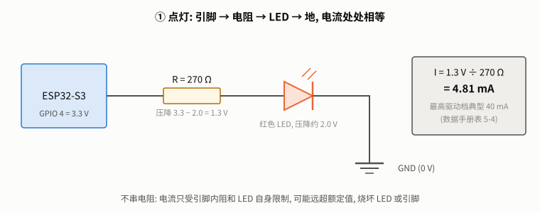

**怎么读**: 电流从 GPIO 4 (3.3 V) 出发, 依次经过电阻和 LED, 流到地 (0 V)。串联电路里电流处处相等; 3.3 V 的电压被电阻和 LED 分掉。

**直觉**: LED 一旦导通, 两端电压基本固定在它的"正向压降" (红色约 2 V), 再多加一点电压电流就猛涨。电阻的作用是"吃掉"多出来的电压, 让电流停在你想要的值。

**公式**: 电阻两端的电压是电源电压减去 LED 压降, 由欧姆定律:

```math
R = \frac{V_\text{引脚} - V_\text{LED}}{I} = \frac{3.3\ \text{V} - 2.0\ \text{V}}{5\ \text{mA}} = 260\ \Omega
```

260 Ω 买不到, 市面上常见的是 E12 系列标准值 (每个数量级 12 个: 1.0, 1.2, 1.5, …, 8.2)。**往大取**, 取 270 Ω: 电阻大一点, 电流就小一点, 更安全。代入回去, 实际电流 $`I = 1.3\ \text{V} / 270\ \Omega = 4.81\ \text{mA}`$。

[b1core.py](b1core.py) 里的实现:

```python
def led_resistor(v_supply, v_forward, i_ma):
    """
    给 LED 串多大的电阻, 才能让电流等于 i_ma 毫安。

    电阻两端的电压 = 电源电压 - LED 正向压降, 再由欧姆定律 R = U / I。
    返回欧姆 (浮点数)。例: 3.3 V 引脚、红色 LED 压降 2.0 V、目标 5 mA → 260 Ω。
    """
    if i_ma <= 0:
        raise ValueError("目标电流必须为正")
    if v_supply <= v_forward:
        raise ValueError("电源电压不高于 LED 压降, LED 不会亮")
    return (v_supply - v_forward) / (i_ma / 1000.0)
```

逐行: `i_ma / 1000.0` 把毫安换成安培; 两个 `raise` 挡住两种没有意义的输入 (电流不为正; 电源电压不够点亮 LED)。

**为什么 5 mA**: 数据手册表 5-4 给出, 引脚在最高驱动档 (PAD_DRIVER = 3) 下的典型输出电流 IOH 是 40 mA、吸收电流 IOL 是 28 mA; 表 5-1 规定所有引脚加起来的输出电流绝对上限 1500 mA。5 mA 远低于单个引脚的能力, 指示用的 LED 也已经足够亮。小车上同时亮的 LED 不多, 这条总额度暂时碰不到; 但"每个引脚能出多少电流、所有引脚加起来有没有上限"是以后接任何负载前都要先查的。

**这里仿真帮不上忙**: Wokwi 的 LED 只模拟"亮/不亮", 不计算电流, 也不会因为不串电阻而"烧掉"。电流只能算, 或在真板上用万用表量。

> **真板对照** ⏳: 用万用表电流档串在电阻和 LED 之间, 量实际电流, 和 4.81 mA 对照; 再量 LED 两端电压, 看你买到的 LED 压降是不是 2.0 V。

---

## 2. 读按钮: 悬空、上拉、弹跳与消抖

> 一句话: 按钮只是一个开关, 要让引脚在"松开"和"按下"时都有确定的电平, 还要处理触点接触瞬间的弹跳。

### 2.1 朴素办法: 按钮一端接引脚, 一端接地, 直接读

按下时引脚接地, 读到 0, 没问题。**松开时呢?** 引脚什么都没接 (悬空)。

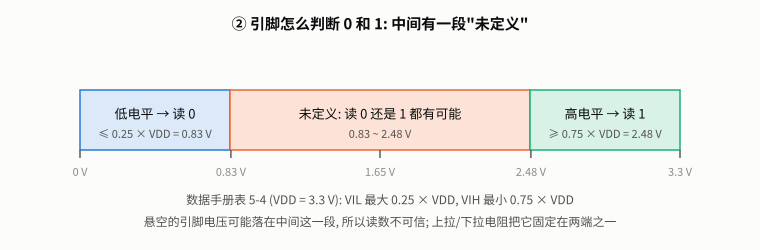

**怎么读**: 数据手册表 5-4 (VDD = 3.3 V) 规定, 输入电压不高于 0.25 × VDD (0.83 V) 读 0, 不低于 0.75 × VDD (2.48 V) 读 1, **中间 0.83 ~ 2.48 V 没有定义**, 读 0 还是 1 都有可能。悬空引脚的电压受旁边导线、手指靠近的干扰, 可能落在任何地方。

仿真实测 ([firmware/case2_floating.py](firmware/case2_floating.py), GPIO 10 什么都不接, 每种设置读 2000 次):

| 设置 | 读到 1 的次数 | 读数翻转次数 |
|---|---|---|
| 不开上下拉 | 0 | 0 |
| 开上拉 | 2000 | 0 |
| 开下拉 | 0 | 0 |

**仿真器把悬空引脚当成固定的 0**, 一次都不乱跳。这是**仿真器会骗你**的第一个例子: 真板上悬空引脚的读数不可信, 程序在仿真里"能用", 到真板上可能乱触发。

> **真板对照** ⏳: 同一个程序在真板上跑, 再用手指靠近 GPIO 10, 记录读数翻转次数。

### 2.2 上拉电阻: 给"松开"一个确定的电平

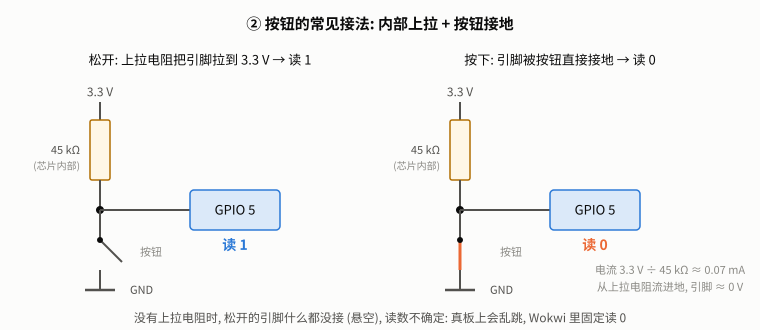

**怎么读**: 芯片内部有一个约 45 kΩ 的电阻 (数据手册表 5-4 的 RPU) 可以接到 3.3 V。松开时, 它把引脚"拉"到 3.3 V, 读 1; 按下时按钮把引脚直接接地, 读 0, 这时只有 3.3 V ÷ 45 kΩ ≈ 0.07 mA 的小电流从上拉电阻流进地。

MicroPython 里一行就打开: `Pin(5, Pin.IN, Pin.PULL_UP)`。这种接法"按下读 0", 叫**低电平有效** (active low)。

一个仿真里看到的细节: 录波显示, 开机后 GPIO 5 在程序打开上拉之前一直读 0, 直到仿真时间 2376.6 ms 程序执行到 `Pin(5, Pin.IN, Pin.PULL_UP)` 才变成 1。**程序启动前的那段时间, 引脚的电平不由你控制**; 小车上如果电机驱动的使能脚在这段时间是不确定的, 电机可能抽动一下 (B2 会再遇到)。

### 2.3 按一下, 被数成几下?

接好了上拉, 读数确定了。朴素办法: 每次看到 1 → 0 (下降沿) 就算按了一下。

用逻辑分析仪录下一次按下 (仿真实测, [results/wokwi/case2_bounce.cvcd](results/wokwi/case2_bounce.cvcd)):

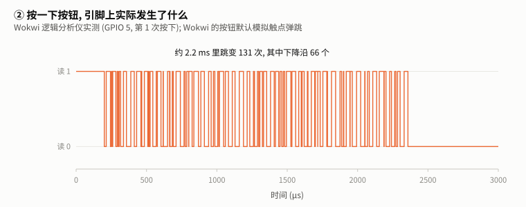

**怎么读**: 横轴是微秒。按下的一瞬间, 电平没有干脆地从 1 变 0, 而是在约 2.2 ms 里来回跳了 131 次, 其中下降沿 66 个, 之后才稳定在 0。这叫**触点弹跳**: 按钮里的金属片碰上时会弹几下。Wokwi 的按钮默认模拟弹跳 (可以用 `"bounce": "0"` 关掉, 但真按钮一定会弹)。

这次录了 4 次真实按下和 1 次"点按" (由自动化脚本触发, 按住时间几乎为 0, 按下和松开的弹跳挤在同一个 2 ms 里)。[experiments/bounce_analysis.py](experiments/bounce_analysis.py) 的输出:

| 簇 | 类型 | 跳变次数 | 下降沿 | 持续 (µs) |
|---|---|---|---|---|
| 1 | 按下 | 131 | 66 | 2157.8 |
| 2 | 松开 | 43 | 21 | 1832.9 |
| 3 | 点按 | 262 | 131 | 2124.0 |
| 4 | 按下 | 161 | 81 | 2165.0 |
| 5 | 松开 | 155 | 77 | 2097.7 |
| 6 | 按下 | 169 | 85 | 2108.8 |
| 7 | 松开 | 191 | 95 | 2326.3 |
| 8 | 按下 | 141 | 71 | 2347.7 |
| 9 | 松开 | 35 | 17 | 2171.4 |

4 次按下分别按住 94.9、33.3、33.3、33.4 ms。**按下和松开都会弹跳**, 每次约 1.8 ~ 2.4 ms。

三种朴素数法的结果 (真实按下 4 次):

| 数法 | 数到 | 说明 |
|---|---|---|
| 数录波里所有下降沿 | **644** | 理想的"中断数下降沿": 每个下降沿都算一下 |
| 芯片上用中断数下降沿 | 113 | 比 644 少, 因为 ESP32 版 MicroPython 的中断回调要排队, 跳得太密时排不下的被丢掉了 (第 7 节) |
| 每 1 ms 读一次, 看到 1 → 0 就算 | 7 | 读得慢, 错过了大部分弹跳, 但还是多数了 3 次 |

三种都是错的。

### 2.4 消抖: 电平稳定一段时间才承认

思路: 原始读数必须**连续 stable_ms 毫秒不变**, 才承认它是新状态。[b1core.py](b1core.py) 的 `Debouncer.update`:

```python
    def update(self, raw, now_ms):
        """喂入一次原始读数和当前时间 (毫秒), 返回消抖后的电平。"""
        if raw != self._candidate:           # 电平变了: 重新开始计时
            self._candidate = raw
            self._since = now_ms
        elif raw != self.stable and self._since is not None \
                and ticks_diff(now_ms, self._since) >= self.stable_ms:
            self.stable = raw                # 新电平保持够久了, 承认它
            if self.pressed:
                self.presses += 1
        return self.stable
```

逐行:
- `_candidate` 是"正在观察、还没承认"的电平, `_since` 是它从什么时候开始保持不变;
- 读数和候选不同 → 换候选、重新计时。弹跳期间每跳一次都会走这条, 计时不断被重置;
- 读数和候选相同、又和已承认的状态不同、并且保持够了 `stable_ms` → 承认它; 如果承认的是"按下", 计数加一;
- `ticks_diff` 而不是直接相减: MicroPython 的毫秒计数器会回绕 (数到上限后从 0 重新开始), 必须用它求差。电脑上测试时 `b1core` 会换成普通减法。

把录波回放给它 (每 1 ms 读一次, 不同的 `stable_ms`):

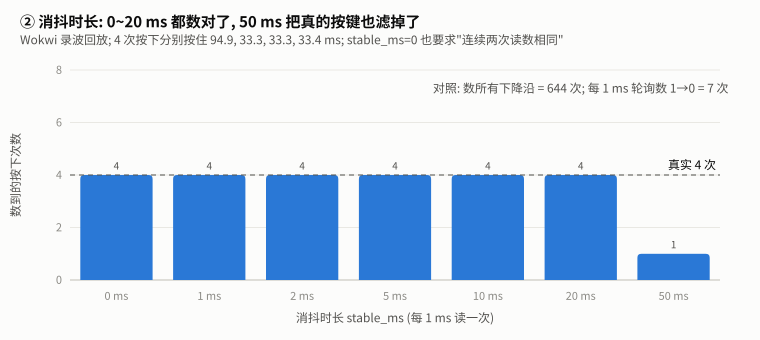

| stable_ms | 数到 (真实 4) | 承认按下最晚比真实按下晚 |
|---|---|---|
| 0 | 4 | 3.8 ms |
| 1 | 4 | 3.8 ms |
| 2 | 4 | 5.0 ms |
| 5 | 4 | 8.0 ms |
| 10 | 4 | 13.0 ms |
| 20 | 4 | 23.0 ms |
| 50 | **1** | — |

**怎么读**:
- `stable_ms = 0` 也数对了: 因为 `Debouncer` 至少要求"连续两次读数相同", 每 1 ms 读一次时, 这已经跨过了大部分弹跳。读得更快 (比如每 0.1 ms) 时, 0 就不够了;
- 2 ~ 20 ms 都对, 代价是承认得更晚: 延迟 ≈ 弹跳时长 + stable_ms;
- **50 ms 只数到 1 次**: 后三次按下每次只按住 33 ms, 不到 50 ms, 被当成抖动滤掉了。

**结论**: 消抖时长要**长于弹跳** (仿真里约 2.3 ms; 真按钮可能更长, ⏳ 真板实测), 又要**短于最短的一次真实按压**。本仓库取 20 ms。

> **真板对照** ⏳: 用真按钮重录一次 (逻辑分析仪或芯片自己采样), 比较弹跳时长和次数。

---

## 3. 调亮度: 软件 PWM 与硬件 PWM

> 一句话: 引脚只能输出 0 或 3.3 V, 想要"一半亮", 就让它快速开关, 一半时间开、一半时间关。

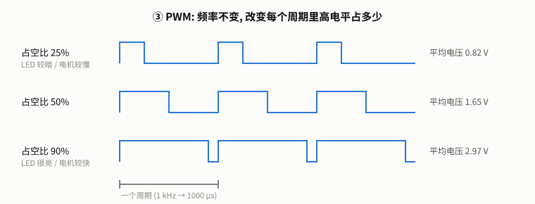

**怎么读**: 频率 (每秒多少个周期) 不变, 改变每个周期里高电平占的比例 (**占空比**)。LED 闪得足够快, 人眼看到的是平均亮度; 电机转得足够慢 (有惯性), 感受到的是平均电压。**B2 控制电机转速用的就是这个**。

MicroPython 用 16 位整数表示占空比 (0 ~ 65535):

```python
def duty_u16(fraction):
    """占空比 (0~1 的小数) → duty_u16 的整数。超出范围的输入截到 [0, 1]。"""
    if fraction <= 0:
        return 0
    if fraction >= 1:
        return DUTY_MAX
    return int(fraction * DUTY_MAX + 0.5)
```

`+ 0.5` 再取整 = 四舍五入: `duty_u16(0.5)` 是 32768 而不是 32767。

### 3.1 朴素办法: 自己在循环里开关

[firmware/case3_pwm.py](firmware/case3_pwm.py) 的软件 PWM:

```python
def software_pwm(cycles, busy):
    for i in range(cycles):
        out.value(1)
        time.sleep_us(500)
        out.value(0)
        time.sleep_us(500)
        if busy and i % 25 == 0:
            print("@BUSY,%d;" % i)       # 模拟"顺手干点别的"
```

目标是 1 kHz、50%: 每个周期 1000 µs, 高电平 500 µs。另一种是**硬件 PWM**: `PWM(out, freq=1000, duty_u16=32768)`, 交给芯片里的 LEDC 外设, CPU 设置一次就不管了。

用逻辑分析仪 (D0 接 GPIO 6) 录下四个阶段, 每段约 300 个周期 (仿真实测, [experiments/pwm_analysis.py](experiments/pwm_analysis.py)):

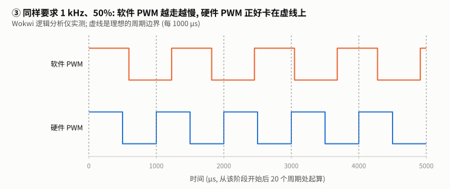

**怎么读**: 虚线是理想的周期边界 (每 1000 µs)。蓝色的硬件 PWM 每次都正好在虚线上翻转; 橙色的软件 PWM 每个周期都多出两百多微秒, 越走越偏。

| 阶段 | 周期数 | 平均周期 (µs) | 标准差 | 最短 | 最长 | 频率误差 | 占空比 |
|---|---|---|---|---|---|---|---|
| 软件 PWM, CPU 空闲 | 296 | 1226.7 | 14.0 | 1134.1 | 1312.6 | −18.5% | 0.484 |
| 软件 PWM, CPU 在忙 | 296 | 1288.8 | 145.8 | 1160.2 | **2069.9** | −22.4% | 0.462 |
| 硬件 PWM, CPU 空闲 | 296 | 1000.0 | 0.0002 | 999.999 | 1000.001 | 0.0% | 0.500 |
| 硬件 PWM, CPU 在忙 | 298 | 1000.0 | 0.0002 | 999.999 | 1000.001 | 0.0% | 0.500 |

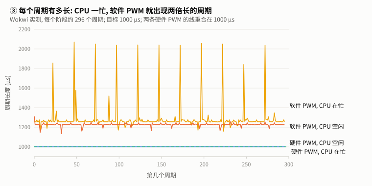

**怎么读**: 每一点是一个周期的长度。CPU 在忙 (每 25 个周期往串口打一行字) 时, 软件 PWM 每隔一段就出现一个接近 2000 µs 的长周期, 一共 13 个; 硬件 PWM 两条线都钉在 1000 µs, 和 CPU 忙不忙无关。

**为什么软件 PWM 慢了**: `sleep_us(500)` 本身是准的 (定时器), 但每次 `out.value()`、循环、函数调用都要花时间, 这些时间都加在周期上。仿真把 CPU 限速在约 8 MHz, 所以每个周期多出了约 227 µs。**真板快得多, 偏差会小很多, 但不会是 0**; 更要紧的是"CPU 一忙周期就变长"这件事在真板上一样成立。

**换到小车上**: 软件 PWM 驱动电机, 转速会随着 CPU 处理网络、传感器而一顿一顿; 硬件 PWM 不受影响。所以 **B2 的电机一律用硬件 PWM**。

> **真板对照** ⏳: 同一个程序在真板上跑, 用逻辑分析仪 (约 30~50 元) 录 GPIO 6, 比较软件 PWM 的周期。

### 3.2 让亮度"匀速"变化: gamma

人眼对亮度的感受不是线性的: 占空比从 10% 到 20% 看起来变化很大, 从 80% 到 90% 几乎看不出来。呼吸灯想"匀速"变亮, 要按 gamma 曲线换算:

```python
def perceived_to_duty(level, gamma=2.2):
    """
    "看起来的亮度" (0~1) → 占空比 (0~1)。

    人眼对亮度的感受不是线性的: 占空比从 10% 到 20% 看起来变化很大, 从 80% 到 90% 几乎看不出来。
    用 gamma 曲线 duty = level ** gamma 补偿, 呼吸灯才会"匀速"变亮变暗。2.2 是显示器常用的值。
    """
    if level <= 0:
        return 0.0
    if level >= 1:
        return 1.0
    return level ** gamma
```

例: 想要"看起来一半亮" (0.5), 占空比是 $`0.5^{2.2} \approx 0.22`$, 不是 0.5。练习 3 会用到。

---

## 4. 读旋钮: ADC 读数和电压成正比吗

> 一句话: ADC 把引脚上的电压变成一个数字; 但"数字 ↔ 电压"的换算并不简单, 量程也有上限。

电位器两端接 3.3 V 和 GND, 中间脚接 GPIO 1。旋钮转到不同位置, 中间脚的电压在 0 ~ 3.3 V 之间变化。这就是遥控器的油门。

[firmware/case4_adc.py](firmware/case4_adc.py) 每秒读 64 次取平均, 打印两种读数:

```python
adc = ADC(Pin(1), atten=ADC.ATTN_11DB)
```

- `read_u16()`: 0 ~ 65535 的原始读数 (芯片内部是 12 位, MicroPython 把它放大到 16 位);
- `read_uv()`: 芯片用出厂校准数据换算出的电压 (微伏)。
- `ATTN_11DB` 是衰减: 芯片的 ADC 本身只能量较低的电压, 衰减越大, 能量的电压范围越大, 11 dB 是最大的一档。

**朴素想法**: 读数和电压成正比, 电压 = 读数 / 65535 × 3.3 V。

### 4.1 仿真实测

仿真运行中转动旋钮到 11 个位置 ([experiments/adc_analysis.py](experiments/adc_analysis.py); "理想电压" = 位置 / 1023 × 3300 mV):

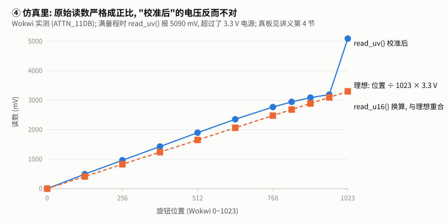

| 位置 | 理想 (mV) | `read_u16()` | 按比例换算 (mV) | 误差 | `read_uv()` (mV) | 误差 |
|---|---|---|---|---|---|---|
| 0 | 0.0 | 0 | 0.0 | 0.0 | 0 | 0 |
| 128 | 412.9 | 8194 | 412.6 | −0.3 | 491 | +78 |
| 256 | 825.8 | 16404 | 826.0 | +0.2 | 962 | +136 |
| 384 | 1238.7 | 24598 | 1238.6 | −0.1 | 1428 | +189 |
| 512 | 1651.6 | 32808 | 1652.0 | +0.4 | 1898 | +246 |
| 640 | 2064.5 | 41002 | 2064.6 | +0.1 | 2354 | +290 |
| 768 | 2477.4 | 49196 | 2477.3 | −0.2 | 2769 | +292 |
| 832 | 2683.9 | 53293 | 2683.6 | −0.3 | 2943 | +259 |
| 896 | 2890.3 | 57406 | 2890.7 | +0.3 | 3088 | +198 |
| 960 | 3096.8 | 61503 | 3097.0 | +0.2 | 3191 | +94 |
| 1023 | 3300.0 | 65535 | 3300.0 | 0.0 | **5090** | +1790 |

64 次读数的标准差全部是 0。

**怎么读**:
- **原始读数在仿真里是一个理想的 ADC**: 严格成正比 (误差 ±0.4 mV 以内), 完全没有噪声。
- **`read_uv()` 在仿真里不对**: 中段偏高近 300 mV, 满量程时报 5090 mV, 超过了 3.3 V 的电源电压, 物理上不可能。具体原因我们没有核实; 一种可能是仿真器没有完整模拟芯片里存放出厂校准数据的 eFuse, MicroPython 按校准公式换算出来的电压就偏了。不管原因是什么, 结论一样: **仿真里不要用 `read_uv()`**。

这是**仿真器会骗你**的又一个例子, 而且方向相反: 仿真里"原始读数"完美, "校准后"反而离谱; 真板上恰恰相反, 原始读数有非线性, 要靠校准修正。

### 4.2 真板上会怎样 (数据手册)

数据手册 5.5 节给出了真实芯片的 ADC 指标 (外接 100 nF 电容、关闭 WiFi、25 °C):

| 指标 | 数值 | 含义 |
|---|---|---|
| DNL (表 5-5) | ±4 LSB | 相邻两档之间的宽度不均匀 |
| INL (表 5-5) | ±8 LSB | 整条曲线偏离直线的程度 |
| ATTEN3 (即 11 dB) 校准后的有效量程 (表 5-6) | **0 ~ 2900 mV** | 超过 2.9 V 的电压量不准 |
| ATTEN3 校准后总误差 (表 5-6) | ±50 mV | |

**对小车的影响**: 旋钮从 0 转到底, 电压从 0 升到 3.3 V; 但 2.9 V 以上量不准, 也就是**旋钮最后约 12% 的行程是"死区"**。做油门时有两种办法:
1. 在软件里把 0 ~ 2.9 V 映射成 0% ~ 100% 油门, 放弃最后一段;
2. 给电位器串一个电阻, 让最高电压落在 2.9 V 以内 (分压, B4 测电池电压时会用到同样的办法)。

### 4.3 校准: 分段线性插值

不管哪种 ADC, 最朴素也最可靠的校准办法是: 用万用表量几个点的真实电压, 做成一张表, 中间插值。[b1core.py](b1core.py) 的 `PiecewiseLinear`:

```python
    def __call__(self, x):
        xs, ys = self.xs, self.ys
        if x <= xs[0]:
            return ys[0]
        if x >= xs[-1]:
            return ys[-1]
        for i in range(1, len(xs)):
            if x <= xs[i]:
                t = (x - xs[i - 1]) / (xs[i] - xs[i - 1])
                return ys[i - 1] + t * (ys[i] - ys[i - 1])
        return ys[-1]
```

逐行: 输入超出表的两端时用端点的值 (不外推, 免得在量程外胡乱放大误差); 否则找到输入落在哪两个校准点之间, 按距离比例 `t` 线性插值。

在仿真里用 3 个点 (0、512、1023) 校准 `read_u16()`, 其余 8 个点的误差都在 ±0.4 mV 以内; 但这只是因为仿真里的 ADC 本来就是直线。**在真板上做这个实验才有意义**。

> **真板对照** ⏳: 旋钮转到十几个位置, 每个位置同时记下 `read_u16()`、`read_uv()` 和万用表量到的 GPIO 1 电压; 画出三条线, 看非线性有多大、2.9 V 以上是不是真的量不准、用 3 个点和 5 个点校准各能把误差降到多少。

---

## 5. 同时做两件事: 阻塞与非阻塞

> 一句话: 主循环里不能 `sleep` 太久, 否则睡觉期间发生的事全看不见。

任务: LED 每秒闪一次, 同时不能漏掉按钮。

**朴素办法 (阻塞)**: 亮 → `sleep_ms(500)` → 看一眼按钮 → 灭 → `sleep_ms(500)` → 看一眼按钮。

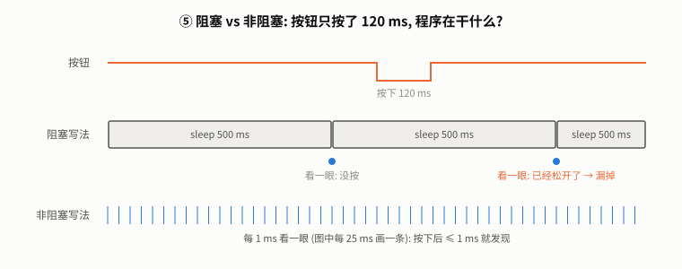

**怎么读**: 按钮只按了 120 ms, 正好落在一次 500 ms 的睡眠里; 程序醒来看时已经松开了, 这一次就漏掉了。

**非阻塞**: 主循环不睡觉, 每一圈问"该闪了吗? 该看按钮了吗?"。[b1core.py](b1core.py) 的 `Every`:

```python
    def ready(self, now_ms):
        if ticks_diff(now_ms, self._next) < 0:
            return False
        self._next += self.period_ms
        if ticks_diff(now_ms, self._next) >= 0:          # 落后了一个周期以上
            behind = ticks_diff(now_ms, self._next) // self.period_ms + 1
            self.overruns += behind
            self._next += behind * self.period_ms
        return True
```

逐行:
- 还没到下一次的时刻 → 返回 False, 主循环接着干别的;
- 到了 → 下一次的时刻按"**上一次计划的时刻 + 周期**"推进, 不按"实际执行的时刻 + 周期"。即使某一次晚了几毫秒, 误差也不会一圈圈累积 (回归测试 `test_every_does_not_drift_and_counts_overruns` 检查了 1000 ms 里的 99 次触发恰好落在 10, 20, …, 990);
- 如果落后超过一整个周期 (主循环被卡住了), 不补跑错过的那几次, 只记进 `overruns`。控制电机时, 补跑几次"过时"的控制反而有害。

**这就是 B3 的 PID 控制循环、B4 断网自动停车的基础**: 它们都是"每隔固定时间做一次", 同时不能耽误别的事。

实验 ([firmware/case5_blocking.py](firmware/case5_blocking.py)): 为了可重复, 不用手按, 让芯片的定时器每 937 ms 把 GPIO 8 拉低 120 ms (GPIO 8 接 GPIO 9), 相当于有人按了 120 ms 的按钮; 937 不是 500 的整数倍, 按下的时刻会落在闪烁节拍的各个位置。两种写法各跑 20 秒 (仿真实测, [experiments/blocking_analysis.py](experiments/blocking_analysis.py)):

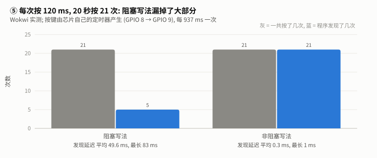

| 写法 | 按下 | 发现 | 发现率 | 平均延迟 | 最长延迟 |
|---|---|---|---|---|---|
| 阻塞 | 21 | 5 | 24% | 49.6 ms | 83 ms |
| 非阻塞 (每 1 ms 看一眼) | 21 | **21** | **100%** | 0.3 ms | 1 ms |

**怎么读**: 阻塞写法每 500 ms 只看一眼, 只有按下的 120 ms 恰好覆盖了"看一眼"的那个时刻才能发现: 概率约 120 / 500 = 24%, 实测正好 5/21 = 24%; 即使发现了, 也平均晚了约 50 ms。非阻塞写法全部发现, 最多晚 1 ms。

这个结论**不依赖 CPU 速度** (只依赖定时器), 仿真和真板应当一致。

---

## 6. 仿真器在哪些地方会"骗"你

本章用到的地方, 仿真结果和真板可能不同。**仿真里跑通只是第一步**, 买了板子要逐项核对。

| 方面 | Wokwi 的表现 (本章实测或文档) | 真板 | 影响 |
|---|---|---|---|
| CPU 速度 | 默认限速约 8 MHz 执行指令; 软件翻转一次引脚 111 µs | 160 MHz, 快得多 | 软件 PWM、循环耗时的数字只能定性看 |
| 外设时序 | 定时器、硬件 PWM 准确 (`sleep_ms(100)` = 100.195 ms; PWM 周期 1000 ± 0.001 µs) | 同样准确 | 可信 |
| 悬空引脚 | 固定读 0, 从不跳 | 受干扰乱跳 | 仿真里发现不了"忘了开上拉" |
| 按键弹跳 | 每次约 2 ms, 几十到两百多次跳变 (默认开启) | 因按钮而异 | 消抖时长要用真按钮再验证 |
| LED 电流 | 不计算, 不会烧 | 会烧 | 电阻必须自己算 |
| ADC | `read_u16()` 是理想直线 (误差 ±0.4 mV)、完全没有噪声; `read_uv()` 换算错误, 满量程报 5090 mV | 有非线性 (INL ±8 LSB)、11 dB 档校准后量程只到 2900 mV (数据手册 5.5 节) | 仿真里看不到非线性和量程上限, 校准只能在真板上做 |
| 直流电机 | **没有**直流电机和直流电机驱动板 (只有步进电机驱动 A4988) | — | B2/B3 的电机部分要用自己写的电机模型仿真 |

---

## 7. 本章真实踩过的坑

### 7.1 `hard=True` 在 ESP32 上不支持

**现象**: 想用中断精确记录每一次跳变的时刻, 写了 `pin.irq(handler, Pin.IRQ_FALLING | Pin.IRQ_RISING, hard=True)`, 一运行就报 `TypeError: extra keyword arguments given`。

**原因**: ESP32 版 MicroPython 的引脚中断不接受 `hard` 参数, 回调都是"软中断": 中断发生时先排进队列, 等主程序执行到下一条字节码之间才运行。时间戳因此被推迟, 跳得太密时队列满了, 后面的直接丢掉 (第 2.3 节芯片上数到 113 个下降沿, 录波里实际有 644 个)。

**为什么当时没发现**: 其它移植版本 (如 RP2040) 支持 `hard=True`, 网上的例子大多照抄。

**解决**: 需要精确测时序时, 不在芯片上自己测, 交给逻辑分析仪 (仿真里的 Wokwi 逻辑分析仪, 真板上用 USB 逻辑分析仪)。本章的 PWM 和弹跳数据都是这么录的。

### 7.2 延迟算出 937 ms: 时间戳的先后

**现象**: 第 5 节的实验第一次跑时, 非阻塞写法的延迟里出现了 4 个 936 / 937 ms ([原始记录](results/wokwi/case5_blocking_first_run_bug.txt)), 其余都是 0 或 1 ms。

**原因**: 主循环先读了 `now = time.ticks_ms()`, 然后定时器回调插进来, 把"按下"的时刻记成了 `now + 1`, 再把引脚拉低; 主循环接着读到低电平, 用旧的 `now` 记下"发现"。于是"发现"比"按下"早了 1 ms, 统计代码把它配给了**上一次**按下, 正好差一个按键周期 937 ms。

**为什么当时没发现**: 计数 (发现了 21 次) 是对的, 只有延迟的统计错了; 而且只在回调恰好插在"读时间"和"读引脚"之间时才出现。

**解决**: 配对时允许 2 ms 的时间戳误差 (见 [firmware/case5_blocking.py](firmware/case5_blocking.py) 里的注释)。修复后重跑, 延迟全部是 0 或 1 ms。**教训**: 两个不同来源的时间戳比较先后时, 要想清楚它们是在什么时刻读的。

### 7.3 自动化按键太短, 消抖数到 0

**现象**: 第一次录弹跳时用键盘快捷键触发按钮, 芯片上的消抖计数是 0。

**原因**: 仿真速度在实时的 3% ~ 100% 之间变化。现实中按住几十毫秒, 在仿真时间里只有一两毫秒, 比弹跳还短, 按下和松开挤在一起, 消抖器正确地把它当成了抖动。

**解决**: 不靠"按住多久"来设计实验, 以录波为准: 录下来的按住时长是多少就是多少, 再把录波回放给消抖算法 (第 2.4 节)。第 5 节干脆让芯片自己产生按键, 时长由定时器保证。

---

## 8. 引脚账: 为小车挑开发板

买板子之前, 先数一数小车要用多少个引脚。按 [PRODUCT.md](../../../projects/car/PRODUCT.md) 的物料, 粗略估计 (具体数目取决于选定的模块, 下单前逐个核对):

| 用途 | 模块 | 引脚数 (约) | 本章对应 |
|---|---|---|---|
| 两个电机的方向和速度 | 电机驱动板 (如 TB6612: 每路 2 个方向 + 1 个 PWM, 外加使能) | 7 | ③ PWM |
| 两个轮子的编码器 | 每个编码器 A/B 两相 | 4 | ② 读引脚 |
| IMU、测距 | I2C 总线 (共用) | 2 | — |
| 麦克风 (v1.0) | I2S | 3 | — |
| 功放 (v1.0) | I2S | 3 | — |
| 急停按钮、状态 LED | — | 2 | ①② |
| **小计 (不含摄像头)** | | **约 21** | |
| 摄像头 (v0.6) | DVP 并口: 8 根数据线 + 时钟、同步、I2C 控制等 | 约 14~16 | — |

ESP32-S3 有 45 个可编程 GPIO (数据手册第 4 页), 但要去掉: 4 个 strapping 引脚 (能用但要小心上电电平)、内部 flash/PSRAM 占用的 6~7 个、USB 的 2 个、串口调试的 2 个。剩下大约 30 个能放心用。

**结论**: 不接摄像头时约 21 个, 一块 ESP32-S3 开发板够用; 加上摄像头就到了 35 个左右, 超出了。而带摄像头的开发板为了接摄像头, 通常只把很少几个空闲引脚引出来。所以两种方案:

1. **一块主控板 (控制、传感器、语音) + 一块独立的摄像头板**, 两块板通过 WiFi 或串口通信 (推荐: 控制和视觉互不干扰, 摄像头板坏了小车还能走);
2. 一块带摄像头的板, 其余功能用扩展芯片 (如 I/O 扩展、电机驱动板的 I2C 版本) 节省引脚 (更省钱, 但更复杂)。

B2 开始前定下具体型号, 把这张表填成每个引脚的实际分配。

---

## 9. 练习

在电脑上做, 由 pytest 判对错 (不需要 Wokwi):

```bash
cd library/hardware/electronics/exercises
python -m pytest test_ex1.py -q
```

| 练习 | 级别 | 内容 | 验收 |
|---|---|---|---|
| [ex1_ohm_pwm_fill.py](exercises/ex1_ohm_pwm_fill.py) | ① 填空 | 补全 `led_resistor`、`next_e12`、`duty_u16` | 与参考实现在几千个输入上逐个一致 |
| [ex2_debouncer_interface.py](exercises/ex2_debouncer_interface.py) | ② 接口 | 只给接口, 自己写整个消抖器 | 本章录到的真实弹跳数出 4 次; 人造弹跳每次恰好数一次、承认时刻精确到 1 ms; 毛刺不算 |
| [ex3_breathing_blank.py](exercises/ex3_breathing_blank.py) | ③ 白纸 | 按住呼吸、松开 1 秒内熄灭的 LED | 周期 1.5~2.5 秒、亮度平滑 (看起来的亮度相邻毫秒变化 ≤ 0.01)、松开后只暗不亮 |

卡住了可以要提示, 按"方向 → 哪一行 → 代码"分级给, 每次只升一级。练习 3 写完可以选做上芯片: 按钮接 GPIO 5、LED 接 GPIO 4, 用逻辑分析仪确认 PWM 是 1 kHz ± 1%。

<details>
<summary>练习 1 的答案 (先自己做)</summary>

见 [b1core.py](b1core.py) 的 `led_resistor`、`next_e12`、`duty_u16`。`next_e12` 的关键是先找数量级: `decade` 从 1 开始, 乘 10 直到下一个数量级超过 `r_ohm`, 再除 10 直到不超过; 然后在 `E12 + (10.0,)` 里找第一个 `base * decade >= r_ohm` 的值, 比较时乘 `(1 - 1e-9)` 容忍浮点误差。
</details>

<details>
<summary>练习 2 的答案 (先自己做)</summary>

见 [b1core.py](b1core.py) 的 `Debouncer` (第 2.4 节逐行讲过)。常见错误: 电平一变就立刻承认 (等于没消抖); 用"上一次读数"而不是"候选电平保持了多久"来判断; 把松开也算进 `presses`。
</details>

<details>
<summary>练习 3 的答案 (先自己做)</summary>

见 [b1core.py](b1core.py) 的 `BreathingLed`: 按住时用三角波生成"看起来的亮度", 经 `perceived_to_duty` (gamma 2.2) 换成占空比; 松开时记下当时的占空比, 在 500 ms 里线性降到 0。
</details>

---

## 10. 这一节在整个领域里的位置

- **学了什么**: 数字输入输出 (GPIO)、上拉电阻、电平阈值、触点弹跳与消抖、PWM (软件与硬件)、ADC、非阻塞的定时循环; 以及"仿真结果什么时候可信"。
- **跳过了什么**: 晶体管与 MOSFET (B2 驱动电机时会讲)、中断的底层机制与实时操作系统 (FreeRTOS, MicroPython 在它之上运行)、模拟电路 (运放、滤波器)、焊接 (B2 之后才需要)、示波器 (逻辑分析仪只看 0/1, 看不到电压的形状)。
- **原理是通用的**: 消抖、非阻塞定时、硬件外设代替软件循环, 在任何单片机 (STM32、RP2040、Arduino) 上都一样; 换到机械臂、无人机上也一样。
- **往哪里深挖**: 中断和实时系统在 B3 (PID 控制循环) 会再遇到; 选修里暂时没有对应的电子学专题, 推荐阅读 Horowitz & Hill《The Art of Electronics》第 1 章 (电压、电流、电阻) 与第 10 章 (数字逻辑)。

---

## 附录: 数据来源与校验和

逻辑分析仪的录波在浏览器里截获后, 以无损的紧凑格式 (`.cvcd`, 格式说明见 [experiments/wokwi_data.py](experiments/wokwi_data.py)) 存入仓库。浏览器里和仓库里分别计算校验和, 一致才算转存成功 (回归测试 `test_recordings_match_capture_checksums` 每次都会重新检查):

| 文件 | 长度 | 校验和 | 对应程序 (bundle 后的校验和) |
|---|---|---|---|
| [case3_pwm.cvcd](results/wokwi/case3_pwm.cvcd) | 8609 (展开后 19562) | 1548054901 (展开后 449219333) | case3_pwm.py (9211 / 301485753) |
| [case2_bounce.cvcd](results/wokwi/case2_bounce.cvcd) | 8696 | 2279279237 | case2_bounce.py (9047 / 3246892945) |

串口记录 (每个文件开头注明了程序与电路图的校验和):

| 文件 | 对应程序 (bundle 后的长度 / 校验和) |
|---|---|
| [case2_floating.txt](results/wokwi/case2_floating.txt) | case2_floating.py (8254 / 3825592388) |
| [case2_bounce_serial.txt](results/wokwi/case2_bounce_serial.txt) | case2_bounce.py (9047 / 3246892945) |
| [case3_pwm_serial.txt](results/wokwi/case3_pwm_serial.txt) | case3_pwm.py (9211 / 301485753) |
| [case4_adc_serial.txt](results/wokwi/case4_adc_serial.txt) | case4_adc.py (8567 / 2458285664) |
| [case5_blocking_serial.txt](results/wokwi/case5_blocking_serial.txt) | case5_blocking.py (10418 / 1071015483) |
| [case5_blocking_first_run_bug.txt](results/wokwi/case5_blocking_first_run_bug.txt) | 修复前的 case5_blocking.py (10291 / 2469380993), 第 7.2 节的坑 |

所有案例共用的电路图 [wokwi/diagram.json](wokwi/diagram.json): 1656 / 3465180896。

以上程序与电路图的校验和都按 LF 换行计算 (仓库里存的就是 LF; Windows 上检出的 `.py`、`.json` 会被转成 CRLF, 自己核对时先换回 LF)。

校验和算法: 对每个字符 $`x \leftarrow (31x + \text{字符编码}) \bmod 2^{32}`$, 见 `wokwi_data.checksum`。
