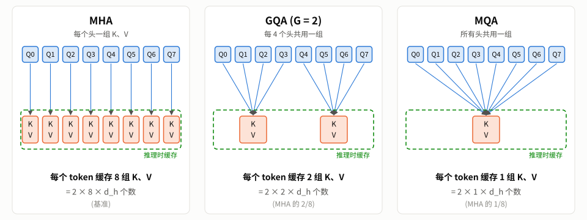
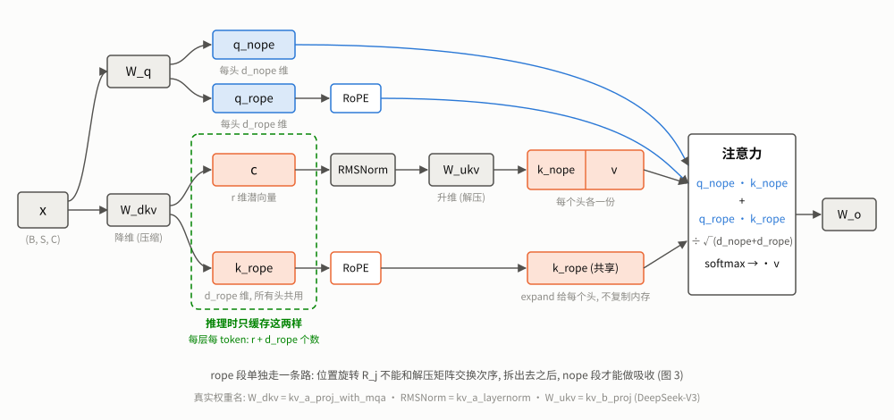
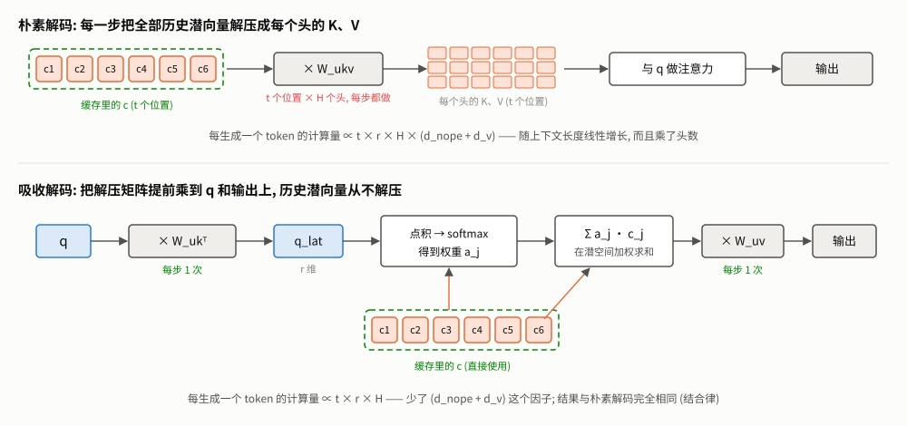
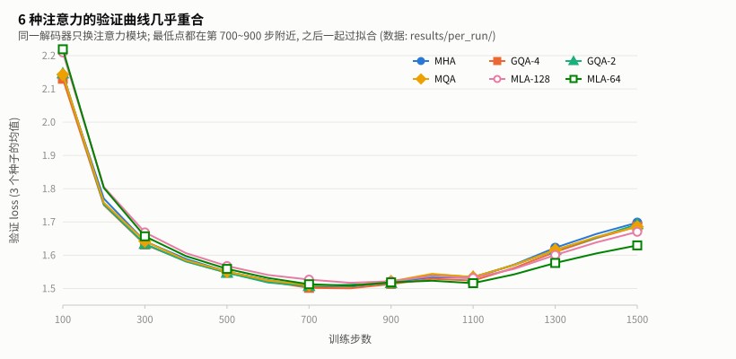
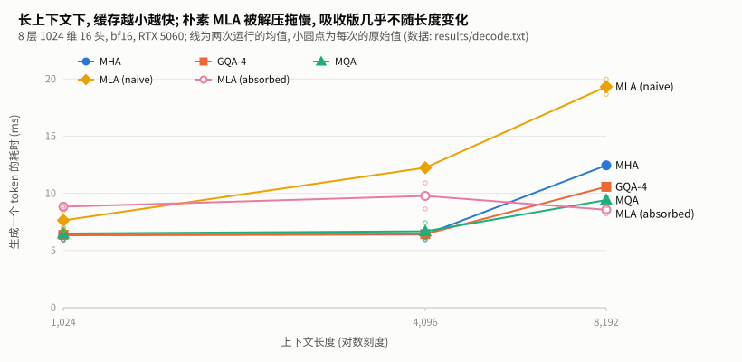
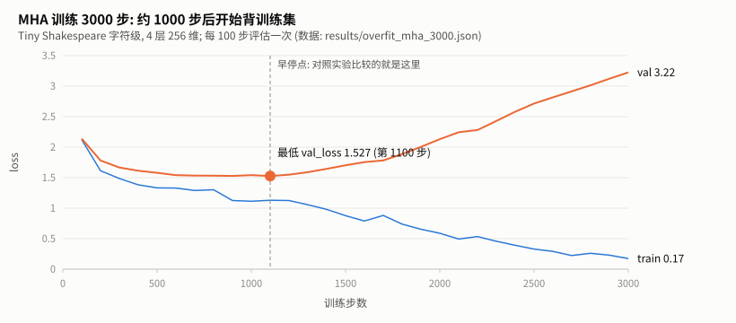

# 注意力线讲义 — MHA → MQA → GQA → MLA

> 生长树总图: [library/llm/llm-tree](../llm-tree/README.md) 的 **A. 注意力线**。
> 配套代码: [variants.py](variants.py) (四种注意力)、[compare.py](compare.py) (训练对照实验)、[decode.py](decode.py) (推理实验)。
> 讲义里所有数字都来自本机实测或 [解剖台](../../frontier/anatomy/ANATOMY.md) 读出的真实模型配置。

---

## 目录

1. [主线问题: KV Cache 为什么成了瓶颈](#1-主线问题-kv-cache-为什么成了瓶颈)
2. [A1 MHA: 出发点](#2-a1-mha-出发点)
3. [A2 MQA: 所有头共用一组 K、V](#3-a2-mqa-所有头共用一组-kv)
4. [A3 GQA: 分组共用](#4-a3-gqa-分组共用)
5. [A4 MLA: 把 K、V 压缩成潜向量](#5-a4-mla-把-kv-压缩成潜向量)
6. [对照实验: 训练质量](#6-对照实验-训练质量)
7. [推理实验: 缓存与速度](#7-推理实验-缓存与速度)
8. [对照真实模型](#8-对照真实模型)
9. [踩坑记录](#9-踩坑记录)
10. [练习](#10-练习)
11. [延伸资源](#11-延伸资源)

**前置**: [A2-minigpt 讲义](../minigpt/TUTORIAL.md) 第 5 节 (注意力) 和专题 A (KV Cache)。

---

## 1. 主线问题: KV Cache 为什么成了瓶颈

### 1.1 一句话

> 注意力线上的每一次演化, 都是在回答同一个问题: **生成时要缓存的 K、V 太多了, 怎么少存一点又不掉质量?**

### 1.2 回顾: 缓存了什么, 有多大

A2-minigpt 专题 A 讲过: 生成时每来一个新 token, 每一层都要把它的 K、V 存下来, 后面的 token 还要用。对标准的多头注意力 (MHA), 每个 token 的缓存是

```math
\text{KV Cache / token} = \underbrace{2}_{K\text{ 和 }V} \times L \times H \times d_h \times (\text{每个数的字节数})
```

($`L`$ 层数, $`H`$ 头数, $`d_h`$ 每个头的维度。)

### 1.3 真实模型有多大 (解剖台实测)

[解剖台](../../frontier/anatomy/ANATOMY.md) 从真实模型的配置里算出的每 token 缓存 (bf16, 只算全注意力层):

| 模型 | 注意力 | 每个 token | 4096 个 token | 32768 个 token |
|---|---|---|---|---|
| OLMo-2-7B | MHA (32 头) | 512 KB | 2.0 GB | 16 GB |
| Qwen3-8B | GQA (32 头 / 8 组) | 144 KB | 0.56 GB | 4.5 GB |
| DeepSeek-V3 | MLA | 68.6 KB | 0.27 GB | 2.1 GB |
| Kimi-Linear-48B-A3B | MLA, 27 层里只有 7 层是全注意力 | 7.0 KB | 0.03 GB | 0.22 GB |

注意两点:

- OLMo-2 和 Qwen3-8B 参数量相近 (都是 70~80 亿), **缓存却差了 3.6 倍**, 差别完全来自注意力的设计。
- DeepSeek-V3 的总参数约 6710 亿 (技术报告数字), 是 OLMo-2 的近百倍, 每个 token 的缓存却只有它的 **13%**。

一张 8GB 的卡, 放下 OLMo-2 的 4 位量化权重 (约 3.5GB) 后, 剩下的显存只够约 9000 个 token 的缓存; 换成 Qwen3-8B 的设计, 同样的显存够 3 万多个 token。**上下文能开多长、能同时服务多少用户, 主要取决于这一项。**

### 1.4 这条线的四个节点

```
MHA ──→ MQA ──→ GQA ──────────────→ MLA
每个头     所有头     分组共用           不按头缓存, 缓存一个
一组 K、V  共用一组   (MHA 与 MQA 之间)  压缩后的潜向量
```

| 节点 | 每层每 token 缓存的数 | 典型取值下 (H=8, d_h=32) |
|---|---|---|
| MHA | $`2 H d_h`$ | 512 |
| GQA (G 组) | $`2 G d_h`$ | G=4: 256, G=2: 128 |
| MQA | $`2 d_h`$ | 64 |
| MLA | $`r + d_{\text{rope}}`$ ($`r`$ 为潜向量维度) | r=128: 144 |



**图 1** 前三个节点的区别, 一张图就能看清。**怎么读**: 上排蓝框是 8 个查询头, 下排橙框是要计算的 K、V, 每条连线表示"这个查询头去这组 K、V 里查找"。绿色虚线框里的东西就是推理时要缓存的。从左到右, 连线越来越集中, 绿框里的橙框越来越少, 缓存也就越来越小。查询头的数量始终不变: 每个头仍然"问自己的问题"。MLA 走的是另一条路, 见图 2。

---

## 2. A1 MHA: 出发点

MHA 在 A2-minigpt 讲义第 5.6 节已经逐行讲过, 这里只强调一个对后面很关键的观察:

**每个头都有自己的 $`W_K^h, W_V^h`$, 所以每个头都要单独缓存 K、V。** 头数越多、维度越大, 缓存越大。

在 [variants.py](variants.py) 里, MHA 不是单独的类, 而是 `GroupedQueryAttention` 在 `n_kv_heads == n_heads` 时的特例:

```python
self.wk = nn.Linear(dim, n_kv_heads * self.head_dim, bias=False)   # K、V 只有 n_kv_heads 组
self.wv = nn.Linear(dim, n_kv_heads * self.head_dim, bias=False)
```

`n_kv_heads = n_heads` 时, 这就是普通的 MHA。

---

## 3. A2 MQA: 所有头共用一组 K、V

### 3.1 一句话

> 查询 Q 仍然每个头一份, 但 K、V 只算一份, 所有头共用。缓存直接缩小到 $`1/H`$。

### 3.2 为什么可行

注意力里, Q 决定"我要找什么", K、V 是"可供查找的内容"。不同的头需要**问不同的问题**, 所以 Q 必须各有一份; 但被查找的内容可以是同一份, 每个头用自己的 Q 去里面找不同的东西。

这个想法来自 Shazeer 2019 年的论文 *Fast Transformer Decoding: One Write-Head is All You Need*。标题里的 "one write-head" 指的就是只写一份 K、V 到缓存里。

### 3.3 代价

所有头只能在**同一个** K、V 空间里查找, 表达能力下降。原论文和后续工作都观察到质量会下降, 而且大规模训练时可能不太稳定。本仓库的小规模实测见第 6 节。

---

## 4. A3 GQA: 分组共用

### 4.1 一句话

> 把 $`H`$ 个查询头分成 $`G`$ 组, 组内的头共用一组 K、V。$`G = H`$ 就是 MHA, $`G = 1`$ 就是 MQA。

出处: Ainslie et al. 2023, *GQA: Training Generalized Multi-Query Transformer Models from Multi-Head Checkpoints*。

### 4.2 代码

```python
def forward(self, x, cos, sin):
    B, S, _ = x.shape                                                    # x: (B, S, C)
    # 1) 投影, 再把最后一维拆成"头 × 每头维度", 然后把"头"挪到第 1 维,
    #    这样 scaled_dot_product_attention 会对每个头分别算注意力
    q = self.wq(x).view(B, S, self.n_heads, self.head_dim).transpose(1, 2)      # (B, H, S, d)
    k = self.wk(x).view(B, S, self.n_kv_heads, self.head_dim).transpose(1, 2)   # (B, G, S, d)
    v = self.wv(x).view(B, S, self.n_kv_heads, self.head_dim).transpose(1, 2)   # (B, G, S, d)
    # 2) RoPE 只作用在 Q 和 K 上 (V 不需要位置信息: 它是"被取走的内容", 不参与比较)
    q, k = apply_rope(q, cos, sin), apply_rope(k, cos, sin)
    # 3) 把每组 K、V 复制给组内的每个查询头: (B, G, S, d) -> (B, H, S, d)
    #    repeat_interleave 让相邻的头属于同一组: G=2, H=8 时排成 [g0 g0 g0 g0 g1 g1 g1 g1]
    #    复制只发生在计算时; 推理时缓存的仍然只是 G 组, 这正是省显存的地方
    group = self.n_heads // self.n_kv_heads                              # 每组几个查询头
    k, v = k.repeat_interleave(group, dim=1), v.repeat_interleave(group, dim=1)
    # 4) 标准的缩放点积注意力: softmax(q·kᵀ/√d + 因果掩码) · v
    #    is_causal=True 让每个位置只能看到自己和之前的位置
    out = F.scaled_dot_product_attention(q, k, v, is_causal=True)       # (B, H, S, d)
    # 5) 把头挪回去并拼接: (B, H, S, d) -> (B, S, H, d) -> (B, S, H*d), 再输出投影
    return self.wo(out.transpose(1, 2).reshape(B, S, -1))               # (B, S, C)
```

和 MHA 相比只多了一步 `repeat_interleave`: 把每组的 K、V 复制给组内的每个查询头。

**`repeat_interleave` 而不是 `repeat`**: 对 $`G=2,\ H=8`$, `repeat_interleave(4, dim=1)` 把组排成 `[g0, g0, g0, g0, g1, g1, g1, g1]`, 也就是头 0~3 用第 0 组, 头 4~7 用第 1 组。`repeat(1, 4, 1, 1)` 会排成 `[g0, g1, g0, g1, ...]`。两种排法都能训练, 但必须和你对"哪些头属于同一组"的约定一致; 加载别人训练好的权重时, 排错了就会得到乱码。

**复制只发生在计算时**: 推理时缓存里存的仍然只有 $`G`$ 组。复制出来的 $`H`$ 份只是临时张量 (实际的高性能实现连这个临时复制都省掉了, 直接在内核里按组索引)。

### 4.3 一个等价关系

GQA 等价于**一个 K、V 投影在组内各头之间完全相同**的 MHA。[tests/test_tree.py](../../../tests/test_tree.py) 里的 `test_mqa_with_one_group_equals_mha_with_tied_kv_heads` 验证了这一点: 把 MQA 的 $`W_K`$ 复制 $`H`$ 份填进一个 MHA, 两者输出一致。

这个等价关系还给出了**把训练好的 MHA 改造成 GQA** 的办法 (GQA 论文的做法): 把同一组里各头的 $`W_K^h, W_V^h`$ 取平均作为这一组的投影, 再用少量数据继续训练让模型适应。这留作第 10 节的练习。

### 4.4 为什么 GQA 成了主流

解剖台里的稠密模型, 除了 OLMo-2 还用 MHA, 几乎全部是 GQA: Mistral-7B (32 头 / 8 组)、Qwen2.5-7B (28 / 4)、Qwen3-8B (32 / 8)、phi-4 (40 / 10)、GLM-4.5 (96 / 8)、gpt-oss (64 / 8)。8 组是最常见的选择, 缓存是 MHA 的 $`8/H`$。

---

## 5. A4 MLA: 把 K、V 压缩成潜向量

### 5.1 一句话

> 不再为每个头缓存 K、V, 而是把 $`x`$ 压缩成一个 $`r`$ 维的**潜向量** $`c`$ 缓存起来, 计算注意力时再从 $`c`$ "解压"出每个头的 K、V。

出处: DeepSeek-AI 2024, *DeepSeek-V2: A Strong, Economical, and Efficient Mixture-of-Experts Language Model*。DeepSeek-V3、Kimi-K2 沿用。

### 5.2 思路: 低秩分解

MHA 里, 所有头的 K 拼起来是 $`k = W_K x`$, $`W_K`$ 的形状是 $`(H d_h) \times C`$。MLA 把它拆成两步:

```math
c = W_{DKV}\, x \ \ (\text{压缩到 } r \text{ 维}), \qquad k^h = W_{UK}^h\, c, \qquad v^h = W_{UV}^h\, c
```

推理时只缓存 $`c`$。DeepSeek-V3 的配置是 $`r = 512`$, 而 128 个头的 K、V 一共有 $`128 \times (192 + 128) = 40960`$ 维 (第 8 节)。

和 GQA 的区别在于: GQA 是让一部分头**完全共用**同一组 K、V; MLA 是让所有头的 K、V **都由同一个低维向量线性生成**, 每个头仍然有自己的 $`W_{UK}^h, W_{UV}^h`$, 所以每个头看到的 K、V 仍然各不相同。

### 5.3 难点: 和 RoPE 冲突

如果直接这样做, RoPE 会出问题。RoPE 要对 K 做一个**依赖位置**的旋转 $`R_j`$:

```math
k_j^h = R_j\, W_{UK}^h\, c_j
```

我们希望推理时能把 $`W_{UK}^h`$ 提前乘到 Q 上 (5.5 节的吸收技巧), 但 $`R_j`$ 夹在中间, 而且每个位置都不同, 矩阵乘法的顺序换不过来。

DeepSeek-V2 的解法是**把每个头的 Q、K 拆成两段**:

| 段 | 维度 | 是否旋转 | K 从哪来 |
|---|---|---|---|
| nope 段 | $`d_{\text{nope}}`$ | 不旋转 | 由 $`c`$ 解压, 可以做吸收 |
| rope 段 | $`d_{\text{rope}}`$ | 旋转 | 直接由 $`x`$ 投影, **所有头共用一份** |

注意力分数是两段点积之和:

```math
\text{score}_{h,j} = \frac{q^{h,\text{nope}} \cdot k_j^{h,\text{nope}} + q^{h,\text{rope}} \cdot k_j^{\text{rope}}}{\sqrt{d_{\text{nope}} + d_{\text{rope}}}}
```

rope 段的 K 所有头共用 (类似 MQA), 所以缓存里只多出 $`d_{\text{rope}}`$ 个数。每层每 token 一共缓存 $`r + d_{\text{rope}}`$ 个数。



**图 2** MLA 的完整数据流, 把 5.2 和 5.3 节合在一起看。**怎么读**: 从左边的输入 $`x`$ 出发, 有三条路:

- **上面一条 (蓝)**: 查询。$`W_q`$ 投影后拆成两段, nope 段直接送进注意力, rope 段先旋转再送进去。
- **中间一条 (橙)**: 先用 $`W_{dkv}`$ 把 $`x`$ **压缩**成 $`r`$ 维的潜向量 $`c`$, 再用 $`W_{ukv}`$ **解压**成每个头各自的 $`k^{\text{nope}}`$ 和 $`v`$。
- **下面一条 (橙)**: $`W_{dkv}`$ 同时产出一个很短的 $`k^{\text{rope}}`$, 旋转后**所有头共用**。

关键在绿色虚线框: 推理时只需要缓存框里的 $`c`$ 和 $`k^{\text{rope}}`$; 框右边的东西都可以随时从框里的东西算出来。

### 5.4 代码

```python
def forward(self, x, cos, sin):
    B, S, _ = x.shape                                                    # x: (B, S, C)
    H = self.n_heads

    # ── 查询: 每个头一份, 拆成 nope / rope 两段, 只旋转 rope 段 ─────────
    q = self.wq(x).view(B, S, H, self.d_nope + self.d_rope).transpose(1, 2)   # (B, H, S, d_nope+d_rope)
    q_nope, q_rope = q.split([self.d_nope, self.d_rope], dim=-1)        # (B, H, S, d_nope), (B, H, S, d_rope)
    q_rope = apply_rope(q_rope, cos, sin)

    # ── 键值: 先压缩 ─────────────────────────────────────────────
    # c 和 k_rope 就是推理时要缓存的全部内容 (讲义图 2 的绿色虚线框)
    c, k_rope = self.w_dkv(x).split([self.kv_rank, self.d_rope], dim=-1)   # (B, S, r), (B, S, d_rope)
    # k_rope 没有"头"这一维: 插入一个长度为 1 的头维度再旋转, 之后由所有头共用
    k_rope = apply_rope(k_rope.unsqueeze(1), cos, sin)                     # (B, 1, S, d_rope)

    # ── 键值: 再解压出每个头的 k_nope 和 v ─────────────────────────
    kv = self.w_ukv(self.kv_norm(c)).view(B, S, H, self.d_nope + self.d_v).transpose(1, 2)
    k_nope, v = kv.split([self.d_nope, self.d_v], dim=-1)               # (B, H, S, d_nope), (B, H, S, d_v)

    # ── 把两段拼回去, 做标准注意力 ────────────────────────────────
    q = torch.cat([q_nope, q_rope], dim=-1)                              # (B, H, S, d_nope+d_rope)
    # expand 让共享的 rope 键"看起来"每个头都有一份, 但不复制内存 (只改了读取方式)
    k = torch.cat([k_nope, k_rope.expand(B, H, S, self.d_rope)], dim=-1)   # (B, H, S, d_nope+d_rope)
    # 分数 = q_nope·k_nope + q_rope·k_rope (拼接后的点积正好是两段点积之和)
    # 缩放默认为 1/√(q 的最后一维) = 1/√(d_nope+d_rope); v 的维度 d_v 可以和 q、k 不同
    out = F.scaled_dot_product_attention(q, k, v, is_causal=True)       # (B, H, S, d_v)
    return self.wo(out.transpose(1, 2).reshape(B, S, -1))               # (B, S, C)
```

- `w_dkv` 一次投影同时得到潜向量 $`c`$ 和共享的 rope 键。DeepSeek 的权重里它叫 `kv_a_proj_with_mqa`, 名字里的 "with_mqa" 指的就是那份"所有头共用"的 rope 键。
- `kv_norm` 对潜向量做 RMSNorm (真实权重里叫 `kv_a_layernorm`)。
- `w_ukv` 是解压矩阵, 把 $`c`$ 变成每个头的 $`[k^{\text{nope}}, v]`$ (真实权重里叫 `kv_b_proj`)。
- `expand` 把共享的 rope 键"看成"每个头都有一份, 不复制内存。

DeepSeek 对 Q 也做了低秩压缩 (`q_a_proj` / `q_b_proj`), 那是为了减少训练时的激活显存, 与 KV Cache 无关, 本实现省略。

### 5.5 推理时的吸收技巧

只缓存 $`c`$ 还不够: 如果每生成一个 token 都要把**所有历史位置**的 $`c`$ 解压成每个头的 K、V, 计算量会随上下文长度乘以头数增长。

利用矩阵乘法的结合律, 解压可以省掉。对第 $`h`$ 个头:

```math
\text{分数: } q^h \cdot \big(W_{UK}^h c_j\big) = \big(W_{UK}^{h\top} q^h\big) \cdot c_j
```

```math
\text{输出: } \sum_j a_j \big(W_{UV}^h c_j\big) = W_{UV}^h \Big(\sum_j a_j c_j\Big)
```

- 分数: 先把新 token 的 $`q^h`$ 变换到潜空间 (每步只做一次), 再直接和缓存里的 $`c_j`$ 点积。
- 输出: 先在潜空间里对 $`c_j`$ 加权求和, 最后只乘一次 $`W_{UV}^h`$。

对应的代码 ([decode.py](decode.py)), 每一步都标了对应公式里的哪一项:

```python
def mla_step_absorbed(attn, h, cos, sin, cache):
    """吸收解码 (讲义图 3 下半部分): 不解压, 注意力直接在潜向量 c 上算。

    einsum 的下标约定 (同一个字母代表同一个维度, 只出现在输入里的字母会被求和掉):
        b batch    h 头    q 查询位置 (这里是 1)    t 历史位置
        r 潜向量维度    d nope/rope 段的维度    v 每头 v 的维度
    """
    B, H = h.size(0), attn.n_heads
    _mla_new_entries(attn, h, cos, sin, cache)
    q_nope, q_rope = _mla_query(attn, h, cos, sin)

    # 1) 把解压矩阵按头拆开。w_ukv.weight 的形状是 (H*(d_nope+d_v), r) (nn.Linear 的权重是 输出×输入),
    #    按"头"切开后, 每个头的前 d_nope 行是 W_uk (生成 k_nope), 后 d_v 行是 W_uv (生成 v)
    W = attn.w_ukv.weight.view(H, attn.d_nope + attn.d_v, attn.kv_rank)     # (H, d_nope+d_v, r)
    W_uk, W_uv = W[:, :attn.d_nope], W[:, attn.d_nope:]                   # (H, d_nope, r), (H, d_v, r)

    # 2) 吸收 W_uk: q_lat[h] = W_uk[h]ᵀ q_nope[h]。对 d 求和, 把 q 从 d_nope 维变到 r 维 (潜空间)
    #    每生成一个 token 只做一次, 和上下文长度无关
    q_lat = torch.einsum("bhqd,hdr->bhqr", q_nope, W_uk)                  # (B, H, 1, r)

    # 3) 注意力分数 = nope 段 + rope 段, 两段都直接和缓存做点积:
    #    nope 段: q_lat · c_j      对 r 求和  (等价于 q_nope · k_nope_j, 但不需要算出 k_nope_j)
    #    rope 段: q_rope · kr_j    对 d 求和  (共享的 rope 键, 所有头用同一份)
    c, kr = cache["c"], cache["kr"]                                       # (B, t, r), (B, t, d_rope)
    scores = (torch.einsum("bhqr,btr->bhqt", q_lat, c)
              + torch.einsum("bhqd,btd->bhqt", q_rope, kr)) / math.sqrt(attn.d_nope + attn.d_rope)
    a = scores.softmax(dim=-1)                                            # (B, H, 1, t) 每行和为 1

    # 4) 吸收 W_uv: Σ_j a_j (W_uv c_j) = W_uv (Σ_j a_j c_j)
    #    先在潜空间对 c 加权求和 (对 t 求和), 再只乘一次 W_uv (对 r 求和)
    ctx = torch.einsum("bhqt,btr->bhqr", a, c)                            # (B, H, 1, r)
    out = torch.einsum("bhqr,hvr->bhqv", ctx, W_uv)                       # (B, H, 1, d_v)
    return attn.wo(out.transpose(1, 2).reshape(B, 1, -1))                 # (B, 1, C)
```

这样, 历史位置的 $`c_j`$ 从头到尾都不需要解压。[decode.py](decode.py) 实现了两种解码方式 (`mla_step_naive` 和 `mla_step_absorbed`), 并验证了它们与整段前向的结果一致 (第 7.1 节)。这正是 5.3 节要把 RoPE 拆出去的原因: rope 段的 $`R_j`$ 夹在中间, 没法吸收。



**图 3** 同一个结果, 两种计算顺序。**怎么读**: 上半部分是朴素解码, 每生成一个 token, 都要把缓存里**全部** $`t`$ 个潜向量乘上解压矩阵 (红字: 每步都做), 得到一大片 K、V 再算注意力。下半部分是吸收解码: 解压矩阵被拆成两半, $`W_{uk}^\top`$ 先乘到新来的 $`q`$ 上, $`W_{uv}`$ 留到最后乘到输出上, 两者都是"每步 1 次" (绿字)。缓存里的 $`c`$ 被用了两次 (一次算分数, 一次加权求和), 但从头到尾都没有被解压。两种顺序的结果完全相同, 这由矩阵乘法的结合律保证, 7.1 节有数值验证。

---

## 6. 对照实验: 训练质量

### 6.1 设置

[compare.py](compare.py): 所有变体共用 [base.py](base.py) 的同一个解码器, **只替换注意力模块**:

- 模型: 4 层、256 维、8 个查询头 (每头 32 维)、SwiGLU、RMSNorm、RoPE, 约 300 万参数;
- 任务: Tiny Shakespeare 字符级, `block_size=256`, batch 32, 1500 步, AdamW, 余弦学习率;
- 每 100 步评估一次, 取**曲线上的最低点** (早停, 原因见第 9 节坑 2);
- 每个变体用 3 个随机种子; 同一个种子下, 所有变体的初始化种子和 batch 顺序完全相同。

### 6.2 结果

```
模型          参数量       最佳 val_loss        Δ    最佳步   KV/token   KV 相对   tokens/s
MHA        3,426,816   1.5029 ± 0.0027   +0.000     767     4,096B     100%    189,660
GQA-4      3,164,672   1.4933 ± 0.0076   -0.010     767     2,048B      50%    198,596
GQA-2      3,033,600   1.5043 ± 0.0055   +0.001     733     1,024B      25%    209,312
MQA        2,968,064   1.5064 ± 0.0093   +0.003     767       512B      12%    195,081
MLA-128    3,443,712   1.5165 ± 0.0019   +0.014     833     1,152B      28%    171,150
MLA-64     3,246,848   1.5067 ± 0.0105   +0.004     867       640B      16%    183,390
```

(± 为 3 个种子的标准差。原始数据: [results/compare.json](results/compare.json), 每一组的完整训练曲线在 [results/per_run/](results/per_run/)。)



**图 4** 6 种注意力的验证曲线 (3 个种子取均值)。**怎么读**: 先看形状: 所有曲线都是先降后升, 最低点在第 700~900 步, 之后开始过拟合, 所以要比较的是**最低点**而不是最后一步 (第 9 节坑 2)。再看间距: 在最低点附近, 6 条线几乎叠在一起, 差别比线宽还小, 这就是上表"差别在波动范围内"的直观样子。最后一步的差别反而大一些 (MLA-64 明显更低), 但那是过拟合程度不同造成的, 不代表注意力本身更好。

### 6.3 哪些差异是真的

只看均值容易被波动骗。因为同一个种子下各变体的初始化和数据顺序相同, 可以**按种子配对**, 看每个种子上"变体减 MHA"的差:

```
GQA-4     [-0.0033, -0.0199, -0.0056]   均值 -0.0096   配对 t = -1.85
GQA-2     [+0.0054, -0.0070, +0.0058]   均值 +0.0014   配对 t = +0.33
MQA       [-0.0075, +0.0091, +0.0088]   均值 +0.0035   配对 t = +0.63
MLA-128   [+0.0128, +0.0132, +0.0147]   均值 +0.0136   配对 t = +23.46
MLA-64    [+0.0138, -0.0088, +0.0062]   均值 +0.0037   配对 t = +0.56
```

3 个样本时, $`|t| > 4.30`$ 才算在 5% 水平上显著。所以:

- **GQA-4、GQA-2、MQA、MLA-64 与 MHA 没有可测的差别。** 差值有正有负, 就是种子波动。
- **MLA-128 在三个种子上都比 MHA 差 0.013~0.015**, 这个差别是真实的, 但很小。

### 6.4 怎么理解这个结果

**MQA 把缓存砍到 1/8, 质量没有可测的下降。** 这和"MQA 会掉质量"的常见说法不矛盾, 而是**规模不同**: 我们的模型只有 300 万参数, 任务是字符级, 语料只有约 100 万字符, 约 800 步就开始过拟合 (最佳步都在 733~867 之间)。这个规模上, 瓶颈是**数据量**, 不是注意力的表达能力, 所以注意力设计上的差别体现不出来。

**这里没有复现 DeepSeek-V2 论文里"MLA 优于 MHA"的结论**, 反而 MLA-128 略差。论文的实验在数十亿到上千亿参数、万亿级 token 上进行, 结论不能直接搬到 300 万参数的小模型上; 反过来, 我们的小实验也不能否定论文。小规模实验能可靠回答的, 是"实现对不对""缓存省了多少", 而不是"哪个架构在大模型上更好"。

### 6.5 追问: MLA-128 为什么略差? 一次没有结论的消融实验

一个可以检验的假设: **位置信息变弱了**。GQA 每个头的 32 维全部参与 RoPE 旋转; 而 MLA-128 每个头的 Q、K 共 48 维, 只有 rope 段的 16 维旋转, 其余 32 维不带位置信息。字符级任务很依赖精确的位置 (比如"换行之后通常是人名")。

检验办法: 只把 rope 段从 16 维加宽到 32 维 (`MLA-128-rope32`), 其余不变。运行 `python compare.py --ablation`:

```
                    配对差值 (3 个种子)            均值      配对 t
MLA-128 - MHA       [+0.0128, +0.0132, +0.0147]   +0.0136   +23.46
rope32  - MHA       [+0.0186, +0.0101, -0.0023]   +0.0088    +1.45
rope32  - rope16    [+0.0058, -0.0031, -0.0170]   -0.0048    -0.72
```

**结论: 没有结论。** 加宽 rope 段后, 与 MHA 的平均差距从 0.014 缩小到 0.009, 方向符合假设; 但三个种子的结果从 +0.019 到 -0.002 都有, 直接比较两个 MLA 变体的差 (t = -0.72) 远不显著。要检测的效应 (约 0.005) 和种子之间的波动 (约 0.01) 一样大, 3 个种子分辨不出来。

这也提醒我们回头审视 6.3 节: MLA-128 那个 $`t = 23`$ 的"显著"结果, 是因为它的三个差值恰好挨得很近 (标准差只有 0.001)。**样本只有 3 个时, 一组偶然紧凑的数值就能把 t 值推得很高**, 再多跑一个种子就可能改变结论。所以更稳妥的说法是: 在这个规模上, 我们**没有发现**任何一种注意力变体在质量上明显优于或劣于 MHA。

要真正回答"MLA 的 rope 段该多宽", 需要更多种子、更大的模型和更多数据。这留作开放问题。

> 💡 **这一节为什么要写进讲义**: 做实验时很容易只报告"有结论"的部分。但一个诚实的"没有结论", 连同它为什么没有结论 (效应和噪声同样大), 本身就是重要的结果: 它告诉你这个问题在什么规模上才值得研究, 也防止你把偶然的波动当成规律。

---

## 7. 推理实验: 缓存与速度

第 6 节比的是训练质量, 但这条线要解决的问题发生在**推理**时。[decode.py](decode.py) 为每种注意力写了带缓存的逐 token 前向, 测两件事: 结果对不对, 缓存和速度怎么样。原始输出: [results/decode.txt](results/decode.txt)。

### 7.1 结果对不对

逐 token 解码 40 个位置, 与整段一次性前向对比 (fp32):

```
MHA              1.31e-06
GQA-4            1.01e-06
MQA              1.10e-06
MLA (naive)      1.10e-06
MLA (absorbed)   1.19e-06
```

全部在 fp32 舍入误差范围内。**吸收技巧 (5.5 节) 在数学上与原始写法完全等价**, 这一行就是它的证明。

### 7.2 缓存与速度

为了看出长上下文的差别, 这里把模型放大到 8 层、1024 维、16 个头 (每头 64 维), bf16, 随机权重 (测速度和显存不需要训练)。先逐 token 填满 8192 个位置的缓存, 再测在不同长度处生成一个 token 的耗时 (每个长度空跑 10 次后测 20 次取中位数; 整个实验连续跑了两遍, 两个数字分别是两遍的结果):

| 变体 | 缓存 / token | 缓存 @8192 | 耗时 @1024 | 耗时 @4096 | 耗时 @8192 |
|---|---|---|---|---|---|
| MHA | 32.0 KB | 256 MB | 5.9 / 6.8 ms | 6.0 / 6.8 ms | 12.4 / 12.5 ms |
| GQA-4 | 8.0 KB | 64 MB | 5.9 / 6.8 ms | 6.2 / 6.7 ms | 10.4 / 10.8 ms |
| MQA | 2.0 KB | 16 MB | 6.0 / 7.0 ms | 5.9 / 7.4 ms | 9.2 / 9.7 ms |
| MLA (naive) | 4.5 KB | 36 MB | 6.8 / 8.5 ms | 12.2 / 12.3 ms | **20.0 / 18.7 ms** |
| MLA (absorbed) | 4.5 KB | 36 MB | 8.8 / 8.9 ms | 8.6 / 10.9 ms | **8.2 / 8.9 ms** |



**图 5** 上表耗时部分的图形版。**怎么读**: 横轴是上下文长度 (对数刻度), 纵轴是生成一个 token 的耗时; 每条线是两次运行的均值, 旁边的小空心圆是每次运行的原始值, 两次的差距就是测量波动。注意两个"分叉": 4096 之后 MHA、GQA-4、MQA 按缓存大小依次分开; 朴素 MLA (黄) 从一开始就往上走, 吸收版 MLA (粉) 则基本是一条平线。

**缓存大小**与第 1.4 节的公式完全吻合。例如 MHA: $`2 \times 16 \times 64 \times 2\ \text{字节} \times 8\ \text{层} = 32\ \text{KB}`$; MLA: $`(256 + 32) \times 2 \times 8 = 4.5\ \text{KB}`$。

**速度**要分两段看:

1. **短上下文 (1024)**: 所有变体都在 6~9 ms, 差别很小。这个规模下, 每生成一个 token 的时间主要花在依次启动几百个小计算任务的固定开销上 (A2-minigpt 专题 A 的结论)。吸收版在这里反而略慢, 因为它把一次融合的注意力拆成了几个 `einsum`, 步骤更多。
2. **长上下文 (8192)**: 差别出现了。
   - MHA → GQA-4 → MQA 依次变快: 每生成一个 token 都要把整个缓存读一遍, **缓存越小, 要读的数据越少**。
   - MLA 朴素版从 6.8 ms 涨到约 19~20 ms: 它的缓存只有 36 MB, 但每一步都要把 8192 个历史潜向量全部解压成 16 个头的 K、V, 这部分计算随长度线性增长, 抵消了缓存小的好处。
   - **MLA 吸收版几乎不随长度变化, 在 8192 时最快。** 吸收技巧不只是为了"不存 K、V", 更是为了"不算 K、V"。

> 💡 关于这些耗时的一个说明: 本实现每一步都用 `torch.cat` 把新的 K、V 接到缓存末尾, 这会把整个缓存复制一遍, 也会随长度变慢。
> 真实的推理框架会预先分配好缓存空间 (或用分页的方式管理), 避免这次复制。所以这里的绝对耗时只能参考, 但各变体之间的**相对趋势**是可靠的: 它在两次独立运行中都复现了。

---

## 8. 对照真实模型

### 8.1 DeepSeek-V3 的 MLA 参数

从解剖台快照里的 `config.json` 读出:

| 参数 | 值 | 含义 |
|---|---|---|
| `num_attention_heads` | 128 | 查询头数 |
| `qk_nope_head_dim` | 128 | 每个头 Q、K 的 nope 段 |
| `qk_rope_head_dim` | 64 | 每个头 Q、K 的 rope 段 (K 的这一段所有头共用) |
| `v_head_dim` | 128 | 每个头 V 的维度 |
| `kv_lora_rank` | 512 | 潜向量 $`r`$ |
| `q_lora_rank` | 1536 | Q 的低秩压缩 (本实现省略) |

每层每个 token:

```math
\text{MHA 等价: } 128 \times (128 + 64) + 128 \times 128 = 40960, \qquad \text{MLA: } 512 + 64 = 576
```

缩小到 **1/71**。61 层、bf16 下, 每个 token 68.6 KB; 换成同样头数和维度的 MHA 则是 4.77 MB。

### 8.2 权重名与本仓库代码的对应

解剖台从 DeepSeek-V3 的张量名里读出, 每一层的注意力有这些权重 (`N` 代表层号):

```
model.layers.N.self_attn.q_a_proj           Q 的压缩     (本实现省略)
model.layers.N.self_attn.q_a_layernorm
model.layers.N.self_attn.q_b_proj           Q 的解压     (本实现的 wq)
model.layers.N.self_attn.kv_a_proj_with_mqa x → [c, 共享 rope 键]   = w_dkv
model.layers.N.self_attn.kv_a_layernorm     对 c 做 RMSNorm         = kv_norm
model.layers.N.self_attn.kv_b_proj          c → 每个头的 [K_nope, V] = w_ukv
model.layers.N.self_attn.o_proj             输出投影                 = wo
```

DeepSeek-V3.2-Exp 在此之外还多了一组 `self_attn.indexer.*` 权重, 这是它的稀疏注意力索引器, 属于树上的下一个节点 (A6 稀疏注意力)。

### 8.3 MLA 不止 DeepSeek 在用

解剖台核实: Kimi-K2 (与 DeepSeek-V3 相同的注意力参数) 和 Kimi-Linear 都用了 MLA。Kimi-Linear 的配置里还有 `mla_use_nope=True`, 也就是它的 MLA 层**完全不用 RoPE**。这时 5.3 节的拆分就不需要了, 这是树上 B7 (不用位置编码) 节点的一个例子。

---

## 9. 踩坑记录

搭这条线的过程中真实踩过的坑:

### 坑 1: 用 `m(x, x)` 检查初始 loss, 得到了"答案泄漏"的结论

写完四种注意力后, 我用 A2-minigpt 讲义 8.3 节的办法做自检: 初始 loss 应该约等于 $`\ln 65 = 4.17`$。结果三种注意力都只有 3.3~3.6, **明显偏低**, 按排查表应该是"答案泄漏"。

模型本身没有问题, 错在测试脚本: 我写的是 `model(x, targets=x)`, 把**输入本身当成了答案**, 没有错开一位。模型能看到当前位置的字符, 加上输入输出共用一张嵌入表, 它天然倾向于"预测自己", loss 就偏低。改成 `model(seq[:, :-1], seq[:, 1:])` 后, 三种注意力的初始 loss 分别是 4.222、4.241、4.226, 与 $`\ln 65`$ 只差约 0.05。

**教训**: 自检方法本身也要用对。排查表里"x、y 没有错开一位"那一行, 说的不只是训练代码, 也包括你写的测试。[tests/test_tree.py](../../../tests/test_tree.py) 的 `test_initial_loss_near_ln_vocab` 里特意留了注释。

### 坑 2: 过拟合会让参数少的变体"显得更好"

对照实验最初的计划是比较训练 2000 步后的 val_loss。先单独跑了一个 3000 步的 MHA 看曲线 ([overfit_check.py](overfit_check.py), 数据存在 [results/overfit_mha_3000.json](results/overfit_mha_3000.json)):

```
step   200  train 1.6134  val 1.7802
step   500  train 1.3327  val 1.5798
step   800  train 1.3021  val 1.5325
step  1100  train 1.1295  val 1.5270   ← 最低点
step  1500  train 0.8771  val 1.7033
step  2000  train 0.5882  val 2.1316
step  3000  train 0.1742  val 3.2248   ← 训练 loss 接近 0, 验证 loss 翻倍
```



**图 6** **怎么读**: 两条线在第 1000 步左右"分道扬镳": 训练 loss (蓝) 一路下降到接近 0, 验证 loss (橙) 却掉头向上。两条线之间的距离, 就是模型"背下来但不会举一反三"的部分。虚线标出的最低点就是早停点。

Tiny Shakespeare 只有约 100 万字符, 300 多万参数的模型约 1000 步后就开始背训练集。(这里的最低点在第 1100 步, 而 1500 步的对照实验里最低点在第 700~900 步, 原因是学习率按余弦曲线在**总步数**内衰减: 总步数越长, 同一步时的学习率越高, 最低点就往后推。)如果比较第 2000 步, 比的就是谁背得更狠; MQA 参数最少、背得最慢, 会显得"最好", 得出完全错误的结论。

改为每 100 步评估一次, 比较每个模型**自己曲线上的最低点** (早停), 并用 3 个随机种子估计波动。

**教训**: 在小语料上做对照实验, 一定先看一条完整的验证曲线, 再决定比较哪个时刻。

### 坑 3: GQA 的分组顺序

4.2 节讲过: `repeat_interleave` 让相邻的头属于同一组, `repeat` 则是交错分组。两者都能训练, 但**加载别人训练好的权重时必须和对方的约定一致**, 排错了不会报错, 只会得到质量很差的输出。练习 2 的测试 `test_group_convention_is_contiguous` 专门检查这一点。

### 坑 4: 第一次测速得到了违反常理的数据

7.2 节的耗时是第二版测量方法的结果。第一版每个长度只测 5 次取平均, 得到的数据里:

```
GQA-4           @1024 23.75ms   @4096  5.71ms   @8192 24.50ms
MLA (naive)     @1024 26.80ms   @4096 27.18ms   @8192 18.59ms
```

GQA-4 在 4096 时比 1024 时快 4 倍, 朴素 MLA 在 8192 时反而最快, 都不合理。按计算量估算, 朴素 MLA 在 8192 长度时每个 token 要多做约 70 GFLOP 的解压运算, 只可能更慢。

原因是笔记本 GPU 的频率会随负载跳变, 几次计时的波动就盖过了真实差异。改为"先空跑 10 次让 GPU 进入稳定状态, 再测 20 次、每次单独同步、取中位数", 并把整个实验跑两遍确认可复现, 才得到 7.2 节那组自洽的数据。

**教训**: 测出来的数据和理论估算对不上时, 先怀疑测量方法。一个数字能不能写进讲义, 至少要满足两条: 能用理论解释, 能重复测出来。

### 坑 5: GPU 上同时跑两个实验, 速度数据会互相污染

对照实验在记录训练速度 (tokens/s), 推理实验在记录每个 token 的耗时。两者同时占用 GPU 时, 测出来的速度都不可信。本讲义的两个 GPU 实验是先后跑的, 但对照实验运行期间我在 CPU 上跑过几次几秒钟的小测试, 可能让当时那几组的 tokens/s 略微偏低; 所以第 6 节的速度只看量级, 几个百分点的差别不说明问题。你自己复现时也要关掉其它占用 GPU 的程序 (包括开着的 Jupyter 内核)。

---

## 10. 练习

三道练习按 [ROADMAP](../../../ROADMAP.md) 约定的三级递进: 同一条线上逐级拿掉"扶手"。练习文件在 [exercises/](exercises/), 每道都配了验收测试, 测试通过就是做对了。

| 级别 | 练习 | 给你什么 | 验收 |
|---|---|---|---|
| ① 填空 | [ex1_gqa_fill.py](exercises/ex1_gqa_fill.py): 补全 GQA | 完整的类, 三处 `TODO` | 与参考实现逐数值一致 (MHA / GQA-4 / GQA-2 / MQA 四种配置) |
| ② 接口 | [ex2_mha_to_gqa.py](exercises/ex2_mha_to_gqa.py): 把训练好的 MHA 改造成 GQA | 只有函数签名 | 5 条性质: 类型正确、不分组时无损、组内相同时无损、分组顺序正确、不修改输入 |
| ③ 白纸 | [ex3_mla_absorbed.py](exercises/ex3_mla_absorbed.py): MLA 的吸收式解码 | 只有验收标准 | 与整段前向一致; 每个位置只缓存 $`r + d_{\text{rope}}`$ 个数; **不许解压历史位置** |

```bash
cd library/llm/attention/exercises
python -m pytest test_ex1.py -q     # 一道一道来
```

这些测试本身验证过: 空白版本全部失败, 填入正确答案后全部通过。练习 3 还专门用"朴素解码" (每步都把历史潜向量解压成 K、V) 测过, 它算出的结果是对的、缓存大小也对, 但会被第三条测试抓住。这正是这道题的考点: **结果对, 不代表做法对。**

**卡住时**: 按约定的分级提示来问, 先给方向, 再指出哪一行, 最后才给代码, 每次只升一级。

**练习 2 的进阶实验** (不在测试里): 用 compare.py 的设置训练一个 MHA 到最佳点, 转换成 GQA-2, 分别测 (a) 转换后不训练、(b) 再训练 200 步、(c) 从头训练的 GQA-2 的 val_loss, 想一想三者的差别说明了什么。

---

## 11. 延伸资源

### 论文
- Shazeer 2019, *Fast Transformer Decoding: One Write-Head is All You Need* (MQA)
- Ainslie et al. 2023, *GQA: Training Generalized Multi-Query Transformer Models from Multi-Head Checkpoints*
- DeepSeek-AI 2024, *DeepSeek-V2: A Strong, Economical, and Efficient Mixture-of-Experts Language Model* (MLA, 第 2.1 节)

### 本仓库
- [A2-minigpt 讲义专题 A](../minigpt/TUTORIAL.md): KV Cache 本身, 以及它在不同规模下的加速比
- [解剖台 library/frontier/anatomy](../../frontier/anatomy/ANATOMY.md): 21 个真实模型的注意力配置与缓存大小
- [LLM 架构生长树 (选修)](../llm-tree/README.md): 注意力线的下一步 (滑动窗口、稀疏注意力、attention sink)
