# 解码与采样讲义 — 从一串分数里挑出下一个 token

> 知识库 · 大语言模型 · 推理与部署段。所有数字都在作者的笔记本上实测 (只用 CPU; 实践一节有一组 GPU 数字), 命令和结果文件见每节末尾。
> 一句话: **模型每一步只给出 "每个 token 有多合适" 的分数; 挑哪一个, 是解码说了算。** 同一个模型, 解码设置不同, 写出来的东西可以从原地转圈变成胡言乱语。

## 目录

**第一部分 · 读懂这份代码**

- [0. 阅读指南](#0-阅读指南)
- [1. 全景: 一步解码在做什么](#1-全景-一步解码在做什么)
- [2. 手算一个最小的例子](#2-手算一个最小的例子)
- [3. 贪心: 最省事, 也最容易转圈](#3-贪心-最省事-也最容易转圈)
- [4. 采样与温度: 多样性和 "像不像" 的取舍](#4-采样与温度-多样性和-像不像-的取舍)
- [5. 截断: top-k、top-p、min-p](#5-截断-top-ktop-pmin-p)
- [6. 重复惩罚: 看起来对症, 其实很脆](#6-重复惩罚-看起来对症-其实很脆)
- [7. 别的惩罚写法: 窗口、减法、禁止重复片段](#7-别的惩罚写法-窗口减法禁止重复片段)
- [8. 完整的流水线: 顺序、核对、停止](#8-完整的流水线-顺序核对停止)
- [9. 束搜索: 总分更高, 照样转圈](#9-束搜索-总分更高-照样转圈)
- [10. 评测为什么用贪心](#10-评测为什么用贪心)
- [11. 从教学实现到工业实现](#11-从教学实现到工业实现)
- [12. 本单元踩坑记录汇总](#12-本单元踩坑记录汇总)
- [13. 练习](#13-练习)
- [14. 延伸资源](#14-延伸资源)
- [15. 实践: 在项目里用](#15-实践-在项目里用)

**第二部分 · 延伸专题**

- [16. 专题 A · 三家框架的执行顺序](#16-专题-a--三家框架的执行顺序)
- [17. 专题 B · 真实小模型上的重复惩罚](#17-专题-b--真实小模型上的重复惩罚)
- [18. 专题 C · 贪心也不完全确定](#18-专题-c--贪心也不完全确定)
- [19. 专题 D · 参数速查: 同一个旋钮, 各家叫什么、默认多少](#19-专题-d--参数速查-同一个旋钮-各家叫什么默认多少)
- [20. 延伸专题练习](#20-延伸专题练习)

---

# 第一部分 · 读懂这份代码

## 0. 阅读指南

### 0.1 这个单元在知识库里的位置

| | |
|---|---|
| 领域 | 知识库 · 大语言模型 ([目录](../README.md)), 推理与部署段 |
| 上游单元 | [minigpt](../minigpt/TUTORIAL.md) (模型怎么 "接着往下写", 温度和 top-k 的第一次出场)、[chat-template](../chat-template/TUTORIAL.md) (模型写的是什么格式、什么时候该停) |
| 下游单元 | [structured-output](../structured-output/TUTORIAL.md) (在这条流水线上再加一步, 让模型只能写合法的格式)、batch-invariance (确定性推理)、speculative-decoding (投机解码) |
| 本单元的例子 | 主干: 一个从莎士比亚语料数出来的字符级小模型 `ToyLM`, 和一个 6 个候选的手算例子; 专题 B、C: chat-template 单元的通用小助手 (查天气、算数、查资料)。项目里的用法只在第 15 节 |

### 0.2 需要先知道什么

只需要两件事, 不熟的话各读一小段:

1. **模型是 "接着往下写" 的**, 每次给出下一个 token 的分数 (logits)。读 [minigpt 讲义第 11 节](../minigpt/TUTORIAL.md#11-生成-一次一个字符)。
2. **softmax 把分数变成概率**: 每个分数取指数, 再除以总和。第 2 节会手算一遍, 不熟也能跟上。

第一次出现的词都会先用一句大白话解释。

### 0.3 文件和命令

```
decoding/
├── sampling.py                 解码的每一步: 惩罚、温度、top-k、top-p、min-p、贪心、采样; 三家框架的顺序 (只用标准库)
├── generate.py                 完整的生成循环和三种停止条件 (练习 2 的参考答案)
├── beam.py                     束搜索 (练习 3 的参考答案)
├── toy_lm.py                   实验对象: 从莎士比亚语料数出来的字符级三元模型
├── experiments/
│   ├── toy_experiments.py      贪心转圈、温度取舍、截断、重复惩罚 (第 3~6 节, 标准库)
│   ├── toy_more.py             惩罚的五种写法、平移、三家顺序、温度与熵、束宽 (第 4、6、7、9 节和专题 A, 标准库, 几秒)
│   ├── check_against_hf.py     每一步和 transformers 逐个核对 (第 8.2 节, 要 transformers, 不要模型)
│   ├── greedy_still_penalizes.py  贪心时重复惩罚还在 (第 8.3 节, 要 transformers 和几百字节的配置)
│   ├── real_model.py           真实小模型上的重复惩罚和确定性 (专题 B、C, 要加载 0.5B / 1.5B 模型, 只用 CPU)
│   ├── practice_car_confidence.py  第 15 节实践: 小车提示下每个 token 的把握
│   └── results/                以上脚本的输出
├── figures/                    make_diagrams.py (结构图)、make_charts.py (数据图)
└── exercises/                  三道练习 + 验收测试
```

| 想做什么 | 需要什么 | 命令 |
|---|---|---|
| 看每一步把概率改成什么样、做练习、重跑第 3~9 节 | 只要 Python 3.8+ | `python sampling.py`; `python experiments/toy_experiments.py`; `python experiments/toy_more.py` |
| 和 transformers 核对 (第 8 节) | `transformers` (见仓库 `requirements.txt`) | `python experiments/check_against_hf.py` |
| 真实模型 (专题 B、C) | `transformers`、`torch`, 约 2~3 GB 内存, 不用显卡 | `python experiments/real_model.py --precision` |

### 0.4 怎么读

- **只想会用**: 第 1~5 节, 再看第 10 节和专题 D 的参数速查。
- **要能讲清楚**: 第一部分全读, 做完三道练习。
- **要用在自己的项目里**: 加上专题 A (换框架时的坑) 和专题 B (真实模型上惩罚做了什么)。

---

## 1. 全景: 一步解码在做什么

### 1.1 一串分数, 挑一个

模型每走一步, 给词表里**每一个** token 打一个分, 这串分数叫 **logits**。分数越高, 模型越觉得它适合放在下一个位置。接下来只有一件事: 从这几万个候选里**挑一个**, 接到后面, 再问下一步。

挑法有很多, 它们统称**解码** (decoding)。所有挑法都可以拆成同一条流水线:

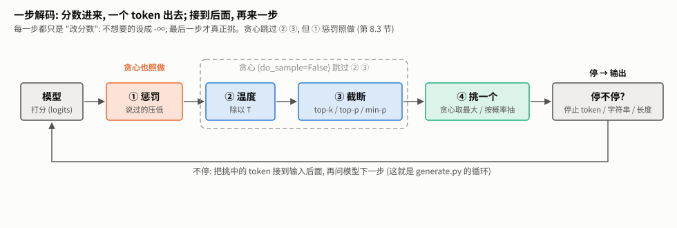

1. **惩罚**: 说过的 token 压低一点, 免得重复 (第 6、7 节);
2. **温度**: 所有分数除以 T, 调节 "多大胆" (第 4 节);
3. **截断**: 把明显不靠谱的候选划掉 (第 5 节);
4. **挑一个**: 贪心取最大, 或者按概率抽签 (第 3、4 节);
5. **停不停**: 写出了停止标记、停止字符串, 或者写满了长度 (第 8.4 节)。

前三步都只是 "改分数": 不想要的设成 -∞ (负无穷), softmax 之后概率就是 0, 永远不会被挑中。第 4 步才真正挑。这个 "改分数" 的视角很重要: 下一个单元 [structured-output](../structured-output/TUTORIAL.md) 让模型只能写合法 JSON, 也只是在这条流水线上多加一步 "改分数"。

### 1.2 实验对象: 一个数出来的小模型

为了把每种挑法看清楚, 本单元用一个最简单的 "语言模型" 做实验。`toy_lm.py` 数一数莎士比亚语料里 "前两个字符是 th 时, 下一个字符是什么" 各出现了多少次, 就能给 65 个字符打分。它叫**三元模型** (trigram): 看两个, 猜第三个。它不用训练、不用显卡, 一秒内建好:

```python
lm = ToyLM.from_corpus()
probs = softmax(lm.logits("th"))     # 前两个字符是 "th" 时, 下一个字符的概率
# 'e' 0.46, ' ' 0.14, 'a' 0.11, 'i' 0.10, 'o' 0.08 ...   (the、with 后面的空格、that、this、those ...)
```

没见过的组合怎么办? `toy_lm.py` 给每个字符的次数都加一个很小的数 α = 0.01 (叫**平滑**), 这样没见过的字符概率很小但不是 0。这个细节第 5.2 节会用到。

真实的大模型用神经网络算 logits, 但**挑的方法完全一样**。所以先在这个小模型上把每种挑法的脾气摸清楚, 专题 B、C 再到真实的小模型上量一遍。

---

## 2. 手算一个最小的例子

"今天天气很___", 假设模型只考虑 6 个候选, 分数如下。`python sampling.py` 打印的就是这一节的数字。

| 候选 | 好 | 热 | 冷 | 晴 | 差 | 怪 |
|---|---|---|---|---|---|---|
| 分数 | 2.0 | 1.5 | 1.0 | 0.5 | -1.0 | -2.0 |

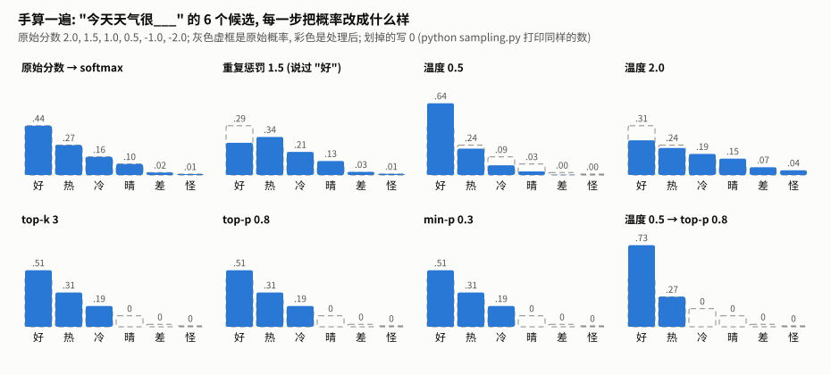

### 2.1 softmax: 分数变概率

每个分数取指数: e^2.0 = 7.39, e^1.5 = 4.48, e^1.0 = 2.72, e^0.5 = 1.65, e^-1 = 0.37, e^-2 = 0.14, 加起来 16.74。每个除以总和:

| 好 | 热 | 冷 | 晴 | 差 | 怪 |
|---|---|---|---|---|---|
| 0.44 | 0.27 | 0.16 | 0.10 | 0.02 | 0.01 |

两个性质后面反复用到:

- **只看差距**: 所有分数同时加上同一个数 c, 每个 e^z 都乘上 e^c, 除以总和时消掉, 概率完全不变。所以分数整体偏高还是偏低, 本来无关紧要 (第 6.3 节会看到有一种惩罚偏偏在乎这个)。
- **-∞ 就是 0**: e^-∞ = 0。截断就是靠这个把候选 "划掉"。

`sampling.py` 的 softmax 先减去最大值再取指数, 这是同一个性质的应用: 减掉最大值概率不变, 但最大的那个变成 e^0 = 1, 不会溢出。

### 2.2 温度: 除以 T

温度 0.5: 分数变成 4, 3, 2, 1, -2, -4, 差距翻倍, 概率变成 0.64, 0.24, 0.09, 0.03, 0.00, 0.00, 第一名更突出。温度 2.0: 分数变成 1, 0.75, 0.5, 0.25, -0.5, -1, 差距减半, 概率变成 0.31, 0.24, 0.19, 0.15, 0.07, 0.04, 更平。

温度只改差距, **不改排名**: 不管 T 是多少, "好" 永远第一。所以贪心不受温度影响, transformers 在贪心时干脆跳过它。温度趋于 0 时就是贪心; 温度很大时接近 6 个候选平均抽。

### 2.3 三种截断

| 方法 | 规则 | 这个例子里 |
|---|---|---|
| top-k 3 | 只留分数最高的 3 个 | 留 好、热、冷 |
| top-p 0.8 | 从高到低累加概率, 留下刚好凑够 0.8 的最少几个 | 0.44 → 0.71 → 0.87, 第三个凑够, 留 好、热、冷 |
| min-p 0.3 | 概率低于 "最高概率 × 0.3" 的划掉 | 门槛 0.44 × 0.3 = 0.13; 冷 0.16 留下, 晴 0.10 划掉 |

划掉之后, 剩下的重新归一化: 0.44 / 0.87 = 0.51, 0.27 / 0.87 = 0.31, 0.16 / 0.87 = 0.19。在这个例子里三种方法碰巧留下同样的 3 个, 第 5 节会看到它们在别的分布上差别很大。

### 2.4 重复惩罚: 排名可以被翻过来

假设前文已经写过 "好"。重复惩罚 1.5 把它的正分除以 1.5: 2.0 → 1.33, 比 "热" 的 1.5 还低。概率变成 好 0.29、热 0.34: **第一名换了**。惩罚和温度不同, 它只改一部分 token, 所以能改变排名, 也就能改变贪心的选择。这是第 8.3 节那个坑的根源。

### 2.5 顺序有影响

"温度 0.5 → top-p 0.8": 温度先把 "好" 推到 0.64, 加上 "热" 0.24 就凑够了 0.88, 只留 2 个, 归一化后 0.73 / 0.27。

反过来 "top-p 0.8 → 温度 0.5": top-p 看的是原始概率, 留 3 个; 再降温, 变成 0.67 / 0.24 / 0.09。同样两个参数, 换个顺序, 一个候选的去留就变了。专题 A 会看到三家主流框架的顺序确实不一样。

---

## 3. 贪心: 最省事, 也最容易转圈

### 3.1 结果

**贪心** (greedy): 每一步都选分数最高的那个。不用随机数, 同样的输入永远得到同样的输出。

让 ToyLM 用贪心从 5 个不同的开头各写 300 个字符 (`toy_experiments.py` 的 A 部分):

| 开头 | 贪心写出来的 |
|---|---|
| `ROMEO:\n` | `I withe the the the the the the the the …` |
| `JULIET:\nO ` | `my the the the the the the the the the t…` |
| `MENENIUS:\nI ` | `withe the the the the the the the the th…` |

**5 个开头全部在第 2~4 个字符就掉进 "the " 的循环, 再也出不来。**

### 3.2 为什么出不来

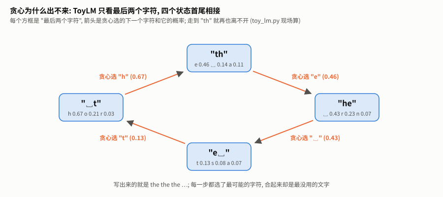

ToyLM 只看最后两个字符, 所以它的 "状态" 只有 "最后两个字符" 这么多种。贪心在每个状态下的选择是固定的: 写到 "th" 选 "e" (0.46), 写到 "he" 选空格 (0.43), 写到 "e␣" 选 "t" (0.13), 写到 "␣t" 选 "h" (0.67), 又回到 "th"。

**只要状态有限、选择固定, 走下去迟早会回到见过的状态, 之后就沿着同一条路永远绕圈。** 这是一个确定的结论, 不是运气: 贪心 + 有限状态 = 必然进入循环。

注意 "e␣" 之后选 "t" 的概率只有 0.13, 模型在这里其实很没把握 (后面还有 s 0.08、a 0.07 等几十个候选)。贪心不管把握大小, 永远选第一。

### 3.3 真实模型也会转圈

真实的大模型看得远得多 (几千个 token), 状态多到不可能重复, 但同样会转圈: 一旦写出一段重复, 前文里 "这段话后面跟着这段话" 的模式就成了最强的证据, 模型越写越确定。[minigpt 讲义第 11.2 节](../minigpt/TUTORIAL.md#112-temperature-和-top-k-实测对比) 里训练好的小 GPT 用接近贪心的温度, 也写出了 "the the the"。Holtzman 等人 2019 年的论文 (第 14 节) 把这种现象叫**退化** (degeneration)。

---

## 4. 采样与温度: 多样性和 "像不像" 的取舍

### 4.1 按概率抽签

**采样** (sampling): 不总是选最高的, 而是按概率抽签。概率 0.46 的 "e" 有 46% 的机会被抽中, 0.13 的 "t" 有 13% 的机会。`sampling.py` 的 `sample`:

```python
def sample(logits, rng=random):
    probs = softmax(logits)
    r, cum = rng.random(), 0.0          # r 是 0 到 1 之间的随机数
    for i, pr in enumerate(probs):
        cum += pr                        # 把 0~1 按概率切成一段一段
        if r < cum:                      # r 落在第 i 段, 就选 i
            return i
    return max(i for i, pr in enumerate(probs) if pr > 0)   # 浮点误差兜底
```

`rng` 用 `random.Random(种子)` 时结果可以复现: 同样的种子, 同样的抽签结果。

最后一行的兜底不是多余的: 浮点加法有误差, 所有概率加起来可能是 0.9999999, 而 r 恰好是 0.99999995, 循环走完都没返回。兜底时选 "最后一个概率不为 0 的", 而不是简单地选最后一个, 因为最后一个可能已经被截断成 0 了。

### 4.2 温度是一个旋钮

**温度** T 先把所有分数除以 T。怎么衡量 "分布有多平"? 用**熵** (entropy): 分布越尖、越确定, 熵越低; 完全确定是 0 比特, 两个候选各一半是 1 比特, 65 个字符完全均匀是 log2(65) = 6.02 比特。

在语料里随机取 500 个位置, 看不同温度下 ToyLM 下一个字符分布的平均熵 (`toy_more.py` 的 H 部分):

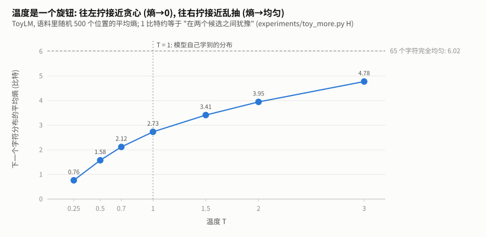

| 温度 | 0.25 | 0.5 | 0.7 | 1.0 | 1.5 | 2.0 | 3.0 |
|---|---|---|---|---|---|---|---|
| 平均熵 (比特) | 0.76 | 1.58 | 2.12 | 2.73 | 3.41 | 3.95 | 4.78 |

温度往下拧, 熵趋向 0, 越来越像贪心; 往上拧, 熵趋向 6.02, 越来越像在 65 个字符里乱抽。T = 1 不改分数, 就是模型自己学到的分布。

### 4.3 多样性和 "像不像" 的取舍

怎么衡量 "写得好不好"? 用两个能自动算的指标:

- **多样性**: 300 个字符里, 不重复的 4 字片段占多少。转圈的文字很低, 正常文字很高;
- **像不像**: 用 ToyLM 自己给每个字符打的平均对数概率 (log 概率, 都是负数, 越接近 0 越 "像模型心中的语料")。

每种设置跑 5 个开头 × 20 个种子 (贪心不用种子, 只跑 5 次), 每次 300 个字符, 再拿语料里随机 100 段真实文字做参照:


| 设置 | 多样性 | 像不像 | 300 字里转圈的比例 |
|---|---|---|---|
| 贪心 | 0.02 | -1.02 | 100% |
| 温度 0.5 | 0.70 | -1.45 | 0% |
| 温度 0.7 | 0.87 | -1.65 | 0% |
| 温度 1.0 | 0.96 | -1.94 | 0% |
| 温度 1.5 | 0.99 | -2.53 | 0% |
| **语料本身** | **0.90** | **-1.89** | — |

能读出三件事:

1. **贪心最 "像", 却最没用。** 它每一步都选最可能的, 所以平均对数概率最高 (-1.02), 可写出来的是 "the the the"。**"每一步最可能" 不等于 "整段最像人写的"**: 人写的文字本来就不是每一步都挑最常见的字。
2. **温度 1.0 最接近语料本身** (-1.94 对 -1.89)。这不是巧合: T = 1 就是按模型自己学到的分布抽签, 抽出来的东西自然和它学的语料一样 "意外"。
3. **温度低了太保守, 高了胡言乱语。** 温度 1.5 时多样性 0.99, 但对数概率掉到 -2.53, 写出来已经不像单词了。

---

## 5. 截断: top-k、top-p、min-p

温度高一点能避免转圈, 但会让概率很低的 "离谱" 候选也有机会被抽中: 一个 0.1% 的字符, 写 300 个字就有不小的机会出现一次。**截断**的思路是: 抽签之前, 先把不靠谱的候选划掉, 剩下的重新归一化。

| 方法 | 规则 | 出处 |
|---|---|---|
| **top-k** | 只留分数最高的 k 个 | Fan et al. 2018 |
| **top-p** (核采样) | 按概率从高到低累加, 留下刚好凑够 p 的最少几个 | Holtzman et al. 2019 |
| **min-p** | 概率低于 "最高概率 × p" 的划掉 | Nguyen et al. 2024 |

### 5.1 它们留下几个候选

关键区别在于: 模型**有把握**时 (分布很尖, 一个候选占了大头), 应该只留很少几个; **没把握**时 (分布很平), 应该多留一些。在语料里随机取 2000 个位置, 看三种方法各留下多少:


| 熵 (比特) | top-k = 5 | top-p = 0.9 | min-p = 0.1 |
|---|---|---|---|
| 0–1 (很有把握) | 46.1 | 1.6 | 1.4 |
| 1–2 | 17.6 | 3.6 | 2.3 |
| 2–3 | 5.1 | 6.5 | 4.9 |
| 3–6 (没把握) | 5.1 | 14.0 | 12.3 |

**top-p 和 min-p 随把握大小伸缩**: 有把握时只留一两个, 没把握时留十几个。**top-k 是个死数**: 没把握时它只留 5 个, 可能把合理的候选划掉了。

top-p 和 min-p 的差别在 "看什么": top-p 看累计的概率质量, min-p 只看和第一名比。分布有一条很长的 "尾巴" (很多个都只有一点点概率) 时, top-p 要一直往下加才能凑够 0.9, 会把尾巴里的一部分也留下; min-p 只要低于门槛就划掉, 对尾巴更狠。所以表里最后一行 top-p 留 14.0 个, min-p 留 12.3 个。

### 5.2 一个意外: 有把握时 top-k 反而留下 46 个

表里第一行的 46.1 不是笔误。ToyLM 对没在语料里见过的组合, 统一给一个很小的平滑概率 (第 1.2 节的 α), 所以很多字符的分数**完全相同**。模型很有把握时, 见过的字符不到 5 个, 第 5 名就落在这堆同分的字符里; 而 top-k 的规则 (transformers 也是这样) 是 "和第 k 名同分的一律保留":

```python
def top_k(logits, k):
    kth = sorted(logits, reverse=True)[k - 1]               # 第 k 名的分数
    return [z if z >= kth else NEG_INF for z in logits]     # >= : 同分的都留下
```

于是几十个字符都留下了。真实大模型的 logits 是连续的实数, 完全同分很少见; 但低精度 (比如 bf16, 只有 8 位有效数字) 下会不会常见, 本单元**没有数据**。这个例子说明: **截断规则在边界上怎么处理并列, 会实实在在地改变结果**, 第 8.2 节和 transformers 核对时还会遇到它。

### 5.3 截断之后的取舍

回到第 4.3 节的图: 温度 1.0 加上三种截断, 多样性都略降、"像不像" 都上升, 都没有转圈。温度 1.5 加 min-p 0.1, 多样性 0.98、对数概率 -2.01, 比单纯温度 1.5 (-2.53) 像得多: 温度放开了多样性, min-p 划掉了离谱的候选。这正是 min-p 论文主张的用法: **高温度 + min-p**。

截断和温度谁先谁后, 会影响 "高温度" 时放进来多少候选。专题 A 用 2000 个上下文量了一下: 温度 1.5、top-p 0.9、min-p 0.1, 先温度后截断 (transformers) 平均留 10.7 个, 先截断后温度 (llama.cpp) 只留 6.9 个。

---

## 6. 重复惩罚: 看起来对症, 其实很脆

### 6.1 公式

既然贪心会转圈, 那就惩罚说过的 token? 这就是**重复惩罚** (repetition penalty, 出自 CTRL 论文, Keskar et al. 2019), transformers 的写法:

```python
def repetition_penalty(logits, prev_ids, penalty):
    out = list(logits)
    for i in set(prev_ids):                        # 说过的每个 token, 出现几次都只罚一次
        z = out[i]
        out[i] = z / penalty if z > 0 else z * penalty
    return out
```

penalty > 1 时, 正分变小、负分变得更负, 总之都往 "不像" 的方向推。为什么要按正负号分开? 如果一律除以 penalty, 负分除以 1.3 反而变大 (-2 → -1.54), 惩罚变成了奖励。

### 6.2 它救不了贪心的转圈

| 设置 | 多样性 | 300 字里转圈的比例 |
|---|---|---|
| 贪心 | 0.02 | 100% |
| 贪心 + 重复惩罚 1.1 | 0.02 | 100% |
| 贪心 + 重复惩罚 1.3 | 0.06 | 100% |
| 贪心 + 重复惩罚 2.0 | 0.15 | 100% |

惩罚加到 2.0 还是全部转圈。原因: 罚的是 "说过的 token", 而写了几十个字符之后, 常用字符**全都说过了**, 它们一起被罚, 彼此的排名没变, 贪心还是选同一个。重复惩罚只能区分 "说过" 和 "没说过", 区分不了 "刚说过三遍" 和 "很久以前说过一次"。第 7 节会看到, 只要换成 "按次数累加", 问题就解决了。

### 6.3 它取决于一个本来无关紧要的数

第 2.1 节说过: 所有分数同时加上同一个常数, 概率一点都不变。但重复惩罚按正负号区别对待, 它在乎。把 "th" 之后的所有分数整体平移, 再用 1.3 惩罚 "e" (`toy_more.py` 的 F 部分):

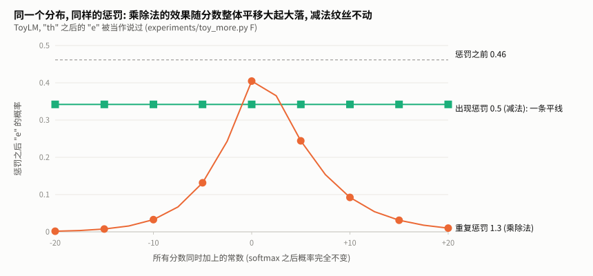

| 所有分数整体平移 | -20 | -10 | 0 | +10 | +20 |
|---|---|---|---|---|---|
| 惩罚前 "e" 的概率 | 0.46 | 0.46 | 0.46 | 0.46 | 0.46 |
| 重复惩罚 1.3 之后 | **0.002** | 0.03 | **0.40** | 0.09 | **0.01** |
| 出现惩罚 0.5 (减法, 第 7 节) 之后 | 0.34 | 0.34 | 0.34 | 0.34 | 0.34 |

**同一个分布、同样 1.3 的惩罚, 效果从 "几乎没影响" 到 "几乎禁止"**, 完全取决于 logits 碰巧落在哪个范围。道理: 乘除法改变的是 "离 0 多远", 分数离 0 越远, 乘以 1.3 改掉的绝对量越大, 而概率只看绝对差距。真实模型的 logits 落在哪个范围, 换一个模型、甚至同一个模型的不同位置都不一样, 同样的 penalty 意味着完全不同的力度。

减法没有这个问题: 每个分数减去 0.5, 和平移多少无关, 曲线是一条平线。

### 6.4 它还罚提示词

transformers 把 "目前所有 token" 都算作说过的, **包括提示词里的** (`generate.py` 也是这样)。对闲聊来说问题不大; 但在工具调用里, 提示词里有一大段工具说明 (JSON Schema), 引号、括号、`"name"` 这些都已经 "说过" 了, 而模型写工具调用时恰恰要一个不差地写出它们。专题 B 在真实模型上量了它的后果; 第 15 节是它在一个具体项目里的后果。

---

## 7. 别的惩罚写法: 窗口、减法、禁止重复片段

### 7.1 四种改法

重复惩罚的三个毛病: 只分 "说过 / 没说过"、受平移影响、罚提示词。各家框架给出了不同的改法, `sampling.py` 都实现了:

| 写法 | 规则 | 谁在用 |
|---|---|---|
| **窗口重复惩罚** | 公式同 6.1, 但只看最近 `last_n` 个 token | llama.cpp (`repeat_last_n`, 默认 64) |
| **出现惩罚** (presence) | 出现过的 token 分数**减去**一个常数 | OpenAI 接口、vLLM、llama.cpp |
| **频率惩罚** (frequency) | 分数减去 "常数 × 出现次数" | 同上 |
| **禁止重复 n 元组** | 如果接上某个 token 会凑出一段前面出现过的 n 个 token, 就把它设成 -∞ | transformers (`no_repeat_ngram_size`) |

出现惩罚和频率惩罚在 OpenAI 接口里是同一个公式的两项:

```python
def presence_frequency_penalty(logits, generated_ids, presence=0.0, frequency=0.0):
    counts = {}
    for t in generated_ids:                        # 只数模型自己生成的 token
        counts[t] = counts.get(t, 0) + 1
    out = list(logits)
    for t, c in counts.items():
        out[t] -= frequency * c + presence         # 减法: 不受平移影响
    return out
```

注意参数名是 `generated_ids`: vLLM 的说明里写明, 这两种惩罚**只看生成的 token, 不看提示词**; 而它的 `repetition_penalty` 和 transformers 一样, 提示词也算。同一个框架里, 两种惩罚看的范围不同。

禁止重复 n 元组的实现:

```python
def no_repeat_ngram(logits, ids, n):
    prefix = tuple(ids[len(ids) - (n - 1):])                       # 最后 n-1 个 token
    banned = {ids[i + n - 1] for i in range(len(ids) - n + 1)      # 前面每一处出现过这 n-1 个 token 的地方,
              if tuple(ids[i:i + n - 1]) == prefix}                #   它后面跟的那个 token 都不许再用
    return [NEG_INF if i in banned else z for i, z in enumerate(logits)]
```

### 7.2 实测: 哪种能打破贪心的转圈

ToyLM, 5 个开头, 贪心各写 300 个字符 (`toy_more.py` 的 E 部分):

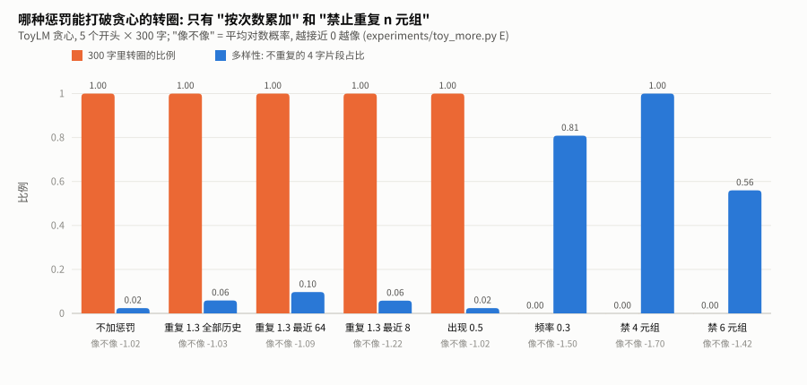

| 设置 | 转圈 | 多样性 | 像不像 | 第一个开头写出的 |
|---|---|---|---|---|
| 不加惩罚 | 100% | 0.02 | -1.02 | `I withe the the the the …` |
| 重复惩罚 1.3, 看全部历史 | 100% | 0.06 | -1.03 | `I withe son the and the the the …` |
| 重复惩罚 1.3, 最近 64 个 | 100% | 0.10 | -1.09 | `I withe son the and the the the …` |
| 重复惩罚 1.3, 最近 8 个 | 100% | 0.06 | -1.22 | `I withe son the and the son the and the son …` |
| 出现惩罚 0.5 | 100% | 0.02 | -1.02 | `I withe the the the the …` |
| **频率惩罚 0.3** | **0%** | **0.81** | -1.50 | `I withe the son there and my lover,↵And thers,↵Tha…` |
| **禁止重复 4 元组** | **0%** | **1.00** | -1.70 | `I withe ther th that this thou and thy th, an thro…` |
| 禁止重复 6 元组 | 0% | 0.56 | -1.42 | `I withe the to the so ther the and the he th the w…` |

逐个看:

- **窗口**没有解决问题, 只是把圈变大了: 只看最近 8 个时, 圈从 "the " 变成 "son the and the " (16 个字符)。窗口里看不到的就不罚, 绕一个比窗口大的圈就躲开了。
- **出现惩罚 0.5** 和不加完全一样。它和全历史重复惩罚一样只分 "说过 / 没说过"; 循环里的 4 个字符很快都说过了, 一起减 0.5, 排名不变。
- **频率惩罚**是唯一一个 "越转越罚" 的: 每绕一圈, 圈里每个字符的次数加 1, 惩罚加 0.3, 迟早有一个没怎么用过的字符翻上来。代价是 "像不像" 掉到 -1.50。
- **禁止重复 4 元组**最彻底: 任何 4 个字符的片段都不许出现第二次, 多样性 1.00。但这也是它的毛病: 正常文字里 "the " 本来就该出现很多次。它写出了 "ther th that this thou and thy th", 每个片段都不重复, 但已经不太像英语。n 取大一点 (6) 温和一些。

### 7.3 怎么选

没有通用答案, 但有几条规律:

1. **想打破循环, 要用 "按次数" 的惩罚** (频率惩罚), 或者直接禁止重复片段。只分 "说过 / 没说过" 的 (重复惩罚、出现惩罚) 打不破。
2. **乘除法的惩罚力度没法跨模型迁移** (第 6.3 节); 减法的至少在 "同样的分数尺度" 下是稳定的。
3. **惩罚是钝器**: 它不知道哪些重复是该有的 ("the"、JSON 的引号), 哪些是退化。多数时候, **采样 + 截断**就足以避免转圈 (第 4.3 节, 温度 0.5 起就是 0% 转圈), 惩罚可以不加。
4. 需要格式一个不差的场合 (工具调用、JSON), 惩罚可能有害 (专题 B), 先关掉, 再看格式错误是不是减少了。

---

## 8. 完整的流水线: 顺序、核对、停止

### 8.1 sampling.py 的 process

transformers 的 `generate` 每一步按这个顺序处理 logits (读它的源码 `_get_logits_processor` 得到):

```
重复惩罚 → 温度 → top-k → top-p → min-p → (采样: 按概率抽 | 贪心: 取最大)
```

`sampling.py` 的 `process` 照这个顺序实现:

```python
def process(logits, prev_ids=(), rep=1.0, temp=1.0, k=0, p=1.0, minp=0.0, do_sample=True):
    x = repetition_penalty(logits, prev_ids, rep)       # 不管贪心还是采样, 都做
    if do_sample:                                        # 只有采样才做下面四步
        if temp != 1.0:
            x = temperature(x, temp)
        if k:
            x = top_k(x, k)
        if p < 1.0:
            x = top_p(x, p)
        if minp > 0:
            x = min_p(x, minp)
    return x
```

`next_token` 再调用 `greedy` 或 `sample`。注意 `if do_sample` 的位置: 惩罚在它外面。第 8.3 节会说为什么这一行很要紧。

### 8.2 和 transformers 核对

`check_against_hf.py` 随机生成 2000 组打分 (平的、尖的、大量并列的各占一部分), 每一步都和 transformers 对应的处理器比对:

| 步骤 | 完全相同 | 只差在 "并列的 token 留哪个" | 真正不同 |
|---|---|---|---|
| 重复惩罚、温度、top-k、min-p | 2000 / 2000 | 0 | 0 |
| top-p | 1652 / 2000 | 348 | 0 |
| 五步串起来 | 1768 / 2000 | 232 | 0 |

top-p 的那 348 组全部出在 "大量并列" 的打分上: 几个 token 概率一样、只能留一部分时, 留哪几个取决于排序时并列元素的先后, 手写版 (Python 的 `sorted`, 稳定排序) 和 PyTorch 的排序不一样。留下的个数和分数完全相同。又是第 5.2 节那个 "边界上的并列"。

top-p 还有一个写法上的细节: transformers 不是 "从高往低加, 凑够 p 就停", 而是反过来 "从低往高加, 把累计概率 ≤ 1 - p 的那些去掉"。两种说法在数学上等价, 但在 "恰好相等" 的边界上可能差一个 token, 所以 `sampling.py` 照 transformers 的写法:

```python
order = sorted(range(len(logits)), key=lambda i: probs[i])   # 从低到高
for rank, i in enumerate(order):
    cum += probs[i]
    if cum <= 1 - p and rank < len(order) - min_keep:         # min_keep: 至少留 1 个
        out[i] = NEG_INF
```

### 8.3 一个坑: 贪心时重复惩罚还在

Qwen2.5-Instruct 发布时带了一份生成配置 `generation_config.json`:

```
do_sample=true, temperature=0.7, top_p=0.8, top_k=20, repetition_penalty=1.1
```

调用 `generate(..., do_sample=False)`, 本意是 "贪心, 什么都不加"。`greedy_still_penalizes.py` 读取这份配置, 装到一个随机初始化的迷你模型上 (不下载权重), 拦截 generate 内部用到的处理器:

```
generate(do_sample=False)                          → ['RepetitionPenaltyLogitsProcessor']
generate(do_sample=False, repetition_penalty=1.0)  → []
generate()  (全用模型自带配置)                       → ['RepetitionPenalty…', 'Temperature…', 'TopK…', 'TopP…']
```

`do_sample=False` 只跳过温度、top-k、top-p 这些 "采样用的" 步骤; 重复惩罚不属于采样, **照样执行**, 而它又能改变排名 (第 2.4 节)。所以 "Qwen2.5 + transformers + `do_sample=False`" 的结果, 准确的说法是 "贪心 + 重复惩罚 1.1"。

**教训**: 模型目录里的 `generation_config.json` 会悄悄生效; 想要什么设置, 把每个参数都显式写出来。vLLM 默认也会读这份配置 (专题 D)。

### 8.4 什么时候停: generate.py

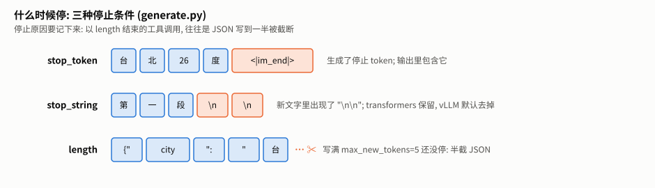

`generate.py` 是完整的生成循环 (练习 2 的参考答案), 每一步问模型、挑 token、接上去、判断要不要停:

```python
def generate(step, prompt_ids, max_new_tokens, stop_ids=(), stop_strings=(), decode=None, rng=None, **cfg):
    rng = rng or random.Random(0)                          # 没给随机数源就用固定种子: 可复现
    ids = list(prompt_ids)
    new = []
    for _ in range(max_new_tokens):
        tok = next_token(step(ids), prev_ids=ids, rng=rng, **cfg)    # prev_ids 包括提示词 (第 6.4 节)
        ids.append(tok)
        new.append(tok)
        if tok in stop_ids:
            return new, "stop_token"
        if stop_strings and any(s in decode(new) for s in stop_strings):
            return new, "stop_string"
    return new, "length"
```

| 停止原因 | 什么时候 | 输出里包不包含停止标记 |
|---|---|---|
| `stop_token` | 生成了停止 token, 比如 Qwen 的 `<\|im_end\|>` (它是怎么来的见 [chat-template 第 6.2 节](../chat-template/TUTORIAL.md#62-模型怎么知道该停)) | 包含 |
| `stop_string` | 新文字里出现了指定的字符串, 比如 `"\n\n"` | transformers 保留; vLLM 默认替你去掉。两家行为不同, 换框架时要注意 |
| `length` | 写满 `max_new_tokens` 还没停 | — |

停止字符串为什么要检查**解码后的文字**, 而不是 token? 因为一个字符串可能被切成好几个 token, 也可能和前后的字合成一个 token; 只有解码成文字才能可靠地找到它。代价是每一步都要解码一遍, 真实系统只检查最后几十个字符。

**评测时一定要记录停止原因**: 一个工具调用以 `length` 结束, 往往就是 JSON 写到一半被截断了。

---

## 9. 束搜索: 总分更高, 照样转圈

### 9.1 规则

贪心每一步只留 1 条路。**束搜索** (beam search) 每一步留 B 条 "到目前为止总分最高" 的路 (总分 = 每一步 log 概率之和, 也就是整段概率的对数), 最后挑总分最高的一条。B = 1 就是贪心, B 足够大就是穷举所有可能。它是机器翻译等任务的标准做法。

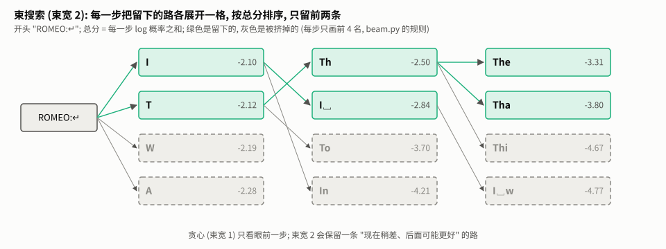

图里从 `ROMEO:↵` 开始, 束宽 2。第一步 "I" (-2.10) 和 "T" (-2.12) 留下, "W"、"A" 被挤掉。第二步两条路各展开 65 个字符, 一共 130 个候选, 按总分排序, 留 "Th" (-2.50) 和 "I␣" (-2.84)。注意 "Th" 来自第一步排第二的 "T": **贪心第一步就选定了 "I", 不会再回头; 束搜索保留了 "现在稍差、后面可能更好" 的路**。

`beam.py` 的核心:

```python
for _ in range(max_new_tokens):
    cands = []
    for seq, score in beams:
        if seq and seq[-1] in stop_ids:
            cands.append((seq, score))               # 结束了: 不再展开, 原样参与比较
            continue
        lp = log_softmax(step(list(prompt_ids) + list(seq)))
        for tok, l in enumerate(lp):
            cands.append((seq + (tok,), score + l))
    cands.sort(key=lambda c: (-c[1], c[0]))          # 总分从高到低; 同分按序列排, 结果唯一
    beams = cands[:beam_width]
```

### 9.2 实测: 束越宽, 总分越高, 照样转圈

从 `ROMEO:\n` 写 40 个字符 (`toy_more.py` 的 I 部分):

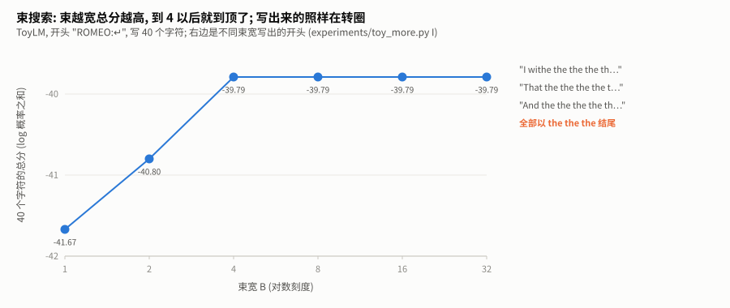

| 束宽 B | 总分 (越高越好) | 写出来的 |
|---|---|---|
| 1 (贪心) | -41.67 | `I withe the the the the the the the the ` |
| 2 | -40.80 | `That the the the the the the the the the` |
| 4 | -39.79 | `And the the the the the the the the the ` |
| 8、16、32 | -39.79 | 同上 |

束越宽, 找到的路总分越高, 到 4 就到顶了; 但**照样在 "the" 里转圈**。这说明问题不在 "搜得不够好", 而在**目标本身**: 在 ToyLM 眼里, "the the the" 就是概率最高的文字。Holtzman 等人 2019 年的论文正是这个观察: 追求 "整段概率最高" 的解码方法 (贪心、束搜索) 写出来的文字反而会退化; 人写的文字概率并不是最高的。他们因此提出了 top-p。

### 9.3 长度归一化

总分是 log 概率之和, 每多一个 token 就多加一个负数, 所以束搜索天然偏爱**短**的输出: 两条路都合理时, 早结束的那条总分更高。实际系统常把总分除以长度 (或者长度的某个幂, 比如 transformers 的 `length_penalty`), 叫**长度归一化**。`beam.py` 为了让练习有唯一答案, 没有做。[structured-output](../structured-output/TUTORIAL.md) 单元在约束解码里会再碰到 "最短的总分最高"。

---

## 10. 评测为什么用贪心

### 10.1 为什么

评测要回答 "A 比 B 好吗"。如果每次跑结果都随机变, 一次的差别可能只是运气, 要跑很多次、算置信区间才能下结论 (见 Agent 领域的 agent-eval 单元)。贪心没有随机性, 同样的输入得到同样的输出, 一个设置跑一遍就够, 别人也能复现。

### 10.2 贪心不保证什么

1. **它测的是 "最可能的那一种行为"**, 不代表用户实际用到的 (产品里常用采样)。专题 B 在真实小模型上算了: 用 Qwen 自带的采样设置, 12 个问题里只有少数几个的回复在采样下大概率和贪心一字不差。
2. **"贪心" 不一定是纯贪心**: 框架可能悄悄加了重复惩罚 (第 8.3 节)。报告数字时写清楚完整的解码设置。
3. **贪心也不一定完全确定**: 不同的计算路径、不同的精度, 两个分数非常接近的 token 可能交换名次 (专题 C)。

所以: 评测用贪心, 是为了让比较便宜、可复现; 但要把完整设置写出来, 而且知道它离 "实际使用" 有多远。

---

## 11. 从教学实现到工业实现

本单元的实现为了好读, 每一步都是 Python 列表上的循环。真实系统做的是同样的数学, 但写法很不一样:

| 本单元 | 真实系统 | 为什么 |
|---|---|---|
| 一次处理一个序列的一个位置, Python 列表 | 一批序列一起处理, 张量 `[batch, vocab]`; 每个请求可以有自己的温度、top-p | 推理服务同时服务很多请求 (见 serving 项目) |
| top-k 用 `sorted` 整表排序 | `torch.topk`, 只找前 k 个 | 词表 15 万, 整表排序很贵 |
| top-p 每一步整表排序 | vLLM: 有 Triton 时先走 Triton 内核, 否则用 PyTorch 整表排序; CUDA 上条件满足时用 FlashInfer 的采样内核 (读 `vllm/v1/sample/ops/topk_topp_sampler.py`, 2026-10-29) | 采样是每一步都要做的, 在 GPU 上能省就省 |
| 惩罚用 `set(prev_ids)` | 维护一张 "每个 token 出现了几次" 的计数表, 每步只更新一个 | 不用每步重新数一遍历史 |
| 停止字符串检查整段解码后的文字 | 只检查最后几十个字符 | 解码整段越来越慢 |
| 抽签用 `random.Random` | 每个请求一个随机数生成器 (可指定种子), 或者用 "加 Gumbel 噪声再取最大" 的等价写法 | 批处理时每个请求的随机性要互不影响 |

最后一行的 "Gumbel 技巧" 值得一说: 给每个分数加一个服从 Gumbel 分布的随机噪声, 再取最大的那个, 得到的结果和 "softmax 之后按概率抽签" 分布完全相同。好处是 "取最大" 在 GPU 上很便宜, 而且和贪心共用同一段代码。

数学上, 工业实现和本单元的一样; 第 8.2 节的核对就是证据。

---

## 12. 本单元踩坑记录汇总

| 坑 | 表现 | 怎么发现的 | 怎么办 |
|---|---|---|---|
| 贪心时重复惩罚还在 | `do_sample=False` 的结果被模型自带的 1.1 改了排名 | `greedy_still_penalizes.py` 拦截处理器 (第 8.3 节) | 显式写 `repetition_penalty=1.0` |
| 重复惩罚的力度随 logits 平移变化 | 同样 1.3, 概率从 0.40 到 0.002 | `toy_more.py` F (第 6.3 节) | 想要稳定的力度, 用减法的惩罚 |
| 重复惩罚和出现惩罚打不破转圈 | 加到 2.0 仍然 100% 转圈 | `toy_experiments.py`、`toy_more.py` E (第 6.2、7.2 节) | 用频率惩罚、禁止重复 n 元组, 或者直接采样 |
| top-k 遇到并列全部保留 | 有把握时平均留 46 个 | `toy_experiments.py` (第 5.2 节) | 知道这条规则; 和框架核对时容忍并列的差异 |
| top-p 的并列取舍和 PyTorch 不同 | 2000 组里 348 组留下的 token 不同, 个数相同 | `check_against_hf.py` (第 8.2 节) | 核对时比较 "个数和分数", 不比较并列时具体留了谁 |
| 停止字符串, 两家处理不同 | transformers 保留, vLLM 默认去掉 | 读文档 (第 8.4 节) | 换框架时检查输出结尾 |
| 三家的执行顺序不同 | 同样参数, llama.cpp 留下的候选可以多一半或少三分之一 | `toy_more.py` G (专题 A) | 换框架时不要直接照搬参数 |
| vLLM 默认读模型自带配置 | 不传参数时, Qwen2.5 的重复惩罚 1.1 也会生效 | 读源码 (专题 D) | 显式传参数, 或者启动时 `--generation-config vllm` |

---

## 13. 练习

### 13.1 动手写代码 (三级递进)

| 级别 | 练习 | 验收 |
|---|---|---|
| ① 填空 | `ex1_filters_fill.py`: 补全 top-p、min-p、重复惩罚 | 600 组随机打分上和参考实现逐位相同 |
| ② 接口 | `ex2_generate.py`: 写出带三种停止条件的生成循环 | 和参考实现在 ToyLM 上逐字一致; 停止条件、可复现、惩罚看得到提示词 |
| ③ 白纸 | `ex3_beam_blank.py`: 从规则说明写出束搜索 | 束够宽时等于穷举; 束宽 1 等于贪心; 和参考实现一致 |

```bash
cd library/llm/decoding/exercises
python -m pytest test_ex1.py -q
```

只需要 Python 和 pytest。测试失败时会打印第一组不同的输入。先自己写, 写完或者卡住很久再展开参考答案。

<details>
<summary>练习 ① 参考答案</summary>

三处 TODO 就是 `sampling.py` 里的三个函数:

```python
def top_p(logits, p, min_keep=1):
    if p >= 1.0:
        return list(logits)
    probs = softmax(logits)
    order = sorted(range(len(logits)), key=lambda i: probs[i])        # 从低到高
    out, cum = list(logits), 0.0
    for rank, i in enumerate(order):
        cum += probs[i]
        if cum <= 1 - p and rank < len(order) - min_keep:
            out[i] = NEG_INF
    return out


def min_p(logits, p, min_keep=1):
    probs = softmax(logits)
    bar = max(probs) * p
    keep = [pr >= bar for pr in probs]
    if sum(keep) < min_keep:
        for i in sorted(range(len(probs)), key=lambda i: -probs[i])[:min_keep]:
            keep[i] = True
    return [z if k else NEG_INF for z, k in zip(logits, keep)]


def repetition_penalty(logits, prev_ids, penalty):
    if penalty == 1.0:
        return list(logits)
    out = list(logits)
    for i in set(prev_ids):
        z = out[i]
        out[i] = z / penalty if z > 0 else z * penalty
    return out
```

容易错的三处: top-p 写成 "从高往低加到 ≥ p 为止" 在边界上会差一个; 重复惩罚忘了 `set`, 同一个 token 出现几次就罚几次; 重复惩罚对负分也除以 penalty, 结果负分变大了。
</details>

<details>
<summary>练习 ② 参考答案</summary>

```python
def generate(step, prompt_ids, max_new_tokens, stop_ids=(), stop_strings=(), decode=None, rng=None, **cfg):
    rng = rng or random.Random(0)
    ids = list(prompt_ids)
    new = []
    for _ in range(max_new_tokens):
        tok = next_token(step(ids), prev_ids=ids, rng=rng, **cfg)
        ids.append(tok)
        new.append(tok)
        if tok in stop_ids:
            return new, "stop_token"
        if stop_strings and any(s in decode(new) for s in stop_strings):
            return new, "stop_string"
    return new, "length"
```

三个要点: `prev_ids=ids` 而不是 `new`, 惩罚才看得到提示词 (和 transformers 一致); `rng` 默认用固定种子, 同样的设置结果可复现; 先判断停止 token 再判断停止字符串, 两个条件同时满足时报 `stop_token`。
</details>

<details>
<summary>练习 ③ 参考答案</summary>

```python
import math


def log_softmax(logits):
    m = max(logits)
    lse = m + math.log(sum(math.exp(z - m) for z in logits))
    return [z - lse for z in logits]


def beam_search(step, prompt_ids, beam_width, max_new_tokens, stop_ids=()):
    beams = [((), 0.0)]
    for _ in range(max_new_tokens):
        cands = []
        for seq, score in beams:
            if seq and seq[-1] in stop_ids:
                cands.append((seq, score))
                continue
            lp = log_softmax(step(list(prompt_ids) + list(seq)))
            for tok, l in enumerate(lp):
                cands.append((seq + (tok,), score + l))
        cands.sort(key=lambda c: (-c[1], c[0]))
        beams = cands[:beam_width]
        if all(seq and seq[-1] in stop_ids for seq, _ in beams):
            break
    best = beams[0]
    return list(best[0]), best[1]
```

写完的那个问题 "为什么束搜索照样转圈": 束搜索只是更努力地找 "整段概率最高" 的文字; 在 ToyLM 眼里, 概率最高的文字就是 "the the the"。搜得越好, 越接近这个目标 (第 9.2 节)。
</details>

### 13.2 思考题

1. 第 7.2 节: 出现惩罚 0.5 和不加惩罚的结果一字不差。不跑代码, 只看第 3.2 节的图, 说明为什么。要多大的出现惩罚才可能打破 "th → e"?

<details>
<summary>参考答案</summary>

出现惩罚只分 "说过 / 没说过"。贪心写出 "I withe the" 之后, 循环里的 t、h、e、空格都说过了, 每个都减 0.5, 它们之间的差距不变。能翻上来的只有 "没说过" 的候选。在 "th" 状态下, "e" 是 0.46, 没说过的里面最高的是 "a" 0.11 ("I withe the" 里没有 a), 两者 log 概率差 ln(0.46 / 0.11) ≈ 1.43。所以出现惩罚至少要超过约 1.4, 才能让 "a" 在这一步翻过 "e"。但换上 "a" 之后, 写出 "tha" 又会进入别的状态, 等 a 也说过了, 新的循环可能又出现。只分 "说过 / 没说过" 的惩罚, 本质上只能推迟循环。
</details>

2. 第 5.1 节的表里, 熵 2–3 比特那一行三种方法留下的个数差不多。为什么恰好在这里交叉?

<details>
<summary>参考答案</summary>

熵 H 比特的分布, 大致相当于 "在 2^H 个候选之间平均犹豫"。H 在 2–3 之间时, 2^H 是 4~8, 正好和 top-k 的 k = 5 差不多; 此时 top-p 0.9 要凑够九成, 大约也需要这么多个。熵更低时 2^H 远小于 5, top-p 留得少; 熵更高时 2^H 远大于 5, top-p 留得多, top-k 还是 5。所以交叉点由 k 决定: k 换成 20, 交叉点就会移到熵 4 比特多一点 (2^4.3 ≈ 20)。
</details>

3. 第 6.3 节: 用 softmax 的公式证明 "所有分数加上同一个常数, 概率不变"。再说明为什么减法的惩罚也不受影响, 而乘除法的受影响。

<details>
<summary>参考答案</summary>

p_i = e^(z_i + c) / Σ_j e^(z_j + c) = e^c · e^(z_i) / (e^c · Σ_j e^(z_j)) = e^(z_i) / Σ_j e^(z_j)。e^c 在分子分母里消掉。

减法惩罚把 z_i 变成 z_i - a。平移后是 (z_i + c) - a = (z_i - a) + c, 等于 "先惩罚再平移", 而平移不改概率, 所以结果和不平移时一样。乘除法把 z_i 变成 z_i / r (正分时)。平移后是 (z_i + c) / r = z_i / r + c / r, 而其他没被惩罚的 token 平移的是 c, 不是 c / r: 被惩罚的 token 相对别人多移了 c / r - c = -c (1 - 1/r)。c 越大, 这个额外的差距越大, 所以惩罚的力度随平移变化。负分那一侧同理。
</details>

4. 第 9.2 节: 束宽 4 以后总分不再升高。这能说明 "-39.79 就是 40 个字符所能达到的最高总分" 吗?

<details>
<summary>参考答案</summary>

不能。束搜索每一步只留 B 条, 被挤掉的路永远不会回来; 束宽 4、8、16、32 得到同一个答案, 只说明 "在这几个束宽下找到的最好结果相同", 不是证明。要证明是全局最优, 得穷举 (65^40 种, 不可能) 或者用别的办法 (比如这个模型只看两个字符, 可以用动态规划在 65 × 65 个状态上精确求解, 这是练习 ③ 测试里 "和穷举比" 只能用很短长度的原因)。实践中 "束宽再加也不变" 常被当作 "大概到顶了" 的经验信号。
</details>

5. 第 10 节: 有人说 "我们用贪心评测, 所以结果和用户实际体验一致"。这句话错在哪?

<details>
<summary>参考答案</summary>

用户用的往往是采样 (产品默认 temperature 0.7 之类), 而采样下同一个问题可能得到不同的回复; 贪心只代表其中最可能的一种。专题 B 测到, 在 Qwen 自带的采样设置下, 多数问题的回复都有不小的概率和贪心不同, 有的几乎一定不同。正确的说法是: 贪心让比较便宜、可复现; 想知道用户体验, 要用产品实际的采样设置跑多次, 看成功率的分布。
</details>

---

## 14. 延伸资源

- Holtzman et al., [The Curious Case of Neural Text Degeneration](https://arxiv.org/abs/1904.09751) (2019): 为什么追求最高概率会退化, 提出 top-p。
- Fan et al., [Hierarchical Neural Story Generation](https://arxiv.org/abs/1805.04833) (2018): top-k 采样。
- Nguyen et al., [Turning Up the Heat: Min-p Sampling for Creative and Coherent LLM Outputs](https://arxiv.org/abs/2407.01082) (2024): min-p。
- Keskar et al., [CTRL: A Conditional Transformer Language Model for Controllable Generation](https://arxiv.org/abs/1909.05858) (2019): transformers 里重复惩罚的出处。
- Hugging Face, [Generation strategies](https://huggingface.co/docs/transformers/main/en/generation_strategies): transformers 的解码参数和 `generation_config` 怎么生效。
- vLLM, [Sampling Parameters](https://docs.vllm.ai/en/latest/api/vllm/sampling_params.html): vLLM 的参数和每种惩罚看哪些 token。
- llama.cpp, [tools/main/README.md](https://github.com/ggml-org/llama.cpp/blob/master/tools/main/README.md): llama.cpp 的采样参数说明。

---

## 15. 实践: 在项目里用

主干讲义用 ToyLM 和通用小助手。这一节把同样的方法用到具体项目上。

### 15.1 小车项目: v0.4 用到本单元的地方

小车项目的 [v0.4 听懂文字](../../../projects/car/v0.4-text-commands/TUTORIAL.md) 让模型 (Qwen2.5-0.5B / 1.5B-Instruct, transformers 本地推理) 通过工具调用开一辆仿真小车。评测用贪心解码 `do_sample=False`, 理由就是第 10.1 节: 每组 30 个任务跑一遍就能比较, 重跑结果逐局一致。

它的提示里有工具说明 (skill 模式两个工具 `go_to`、`look`, 整个提示 399 个 token, 见 [chat-template 第 16.1 节](../chat-template/TUTORIAL.md#161-小车项目-v04-的提示账本)), 正是第 6.4 节说的 "提示词里一大段 JSON"。模型的回复第一个 token 最关键: 写出 `<tool_call>`, 后面才会是合法的工具调用; 写成普通文字, 解析器认不出来, 小车就不动。

### 15.2 每个 token 有多大把握

`practice_car_confidence.py` 用 v0.4 skill 模式的 6 条指令, 和专题 B 一样的方法 (CPU), 看回复第一个 token 的候选:

| 模型 | 第一个 token 的候选 (原始概率) | 加重复惩罚 1.1 后 | 惩罚换掉第一名 |
|---|---|---|---|
| 0.5B | `<tool_call>` 0.89~0.98, 其余都在 0.01 以下 | `<tool_call>` 降到 0.58~0.91, 仍是第一 | 0 / 6 条指令 |
| 1.5B | 在 `<tool_call>`、`{"` (裸写 JSON)、`"go` (普通文字) 之间犹豫, 例如 0.34 / 0.24 / 0.30 | 前两个被压低, `"go` 升到 0.52~0.60 | **3 / 6** 条指令, 全部换成 `"go` |

为什么偏偏压低前两个: 提示词里的工具说明本身就写着 `<tool_call>` 和一段段 JSON (见 [chat-template 第 7.1 节](../chat-template/TUTORIAL.md#71-说明书-追加在-system-后面)), 这些 token 都 "说过" 了 (第 6.4 节)。0.5B 对格式把握很大, 压一压还是第一; 1.5B 本来就在犹豫, 一压就换了 (第 2.4 节的手算例子就是这个机制)。

### 15.3 关掉重复惩罚, 成功率变了多少

v0.4 的 [run_decoding_suite.py](../../../projects/car/v0.4-text-commands/run_decoding_suite.py) 在 GPU 上跑了几组解码设置 (Qwen2.5-1.5B, skill 模式, 每组 30 个任务约 30 秒):

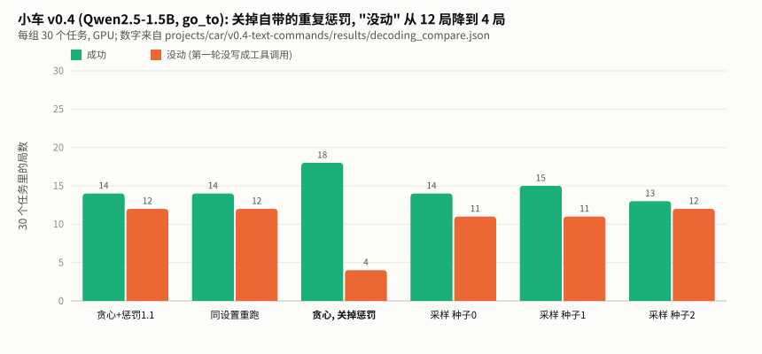

| 解码设置 | 成功 | 没动 (格式错) |
|---|---|---|
| 贪心 + 自带重复惩罚 1.1 (最初公开的数字) | 14/30 | 12 |
| 同样设置重跑 | 14/30, 30 局逐局一致 | 12 |
| **贪心, 关掉重复惩罚** | **18/30** | **4** |
| 采样 (Qwen 自带设置), 种子 0 / 1 / 2 | 14 / 15 / 13 | 11 / 11 / 12 |

关掉重复惩罚后, 8 局从 "没动" 变成动了 (4 局成功), 没有一局变差; 这 8 局的模型回复从普通文字 `"go_to target:red_cup"` 变成了带格式的工具调用, 和 15.2 节的机制对得上。要注意证据的分量: 第一轮回复只取决于指令文字, 30 个任务是 9 种 "句式 × 目标" 轮流出现, 这 8 局只对应 2 条不同的指令。

采样设置下成功率和贪心差不多 (13~15): 单看一局, 采样会改变它往哪边走; 合起来看, 成功率变化不大。

**结论**: 用 transformers 跑工具调用, 显式写上 `repetition_penalty=1.0`。剩下 4 局 "没动" 靠调解码参数堵不完, 这是 [structured-output](../structured-output/TUTORIAL.md) 单元要解决的。

### 15.4 推理服务项目

[推理服务](../../../projects/serving/README.md) 项目里的采样器, 就是第 11 节表格右边那一列: 一批请求、每个请求自己的参数和随机种子。写那个项目时, 这一节补上实测。

---

# 第二部分 · 延伸专题

## 16. 专题 A · 三家框架的执行顺序

### 16.1 读源码得到的顺序

第 2.5 节手算过: 同样两个参数, 换个顺序, 结果就变了。三家主流框架的顺序 (2026-10-29 读的源码):

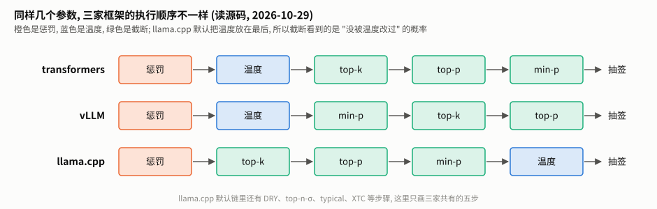

| 框架 | 顺序 | 出处 |
|---|---|---|
| transformers | 重复惩罚 → 温度 → top-k → top-p → min-p | `generation/utils.py` 的 `_get_logits_processor` |
| vLLM | 惩罚 → (贪心直接取最大) → 温度 → min-p → top-k / top-p | `vllm/v1/sample/sampler.py` |
| llama.cpp | 惩罚 → DRY → top-n-σ → top-k → typical → top-p → min-p → XTC → **温度** | `common/common.h` 的默认 `samplers` 列表 |

llama.cpp 把温度放在**最后**: 截断看到的是没被温度改过的概率, 温度只影响 "留下来的候选之间怎么分"。这和 min-p 论文推荐的 "温度最后" 一致: 温度再高, 也不会把被划掉的候选放回来。

`sampling.py` 的 `ORDERS` 和 `process_order` 只改顺序, 每一步本身的写法完全相同, 用来单独看 "顺序" 的影响:

```python
ORDERS = {
    "transformers": ["rep", "temp", "k", "p", "minp"],
    "vllm": ["rep", "temp", "minp", "k", "p"],
    "llama.cpp": ["rep", "k", "p", "minp", "temp"],
}
```

### 16.2 实测: 差多少

ToyLM, 语料里随机 2000 个上下文, 四组参数, 和 transformers 的顺序比 (`toy_more.py` 的 G 部分)。**总变差** (total variation distance) 衡量两个分布差多少: 每个候选的概率差取绝对值加起来再除以 2, 0 是完全一样, 1 是完全不重叠。

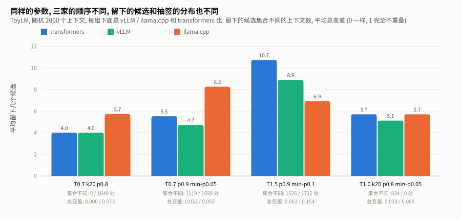

| 参数 | 平均留下 (transformers / vLLM / llama.cpp) | 候选集合和 transformers 不同的上下文 (vLLM / llama.cpp) | 平均总变差 (vLLM / llama.cpp) |
|---|---|---|---|
| 温度 0.7, top-k 20, top-p 0.8 | 4.0 / 4.0 / 5.7 | 0 / 1640 | 0.000 / 0.073 |
| 温度 0.7, top-p 0.9, min-p 0.05 | 5.5 / 4.7 / 8.3 | 1119 / 1699 | 0.032 / 0.053 |
| 温度 1.5, top-p 0.9, min-p 0.1 | 10.7 / 8.9 / 6.9 | 1526 / 1712 | 0.053 / 0.154 |
| 温度 1.0, top-k 20, top-p 0.8, min-p 0.05 | 5.7 / 5.1 / 5.7 | 834 / 0 | 0.033 / 0.000 |

能读出:

1. **第一行 (Qwen2.5 自带的采样设置)**: vLLM 和 transformers 完全一样 (没有 min-p, 剩下几步顺序相同); llama.cpp 在 2000 个上下文里有 1640 个留下的候选不同, 平均多留 1.7 个。温度 0.7 < 1 会让分布变尖, transformers 先变尖再 top-p, 凑够 0.8 需要的候选少; llama.cpp 先 top-p 再变尖, 用的是没变尖的概率, 要多留几个。
2. **温度 > 1 时方向反过来** (第三行): 温度 1.5 让分布变平, transformers 先变平再截断, 留下 10.7 个; llama.cpp 先截断, 只留 6.9 个。
3. **最后一行**: 温度 1.0 等于不做温度, llama.cpp 的其余顺序和 transformers 相同, 结果一模一样; vLLM 把 min-p 放在 top-k / top-p 之前, 仍有差别。

总变差 0.05~0.15 意味着什么? 大致是 "每抽 100 次, 有 5~15 次会因为框架不同而落在不同的候选上"。对闲聊无所谓, 对 "格式一个不差" 的输出要小心: **换框架时, 同一组参数并不是同一个解码设置**。

### 16.3 不在三家共有部分里的步骤

llama.cpp 的默认链里还有几种本单元没实现的步骤, 默认都是关的或者无效的:

- **DRY** (Don't Repeat Yourself): 一种专门针对 "重复一长段" 的惩罚, 重复得越长罚得越重 (指数增长), 默认关 (`dry_multiplier = 0`)。
- **top-n-σ**: 只留 "分数比最高分低不超过 n 个标准差" 的候选, 默认关。
- **typical**: 按 "这个候选的意外程度和平均意外程度差多少" 截断, 默认关 (`typ_p = 1.0`)。
- **XTC** (Exclude Top Choices): 以一定概率**去掉**最可能的几个, 逼模型写得更有新意, 默认关。

它们的存在说明: 截断和惩罚还有很多设计空间, 本单元的五步只是三家共有的那部分。

---

## 17. 专题 B · 真实小模型上的重复惩罚

### 17.1 实验设计

前面在 ToyLM 上看到: 重复惩罚只分 "说过 / 没说过"、罚提示词、能翻转排名。在真实的小模型上会怎样? `real_model.py` 用 chat-template 单元的通用小助手 (系统提示 + 查天气、算数、查资料三个工具的说明), 问 12 个问题: 6 个该调工具 (天气、算数、查资料各两个), 6 个不该 (打招呼、自我介绍、翻译、写诗、编程问题、1 加 1)。全部在 CPU 上:

| 模型 | 精度 | 内存 | 时间 |
|---|---|---|---|
| Qwen2.5-0.5B-Instruct | fp32 | 约 2 GB | 几分钟 |
| Qwen2.5-1.5B-Instruct | bf16 | 约 3 GB | 十几分钟 |

每个问题:

1. 贪心写出回复两次: 关掉重复惩罚, 和模型自带的 1.1。看回复变没变、第一个 token 变没变;
2. 在 "关掉惩罚" 的回复上逐位置算: 用 Qwen 自带的采样设置 (惩罚 1.1 → 温度 0.7 → top-k 20 → top-p 0.8) 时, 这一步仍然抽中同一个 token 的概率 `p_keep`。整条回复在采样下和贪心一字不差的概率 = 各位置 `p_keep` 的乘积。这是精确计算, 不是抽样统计。

### 17.2 结果

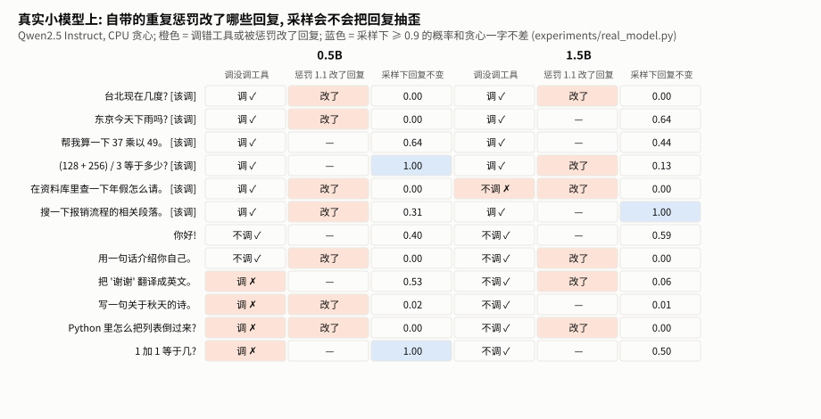

| | 0.5B (fp32) | 1.5B (bf16) |
|---|---|---|
| 该不该调工具判断对了 (关掉惩罚) | 8 / 12 | 11 / 12 |
| 同上, 惩罚 1.1 | 8 / 12 | 10 / 12 |
| 惩罚 1.1 改变了贪心回复 | **7 / 12** | **6 / 12** |
| 其中第一个 token 就变了 | 0 | 3 |
| 采样下回复和贪心一字不差的概率 ≥ 0.9 | 2 / 12 | 1 / 12 |
| 同上 < 0.1 | 6 / 12 | 6 / 12 |

几个具体的例子 (关掉惩罚 → 惩罚 1.1):

| 模型 | 问题 | 关掉惩罚 | 惩罚 1.1 |
|---|---|---|---|
| 0.5B | 台北现在几度? | `{"city": "台北", "unit": "fahrenheit"}` | `{"city": "台北"}` |
| 0.5B | 搜一下报销流程的相关段落。 | `{"query": "报销流程", "top_k": 3}` | `{"query": "报销流程", "top_k": 1}` |
| 0.5B | 写一句关于秋天的诗。 | 调计算器, `"expression": "3*(4+5)"` | 调计算器, `"expression": "秋风起，落叶飘，丰收喜气盈门。"` |
| 1.5B | (128 + 256) / 3 等于多少? | 直接写 `<tool_call>` (0.47) | 第一个 token 换成 "为了" (0.54), 先写一段话再调工具 |
| 1.5B | Python 里怎么把列表倒过来? | 第一个 token "在" (0.38) | "在" 被压到 0.09, 换成 "要" |

### 17.3 读出什么

1. **惩罚改的主要是工具调用里的 JSON。** 0.5B 有 7 条回复被改, 第一个 token 一条都没变 (`<tool_call>` 的把握在 0.55~0.99, 压不下去), 变的是后面的参数: `"unit"` 没了、`"top_k"` 从 3 变成 1。这些都是 "提示词里说过" 的 token: 工具说明里写过 `unit`、`top_k`、数字 3 (示例 `3*(4+5)`), 惩罚把它们一起压低了。改得对不对说不准 (台北用华氏度本来就怪), 但**参数是被一个和语义无关的规则改的**。
2. **1.5B 在开头犹豫, 惩罚就翻掉开头。** 1.5B 的 3 个首 token 变化都发生在第一名不到 0.5 的问题上 (0.47、0.38、0.25)。"(128 + 256) / 3" 那条, `<tool_call>` 是提示词里说过的, 被压到 0.15, 没说过的 "为了" 升到第一, 模型先写一段话: 该不该调工具的判断从 11 对降到 10 对。这和第 2.4 节手算的机制完全一样。
3. **采样下, 回复几乎总会变。** Qwen 自带的采样设置下, 两个模型都只有一两个问题的回复大概率 (≥ 0.9) 和贪心一样; 一半问题低于 0.1。原因之一是惩罚: 采样设置里同样带着 1.1 的惩罚, 它能把 JSON 里 "说过" 的 token 压出 top-p 0.8 的范围, 那一步的 `p_keep` 就直接是 0 (比如 0.5B 写天气参数时, 原始概率 0.57 的 `",` 在采样设置下 `p_keep` 是 0)。惩罚和温度、截断各占多少, 留作专题练习 2。第 10.2 节说 "贪心只代表最可能的一种", 这里就是量化的证据。
4. **0.5B 的问题主要不在解码。** 它在 6 个不该调工具的问题里有 4 个也调了 (把 "谢谢" 翻译成英文也去查北京天气), 关不关惩罚都一样。解码只能在模型给的分数里挑, 分数本身错了, 换什么挑法都救不回来。

结论和第 7.3 节一致: **需要格式一个不差的时候, 先关掉重复惩罚**。

---

## 18. 专题 C · 贪心也不完全确定

### 18.1 两条计算路径

生成时, 框架用 **KV 缓存** 逐步算: 每一步只算新 token, 前面的中间结果存起来复用 (原理在 LLM 领域的 kv-cache 单元)。也可以把 "提示 + 回复" 整段一次算完。数学上两者完全相同; 但浮点数的加法不满足结合律 ((a + b) + c 和 a + (b + c) 可能差最后一位), 两条路径的计算顺序不同, 结果可能差一点点。

`real_model.py` 在每个问题上把两条路径的分数逐位置比较:

| 模型 | 精度 | 比较的位置 | 排第一的 token 不同 | 分数最大差 |
|---|---|---|---|---|
| 0.5B | fp32 | 301 | 0 | 0.0001 |
| 1.5B | bf16 | 284 | **1** | 0.94 |

1.5B 用 bf16, 两条路径的分数最多差 0.94, 在 284 个位置里有 1 个排第一的 token 不同 (在 "用一句话介绍你自己" 的回复里, 这条回复好几个位置的第一名都不到 0.4)。0.5B 用 fp32, 最多只差 0.0001, 一个都没翻。这里的 "不同" 只是两种算法给出的分数不同; 实际生成走的是逐步算那条路, 所以上面的回复不受影响。但它说明: **"同样的贪心" 在两条计算路径下, 可以给出不同的答案**。

### 18.2 精度

同一个 0.5B 模型, 换成 bf16 (16 位浮点, 有效数字比 fp32 少很多) 再贪心写一遍 (`real_model.py --precision`): 12 个问题里 **1 个回复不同**:

| 精度 | "用一句话介绍你自己" 的回复 |
|---|---|
| fp32 | 我是一个能够提供**实时天气信息和进行简单算术计算**的助手。 |
| bf16 | 我是一个能够提供**天气查询和计算算术表达式**的助手。 |

分岔在第 5 个 token: fp32 选 "实时", 它在 fp32 下的概率只有 0.49, 模型本来就在几个说法之间犹豫。精度带来的一点误差就足以让名次交换, 之后整段回复都不一样了。其余 11 个问题, 第一名都领先得比较多, bf16 和 fp32 一字不差。

### 18.3 这意味着什么

1. **同一台机器、同一条路径、同一个精度, 贪心是稳定的**: 第 15.3 节的小车评测重跑一遍, 30 局逐局一致。
2. **换了任何一样** (批大小、精度、硬件、框架版本、是否用 KV 缓存), 两个分数接近的位置就可能换名次, 之后整段都不同。所以 "贪心可复现" 只在 "什么都不变" 时成立。
3. 第一名和第二名差距越小, 越容易翻。专题 B 里 `p_keep` 很低的位置, 往往也是这种位置。

想做到 "换了批大小也一字不差", 需要专门设计的 "批不变" 计算 (每个算子的累加顺序固定, 不随批大小变化)。DeepSeek 2026 年开源的推理框架 DeepInfer 把它列为一项功能 (见 [前沿雷达](../../frontier/radar.md)); 原理放在 LLM 领域的 batch-invariance 单元讲。

---

## 19. 专题 D · 参数速查: 同一个旋钮, 各家叫什么、默认多少

| 旋钮 | transformers (`generate`) | vLLM (`SamplingParams`) | llama.cpp (`llama-cli` / `llama-server`) | OpenAI 接口 |
|---|---|---|---|---|
| 贪心 / 采样 | `do_sample=False` / `True` | `temperature=0` 就是贪心 | `--temp 0` (≤ 0 就是贪心) | `temperature=0` (接近贪心) |
| 温度 | `temperature` | `temperature` | `--temp`, 默认 **0.8** | `temperature` |
| top-k | `top_k`, 默认 50 (只在采样时生效) | `top_k`, 默认关 | `--top-k`, 默认 **40** | 无 |
| top-p | `top_p` | `top_p` | `--top-p`, 默认 **0.95** | `top_p` |
| min-p | `min_p` | `min_p` | `--min-p`, 默认 **0.05** | 无 |
| 重复惩罚 (乘除法) | `repetition_penalty`, 看提示词 | `repetition_penalty`, 看提示词 | `--repeat-penalty`, 默认 1.0 (关), 只看最近 `--repeat-last-n` 64 个 | 无 |
| 出现 / 频率惩罚 (减法) | 无 (有 `no_repeat_ngram_size`) | `presence_penalty`、`frequency_penalty`, 只看生成的 | `--presence-penalty`、`--frequency-penalty` | `presence_penalty`、`frequency_penalty` |
| 停止字符串 | `stop_strings` (要传 tokenizer), 输出里保留 | `stop`, 默认从输出里去掉 | `--reverse-prompt` / 接口的 `stop` | `stop` |
| 模型自带的 `generation_config.json` | **生效** (第 8.3 节) | **默认生效** (`generation_config="auto"`; `--generation-config vllm` 关掉) | 不读 (GGUF 文件里没有这份配置) | — |

llama.cpp 的默认值来自 `common/common.h` 的 `common_params_sampling` (2026-10-29); vLLM 的 `generation_config` 默认值来自 `vllm/config/model.py`。

两条最常踩的:

1. **llama.cpp 默认是采样** (温度 0.8), 不是贪心。拿它做评测要显式 `--temp 0`。
2. **transformers 和 vLLM 都会读模型自带的配置**。Qwen2.5 的配置里有重复惩罚 1.1, 不传参数时它就在。专题 B 和第 15 节都说明, 对工具调用来说它不一定是好事。

---

## 20. 延伸专题练习

1. **(专题 A)** 在 `sampling.py` 里给 `ORDERS` 加一个 "温度最后的 transformers": 惩罚 → top-k → top-p → min-p → 温度。用 `toy_more.py` G 的方法量一量它和 llama.cpp 差多少, 解释为什么。

<details>
<summary>参考答案</summary>

加一行 `"transformers-temp-last": ["rep", "k", "p", "minp", "temp"]`。它和 llama.cpp 的顺序完全相同 (本单元只实现了三家共有的五步), 所以候选集合不同的上下文是 0, 总变差是 0。这个练习说明: 专题 A 测到的差别全部来自 "温度放在截断之前还是之后", top-k / top-p / min-p 之间的先后在这几组参数下影响小得多 (只有 vLLM 把 min-p 提前时才有差别, 见 16.2 节最后一行)。
</details>

2. **(专题 B)** `real_model.py` 的 `p_keep` 把 "惩罚" 和 "温度 + 截断" 混在一起算。改一改, 分别算 "只有惩罚 1.1 + 贪心" 和 "只有温度 0.7 + top-k 20 + top-p 0.8" 两种情况下回复不变的概率, 看看哪一个对回复的影响更大。

<details>
<summary>参考答案</summary>

"只有惩罚 + 贪心" 不涉及随机性, 回复要么变要么不变, 就是 17.2 节表里 "惩罚 1.1 改了回复" 那一列。"只有温度 + 截断" 把 `S.process(x, prev, do_sample=True, **QWEN_SAMPLING)` 换成 `S.process(x, prev, do_sample=True, rep=1.0, temp=0.7, k=20, p=0.8)` 即可。可以预期: 温度 0.7 + top-p 0.8 会把很多 "第一名 0.9 以上" 的位置截成只剩一个候选 (`p_keep = 1`), 而惩罚能把 JSON 里那些 "说过" 的 token 压出 top-p 的范围 (`p_keep = 0`)。专题 B 里 `p_keep = 0` 的位置有多少是被惩罚压出来的, 跑一下就知道; 本单元没有替你跑, 这正是练习的目的。
</details>

3. **(专题 C)** 为什么 "第一名和第二名差距越小越容易翻"? 用 bf16 的精度粗略估算: logits 在 20 左右时, bf16 能分辨的最小差别大约是多少?

<details>
<summary>参考答案</summary>

计算误差会让每个分数偏一点点; 两个分数的差距小于这个误差时, 谁大谁小就可能颠倒。bf16 有 8 位有效二进制位 (7 位尾数 + 隐含的 1), 在 16 到 32 之间相邻两个能表示的数相差 2^4 × 2^-7 = 0.125。也就是说, logits 在 20 左右时, 差距小于约 0.1 的两个候选, bf16 可能根本分不清。0.1 的 logit 差距对应概率比 e^0.1 ≈ 1.1, 比如 0.52 对 0.47, 正是 18.2 节那种 "犹豫" 的位置。fp32 有 24 位有效位, 同样范围里的间隔约 0.000002, 所以 fp32 下两条路径几乎不翻 (18.1 节 0.5B 的 0 次)。
</details>

4. **(专题 D)** 你要把一个在 transformers 上调好的工具调用应用搬到 llama.cpp 上。列出至少四个要检查的解码设置。

<details>
<summary>参考答案</summary>

① 温度: llama.cpp 默认 0.8 采样, transformers 上如果是贪心, 要显式 `--temp 0`; ② top-k / top-p / min-p 的默认值不同 (40 / 0.95 / 0.05), 而且温度放在最后, 同样的参数留下的候选不同 (专题 A); ③ 重复惩罚: transformers 可能从 `generation_config.json` 继承了 1.1 且看提示词, llama.cpp 默认关、开了也只看最近 64 个, 行为不同; ④ 停止条件: 停止 token 是否一致 (GGUF 里的 eos 设置)、停止字符串是否保留在输出里; ⑤ 对话模板: GGUF 里带的模板是否和 Hugging Face 上的一致 (见 [chat-template](../chat-template/TUTORIAL.md))。搬完之后用同一批测试问题对比输出, 而不是只看参数对不对。
</details>

---

*上一单元: [chat-template](../chat-template/TUTORIAL.md); 下一单元: [structured-output 约束解码](../structured-output/TUTORIAL.md)。*
