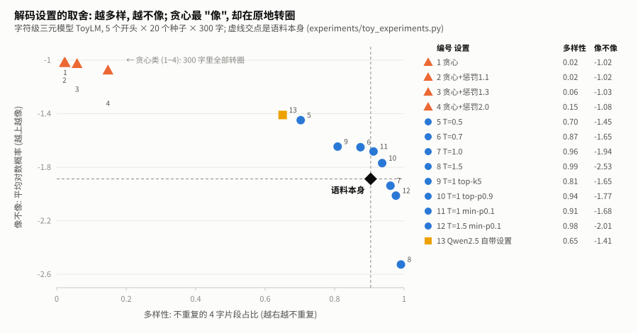
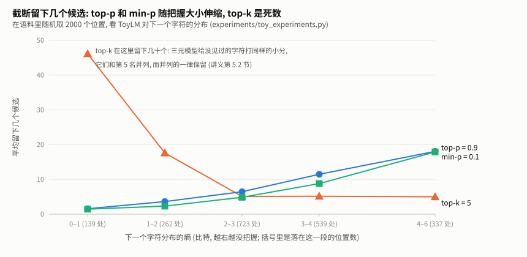

# 解码与采样讲义 — 从一串分数里挑出下一个 token

> 知识库 · 大语言模型 · 第 6 单元。所有数字都在作者的笔记本上实测, 命令和结果文件见每节末尾。
> 一句话: **模型每一步只给出 "每个 token 有多合适" 的分数; 挑哪一个, 是解码说了算。** 同一个模型, 解码设置不同, 写出来的东西可以从原地转圈变成胡言乱语。

## 目录

- [0. 阅读指南](#0-阅读指南)
- [1. 问题: 一串分数, 挑一个](#1-问题-一串分数-挑一个)
- [2. 贪心: 最省事, 也最容易转圈](#2-贪心-最省事-也最容易转圈)
- [3. 采样与温度: 多样性和 "像不像" 的取舍](#3-采样与温度-多样性和-像不像-的取舍)
- [4. 截断: top-k、top-p、min-p](#4-截断-top-ktop-pmin-p)
- [5. 重复惩罚: 看起来对症, 其实很脆](#5-重复惩罚-看起来对症-其实很脆)
- [6. 完整的流水线: 顺序、停止条件, 以及一个坑](#6-完整的流水线-顺序停止条件-以及一个坑)
- [7. 束搜索: 总分更高, 照样转圈](#7-束搜索-总分更高-照样转圈)
- [8. 评测为什么用贪心, 以及贪心不保证什么](#8-评测为什么用贪心-以及贪心不保证什么)
- [9. 练习](#9-练习)
- [10. 延伸资源](#10-延伸资源)

---

## 0. 阅读指南

### 0.1 这个单元在仓库里的位置

| | |
|---|---|
| 领域 | 知识库 · 大语言模型 ([目录](../README.md)) |
| 用到它的地方 | 小车 [v0.4 听懂文字](../../../projects/car/v0.4-text-commands/TUTORIAL.md): 评测用的是贪心解码, 工具调用的 JSON 要一个字都不能错; 项目 [推理服务](../../../projects/serving/README.md): 推理引擎里的采样器 |
| 相邻单元 | 上游 [minigpt 第 11 节](../minigpt/TUTORIAL.md#11-生成-一次一个字符) (温度和 top-k 的基础, 本单元从那里接着讲)、[chat-template](../chat-template/TUTORIAL.md); 下游 structured-output (约束解码)、batch-invariance (确定性推理) |

### 0.2 需要先知道什么

1. **模型是 "接着往下写" 的**, 每次给出下一个 token 的分数 (logits)。读 [minigpt 讲义第 11.1 节](../minigpt/TUTORIAL.md#111-自回归循环)。
2. **softmax 把分数变成概率**, 温度是 "分数先除以 T"。读 [minigpt 讲义第 11.2 节](../minigpt/TUTORIAL.md#112-temperature-和-top-k-实测对比)。

### 0.3 文件和命令

```
decoding/
├── sampling.py          解码的每一步: 重复惩罚、温度、top-k、top-p、min-p、贪心、采样 (只用标准库)
├── generate.py          完整的生成循环和三种停止条件
├── beam.py              束搜索 (练习 3 的参考答案)
├── toy_lm.py            本单元的实验对象: 从莎士比亚语料数出来的字符级三元模型
├── experiments/
│   ├── toy_experiments.py         第 2~5 节的数字 (只用标准库, 约 10 秒)
│   ├── check_against_hf.py        和 transformers 逐步核对 (需要 transformers, 不需要模型)
│   ├── greedy_still_penalizes.py  第 6.3 节的坑 (需要 transformers 和几百字节的配置文件)
│   └── results/
├── figures/             配图与生成脚本
└── exercises/           三道练习 + 验收测试
```

| 想做什么 | 需要什么 | 命令 |
|---|---|---|
| 看每一步把概率改成什么样、做练习、重跑第 2~5 节 | 只要 Python 3.8+ | `python sampling.py`; `python experiments/toy_experiments.py`; `cd exercises && python -m pytest test_ex1.py -q` |
| 和 transformers 核对 (第 6 节) | `transformers` (见仓库 `requirements.txt`) | `python experiments/check_against_hf.py` |

---

## 1. 问题: 一串分数, 挑一个

模型每走一步, 给词表里**每一个** token 打一个分, 这串分数叫 **logits**。分数越高, 模型越觉得它适合放在下一个位置。接下来要做的事只有一件: 从这几万个候选里**挑一个**, 接到后面, 再问下一步。

挑法有很多, 它们统称**解码** (decoding)。为了把每种挑法看清楚, 本单元用一个最简单的 "语言模型" 做实验: `toy_lm.py` 数一数莎士比亚语料里 "前两个字符是 th 时, 下一个字符是什么" 各出现了多少次, 就能给 65 个字符打分。它不用训练、不用显卡, 一秒内建好:

```python
lm = ToyLM.from_corpus()
probs = softmax(lm.logits("th"))     # 前两个字符是 "th" 时, 下一个字符的概率
# 'e' 0.46, ' ' 0.14, 'a' 0.11, 'i' 0.10, 'o' 0.08 ...   (the、with 后面的空格、that、this、those ...)
```

真实的大模型用神经网络算 logits, 但**挑的方法完全一样**。所以先在这个小模型上把每种挑法的脾气摸清楚, 第 8 节再说它们在真实模型和小车上意味着什么。

`python sampling.py` 用一个 6 个 token 的小例子, 打印每一步把概率改成了什么样:

```
原始          走:0.44  转:0.27  停:0.16  看:0.10  飞:0.02  跳:0.01
温度 0.5      走:0.64  转:0.24  停:0.09  看:0.03  飞:0.00  跳:0.00
温度 2.0      走:0.31  转:0.24  停:0.19  看:0.15  飞:0.07  跳:0.04
top-k 3       走:0.51  转:0.31  停:0.19  看:0.00  飞:0.00  跳:0.00
贪心选中       走
```

---

## 2. 贪心: 最省事, 也最容易转圈

**贪心** (greedy): 每一步都选分数最高的那个。不用随机数, 同样的输入永远得到同样的输出。

让 ToyLM 用贪心从 5 个不同的开头各写 300 个字符 (`toy_experiments.py` 的 A 部分):

| 开头 | 贪心写出来的 |
|---|---|
| `ROMEO:\n` | `I withe the the the the the the the the …` |
| `JULIET:\nO ` | `my the the the the the the the the the t…` |
| `MENENIUS:\nI ` | `withe the the the the the the the the th…` |

**5 个开头全部在第 2~4 个字符就掉进 "the " 的循环, 再也出不来。**

原因很直接: ToyLM 只看最后两个字符。写到 "th" 时最可能的是 "e"; 写到 "he" 时最可能的是空格; 写到 "e " 时最可能的是 "t"; 写到 " t" 时最可能的是 "h", 又回到了 "th"。只要某一步回到了见过的状态, 贪心就会沿着同一条路永远走下去。

真实的大模型看得远得多, 但同样会转圈: [minigpt 第 11.2 节](../minigpt/TUTORIAL.md#112-temperature-和-top-k-实测对比) 里训练好的小 GPT 用接近贪心的温度, 也写出了 "the the the"。

---

## 3. 采样与温度: 多样性和 "像不像" 的取舍

**采样** (sampling): 不总是选最高的, 而是按概率抽签。概率 0.46 的 "e" 有 46% 的机会被抽中。**温度** T 先把所有分数除以 T: T < 1 拉大差距 (更像贪心), T > 1 缩小差距 (更随机)。

怎么衡量 "写得好不好"? 用两个能自动算的指标:

- **多样性**: 300 个字符里, 不重复的 4 字片段占多少。转圈的文字很低, 正常文字很高;
- **像不像**: 用 ToyLM 自己给每个字符打的平均对数概率 (log 概率, 都是负数, 越接近 0 越 "像模型心中的语料")。

每种设置跑 5 个开头 × 20 个种子 (贪心不用种子, 只跑 5 次), 每次 300 个字符, 再拿语料里随机 100 段真实文字做参照:



| 设置 | 多样性 | 像不像 | 300 字里转圈的比例 |
|---|---|---|---|
| 贪心 | 0.02 | -1.02 | 100% |
| 温度 0.5 | 0.70 | -1.45 | 0% |
| 温度 0.7 | 0.87 | -1.65 | 0% |
| 温度 1.0 | 0.96 | -1.94 | 0% |
| 温度 1.5 | 0.99 | -2.53 | 0% |
| **语料本身** | **0.90** | **-1.89** | — |

能读出三件事:

1. **贪心最 "像", 却最没用。** 它每一步都选最可能的, 所以平均对数概率最高 (-1.02), 可写出来的是 "the the the"。**"每一步最可能" 不等于 "整段最像人写的"**: 人写的文字本来就不是每一步都挑最常见的字。
2. **温度 1.0 最接近语料本身** (-1.94 对 -1.89)。这不是巧合: T = 1 就是按模型自己学到的分布抽签, 抽出来的东西自然和它学的语料一样 "意外"。
3. **温度低了太保守, 高了胡言乱语。** 温度 1.5 时多样性 0.99, 但对数概率掉到 -2.53, 写出来已经不像单词了。

---

## 4. 截断: top-k、top-p、min-p

温度高一点能避免转圈, 但会让概率很低的 "离谱" 候选也有机会被抽中。**截断**的思路是: 抽签之前, 先把不靠谱的候选划掉 (分数设成 -∞, softmax 之后概率为 0), 剩下的重新归一化。三种划法:

| 方法 | 规则 | 出处 |
|---|---|---|
| **top-k** | 只留分数最高的 k 个 | — |
| **top-p** (核采样) | 按概率从高到低累加, 留下刚好凑够 p 的最少几个 | Holtzman et al. 2019 |
| **min-p** | 概率低于 "最高概率 × p" 的划掉 | Nguyen et al. 2024 |

### 4.1 它们留下几个候选

关键区别在于: 模型**有把握**时 (分布很尖, 一个候选占了大头), 应该只留很少几个; **没把握**时 (分布很平), 应该多留一些。用 "熵" 衡量有没有把握 (熵越低越有把握, 0 比特就是百分之百确定)。在语料里随机取 2000 个位置, 看三种方法各留下多少:



| 熵 (比特) | top-k = 5 | top-p = 0.9 | min-p = 0.1 |
|---|---|---|---|
| 0–1 (很有把握) | 46.1 | 1.6 | 1.4 |
| 1–2 | 17.6 | 3.6 | 2.3 |
| 2–3 | 5.1 | 6.5 | 4.9 |
| 3–6 (没把握) | 5.1 | 14.0 | 12.3 |

**top-p 和 min-p 随把握大小伸缩**: 有把握时只留一两个, 没把握时留十几个。**top-k 是个死数**: 没把握时它只留 5 个, 可能把合理的候选划掉了。

### 4.2 一个意外: 有把握时 top-k 反而留下 46 个

表里第一行的 46.1 不是笔误。ToyLM 对没在语料里见过的组合, 统一给一个很小的平滑概率 (`toy_lm.py` 的 α), 所以很多字符的分数**完全相同**。模型很有把握时, 见过的字符不到 5 个, 第 5 名就落在这堆同分的字符里; 而 top-k 的规则 (transformers 也是这样) 是 "和第 k 名同分的一律保留", 于是几十个字符都留下了。

真实大模型的 logits 是连续的实数, 这么多同分的情况很少见; 但低精度 (比如 bf16) 下有没有, 本单元**没有数据**。这个例子说明的是: **截断规则在边界上怎么处理并列, 会实实在在地改变结果**, 第 6.2 节和 transformers 核对时还会遇到它。

### 4.3 截断之后的取舍

回到第 3 节的图: 温度 1.0 加上三种截断, 多样性都略降、"像不像" 都上升, 都没有转圈。温度 1.5 加 min-p 0.1, 多样性 0.98、对数概率 -2.01, 比单纯温度 1.5 (-2.53) 像得多: 温度放开了多样性, min-p 划掉了离谱的候选。这正是 min-p 论文主张的用法。

---

## 5. 重复惩罚: 看起来对症, 其实很脆

既然贪心会转圈, 那就惩罚说过的 token? 这就是**重复惩罚** (repetition penalty, 出自 CTRL 论文, Keskar et al. 2019), transformers 的写法:

```python
for i in set(prev_ids):                       # 说过的每个 token, 出现几次都只罚一次
    z = logits[i]
    logits[i] = z / penalty if z > 0 else z * penalty
```

penalty > 1 时, 正分变小、负分变得更负, 总之都往 "不像" 的方向推。

### 5.1 它救不了贪心的转圈

| 设置 | 多样性 | 300 字里转圈的比例 |
|---|---|---|
| 贪心 | 0.02 | 100% |
| 贪心 + 重复惩罚 1.1 | 0.02 | 100% |
| 贪心 + 重复惩罚 1.3 | 0.06 | 100% |
| 贪心 + 重复惩罚 2.0 | 0.15 | 100% |

惩罚加到 2.0 还是全部转圈。原因: 罚的是 "说过的 token", 而写了几十个字符之后, 常用字符**全都说过了**, 它们一起被罚, 彼此的排名没变, 贪心还是选同一个。重复惩罚只能区分 "说过" 和 "没说过", 区分不了 "刚说过三遍" 和 "很久以前说过一次"。

### 5.2 它取决于一个本来无关紧要的数

softmax 有个性质: 所有分数**同时加上同一个常数**, 概率一点都不变。所以模型的 logits 整体偏高还是偏低, 本来无关紧要。但重复惩罚按正负号区别对待, 它在乎:

| 所有分数整体平移 | "th" 之后 "e" 的概率 (惩罚前) | 用 1.3 惩罚 "e" 之后 |
|---|---|---|
| -20 | 0.46 | **0.002** |
| 0 | 0.46 | **0.40** |
| +20 | 0.46 | **0.01** |

**同一个分布、同样 1.3 的惩罚, 效果从 "几乎没影响" 到 "几乎禁止"**, 完全取决于模型的 logits 碰巧落在哪个范围。换一个模型、甚至同一个模型的不同位置, 同样的 penalty 意味着完全不同的力度。

OpenAI 接口里的 frequency / presence penalty 是**从分数里减去**一个数 (按出现次数或是否出现), 减法不受整体平移影响, 没有这个问题。本单元没有实现它们, 留作思考题。

### 5.3 它还罚提示词

transformers 把 "目前所有 token" 都算作说过的, **包括提示词里的**。对聊天来说问题不大; 但 v0.4 小车的提示里有 5 个工具的 JSON 说明 (535 个 token, 见 [chat-template 第 5 节](../chat-template/TUTORIAL.md#5-账本-一次提示里谁占了多少-token)), 引号、括号、`"name"` 这些都已经 "说过" 了, 而模型写工具调用时恰恰要一个不差地写出它们。这对小车的成功率有没有影响, 本单元**没有数据** (第 8.3 节)。

---

## 6. 完整的流水线: 顺序、停止条件, 以及一个坑

### 6.1 顺序

transformers 的 `generate` 每一步按这个顺序处理 logits (读它的源码 `_get_logits_processor` 得到):

```
重复惩罚 → 温度 → top-k → top-p → min-p → (采样: 按概率抽 | 贪心: 取最大)
```

`sampling.py` 的 `process` 照这个顺序实现。顺序有影响: 比如先做温度再做 top-p, 温度会改变概率, 也就改变了 "凑够 p" 要几个 token。

### 6.2 和 transformers 核对

`check_against_hf.py` 随机生成 2000 组打分 (平的、尖的、大量并列的各占一部分), 每一步都和 transformers 对应的处理器比对:

| 步骤 | 完全相同 | 只差在 "并列的 token 留哪个" | 真正不同 |
|---|---|---|---|
| 重复惩罚、温度、top-k、min-p | 2000 / 2000 | 0 | 0 |
| top-p | 1652 / 2000 | 348 | 0 |
| 五步串起来 | 1768 / 2000 | 232 | 0 |

top-p 的那 348 组全部出在 "大量并列" 的打分上: 几个 token 概率一样、只能留一部分时, 留哪几个取决于排序时并列元素的先后, 手写版和 PyTorch 的排序不一样。留下的个数和分数完全相同。又是第 4.2 节那个 "边界上的并列"。

### 6.3 一个坑: 贪心时重复惩罚还在

Qwen2.5-Instruct 发布时带了一份生成配置 `generation_config.json`:

```
do_sample=true, temperature=0.7, top_p=0.8, top_k=20, repetition_penalty=1.1
```

v0.4 的评测调用 `generate(..., do_sample=False)`, 本意是 "贪心, 什么都不加"。`greedy_still_penalizes.py` 读取这份配置, 装到一个随机初始化的迷你模型上 (不下载权重), 拦截 generate 内部用到的处理器:

```
generate(do_sample=False)                          → ['RepetitionPenaltyLogitsProcessor']
generate(do_sample=False, repetition_penalty=1.0)  → []
generate()  (全用模型自带配置)                       → ['RepetitionPenalty…', 'Temperature…', 'TopK…', 'TopP…']
```

`do_sample=False` 只跳过温度、top-k、top-p 这些 "采样用的" 步骤; 重复惩罚不属于采样, **照样执行**。所以 v0.4 已经公开的数字, 准确的说法是 "贪心 + 重复惩罚 1.1"。[v0.4 讲义](../../../projects/car/v0.4-text-commands/TUTORIAL.md) 和 [agent-loop 讲义](../../agent/agent-loop/TUTORIAL.md) 都已经注明。

**教训**: 用 transformers 时, 模型目录里的 `generation_config.json` 会悄悄生效; 想要什么设置, 把每个参数都显式写出来。

### 6.4 什么时候停

`generate.py` 实现三种停止条件, 返回值里说明是哪一种:

| 停止原因 | 什么时候 | 输出里包不包含停止标记 |
|---|---|---|
| `stop_token` | 生成了停止 token, 比如 Qwen 的 `<\|im_end\|>` (它是怎么来的见 [chat-template 第 2.2 节](../chat-template/TUTORIAL.md#22-特殊标记是新增的-token)) | 包含 |
| `stop_string` | 新文字里出现了指定的字符串, 比如 `"\n\n"` | transformers 保留; vLLM 默认替你去掉。两家行为不同, 换框架时要注意 |
| `length` | 写满 `max_new_tokens` 还没停 | — |

评测时一定要记录停止原因: 一个工具调用以 `length` 结束, 往往就是 JSON 写到一半被截断了。

---

## 7. 束搜索: 总分更高, 照样转圈

贪心每一步只留 1 条路。**束搜索** (beam search) 每一步留 B 条 "到目前为止总分最高" 的路 (总分 = 每一步 log 概率之和), 最后挑总分最高的一条。B = 1 就是贪心, B 足够大就是穷举所有可能。它是机器翻译等任务的标准做法。

在 ToyLM 上从 `ROMEO:\n` 写 40 个字符 (`beam.py`, 练习 3 的参考答案):

| 束宽 B | 总分 (越高越好) | 写出来的 |
|---|---|---|
| 1 (贪心) | -41.67 | `I withe the the the the the the the the ` |
| 2 | -40.80 | `That the the the the the the the the the` |
| 4 | -39.79 | `And the the the the the the the the the ` |
| 8 | -39.79 | `And the the the the the the the the the ` |

束越宽, 找到的路总分越高, 但**照样在 "the" 里转圈**。这正是 Holtzman 等人 2019 年那篇论文的观察: 追求 "整段概率最高" 的解码方法 (贪心、束搜索) 写出来的文字反而会退化成重复; 人写的文字概率并不是最高的。他们因此提出了 top-p。

另外, 总分是 log 概率之和, 越长越负, 所以束搜索天然偏爱短的输出; 实际系统常把总分除以长度 (长度归一化)。`beam.py` 为了让练习有唯一答案, 没有做。

---

## 8. 评测为什么用贪心, 以及贪心不保证什么

### 8.1 为什么用贪心

评测要回答 "A 比 B 好吗"。如果每次跑结果都随机变, 一次的差别可能只是运气, 要跑很多次、算置信区间才能下结论 (见 Agent 领域的 agent-eval 单元)。贪心没有随机性, 同样的输入得到同样的输出, 一个设置跑一遍就够, 别人也能复现。

代价是: 贪心测出来的是 "最可能的那一种行为", 不代表用户实际用到的 (产品里常用采样)。

### 8.2 贪心也不保证完全一样

同样的输入、同样的贪心, 在 GPU 上也可能得到不同的结果: 不同的批大小、不同的并行方式会让浮点运算的累加顺序不同, 两个分数非常接近的 token 可能因此交换名次。DeepSeek 今年开源的推理框架 DeepInfer 专门把 "批不变推理" 列为一项功能 (见 [前沿雷达](../../frontier/radar.md))。原理放在 LLM 领域的 batch-invariance 单元讲。

### 8.3 在真实模型和小车上: 还没有数据

下面这些问题要加载真实模型才能回答, **目前没有数据**:

| 问题 | 需要 |
|---|---|
| v0.4 的提示下, 模型写工具调用时每个 token 有多大把握? 哪些位置最容易被采样抽歪? | Qwen2.5-0.5B 或 1.5B 做几十次前向计算 (CPU 可做) |
| 用 Qwen 自带的采样设置跑 v0.4, 成功率比贪心低多少? 换几个种子差多少? | GPU 评测, 每组 30 个任务 |
| 把重复惩罚关掉 (设成 1.0), v0.4 的成功率变不变? | GPU 评测 |

---

## 9. 练习

### 9.1 动手写代码 (三级递进)

| 级别 | 练习 | 验收 |
|---|---|---|
| ① 填空 | `ex1_filters_fill.py`: 补全 top-p、min-p、重复惩罚 | 600 组随机打分上和参考实现逐位相同 |
| ② 接口 | `ex2_generate.py`: 写出带三种停止条件的生成循环 | 和参考实现在 ToyLM 上逐字一致; 停止条件、可复现、惩罚看得到提示词 |
| ③ 白纸 | `ex3_beam_blank.py`: 从规则说明写出束搜索 | 束够宽时等于穷举; 束宽 1 等于贪心; 和参考实现一致 |

```bash
cd library/llm/decoding/exercises
python -m pytest test_ex1.py -q
```

只需要 Python 和 pytest。提示规则: 卡住了可以要提示, 按 "方向 → 哪一行 → 代码" 分级给, 每次只升一级。

### 9.2 思考题

1. 第 5.1 节: 设计一种 "惩罚" 能真正打破贪心的转圈 (提示: 只罚最近几十个 token? 按次数累加?)。在 ToyLM 上实现并用 `toy_experiments.py` 的指标测一测。
2. 第 5.2 节: 实现 OpenAI 式的 presence penalty (说过的 token 分数减去一个常数), 验证它不受整体平移影响。
3. 第 4.1 节的表里, 熵 2–3 比特那一行三种方法留下的个数差不多。为什么恰好在这里交叉?
4. 第 7 节: 束搜索总分随 B 增大而升高, 写出来的却没变好。"总分" 这个目标本身错在哪里?

---

## 10. 延伸资源

- Holtzman et al., [The Curious Case of Neural Text Degeneration](https://arxiv.org/abs/1904.09751) (2019): 为什么追求最高概率会退化, 提出 top-p。
- Nguyen et al., [Turning Up the Heat: Min-p Sampling for Creative and Coherent LLM Outputs](https://arxiv.org/abs/2407.01082) (2024): min-p。
- Keskar et al., [CTRL: A Conditional Transformer Language Model for Controllable Generation](https://arxiv.org/abs/1909.05858) (2019): transformers 里重复惩罚的出处。
- Hugging Face, [Chat templates](https://huggingface.co/docs/transformers/main/en/chat_templating) 与 `generation_config` 的说明: 模型自带的生成配置怎么生效。

---

*下一单元: structured-output 约束解码 (让模型只能写出合法的工具调用)。*
