# miniGPT 讲义 — 从一行字符到会写莎士比亚的模型

> 本讲义配合 [model.py](model.py)、[train.py](train.py)、[config.py](config.py) 阅读。
> 讲义里**所有数字、张量形状和模型输出都是在测量平台 (RTX 5060 Laptop 8GB, 见根目录 README) 实际跑出来的**,
> 不是从别处抄来的示意值。你照着跑, 应该看到同样量级的结果 (随机种子不同, 生成的具体文字会不同)。

---

## 目录

**第一部分 · 读懂这份代码**

0. [阅读指南](#0-阅读指南)
1. [全景: 一次训练到底发生了什么](#1-全景-一次训练到底发生了什么)
2. [数据: 字符怎么变成训练样本](#2-数据-字符怎么变成训练样本)
3. [模型总览: 10 万个参数都在哪](#3-模型总览-10-万个参数都在哪)
4. [Embedding: 把编号变成向量](#4-embedding-把编号变成向量)
5. [注意力: 让每个字符看前文](#5-注意力-让每个字符看前文)
6. [FFN: 每个位置独立地"想一想"](#6-ffn-每个位置独立地想一想)
7. [Block: 残差连接 + Pre-LN](#7-block-残差连接--pre-ln)
8. [输出与损失: loss 的数值意味着什么](#8-输出与损失-loss-的数值意味着什么)
9. [初始化: 起点也有讲究](#9-初始化-起点也有讲究)
10. [训练循环](#10-训练循环)
11. [生成: 一次一个字符](#11-生成-一次一个字符)
12. [规模: 放大模型会怎样](#12-规模-放大模型会怎样)
13. [本项目踩坑记录汇总](#13-本项目踩坑记录汇总)
14. [练习](#14-练习)
15. [延伸学习资源](#15-延伸学习资源)

**第二部分 · 延伸专题** (每个专题配一个 [experiments/](experiments/) 实验脚本)

16. [专题 A · KV Cache: 生成为什么能快 10 倍](#16-专题-a--kv-cache-生成为什么能快-10-倍)
17. [专题 B · 梯度推导: 训练信号从哪来](#17-专题-b--梯度推导-训练信号从哪来)
18. [专题 C · 数值格式: fp32 / fp16 / bf16 与混合精度](#18-专题-c--数值格式-fp32--fp16--bf16-与混合精度)
19. [专题 D · FlashAttention: 不把 S×S 矩阵写进显存](#19-专题-d--flashattention-不把-ss-矩阵写进显存)
20. [专题 E · 显存与算力账本: 8GB 能训多大的模型](#20-专题-e--显存与算力账本-8gb-能训多大的模型)
21. [延伸专题练习](#21-延伸专题练习)

---

## 0. 阅读指南

### 0.1 读完你能回答这些问题

- 一个 GPT 从输入一串字符, 到输出"下一个字符的概率", 中间每一步张量长什么样?
- 为什么注意力要除以 $`\sqrt{d_k}`$? 不除会怎样? (有实测数据)
- 为什么未训练模型的 loss 应该≈4.17, 而不是别的数? 这个数怎么帮你查 bug?
- 训练日志里的 `val_loss 1.92` 到底意味着什么?
- temperature 和 top-k 各自控制什么? 调错了会生成什么样的东西? (有实测对比)
- 这个项目真实踩过的 4 个坑是什么, 为什么当时没人发现?

### 0.2 前置知识

| 需要 | 程度 | 不会怎么办 |
|---|---|---|
| Python | 能读 class、列表推导 | — |
| PyTorch 基础 | 知道 `tensor`、`nn.Linear`、`loss.backward()` | 先看 PyTorch 官方 60 分钟入门 |
| 矩阵乘法 | 知道 (a×b) @ (b×c) = (a×c) | 本讲义遇到会再解释 |
| [A4-modern-small-model](../modern-small-model/TUTORIAL.md) | **不需要** | 本项目自成一体; 想深挖某个组件再去看它 |

### 0.3 怎么读

- **第一遍**: 只读每节开头的「一句话」和「直觉」, 再跑一遍第 1 节的命令。约 30 分钟。
- **第二遍**: 打开代码文件, 跟着「逐行拆解」对照着读, 把「动手验证」里的代码贴进 Python 跑。约 3 小时。
- **第三遍**: 做第 14 节的练习, 先自己想, 再展开答案。

### 0.4 记号约定

全文用这几个字母表示张量的各个维度, 和代码里的变量名一致:

| 记号 | 含义 | nano 配置下的值 |
|---|---|---|
| `B` | batch size, 一次喂给模型几段文本 | 32 |
| `S` | 序列长度, 每段文本几个字符 (代码里也叫 `T`) | ≤ 64 (`block_size`) |
| `C` | 每个字符用多长的向量表示 (`n_embd`, 也叫 d_model) | 64 |
| `H` | 注意力头数 (`n_head`) | 2 |
| `d_k` | 每个头分到的维度 = C / H | 32 |
| `V` | 词表大小 (`vocab_size`) | 65 |

`(B, S, C)` 读作"一个三维张量, 第 0 维长 B, 第 1 维长 S, 第 2 维长 C"。

---

## 1. 全景: 一次训练到底发生了什么

### 1.1 一句话

> GPT 训练 = 给模型看一段文字, 让它在**每一个位置**猜下一个字符, 猜错了就按错的程度调整参数; 重复几千次。

### 1.2 先跑起来

```bash
conda activate roots-ai
cd library/llm/minigpt
python train.py --config nano          # 默认 5000 步, 本机约 30 秒
```

本机实测日志 (节选):

```
iter     0/5000 | train_loss 4.1787 | val_loss 4.1780 | lr 0.00e+00 | 252.1ms/iter
iter   500/5000 | train_loss 2.4178 | val_loss 2.3706 | lr 9.85e-04 | 6.1ms/iter
iter  1000/5000 | train_loss 2.2200 | val_loss 2.1905 | lr 9.27e-04 | 7.3ms/iter
iter  2000/5000 | train_loss 2.0613 | val_loss 2.0174 | lr 7.05e-04 | 5.2ms/iter
iter  3000/5000 | train_loss 1.9128 | val_loss 1.9719 | lr 4.22e-04 | 5.5ms/iter
iter  4500/5000 | train_loss 1.9622 | val_loss 1.9261 | lr 1.23e-04 | 6.1ms/iter
最佳 val_loss: 1.9209
```

第 0 步耗时 252ms 是因为 GPU 第一次运行要编译/加载 kernel, 之后稳定在 5~7ms。

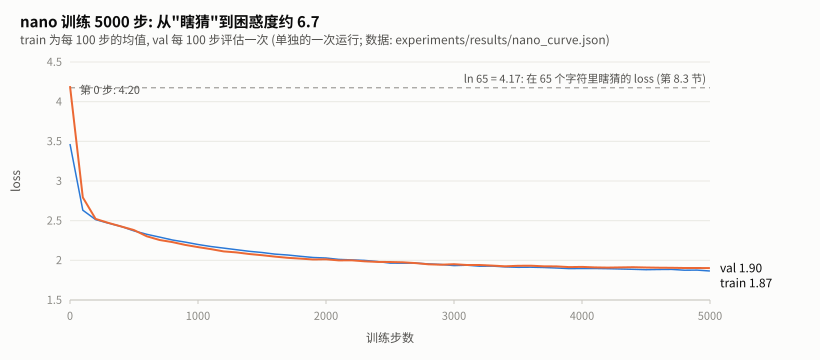

**图 1** 上面的日志画成曲线是这个样子 (这是单独跑的一次, 每 100 步评估一次, 所以数字和日志略有不同: 这次最后的 val_loss 是 1.90)。**怎么读**: 虚线是 $`\ln 65 = 4.17`$, 也就是"在 65 个字符里瞎猜"的 loss; 橙色的 val 曲线正好从 4.20 起步, 说明模型一开始确实是在瞎猜 (第 8.3 节)。前 500 步下降最快, 之后越来越平缓。蓝色的 train 在第 0 步只有约 3.45, 不是因为模型更聪明, 而是它画的是**第 0~99 步的平均值**, 这 100 步里模型已经学到了不少。全程 train 和 val 贴得很近, 说明 nano 这么小的模型在 5000 步内还没有过拟合 (对比第 12.2 节的 micro)。


### 1.3 从乱码到"像莎士比亚"

同一个模型, 训练前后各让它写一段:

**训练前** (参数是随机数):
```
t3ZrjmhfkqkARxLsXltUWHoHcu  exhkyU&aNdkIxAlsvSBUMyccRD$BygX-
```

**训练 2500 步后** (约 15 秒):
```
I of to deant of his me, card the. Sir I my juy percks,
Dath mer for the nam mighter gees,
Which done!

POHENTIO:
I sway to the ponort and in band heare brefully of te Ponter:
```

注意它学会了什么: 单词之间有空格、句子有标点、**全大写的人名后面跟冒号再换行**(剧本格式)、常见词 `the` `of` `Which` 拼对了。它没学会的: 大多数长单词是编的, 句子没有意义。一个只有 10 万参数、只看过字符的模型, 能力就到这里, 第 12 节会看到放大模型后的变化。

### 1.4 全流程图

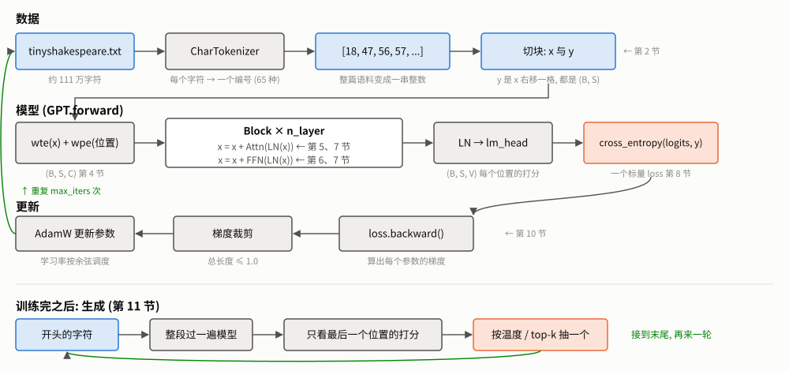

**图 2** 一次训练的全流程。**怎么读**: 分三段从上往下看: **数据** (第 2 节) 把文本变成编号再切成 x、y; **模型** (第 4~8 节) 把 x 变成每个位置的打分, 再和 y 比较得到一个 loss; **更新** (第 10 节) 根据 loss 调整参数, 然后回到开头取下一个 batch (左边的绿色箭头)。最下面一行是训练完以后的生成 (第 11 节): 每生成一个字符, 就把它接到末尾再算一轮。每个方框下面的小字写的是那一步的输出形状或作用, 右侧的"← 第 N 节"告诉你去哪一节看细节。

---

## 2. 数据: 字符怎么变成训练样本

> 数据部分的代码在仓库根目录 [common/text_data.py](../../../common/text_data.py) (与 A4-modern-small-model 共用),
> 本项目的 [data.py](data.py) 只负责组装。

### 2.1 一句话

> 把每个字符换成一个编号, 再切成定长的小段; 每一段的"答案"就是它自己右移一格。

### 2.2 字符级分词: 词表就是"出现过的所有字符"

```python
class CharTokenizer:
    def __init__(self, text: str):
        chars = sorted(set(text))                 # ① 去重 + 排序
        self.vocab_size = len(chars)
        self.char_to_idx = {ch: i for i, ch in enumerate(chars)}   # ② 字符 → 编号
        self.idx_to_char = {i: ch for i, ch in enumerate(chars)}   # ③ 编号 → 字符
```

实测, Tiny Shakespeare 一共只有 **65 种字符**, 排序后是:

```
"\n !$&',-.3:;?ABCDEFGHIJKLMNOPQRSTUVWXYZabcdefghijklmnopqrstuvwxyz"
 ↑ 编号 0 是换行符, 编号 1 是空格, ...
```

所以 `encode("Hi!") = [20, 47, 2]`: `H` 排第 20, `i` 排第 47, `!` 排第 2。

**为什么要 `sorted`?** `set` 的遍历顺序在不同 Python 进程里可能不同。不排序的话, 同一份语料今天建出来 `H`=20, 明天可能 `H`=31, 存下来的模型就对不上了。排序保证**同样的语料永远得到同样的编号**。

**和 BPE 的区别**: 字符级的词表只有 65, 每个字符一个 token, 压缩率最低 (一段话多长, token 就有多少个)。真实 LLM 用 BPE (见 [A1-bpe](../bpe/TUTORIAL.md)), 词表几万到十几万, 一个 token 平均对应 3~4 个英文字符。本项目用字符级, 是为了让词表小到能一眼看完, 把注意力留给模型本身。

### 2.3 训练样本: 答案就是右移一格

语言模型的任务是"根据前文猜下一个字符"。一段长 S+1 的文本可以一次性造出 S 道题:

```
原文 (S+1=9 个字符):  F  i  r  s  t     C  i  t
                      ─────────────────────────
x (输入, 前 8 个):    F  i  r  s  t     C  i
y (答案, 后 8 个):    i  r  s  t     C  i  t
                      ↑
           位置 0 的题: 看到 "F", 猜 "i"
           位置 1 的题: 看到 "Fi", 猜 "r"
           ...
           位置 7 的题: 看到 "First Ci", 猜 "t"
```

**关键**: 位置 1 的题只能看 "Fi", 不能偷看后面的 "rst..."。这个"不许偷看"由第 5 节的**因果掩码**保证。正因为有掩码, 一段文本才能同时当 S 道题来用, 训练效率是"一次只问一道题"的 S 倍。

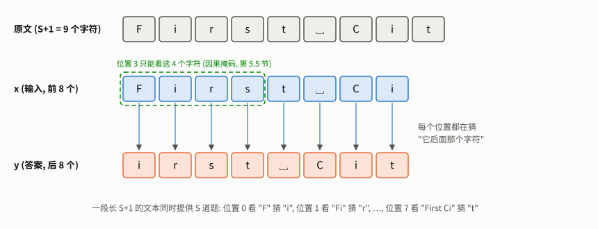

**图 3** **怎么读**: 第一行是原文 9 个字符; x 取前 8 个 (蓝), y 取后 8 个 (橙), 竖箭头把同一列的 x 和 y 连起来: 每一列就是一道题, "看到 x 这一列及其左边的所有字符, 猜 y 这一列"。绿色虚线框标出了位置 3 能看到的范围: 只有 F、i、r、s 四个字符, 它要猜的是 t。


对应代码 ([common/text_data.py](../../../common/text_data.py)):

```python
def __getitem__(self, idx):
    start = idx * self.stride
    x = self.data[start : start + self.block_size]
    y = self.data[start + 1 : start + self.block_size + 1]   # 右移一格
    return x, y
```

### 2.4 切块方式: stride

`stride` 决定相邻两个样本的起点隔多远:

| stride | 样本数 (Tiny Shakespeare 训练集, block=64) | 特点 |
|---|---|---|
| `block_size` (本项目) | 15,685 | 样本互不重叠, 一个 epoch 恰好扫一遍语料 |
| 1 (A4-modern-small-model) | 约 100 万 | 每个起点一个样本, 高度重叠 |

两种都对。本项目选不重叠, 是因为它让"一个 epoch"有清晰的含义。

### 2.5 训练/验证切分: 按顺序切, 不能先打乱

```python
# common/text_data.py 的 make_loaders() 里 (train_ratio = 0.9)
n = int(train_ratio * len(data))
train_ds = TextDataset(data[:n], block_size, stride)     # 前 90% 做训练集
val_ds = TextDataset(data[n:], block_size, stride)       # 后 10% 做验证集
```

**为什么不能先打乱再切?** 如果按"块"随机分到训练集和验证集, 相邻的两块 (比如一句话的前半句和后半句) 会分别落进两边。模型在训练集里见过前半句, 验证时猜后半句就容易得多, 验证 loss 会**虚低**, 你会以为模型泛化得很好。按位置切开, 验证集是模型完全没见过的后 10% 剧本, 测出来的才是真实水平。

### 2.6 🔍 动手验证

```python
from data import download_tiny_shakespeare, create_dataloaders
text = download_tiny_shakespeare()
train_loader, val_loader, tok = create_dataloaders(text, block_size=8, batch_size=1)
x, y = next(iter(train_loader))
print(repr(tok.decode(x[0].tolist())), "→", repr(tok.decode(y[0].tolist())))
# 你会看到 y 恰好是 x 去掉第一个字符、在末尾多一个字符
```

---

## 3. 模型总览: 10 万个参数都在哪

### 3.1 参数清单 (nano 配置, 实测)

```
名称                          形状          个数
wte.weight                   (65, 64)       4160   ← 每个字符一个 64 维向量
wpe.weight                   (64, 64)       4096   ← 每个位置一个 64 维向量
blocks.0.ln_1.weight/bias    (64,) ×2        128
blocks.0.attn.c_attn.weight  (192, 64)     12288   ← 一次算出 Q、K、V (64×3=192)
blocks.0.attn.c_attn.bias    (192,)          192
blocks.0.attn.c_proj.weight  (64, 64)       4096   ← 多头结果合并后的输出投影
blocks.0.attn.c_proj.bias    (64,)            64
blocks.0.ln_2.weight/bias    (64,) ×2        128
blocks.0.mlp.c_fc.weight     (256, 64)     16384   ← FFN 升维 64 → 256
blocks.0.mlp.c_fc.bias       (256,)          256
blocks.0.mlp.c_proj.weight   (64, 256)     16384   ← FFN 降维 256 → 64
blocks.0.mlp.c_proj.bias     (64,)            64
(blocks.1 同上)                            49,984   ← 每个 Block 49,984
ln_f.weight/bias             (64,) ×2        128
                                   合计  108,352
```

三个值得注意的地方:

1. **`lm_head` 不在清单里。** 它和 `wte` 共用同一块权重 (第 4.4 节), PyTorch 只算一次。
2. **FFN 占了每个 Block 参数的 66%** (33,088 / 49,984)。很多人以为 Transformer 的参数主要在注意力里, 其实是在 FFN 里。GPT-3 等大模型也是这个比例。
3. **`nn.Linear` 的权重形状是 `(输出, 输入)`**, 和数学书上 `x @ W` 的 `W: (输入, 输出)` 是反的。PyTorch 内部算的是 `x @ W.T`。读别人代码时这点经常让人困惑。

### 3.2 形状追踪: 一个 batch 从头走到尾

用 `B=2, S=8` 的输入 (`"First Ci"` 和 `"ROMEO:\nO"`), 在每个模块上挂钩子打印输出形状, 实测:

```
输入 idx                   (2, 8)        整数, 每个是字符编号
wte                    -> (2, 8, 64)    查表: 每个编号换成一个 64 维向量
wpe                    -> (8, 64)       位置 0~7 各一个向量 (没有 batch 维, 靠广播加到每条样本上)
blocks[0].ln_1         -> (2, 8, 64)    LayerNorm 不改形状
blocks[0].attn.c_attn  -> (2, 8, 192)   Q、K、V 拼在一起
blocks[0].attn         -> (2, 8, 64)    注意力输出回到 64 维
blocks[0].mlp.c_fc     -> (2, 8, 256)   FFN 升到 4 倍
blocks[0].mlp          -> (2, 8, 64)    再降回来
blocks[0]              -> (2, 8, 64)    一个 Block 进出形状不变 → 所以能叠任意多层
ln_f                   -> (2, 8, 64)
lm_head                -> (2, 8, 65)    每个位置对 65 个字符各打一个分
```

**记住这条主线**: 进模型是 `(B, S)` 的整数, 中间一直是 `(B, S, C)`, 出模型是 `(B, S, V)` 的分数。每个 Block 都是 `(B, S, C) → (B, S, C)`, 这就是 Transformer 可以随意加深的原因。

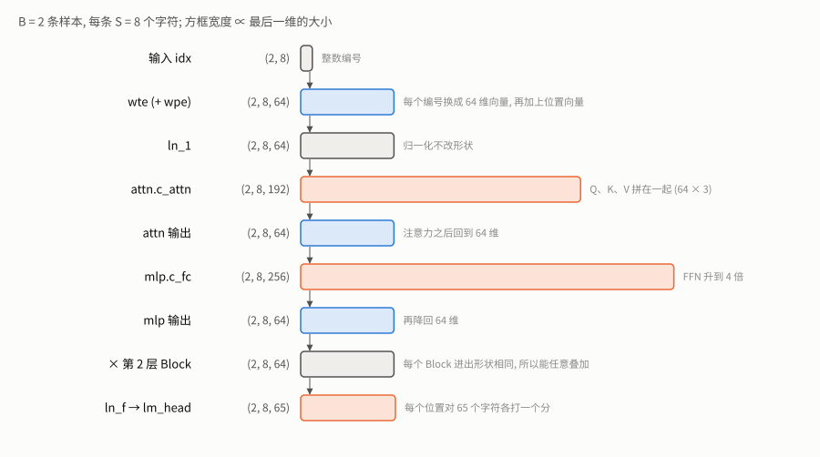

**图 4** 上面那张实测形状表的图形版, **方框宽度正比于最后一维的大小**。**怎么读**: 一眼就能看出模型里两次"变宽": `c_attn` 变成 3 倍宽 (Q、K、V 拼在一起), FFN 的 `c_fc` 变成 4 倍宽; 而每次变宽之后都会变回 64 维, 所以主干 (蓝色方框) 的宽度始终不变。最后 `lm_head` 把 64 维变成 65 维, 对应 65 个字符的打分。


---

## 4. Embedding: 把编号变成向量

### 4.1 一句话

> 编号本身没有意义 (`H`=20 不代表 `H` 比 `i`=47 "小"), 所以给每个编号配一个可学习的向量, 让模型自己决定字符之间的关系。

### 4.2 逐行拆解

```python
# __init__
self.wte = nn.Embedding(config.vocab_size, config.n_embd)    # (65, 64)  token embedding
self.wpe = nn.Embedding(config.block_size, config.n_embd)    # (64, 64)  position embedding

# forward
pos = torch.arange(0, S, dtype=torch.long, device=idx.device)   # [0, 1, ..., S-1]
tok_emb = self.wte(idx)       # (B, S, C)   第 b 条样本第 s 个字符的向量
pos_emb = self.wpe(pos)       # (S, C)      第 s 个位置的向量
x = self.drop(tok_emb + pos_emb)   # 广播: (B,S,C) + (S,C) → (B,S,C)
```

`nn.Embedding(65, 64)` 本质上就是一张 65 行 × 64 列的表, `wte(idx)` 就是"按编号取第几行"。它和"把编号变成 one-hot 再乘一个矩阵"数学上完全等价, 只是查表更快:

```math
\mathrm{wte}(i) = e_i^\top W_E, \qquad e_i = (0,\dots,0,\underbrace{1}_{\text{第 } i \text{ 位}},0,\dots,0) \in \mathbb{R}^{V},\quad W_E \in \mathbb{R}^{V \times C}
```

one-hot 向量 $`e_i`$ 乘矩阵, 结果恰好是 $`W_E`$ 的第 $`i`$ 行。于是第 $`s`$ 个位置的输入向量是

```math
h^{(0)}_s = W_E[\,x_s\,] + W_P[\,s\,]
```

$`W_E`$ 就是代码里的 `wte.weight`, $`W_P`$ 是 `wpe.weight`。

### 4.3 为什么需要位置向量

注意力 (第 5 节) 本身不看顺序: 位置 i 把它能看到的前文 (0..i) 当成一个**无序的集合**来加权求和。
举例来说, `"ABC"` 和 `"BAC"` 在最后一个位置看到的都是 {A, B, C} 这三个字符。如果没有位置向量,
第一层在这个位置算出的结果会**完全相同**, 模型分不出谁先谁后。

实测 (把 `wpe` 全部置零, 比较两种输入在各层最后一个位置的输出):

```
第 1 层, 最后位置:  相同      ← 看到的都是集合 {A, B, C}
第 1 层, 位置 0:    不同      ← "ABC" 的位置 0 只看到 A, "BAC" 的只看到 B
第 2 层, 最后位置:  不同      ← 第 2 层汇总的是第 1 层各位置的结果, 而位置 0 已经不同了
```

所以严格地说, 因果掩码让每个位置能看到的范围不同, 多层叠起来后会**间接**透露一些顺序信息。
但这种线索很弱, 也很难学; 显式加上位置向量, 模型从第一层就能直接知道每个字符在哪。

加上 `wpe` 后, 同一个字符 `e` 在位置 3 和位置 10 的向量就不一样了, 模型由此知道顺序。

**为什么是"加"而不是"拼接"?** 拼接会让维度从 64 变 128, 后面所有层都得变大。相加保持维度不变, 实践中效果一样好: 64 维空间足够大, 模型会学着把"字符信息"和"位置信息"放到不同的方向上, 互不干扰。

**局限**: `wpe` 只有 `block_size` 行, 所以模型**最多只能处理 64 个字符**的上下文, 超出部分没有对应的位置向量。`generate()` 里的截断 (第 11 节) 就是为此。现代模型改用 RoPE (旋转位置编码) 等方法来缓解这个限制, 见 [A4-modern-small-model 第 3 节](../modern-small-model/TUTORIAL.md)。

### 4.4 权重绑定: 输入表和输出表用同一张

```python
self.lm_head = nn.Linear(config.n_embd, config.vocab_size, bias=False)
self.lm_head.weight = self.wte.weight      # 这一行让两者指向同一块内存
```

- `wte`: 编号 → 向量, 形状 `(65, 64)`
- `lm_head`: 向量 → 对每个编号打分, 权重形状也是 `(65, 64)` (记得 `nn.Linear` 的权重是 `(输出, 输入)`)

两者形状正好相同。直觉上它们做的是同一件事的两个方向: 如果字符 `e` 的向量是 **v**, 那么模型输出一个接近 **v** 的向量时, 就应该给 `e` 打高分。`lm_head` 的打分方式正是"输出向量和每个字符向量做点积", 用同一张表天然满足这个要求。

好处: 少一份参数, 而且输入和输出两端都在训练同一张表, 学得更快。

> ⚠️ **本项目踩过的坑 #1**: 早期版本漏了 `self.lm_head.weight = self.wte.weight` 这一行。
> 代码照样能训练, 但 GPT-2 Small 配置的参数量是 **163.0M** 而不是文档里写的 **124.4M**,
> 多出来的正好是 50257 × 768 = 38,597,376 个参数, 即一份独立的 `lm_head`。
> 这类 bug 的特点是"不报错、能训练、只是不对", 唯一的发现办法是**拿参数量和公开数字核对**。

---

## 5. 注意力: 让每个字符看前文

这是整个模型最核心的部分, 分 6 步讲。

### 5.1 一句话

> 每个位置拿着自己的"问题"(Q), 去和前面每个位置的"标签"(K) 比相似度, 按相似度加权, 把前面各位置的"内容"(V) 汇总过来。

### 5.2 直觉: 为什么需要它

猜 `"I will th"` 的下一个字符。只看最后一个字符 `h` 是不够的, 需要知道前面是 `t`, 再往前是一个空格, 才能判断这是一个 `th` 开头的新单词, 下一个很可能是 `e`。注意力让每个位置能**有选择地**从前文收集信息: 哪些位置相关就多看, 不相关就少看。

训练好的 nano 模型在这个输入上给出的下一个字符概率 (实测):

```
P(下一个 | "ROMEO:\nI will th") = e: 0.56, a: 0.14, i: 0.10, o: 0.09, y: 0.07, u: 0.015
```

`the / that / this / those / thy / thus`, 模型的排序和英语里这些词的常见程度基本一致。

### 5.3 公式与每一项的意思

```math
\mathrm{Attention}(Q, K, V) = \mathrm{softmax}\!\left( \frac{Q K^\top}{\sqrt{d_k}} + M \right) V
```

其中 $`M`$ 是因果掩码: 允许看的位置为 $`0`$, 不许看的位置为 $`-\infty`$。

| 部分 | 形状 (单头) | 意思 |
|---|---|---|
| `Q` (query) | `(S, d_k)` | 每个位置的"我想找什么" |
| `K` (key) | `(S, d_k)` | 每个位置的"我能提供什么" |
| `V` (value) | `(S, d_k)` | 每个位置真正交出去的内容 |
| $`QK^\top`$ | `(S, S)` | 第 $`i`$ 行第 $`j`$ 列 = 位置 $`i`$ 对位置 $`j`$ 的相关度 |
| $`\div \sqrt{d_k}`$ | | 缩放, 见 5.4 |
| $`+\,M`$ | `(S, S)` | 把"未来"位置的分数设成 $`-\infty`$, 见 5.5 |
| $`\mathrm{softmax}(\cdot)`$ | `(S, S)` | 每一行变成和为 1 的权重 |
| $`\cdot\, V`$ | `(S, d_k)` | 每个位置得到前文内容的加权平均 |

Q、K、V 都由同一个输入 x 经过不同的线性变换得到, 所以叫 **Self**-Attention。

### 5.4 为什么要除以 √d_k (实测)

假设 $`q, k`$ 的每个分量都是均值 0、方差 1 的独立随机数。它们的点积是 $`d_k`$ 项乘积之和:

```math
q \cdot k = \sum_{t=1}^{d_k} q_t k_t, \qquad \mathrm{Var}(q_t k_t) = \mathrm{Var}(q_t)\,\mathrm{Var}(k_t) = 1
```

独立随机变量之和的方差等于方差之和, 所以 $`\mathrm{Var}(q \cdot k) = d_k`$, **标准差是 $`\sqrt{d_k}`$**。除以 $`\sqrt{d_k}`$ 后方差恰好变回 1。实测 10000 组:

```
d_k=4    std(q·k)=1.99    std(q·k/√d_k)=1.00
d_k=16   std(q·k)=3.99    std(q·k/√d_k)=1.00
d_k=64   std(q·k)=7.97    std(q·k/√d_k)=1.00
d_k=256  std(q·k)=16.08   std(q·k/√d_k)=1.01
```

点积的尺度随维度增长, 那么尺度变大会怎样? 看 softmax 对输入放大的反应 (实测):

```
softmax([ 1,  2,  3]) = [0.090, 0.245, 0.665]     ← 有主有次, 三个位置都在贡献
softmax([ 8, 16, 24]) = [0.000, 0.000, 0.9997]    ← 几乎只剩最大的
softmax([16, 32, 48]) = [0.000, 0.000, 1.000]     ← 完全变成"只选一个"
```

分数尺度越大, softmax 越接近"只选最大值"。一行注意力一旦饱和 (几乎全部权重压在一个位置上), **穿过 softmax 传回这一行的梯度就几乎为 0**: 微调分数不再改变输出, 模型没法学着把注意力挪到别处。专题 B 实测: 不缩放、$`d_k=256`$ 时, 约一半的行饱和, 这些行收到的梯度只有其余行的约千分之一。

除以 $`\sqrt{d_k}`$ 把点积的标准差拉回 1 左右, 让 softmax 保持在"有主有次"的区间。

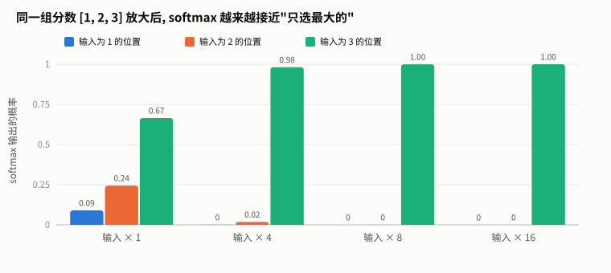

**图 5** 上面三行 softmax 实测的柱状图版本 (多加了一组 ×4)。**怎么读**: 每一组柱子是同一组分数 [1, 2, 3] 放大若干倍之后的 softmax 输出。×1 时三个位置都有份 (0.09 / 0.24 / 0.67); 放大到 ×4 时最大的已经拿走 98%; ×8 以后另外两根柱子完全消失。注意力分数如果不除以 $`\sqrt{d_k}`$, 就相当于被放大了 $`\sqrt{d_k}`$ 倍 (这个模型里是 $`\sqrt{32} \approx 5.7`$ 倍), 会落到右边几组的状态。


### 5.5 因果掩码: 不许看未来

```python
# CausalSelfAttention.__init__: 建一次, 存成 buffer (不是参数, 不训练, 但会跟着 .to(device) 搬到 GPU)
# masked_fill 只接受 bool mask, 且填的是 True 处;
# 因此这里直接标记「要屏蔽」的上三角, 下三角(含对角)保持 False
mask = torch.triu(torch.ones(config.block_size, config.block_size, dtype=torch.bool), diagonal=1)
mask = mask.view(1, 1, config.block_size, config.block_size)   # 前两维留给 B、H 广播
self.register_buffer("mask", mask)
```

`torch.triu(..., diagonal=1)` 取**严格上三角** (对角线上方)。S=5 时 (1 = 屏蔽):

```
         看 j=0  1  2  3  4
位置 i=0   [ 0,  1, 1, 1, 1 ]     位置 0 只能看自己
      1   [ 0,  0, 1, 1, 1 ]     位置 1 能看 0、1
      2   [ 0,  0, 0, 1, 1 ]
      3   [ 0,  0, 0, 0, 1 ]
      4   [ 0,  0, 0, 0, 0 ]     最后一个位置能看全部
```

```python
# scaled_dot_product_attention 里: mask 按最大长度 block_size 建好, 切出左上角 S×S 来用
scores = scores.masked_fill(mask[:, :, :scores.size(-2), :scores.size(-1)], float("-inf"))
attn_weights = F.softmax(scores, dim=-1)                 # (B, H, S, S) 每一行和为 1
```

`masked_fill` 把 mask 为 True 的格子填成 $`-\infty`$; 因为 $`e^{-\infty} = 0`$, softmax 之后这些位置的权重恰好是 0。实测一组随机 Q、K 算出的注意力权重:

```
[[1.    0.    0.    0.    0.   ]      ← 位置 0 只有自己, 权重 1
 [0.438 0.562 0.    0.    0.   ]
 [0.289 0.038 0.673 0.    0.   ]
 [0.182 0.502 0.137 0.179 0.   ]
 [0.131 0.044 0.047 0.081 0.696]]     ← 每行和为 1, 右上角全是 0
```

`mask[:, :, :scores.size(-2), :scores.size(-1)]`: mask 按最大长度 64 建好, 实际输入可能更短, 切出左上角 S×S 来用 (`scores.size(-2)` 和 `scores.size(-1)` 都等于 S)。

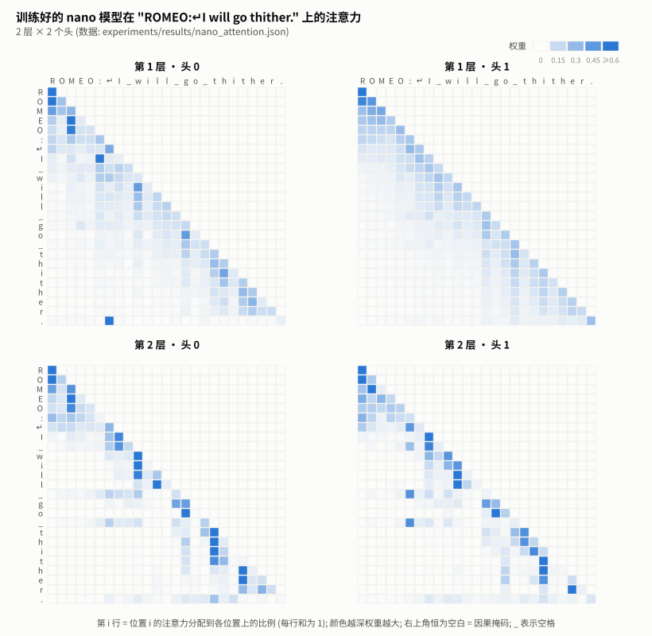

**图 6** 上面是随机 Q、K 算出的权重; 这张图是**训练好的** nano 模型在一句台词上的真实注意力 (2 层 × 2 个头)。**怎么读**: 第 $`i`$ 行是位置 $`i`$ 的注意力怎么分配给它能看到的各个位置, 每行加起来是 1; 颜色越深权重越大 (≥0.6 都画成最深); 右上角恒为空白, 那就是因果掩码。

把四个头的权重统计一下 (第 3 行起的平均值; 若均匀分配给能看到的所有位置, 平均约 0.10):

| 头 | 给自己 | 给前一个字符 | 给前两个字符 | 给第一个字符 |
|---|---|---|---|---|
| 第 1 层 · 头 0 | 0.15 | 0.21 | 0.18 | 0.06 |
| 第 1 层 · 头 1 | 0.21 | 0.19 | 0.15 | 0.05 |
| 第 2 层 · 头 0 | 0.20 | **0.32** | 0.18 | 0.05 |
| 第 2 层 · 头 1 | 0.18 | **0.35** | 0.14 | 0.06 |

所有头都把大部分注意力放在**最近的两三个字符**上, 图上表现为紧贴对角线的深色斜带; 第 2 层的两个头尤其偏重"前一个字符", 是均匀分配的 3 倍多。对一个字符级模型来说这很合理: 猜下一个字母, 最有用的信息就是刚刚写下的那几个字母。也有例外: 第 1 层头 0 在句末的 "." 上 (最后一行) 把 0.73 的权重给了换行符, 相当于回头看"这一行从哪里开始"。


> ⚠️ **本项目踩过的坑 #2**: 早期版本是这样建掩码的:
> ```python
> mask = torch.tril(torch.ones(block_size, block_size))   # 浮点型下三角 (1 = 允许看)
> ```
> 这里有两个错误叠在一起:
> 1. `masked_fill` 只接受 **bool** 型掩码, 浮点型直接报错, 脚本一运行就崩。
> 2. 更隐蔽的是: 就算把它改成 bool, `masked_fill` 填的是 **True 的位置**, 而下三角的 True 恰好是"允许看"的区域。
>    结果因果方向完全反了: 每个位置只能看**未来**、看不到过去; 最后一行全是 True, 全被填成 -∞, softmax 后得到 NaN。
>
> 正确做法是标记"要屏蔽"的区域: 严格上三角 (`triu`, `diagonal=1`) 设为 True。
> **教训**: 掩码有两种相反的约定 (1=允许 / 1=屏蔽), 不同库用的不一样, 写之前先查清楚你调用的函数用哪种。

### 5.6 多头: 同时问好几个问题

一个注意力头只能形成一种"关注模式"。实践中, 位置 i 可能同时需要"上一个字符是什么"和"这个词从哪里开始"两类信息。多头把 C=64 维切成 H=2 份, 每份 32 维独立做注意力, 最后拼回来。

逐行拆解 [model.py](model.py) 的 `CausalSelfAttention.forward`, 以 nano (B=32, S=64, C=64, H=2, d_k=32) 为例:

```python
def forward(self, x):
    B, S, C = x.shape                                    # nano: B=32, S=64, C=64

    qkv = self.c_attn(x)                                 # (32, 64, 192)  一次矩阵乘法算出 Q、K、V
    q, k, v = qkv.split(C, dim=-1)                       # 各 (32, 64, 64)

    # view:      (32, 64, 64) -> (32, 64, 2, 32)  把 64 维看成 2 个头 × 32 维 (不搬动数据)
    # transpose: (32, 64, 2, 32) -> (32, 2, 64, 32)  把"头"挪到前面
    q = q.view(B, S, self.n_heads, self.d_k).transpose(1, 2)
    k = k.view(B, S, self.n_heads, self.d_k).transpose(1, 2)
    v = v.view(B, S, self.n_heads, self.d_k).transpose(1, 2)

    attn_out, _ = scaled_dot_product_attention(q, k, v, self.mask)   # (32, 2, 64, 32)

    # transpose: (32, 2, 64, 32) -> (32, 64, 2, 32)  头挪回后面
    # contiguous + view: -> (32, 64, 64)  2 个头拼回 64 维
    attn_out = attn_out.transpose(1, 2).contiguous().view(B, S, C)

    return self.resid_dropout(self.c_proj(attn_out))     # (32, 64, 64)  输出投影, 让各头的信息混合
```

**为什么要 `transpose(1, 2)`?** `torch.matmul` 对最后两维做矩阵乘法, 前面的维度当作"批"。把形状排成 `(B, H, S, d_k)` 后, `q @ k.transpose(-2, -1)` 就自动对每条样本、每个头分别算出 `(S, S)` 的分数矩阵, 不用写循环。

**为什么要 `.contiguous()`?** `transpose` 不真正搬动数据, 只是改了"怎么读"; 此时内存里的数据顺序和新形状不一致, `view` 要求数据连续存放, 所以必须先 `contiguous()` 复制一份连续的。漏了会报错 `view size is not compatible with input tensor's size and stride`。

**为什么 Q、K、V 用一个大矩阵 `c_attn` 而不是三个小矩阵?** 数学上完全等价 (三个 64×64 的矩阵拼成一个 64×192)。一次大的矩阵乘法比三次小的在 GPU 上更快。

**多头不增加参数**: 不管分几个头, `c_attn` 都是 64×192。多头只是改变了"怎么用"这些参数。

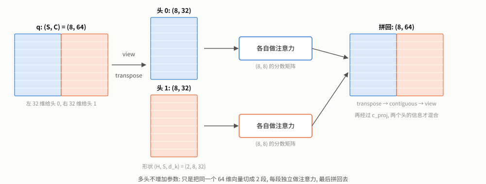

**图 7** 上面逐行拆解的形状变化画成图。**怎么读**: 左边是一个位置序列的 q, 形状 (8, 64); 蓝色是前 32 维, 橙色是后 32 维。`view` + `transpose` 把它切成两个独立的 (8, 32) 矩阵, 也就是两个头; 两个头各自做一次完整的注意力 (各有一张 8×8 的分数矩阵), 互不干扰; 最后 `transpose` + `contiguous` + `view` 把它们拼回 (8, 64)。拼回之后两半仍然是分开算出来的, 要再经过 `c_proj` 这个线性层, 两个头的信息才真正混合。


---

## 6. FFN: 每个位置独立地"想一想"

### 6.1 一句话

> 注意力负责"从别处收集信息", FFN 负责"对收集来的信息做加工"; 它对每个位置独立计算, 位置之间不交流。

### 6.2 逐行拆解

```python
# __init__ (nano: config.n_embd = 64)
self.c_fc = nn.Linear(config.n_embd, 4 * config.n_embd, bias=config.bias)    # 升维 64 -> 256
self.gelu = nn.GELU()                                                         # 非线性, 没有它两层线性等于一层
self.c_proj = nn.Linear(4 * config.n_embd, config.n_embd, bias=config.bias)  # 降维 256 -> 64
self.dropout = nn.Dropout(config.dropout)

def forward(self, x):                                    # x: (B, S, 64), 每个位置独立计算
    x = self.c_fc(x)                                     # (B, S, 256)
    x = self.gelu(x)
    x = self.c_proj(x)                                   # (B, S, 64)
    return self.dropout(x)
```

写成公式 (对每个位置的向量 $`x \in \mathbb{R}^{C}`$ 独立计算):

```math
\mathrm{FFN}(x) = \mathrm{GELU}(x W_1 + b_1)\, W_2 + b_2, \qquad W_1 \in \mathbb{R}^{C \times 4C},\quad W_2 \in \mathbb{R}^{4C \times C}
```

**为什么先升维再降维?** 在高维空间里, 一个非线性函数能表达的变换多得多。中间维度取 4 倍是 GPT-2 原论文的选择, 之后的大部分模型沿用了这个比例 (LLaMA 用 SwiGLU 时改成约 8/3 倍, 见 [A4-modern-small-model 第 5 节](../modern-small-model/TUTORIAL.md))。

**为什么一定要有非线性 (GELU)?** 两个线性层叠在一起还是一个线性层 (`W2 @ (W1 @ x) = (W2 @ W1) @ x`), 没有 GELU 的话这 32,768 个参数等于白加。

**GELU vs ReLU**:

```math
\mathrm{ReLU}(x) = \max(0, x), \qquad \mathrm{GELU}(x) = x \cdot \Phi(x)
```

$`\Phi(x)`$ 是标准正态分布的累积分布函数, 即"一个标准正态随机数小于 $`x`$ 的概率"。所以 GELU 可以理解为: 按 $`x`$ 有多大概率"算正数"来决定保留多少。ReLU 在 0 处是一个硬拐角 (负数全部变 0); GELU 是一条平滑曲线, 负数会被压小但不完全归零 (最小值约 $`-0.17`$, 在 $`x \approx -0.75`$ 处)。平滑意味着梯度处处连续, 训练更稳定。GPT-2 选了 GELU, 之后的模型大多跟进。

---

## 7. Block: 残差连接 + Pre-LN

### 7.1 一句话

> 每个子层 (注意力、FFN) 都不直接替换 x, 而是算出一个"修改量"加到 x 上; 算之前先把 x 归一化。

### 7.2 代码

```python
def forward(self, x):
    x = x + self.attn(self.ln_1(x))    # 残差: x 加上注意力的"修改量"
    x = x + self.mlp(self.ln_2(x))     # 残差: x 加上 FFN 的"修改量"
    return x
```

只有两行, 但包含了两个决定 Transformer 能否训练起来的设计。

### 7.3 残差连接: 为什么是 `x + f(x)` 而不是 `f(x)`

- **信息不丢**: 就算某一层什么都没学到 (`f(x)≈0`), x 也原样传了下去。
- **梯度有高速公路**: 求导时 $`\dfrac{\partial\,(x + f(x))}{\partial x} = I + \dfrac{\partial f}{\partial x}`$。那个单位矩阵 $`I`$ 让梯度可以不经过任何权重直接从 loss 传回第一层, 不会因为层数多而越乘越小 (梯度消失)。这是能把网络叠到几十上百层的前提。

可以把整个模型理解为: 一条贯穿始终的"主干" x, 每一层往上面写一点东西。研究者常把这条主干叫 **residual stream (残差流)**。

### 7.4 LayerNorm: 把每个向量拉回标准尺度

对每个位置的 $`C`$ 维向量 $`x`$, 减去自己的均值、除以自己的标准差, 再乘一个可学习的缩放 $`\gamma`$、加一个可学习的偏移 $`\beta`$:

```math
\mu = \frac{1}{C}\sum_{i=1}^{C} x_i,\qquad \sigma^2 = \frac{1}{C}\sum_{i=1}^{C} (x_i - \mu)^2,\qquad \mathrm{LN}(x)_i = \gamma_i \,\frac{x_i - \mu}{\sqrt{\sigma^2 + \epsilon}} + \beta_i
```

$`\epsilon`$ (默认 $`10^{-5}`$) 防止方差为 0 时除以 0。注意方差除的是 $`C`$ 而不是 $`C-1`$ (有偏估计)。

数值例子 (实测, $`\gamma=1,\ \beta=0`$ 的初始状态):

```
x       = [2, 4, 6, 8]          mean = 5, var = 5, std = 2.236
LN(x)   = [-1.342, -0.447, 0.447, 1.342]
```

无论输入整体多大多小, 输出都是均值 0、标准差 1。这让每一层拿到的输入尺度稳定, 训练不容易发散。

### 7.5 Pre-LN vs Post-LN

| | 写法 | 特点 |
|---|---|---|
| Post-LN (2017 原版 Transformer) | `x = LN(x + f(x))` | LN 挡在残差主干上, 梯度要穿过它; 深了以后很难训练, 必须小心地用 warmup |
| **Pre-LN (GPT-2 起, 本项目)** | `x = x + f(LN(x))` | 主干上没有任何东西挡着, 梯度高速公路畅通; 训练稳定得多 |

Pre-LN 的代价是主干上的数值会随层数一直累加、越来越大, 所以在所有 Block 之后要再补一个 `ln_f`, 把它拉回标准尺度再交给 `lm_head`。这就是 `GPT.forward` 末尾 `x = self.ln_f(x)` 的由来。

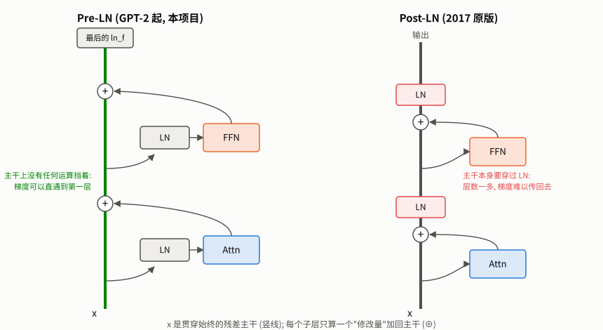

**图 8** 两种结构各画了两个子层 (注意力、FFN)。**怎么读**: 粗竖线是残差主干 $`x`$, 从下往上流动; 每个子层从主干上"分出去"算一个修改量, 再在 ⊕ 处加回来。左边的 Pre-LN, LN 在分支上, **主干从头到尾没有任何运算挡着** (绿色), 梯度可以沿着它直接传回第一层; 主干上的数值会一路累加, 所以最顶上要补一个 `ln_f`。右边的 Post-LN, LN 直接放在主干上 (红色), 每经过一层, 主干本身就要穿过一次 LN, 层数一多梯度就难以传回去。


---

## 8. 输出与损失: loss 的数值意味着什么

### 8.1 从向量到概率

```python
logits = self.lm_head(x)        # (B, S, 65)  每个位置对 65 个字符各打一个分, 可正可负
```

`logits` 还不是概率。softmax 把它变成和为 1 的概率分布:

```math
P(c) = \mathrm{softmax}(z)_c = \frac{e^{z_c}}{\sum_{j=1}^{V} e^{z_j}}
```

$`z`$ 是某个位置的 logits 向量 (长度 $`V=65`$)。

### 8.2 交叉熵: 猜对答案的概率取负对数

```python
loss = F.cross_entropy(
    logits.reshape(-1, logits.size(-1)),    # (B*S, 65)  把所有位置摊平成一个大 batch
    targets.reshape(-1),                    # (B*S,)
    ignore_index=-1,  # 答案为 -1 的位置不计入 loss (为补齐 padding 预留; 本项目用不到)
)
```

用 `reshape` 而不是 `view`: 如果 `targets` 是切片得到的 (例如 `x[:, 1:]`), 它在内存里不连续, `view` 会直接报错, `reshape` 会在需要时自动复制一份。
本项目早期用的是 `view`, 因为训练时的 batch 都由 DataLoader 拼接而成、恰好总是连续的, 所以一直没出问题; 直到给代码补注释、写测试时用切片构造目标才暴露出来。

对每个位置, 只看模型给**正确答案** $`y`$ 分配了多少概率, 取负对数, 再对所有 $`N = B \times S`$ 个位置取平均:

```math
\mathcal{L} = -\frac{1}{N}\sum_{n=1}^{N} \ln P(y_n) = -\frac{1}{N}\sum_{n=1}^{N} \ln \frac{e^{z_{n,y_n}}}{\sum_j e^{z_{n,j}}}
```

单个位置的 $`-\ln p`$ 实测换算:

```
p = 1/65 = 0.0154  →  loss = 4.1744     (纯瞎猜)
p = 0.1            →  loss = 2.3026
p = 0.5            →  loss = 0.6931
p = 0.9            →  loss = 0.1054
p = 1.0            →  loss = 0         (完全确定且猜对)
```

### 8.3 初始 loss ≈ ln(V): 最有用的自检

刚初始化的模型输出接近随机, 对 65 个字符的打分差不多, 概率都约等于 $`1/V`$, 所以

```math
\mathcal{L}_0 \approx -\ln \frac{1}{V} = \ln V = \ln 65 = 4.1744
```

回头看第 1.2 节的日志: `iter 0 | train_loss 4.1787`, **和理论值只差 0.004**。

这是查 bug 最便宜的办法。**第 0 步的 loss 明显偏离 ln(V), 就说明有问题**:

| 第 0 步 loss | 可能的原因 |
|---|---|
| 远大于 ln(V), 比如 10、20 | 初始化尺度太大, 模型一上来就很"自信"地猜错 |
| 远小于 ln(V), 比如 0.5 | 答案泄漏了: 掩码写错让模型看到了未来, 或 x、y 没有错开一位 |
| NaN | 掩码让某一行全是 -∞; 或学习率/数值溢出 |

### 8.4 读懂 `val_loss 1.92`

loss 是对数尺度, 不直观。取指数得到 **困惑度 (perplexity)**:

```math
\mathrm{PPL} = e^{\mathcal{L}}
```

直观含义: 如果模型每一步都在 $`k`$ 个候选里均匀地猜, 它的 loss 就是 $`\ln k`$, 困惑度就是 $`k`$。所以困惑度可以读作\"相当于在几个候选里挑\"。实测:

```
e^4.1744 = 65.0     训练前: 相当于每次在 65 个字符里均匀瞎猜
e^1.9209 = 6.83     训练后: 相当于每次在约 7 个候选里挑
```

从"65 选 1"进步到"约 7 选 1", 这就是 5000 步训练换来的东西。

### 8.5 `ignore_index=-1`

`cross_entropy` 会跳过答案等于 -1 的位置。本项目所有样本都是满长度, 用不到; 它是为"把长短不一的句子补齐到同一长度"的场景预留的: 补齐的位置标成 -1, 就不会参与 loss。

---

## 9. 初始化: 起点也有讲究

```python
def _init_weights(self, module):
    if isinstance(module, nn.Linear):
        torch.nn.init.normal_(module.weight, mean=0.0, std=0.02)
        if module.bias is not None:
            torch.nn.init.zeros_(module.bias)
    elif isinstance(module, nn.Embedding):
        torch.nn.init.normal_(module.weight, mean=0.0, std=0.02)

# 之后再单独处理所有 c_proj:
for pn, p in self.named_parameters():
    if pn.endswith("c_proj.weight"):
        torch.nn.init.normal_(p, mean=0.0, std=0.02 / math.sqrt(2 * config.n_layer))
```

**std=0.02** 是 GPT-2 论文用的值。足够小, 让初始 logits 接近 0、概率接近均匀, 于是初始 loss ≈ ln(V) (第 8.3 节)。

**为什么 `c_proj` 要再除以 $`\sqrt{2 L}`$ ($`L`$ = `n_layer`)?** `c_proj` 是每个子层写回残差主干的最后一步。整个模型有 $`L`$ 个 Block, 每个 Block 往主干上加 2 次 (注意力、FFN 各一次), 一共 $`2L`$ 次。把每次加上的量近似看成相互独立、方差为 $`\sigma^2`$, 则

```math
\mathrm{Var}\Big(x_0 + \sum_{i=1}^{2L} \Delta_i\Big) \approx \mathrm{Var}(x_0) + 2L\,\sigma^2
```

模型越深, 主干的方差越大。把每个 $`\Delta_i`$ 的标准差缩小到原来的 $`1/\sqrt{2L}`$, 第二项就变成 $`\sigma^2`$, 与层数无关了。

---

## 10. 训练循环

### 10.1 优化器: AdamW

```python
optimizer = optim.AdamW(
    model.parameters(),
    lr=args.lr,               # 只是初始值, 每一步都会被学习率调度覆盖
    betas=(0.9, 0.95),        # β2=0.95 比默认 0.999 记忆更短, 梯度突变时反应更快 (GPT 系列的常用设置)
    eps=1e-8,
    weight_decay=0.1,         # 对所有参数都施加 (更常见的做法是只对二维权重施加, 见讲义练习 3)
)
```

- **Adam**: 给每个参数单独维护一个"历史梯度的平均"和"历史梯度平方的平均", 用它们调节步长。梯度一直很大的参数自动走小步, 一直很小的走大步。
- **W (decoupled weight decay)**: 每一步把参数往 0 拉一点, 防止某些参数长得过大。AdamW 的改进在于这个"拉"和 Adam 的自适应步长分开计算, 效果比老式 L2 正则更好。
完整的更新规则 (第 $`t`$ 步, $`g_t`$ 是梯度, $`\eta`$ 是学习率, $`\lambda`$ 是 weight_decay):

```math
\begin{aligned}
m_t &= \beta_1 m_{t-1} + (1-\beta_1)\, g_t && \text{梯度的滑动平均 (方向)}\\
v_t &= \beta_2 v_{t-1} + (1-\beta_2)\, g_t^2 && \text{梯度平方的滑动平均 (尺度)}\\
\hat m_t &= \frac{m_t}{1-\beta_1^t},\qquad \hat v_t = \frac{v_t}{1-\beta_2^t} && \text{偏差修正: 早期 } m, v \text{ 从 0 起步, 偏小}\\
\theta_t &= \theta_{t-1} - \eta \left( \frac{\hat m_t}{\sqrt{\hat v_t} + \epsilon} + \lambda\, \theta_{t-1} \right)
\end{aligned}
```

$`\hat m_t / \sqrt{\hat v_t}`$ 这一项的大小大致在 1 左右, 与梯度本身的尺度无关, 这就是"每个参数自适应步长"的来源。最后的 $`\lambda\,\theta_{t-1}`$ 就是 weight decay, 它直接加在更新量上, 不经过 $`\sqrt{\hat v_t}`$ 的缩放, 这正是 AdamW 里"W (decoupled)"的含义。

- **`betas=(0.9, 0.95)`**: 即 $`\beta_1 = 0.9,\ \beta_2 = 0.95`$。第二个数比默认的 0.999 小, 意味着对"梯度平方"的记忆更短, 遇到梯度突变时反应更快。这是 GPT 系列训练的常用设置。

> 💡 一个可以改进的点: 本项目对**所有参数**都施加 weight decay, 包括 LayerNorm 的 γ/β 和各种 bias。
> 更常见的做法 (nanoGPT、[A4-modern-small-model/train.py](../modern-small-model/train.py)) 是只对二维的权重矩阵施加,
> 因为把 LayerNorm 的缩放往 0 拉没有道理。这里不算 bug, 但留作第 14 节的练习。

### 10.2 学习率: 先热身, 再余弦下降

```python
def get_lr(it, warmup_iters, lr_decay_iters, learning_rate, min_lr):
    if it < warmup_iters:                                   # 阶段 1: 线性升温
        return learning_rate * it / warmup_iters
    if it > lr_decay_iters:                                 # 阶段 3: 保持最低
        return min_lr
    decay_ratio = (it - warmup_iters) / (lr_decay_iters - warmup_iters)
    coeff = 0.5 * (1.0 + math.cos(math.pi * decay_ratio))   # 从 1 平滑降到 0
    return min_lr + coeff * (learning_rate - min_lr)        # 阶段 2: 余弦下降
```

默认参数 (lr=1e-3, warmup=100, 共 5000 步, min_lr=1e-4) 的实测取值:

```
it=0     lr=0.000e+00     ┐
it=50    lr=5.000e-04     ├ 热身: 100 步内从 0 线性升到峰值
it=100   lr=1.000e-03     ┘
it=1000  lr=9.271e-04     ┐
it=2550  lr=5.500e-04     ├ 余弦: 开头和结尾降得慢, 中间降得快; 正中间 (2550) 恰好是峰值和最低值的平均
it=4000  lr=1.894e-04     │
it=5000  lr=1.000e-04     ┘
it=6000  lr=1.000e-04       之后保持最低值
```


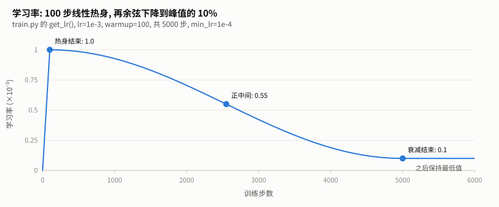

**图 9** 上表的完整曲线, 由 `train.py` 里的 `get_lr()` 直接算出。**怎么读**: 最左边那段几乎竖直的线就是 100 步的热身 (相对 5000 步很短); 之后是半个余弦周期: 开头和结尾平缓、中间陡; 正中间 (第 2550 步) 恰好是峰值和最低值的平均 0.55; 第 5000 步之后保持 0.1 不变。

写成公式 ($`\eta_{\max}`$ = `learning_rate`, $`\eta_{\min}`$ = `min_lr`, $`T_w`$ = `warmup_iters`, $`T`$ = `lr_decay_iters`):

```math
\eta(t) = \begin{cases} \eta_{\max} \cdot \dfrac{t}{T_w} & t < T_w \\[2mm] \eta_{\min} + \dfrac{1}{2}\left(1 + \cos\!\left(\pi\, \dfrac{t - T_w}{T - T_w}\right)\right)(\eta_{\max} - \eta_{\min}) & T_w \le t \le T \\[2mm] \eta_{\min} & t > T \end{cases}
```

中间那段在 $`t = T_w`$ 时 $`\cos 0 = 1`$, 得到 $`\eta_{\max}`$; 在 $`t = T`$ 时 $`\cos\pi = -1`$, 得到 $`\eta_{\min}`$; 正中间 $`\cos\frac{\pi}{2} = 0`$, 恰好是两者的平均, 与上表 it=2550 的实测值一致。

**为什么要热身?** 刚开始参数是随机的, 梯度方向很不可靠; Adam 维护的两个平均值也还没积累起来, 估得不准。这时候用大学习率容易一步迈错, loss 直接飞掉。先用小步走一段, 等统计量稳定了再加速。

**为什么最后要降下来?** 训练后期离好的解已经很近, 大步长会在最优点附近来回震荡。步子缩小才能落进去。

### 10.3 一步训练的逐行拆解

```python
x, y = next(batches)                                  # ① 取一个 batch
x, y = x.to(device), y.to(device)

with torch.autocast(device_type=device, enabled=use_amp):
    logits, loss = model(x, y)                        # ② 前向

optimizer.zero_grad()                                 # ③ 清掉上一步的梯度 (PyTorch 默认会累加)
scaler.scale(loss).backward()                         # ④ 反向, 算梯度

scaler.unscale_(optimizer)                            # ⑤ 混合精度下先把梯度还原到真实尺度
torch.nn.utils.clip_grad_norm_(model.parameters(), 1.0)   # ⑥ 梯度裁剪

scaler.step(optimizer)                                # ⑦ 更新参数
scaler.update()
```

**③ 为什么要 `zero_grad`?** PyTorch 的 `.backward()` 是把新梯度**加到**已有梯度上, 而不是覆盖。忘了清零, 每一步的梯度就是之前所有步的总和, 训练会迅速发散。

**⑥ 梯度裁剪**: 把所有参数的梯度拼成一个长向量 $`g`$, 计算它的 L2 范数, 超过阈值 $`c`$ (这里是 1.0) 就整体按比例缩小:

```math
\|g\|_2 = \sqrt{\sum_{\text{所有参数 } p} \|\nabla_p \mathcal{L}\|_2^2}, \qquad g \leftarrow g \cdot \min\!\left(1,\ \frac{c}{\|g\|_2}\right)
```

方向不变, 只限制步子的最大幅度。偶尔遇到一个"怪" batch 产生巨大的梯度时, 它能防止一步就把训练搞崩。

**④⑤⑦ 里的 `scaler`**: 只在开启 `--amp` (混合精度) 时起作用, 不开时这些调用什么都不做。混合精度用 16 位浮点数做大部分计算来提速省显存。fp16 能表示的最小正数有限, 很小的梯度会直接变成 0 (下溢), 所以先把 loss 放大 (`scale`), 算完梯度再缩回来 (`unscale_`)。

> 💡 本机 (RTX 5060, Blackwell) 实测 `--amp` 在本项目上可以正常训练: 参数保持 fp32, 只有计算是 fp16。
> 但在 [C2-tool-finetune](../../post-training/tool-finetune/) 里, 由于模型权重本身是 bf16, 用 fp16 的 scaler 会崩溃,
> 那边必须用 bf16。两个场景的区别在于**参数本身是什么精度**。

### 10.4 评估: 为什么要固定看同一批数据

```python
@torch.no_grad()
def evaluate(model, loader, device, use_amp, max_batches=20):
    model.eval()                    # 关闭 dropout
    total, n = 0.0, 0
    for x, y in loader:             # val_loader 不打乱, 所以每次都是同样的前 20 个 batch
        if n >= max_batches:
            break
        ...
    model.train()                   # 切回训练模式 (重新打开 dropout)
    return total / max(n, 1)
```

- **`@torch.no_grad()`**: 评估不需要梯度, 关掉可以省显存、提速。
- **`model.eval()` / `model.train()`**: 训练时 dropout 会随机丢掉一部分神经元, 评估时要关掉, 否则同一个输入每次结果都不一样。评估完必须切回去, 忘了切回去后面的训练就没有 dropout 了。
- **固定看同一批**: 用 val_loss 来挑"最好的 checkpoint", 前提是不同时刻的 val_loss 可比。如果每次随机抽不同的 batch, 数字的波动里会混进"这次抽到的数据难不难", 挑出来的不一定真的最好。

> ⚠️ **本项目踩过的坑 #3**: 早期版本的评估是这样写的:
> ```python
> for _ in range(20):
>     x_val, y_val = next(iter(val_loader))
> ```
> `iter(val_loader)` 每次都新建一个迭代器, 而 val_loader 不打乱, 所以**每次拿到的都是第一个 batch**。
> 这个循环看起来是"取 20 个 batch 求平均", 实际上是把同一个 batch 算了 20 遍:
> 验证集有 1742 块, 实际只用了 32 块。
> 这个 bug 不报错, 打印出来的 val_loss 看上去也合理, 只能靠"两次取出来的 batch 是否相同"这种直接检查发现。
> 训练取数原来也是同样写法, 虽然因为训练集打乱了所以结果是对的, 但每一步都重建迭代器, 白白浪费时间。现在改为
> `infinite_batches()` 持有一个迭代器反复用。

---

## 11. 生成: 一次一个字符

### 11.1 自回归循环

```python
@torch.no_grad()
def generate(self, idx, max_new_tokens, temperature=1.0, top_k=None):
    for _ in range(max_new_tokens):
        idx_cond = idx if idx.size(1) <= self.config.block_size else idx[:, -self.config.block_size:]   # ①
        logits, _ = self(idx_cond)                         # ② 整段前向
        logits = logits[:, -1, :] / temperature            # ③ 只要最后一个位置的预测
        if top_k is not None:                              # ④ 只保留前 k 名
            v, _ = torch.topk(logits, min(top_k, logits.size(-1)))
            logits[logits < v[:, [-1]]] = float("-inf")
        probs = F.softmax(logits, dim=-1)
        idx_next = torch.multinomial(probs, num_samples=1) # ⑤ 按概率抽一个
        idx = torch.cat((idx, idx_next), dim=1)            # ⑥ 接到末尾, 进入下一轮
    return idx
```

① **截断**: 位置表只有 `block_size` 行 (第 4.3 节), 输入超过这个长度就只保留最近的 `block_size` 个字符。模型因此"忘记"了更早的内容。

> ⚠️ **本项目踩过的坑 #4** (发生在姊妹项目 [A4-modern-small-model](../modern-small-model/)):
> 那边的 `generate` 把截断长度写死成 1024, 而训练用的 `block_size` 是 128。
> 训练全程正常, 直到训练结束开始生成, 一超过 128 个字符就越界崩溃。
> 在 GPU 上它的报错是 `CUBLAS_STATUS_EXECUTION_FAILED`, 看起来像驱动或显卡问题, 实际是下标越界;
> 改到 CPU 上跑, 才得到真正的报错 `IndexError: index out of range in self`。
> **教训**: GPU 报的错往往是异步的、二手的。看不懂 CUDA 报错时, 先用 CPU 复现一次。

② **效率问题**: 每生成一个字符, 都把整段输入重新算一遍, 前面那些位置的结果其实上一轮已经算过。真实系统用 **KV Cache** 把每个位置的 K、V 存下来, 新一轮只算最新的一个位置。本项目为了代码简单没有实现。

③ **只取最后一个位置**: 模型对每个位置都给了预测, 但生成时只关心"整段文字之后的下一个字符", 也就是最后一个位置的输出。

### 11.2 temperature 和 top-k: 实测对比

温度是在 softmax 之前把 logits 除以 $`T`$:

```math
P_T(c) = \frac{e^{z_c / T}}{\sum_j e^{z_j / T}}
```

两个字符的概率之比是 $`P_T(a)/P_T(b) = e^{(z_a - z_b)/T}`$。$`T`$ 越小, 分数差被放大得越厉害; $`T \to 0`$ 时只剩最大的那个 (等价于每次选最可能的), $`T \to \infty`$ 时变成均匀分布。

- **$`T < 1`$**: 分数差距被放大, 分布变尖, 更倾向于选最可能的字符。
- **$`T > 1`$**: 分数差距被缩小, 分布变平, 不常见的字符也有机会被选中。

top-k 是只在分数最高的 $`k`$ 个字符里抽, 其余字符的 logit 设成 $`-\infty`$, softmax 后概率为 0, 剩下 $`k`$ 个重新归一化。

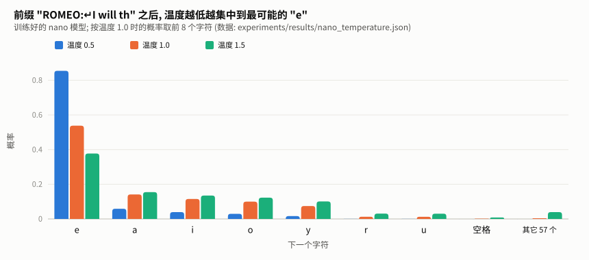

**图 10** 先看温度对概率分布本身做了什么, 再看它生成出来的文字。这是训练好的 nano 模型读完 `"ROMEO:\nI will th"` 之后, 对下一个字符的预测。**怎么读**: 每个字符有三根柱子, 分别是温度 0.5、1.0、1.5 下的概率。温度 1.0 (橙) 是模型原本的预测: `e` 占 54%, 后面依次是 a、i、o、y (对应 the、that、this、those、thy)。温度降到 0.5 (蓝), `e` 涨到 85%, 其它都被压低; 升到 1.5 (绿), `e` 降到 38%, 其它都被抬高, 连最右边"其它 57 个字符"合计也从 0.4% 涨到 3.9%: 这就是高温下开始出现乱拼单词的原因。

用第 1 节训练好的 nano 模型, 以 `"ROMEO:\n"` 开头生成 120 个字符, 同一个随机种子, 实测:

**T=0.01 (几乎等于每次都选最可能的那个)**
```
ROMEO:
I will the shall the shall the the the the so the son the the the the the the the the the the the the the the the th
```
陷入重复。每一步都选当下最可能的字符, 而 "the" 后面最可能的又是 " the"。只选最优在局部是对的, 合起来却是车轱辘话。

**T=0.8, top_k=50 (train.py 里的默认设置)**
```
ROMEO:
My cloud shad may the such crone, thou nobled for you for thee plaiston,
Bre that and of the not so,
The thou dukee sigh
```

**T=1.0, 不限制**
```
ROMEO:
My cloud shad day:
we my chard's, onot nobled fe thy erear heed lamst of dreactable man's pland her,
Two thou du
```

**T=1.5 (太随机)**
```
ROMEO:
Mistloulf;
Od Caund for AUTYARK:
Wo, Whnquen'd.  Herye ear heed lamst-d!

KISSICER:
```
拼写崩坏, 开始出现 `AUTYARK`、`KISSICER` 这样的"人名"。

**T=0.8, top_k=3 (候选太少)**
```
ROMEO:
This the shall, that she heard to that that to the the to thee that to a the that and and the here her that to thee the
```
每一步只能在 3 个字符里挑, 和 T 很低的效果类似, 又开始重复。

**结论**: 低温和小 k 都让输出"保守", 代价是重复; 高温让输出"大胆", 代价是胡言乱语。0.7~1.0 的温度配合中等的 k 是常见的平衡点。注意 **nano 有 65 个字符, `top_k=50` 几乎不起作用**, 它在词表几万的 BPE 模型上才有意义。

---

## 12. 规模: 放大模型会怎样

### 12.1 nano vs micro 实测对比

```bash
python train.py --config nano                    # 5000 步
python train.py --config micro --max_iters 3000  # 3000 步
```

| | nano | micro |
|---|---|---|
| 层数 / 头数 / 维度 | 2 / 2 / 64 | 4 / 4 / 128 |
| 上下文长度 `block_size` | 64 | 256 |
| 参数量 | 108,352 | 834,432 (7.7 倍) |
| 每步看的字符数 (B×S) | 32 × 64 = 2,048 | 32 × 256 = 8,192 |
| 每步耗时 (本机) | 5~7 ms | 37~115 ms (见下方说明) |
| 训练步数 | 5000 | 3000 |
| 最佳 val_loss | 1.921 (困惑度 6.8) | **1.636** (困惑度 5.1) |

**每步耗时为什么波动这么大**: 同一个 micro 配置, 本机测到过 37ms 也测到过 115ms。笔记本 GPU 的频率受功耗和温度限制, 后台有别的程序 (比如开着的 Jupyter) 用 GPU 时也会变慢。所以**单次计时只能看量级**, 要比较两个配置的速度, 得在同样条件下各跑几次。

用同样的开头 `"ROMEO:\n"` 和同样的设置 (T=0.8, top_k=50, 种子 42) 各生成 200 个字符:

**nano**
```
ROMEO:
My cloud shad may the such crone, thou nobled for you for thee plaiston,
Bre that and of the not so,
The thou dukee sigh fament.

FORCHENRY OR OF MARD ORII:
No no not I, was with fairth then has and d
```

**micro**
```
ROMEO:
My cloud sover, you more courtness to the bed.

HENRY BOLINGBROKE:
March, report them; how they heart, that it up.

AUTOLYCUS:
He her hand, let me be the fall for the prince,
With cause the hope and d
```

micro 的进步:
- **人名是真的**: `HENRY BOLINGBROKE` (《理查二世》) 和 `AUTOLYCUS` (《冬天的故事》) 作为说话人在训练语料里分别出现了 90 次和 67 次, 模型把它们完整记住了。nano 只能编出 `FORCHENRY OR OF MARD ORII` 这种"看起来像人名"的东西。
- **几乎没有拼错的词**, 标点和断句也更自然。
- 句子仍然没有意义。字符级模型要学会"意思", 需要大得多的规模。

### 12.2 留意过拟合的苗头

micro 训练日志里 train_loss 和 val_loss 的差距:

```
iter  1000 | train_loss 1.8102 | val_loss 1.8847    差 0.07
iter  2000 | train_loss 1.5689 | val_loss 1.6852    差 0.12
iter  2500 | train_loss 1.4991 | val_loss 1.6513    差 0.15
```

nano 训练到最后两者基本持平 (1.96 vs 1.93), micro 的差距却在一路拉大。这说明 micro 开始**背训练集**了: 它在见过的文本上越来越准, 在没见过的文本上进步越来越慢。Tiny Shakespeare 只有约 100 万字符, 对 83 万参数的模型来说已经偏少。

如果继续加大模型或延长训练, val_loss 迟早会掉头上升。应对办法: 加大 `--dropout`、减少训练步数、或者换更大的语料。`train.py` 保存的是 **val_loss 最低**的那个 checkpoint (`model_best.pt`), 所以即使后面过拟合了, 你拿到的仍是最好的那一版。

### 12.3 估算更大模型的参数量

```bash
python config.py
```

```
配置名               层数   头数     维度        参数量
nano               2    2     64     119.4K
micro              4    4    128       7.3M
small             12   12    768     124.4M
medium            24   16   1024     354.6M
large             36   20   1280     773.6M
```

这里 nano、micro 的数字比 12.1 节的表大, 是因为 `config.py` 按 GPT-2 的 50257 词表估算, 而训练时实际词表只有 65。可见在小模型里, **词表大小对参数量影响很大**: micro 换成 GPT-2 词表, 光 embedding 就有 50257 × 128 ≈ 640 万参数, 比模型其余部分加起来还多。

想在本机 8GB 显存上训练 small (124M) 是可行的, 但用 Tiny Shakespeare 训练它会严重过拟合; 那个规模需要的是 GB 级的语料。

---

## 13. 本项目踩坑记录汇总

| # | 现象 | 根因 | 为什么当时没发现 | 怎么发现的 |
|---|---|---|---|---|
| 1 | GPT-2 Small 实际 163M, 文档写 124M | 漏了 `lm_head` 和 `wte` 的权重绑定 | 不报错, 照样能训练 | 拿参数量和公开数字核对 |
| 2 | 脚本一运行就崩; 简单修复后因果方向反转, 出现 NaN | 掩码约定写反 (1=允许 vs 1=屏蔽), 且用了浮点型 | 第一层错误 (类型) 掩盖了第二层错误 (方向) | 读 `masked_fill` 文档, 打印掩码矩阵 |
| 3 | val_loss 只代表 32 块数据 | `next(iter(loader))` 每次都新建迭代器 | 数字看起来合理, 不报错 | 直接比较两次取出的 batch 是否相同 |
| 4 | (A4-modern-small-model) 训练结束时报 CUBLAS 错误 | 生成时截断长度写死, 位置表越界 | 只在训练结束后的生成阶段触发; GPU 报错是二手的 | 切到 CPU 复现, 拿到真正的 IndexError |

共同点: **前三个都不会让程序崩溃 (修复后的 #2 也是), 结果"看起来合理"。** 深度学习代码最危险的 bug 就是这一类。对付它们的通用办法:

1. 第 0 步 loss 和 ln(V) 对一下 (第 8.3 节)。
2. 参数量和公开数字对一下 (第 3.1 节)。
3. 掩码、数据切分这类东西, 打印出来用眼睛看一遍。
4. 能用很小的例子手算验证的, 就手算一遍。
5. GPU 报错看不懂, 先切到 CPU。

---

## 14. 练习

每道题先自己想, 再展开答案。

### 练习 1: 预测初始 loss

如果把数据换成一份有 100 种不同字符的语料, 模型刚初始化时的 loss 大约是多少? 如果实际跑出来是 0.3, 你会先怀疑什么?

<details>
<summary>答案</summary>

$`\ln 100 \approx 4.605`$。

如果是 0.3, 说明模型一开始给正确答案的平均概率约为 $`e^{-0.3} \approx 74\%`$, 一个随机模型不可能做到, 一定是答案泄漏了。优先检查两处: 因果掩码是否写反或没生效; x 和 y 是否真的错开了一位 (如果 y 就是 x, 模型只要原样输出输入就能猜对)。
</details>

### 练习 2: 去掉 √d_k 会怎样

把 `scaled_dot_product_attention` 里的 `/ math.sqrt(d_k)` 删掉, 分别用 nano (d_k=32) 和 small (d_k=64) 训练, 你预期哪个受影响更大? 为什么?

<details>
<summary>答案</summary>

small 受影响更大。点积的标准差约为 $`\sqrt{d_k}`$ (第 5.4 节): nano 为 $`\sqrt{32}\approx 5.7`$, small 为 $`\sqrt{64} = 8`$。尺度越大, 越多的行饱和成"只选一个", 这些行几乎收不到梯度 (专题 B 的实测: $`d_k=64`$ 不缩放时约 24% 的行饱和, $`d_k=256`$ 时约 52%)。

注意一个容易误判的现象: 不缩放时, **对 Q 的总梯度反而可能更大**, 因为链式法则里还要乘上没有被缩小的 K。所以只看"梯度范数有没有变小"是看不出这个问题的, 要看梯度**分布在多少个位置上**。

实际跑的时候还要注意: 初始化时 std=0.02 让 Q、K 很小, 点积一开始并不大, 所以训练初期差别可能不明显; 随着权重长大, 差别才会显现出来。这也是为什么不缩放的问题容易被忽视。
</details>

### 练习 3: 只对权重矩阵做 weight decay

参考 [A4-modern-small-model/train.py](../modern-small-model/train.py) 里的写法, 改造本项目的优化器: 二维参数施加 weight_decay=0.1, 一维参数 (LayerNorm 和 bias) 不施加。对比改造前后 5000 步的最佳 val_loss。

<details>
<summary>提示与参考写法</summary>

```python
decay     = [p for n, p in model.named_parameters() if p.dim() >= 2]
no_decay  = [p for n, p in model.named_parameters() if p.dim() < 2]
optimizer = optim.AdamW(
    [{"params": decay, "weight_decay": 0.1},
     {"params": no_decay, "weight_decay": 0.0}],
    lr=args.lr, betas=(0.9, 0.95), eps=1e-8,
)
```

注意 `wte` 是二维的, 会被施加 decay; 因为它和 `lm_head` 绑定, `named_parameters()` 里只会出现一次, 不会被重复计算。在 nano 这么小的模型上差别可能在噪声范围内, 这本身也是一个值得记录的结论。
</details>

### 练习 4: 为什么 FFN 不需要掩码

注意力需要因果掩码防止偷看未来, 为什么 FFN 不需要?

<details>
<summary>答案</summary>

FFN 对每个位置独立计算 (`nn.Linear` 只作用在最后一维 C 上), 位置 i 的输出只取决于位置 i 的输入, 根本没有途径接触到其它位置。整个模型里, **只有注意力会在位置之间传递信息**, 所以只需要在注意力里加掩码。
</details>

### 练习 5: 手算一行注意力

位置 2 的注意力分数 (已除以 $`\sqrt{d_k}`$) 是 `[1.0, 0.0, 2.0, 5.0, 3.0]`, 应用因果掩码并做 softmax 后, 每个位置的权重是多少?

<details>
<summary>答案</summary>

位置 2 只能看 0、1、2, 位置 3、4 被设成 -∞:

```
exp([1.0, 0.0, 2.0]) = [2.718, 1.000, 7.389], 和 = 11.107
权重 = [0.245, 0.090, 0.665, 0, 0]
```

可以用 `torch.softmax(torch.tensor([1., 0., 2.]), 0)` 核对。注意被屏蔽位置的原始分数 (5.0、3.0) 再大也没有影响。
</details>

---

## 15. 延伸学习资源

### 视频
- **Andrej Karpathy, "Let's build GPT: from scratch, in code, spelled out."** (YouTube, 约 2 小时)。和本项目几乎是同一份代码的现场推导, 强烈推荐。
- **3Blue1Brown, "Neural Networks" 系列第 5~6 集** (Transformer 与注意力)。用动画讲清楚注意力在几何上在做什么。

### 代码
- [karpathy/nanoGPT](https://github.com/karpathy/nanoGPT): 本项目的直接参考, `model.py` 不到 400 行。
- [karpathy/minGPT](https://github.com/karpathy/minGPT): nanoGPT 的前身, 注释更偏教学。
- [rasbt/LLMs-from-scratch](https://github.com/rasbt/LLMs-from-scratch): 《从零构建大模型》配套代码, 讲解更系统。

### 文章
- Jay Alammar, *The Illustrated GPT-2*: 大量图示, 适合在第 5 节卡住时看。
- Vaswani et al., 2017, *Attention Is All You Need*: Transformer 原论文。
- Radford et al., 2019, *Language Models are Unsupervised Multitask Learners*: GPT-2 论文, 本项目的初始化 std=0.02 和残差缩放都出自这里。

### 本仓库内
- [A1-bpe](../bpe/TUTORIAL.md): 把本项目的字符级分词换成 BPE, 下一步自然的升级。
- [A4-modern-small-model](../modern-small-model/TUTORIAL.md): 本项目每个组件的"现代版本" (RoPE、RMSNorm、SwiGLU、GQA)。

---

# 第二部分 · 延伸专题

前 15 节讲透了这份代码本身。下面 5 个专题往外走一步, 讲这份代码**没写、但真实大模型都离不开**的东西。

每个专题都配了一个实验脚本, 放在 [experiments/](experiments/) 下, 正文里的数字就是这些脚本在本机的输出:

| 专题 | 脚本 | 需要 GPU |
|---|---|---|
| 16. KV Cache: 生成为什么能快 10 倍 | [kv_cache.py](experiments/kv_cache.py) | 部分 |
| 17. 梯度推导: 训练信号从哪来 | [gradients.py](experiments/gradients.py) | 否 |
| 18. 数值格式: fp32 / fp16 / bf16 与混合精度 | [precision.py](experiments/precision.py) | 部分 |
| 19. FlashAttention: 不把 S×S 矩阵写进显存 | [flash_attention.py](experiments/flash_attention.py) | 是 |
| 20. 显存与算力账本: 8GB 能训多大的模型 | [memory_compute.py](experiments/memory_compute.py) | 是 |

```bash
cd library/llm/minigpt
python experiments/kv_cache.py      # 其它脚本同理
```

---

## 16. 专题 A · KV Cache: 生成为什么能快 10 倍

### 16.1 一句话

> 生成时把每一层、每个位置算过的 K 和 V 存起来, 新来的 token 只算它自己那一个位置。

### 16.2 重复计算在哪

回看第 11.1 节的 `generate()`: 每生成一个字符, 都把**整段**输入重新过一遍模型。生成第 $`t`$ 个字符时要处理 $`t`$ 个位置, 一共生成 $`n`$ 个:

```math
\text{不用 cache 处理的位置总数} = \sum_{t=1}^{n} t = \frac{n(n+1)}{2} \approx \frac{n^2}{2}
```

而真正"新"的只有每一步的最后一个位置, 一共 $`n`$ 个。生成 1000 个字符时, 约 99.8% 的计算是在重复上一步已经算过的东西。


**图 11** **怎么读**: 每一行是生成的一步, 每一列是序列中的一个位置。左边不用 cache: 第 $`t`$ 步要把位置 1 到 $`t`$ 全部重算 (浅蓝), 6 步一共算了 21 个位置; 右边用 cache: 每一步只算新来的那一个 (深蓝), 之前的位置直接从缓存读出 (绿色虚线), 一共只算 6 个。左边是一个三角形, 面积随长度平方增长; 右边是一条对角线, 随长度线性增长。


### 16.3 为什么可以缓存: 因果掩码让过去的结果"冻结"

能缓存的前提是: **旧位置的计算结果不会因为新 token 的到来而改变。**

这正是因果掩码保证的。位置 $`j`$ 在每一层的输出只取决于位置 $`0..j`$ 的输入 (第 5.5 节), 后面接上多少新字符都影响不到它。所以位置 $`j`$ 在每一层的 $`k_j, v_j`$ 算一次就永远有效。

**为什么只缓存 K、V, 不缓存 Q?** 新位置 $`t`$ 的注意力输出是

```math
o_t = \sum_{j \le t} \mathrm{softmax}_j\!\left(\frac{q_t \cdot k_j}{\sqrt{d_k}}\right) v_j
```

它需要的是**自己的** $`q_t`$ 和**所有位置的** $`k_j, v_j`$。旧位置的 $`q_j`$ 只在计算旧位置自己的输出时用过, 之后再也用不到。

> 💡 这也说明了 KV Cache 为什么只适用于 decoder-only 的因果模型。
> 像 BERT 这样的双向模型, 每个位置都能看到后面, 新来一个 token 会改变所有旧位置的结果, 缓存就失效了。

### 16.4 代码要点

[kv_cache.py](experiments/kv_cache.py) 用 `model.py` 里同一套权重, 手写了逐 token 的前向。核心是注意力那几行:

```python
q, k, v = attn.c_attn(h).split(model.config.n_embd, dim=-1)       # 只算新 token: 各 (B, 1, C)
# (B, 1, C) -> (B, H, 1, d_k)
q, k, v = (t.view(B, 1, attn.n_heads, attn.d_k).transpose(1, 2) for t in (q, k, v))
if len(cache) <= i:
    cache.append([k, v])
else:  # 把新位置的 K、V 接到缓存末尾
    cache[i][0] = torch.cat([cache[i][0], k], dim=2)
    cache[i][1] = torch.cat([cache[i][1], v], dim=2)
K, V = cache[i]                                                   # (B, H, pos+1, d_k)
# 新 token 是当前最后一个位置, 前面全都可以看, 所以不需要掩码
w = F.softmax(q @ K.transpose(-2, -1) / math.sqrt(attn.d_k), dim=-1)   # (B, H, 1, pos+1)
```

注意这里**没有掩码**: 新 token 是当前最后一个位置, 前面所有位置它都可以看, 天然满足因果约束。

### 16.5 实测一: 结果完全一致

逐个位置用 cache 计算, 与整段一次性前向对比:

```
[等价性] 40 个位置逐个用 cache 计算, 与整段前向的最大差异 = 2.38e-07
```

$`10^{-7}`$ 量级是 fp32 的舍入误差 (fp32 的相对精度约 $`1.2 \times 10^{-7}`$, 见专题 C), 两种算法在数学上完全等价。

### 16.6 实测二: 加速比取决于瓶颈在哪

生成 255 个 token, 三种模型规模:

```
设备=cpu                                  设备=cuda
  配置      无 cache  有 cache  加速         配置      无 cache  有 cache  加速
  nano        242ms     153ms   1.6x         nano        316ms     272ms   1.2x
  micro       615ms     307ms   2.0x         micro       588ms     485ms   1.2x
  6层384维   2399ms     861ms   2.8x         6层384维    806ms     731ms   1.1x
```

**CPU 上**, 模型越大加速越明显, 符合"省掉了重复计算"的预期。

**GPU 上却几乎没有加速。** 原因是这些模型太小了: 每生成一个 token, GPU 要依次启动几十个小计算任务 (每个 Linear、softmax、LayerNorm 都是一个), 每次启动有约几微秒的固定开销。计算量小到 GPU 一瞬间就算完时, 时间几乎全花在"启动"上, 多算一点少算一点没区别。这时的瓶颈不是计算量, cache 省下的恰好是不构成瓶颈的那部分。

换成 GPT-2 Small 的规模 (12 层 768 维), 生成越来越长的文本:

```
  长度     无 cache   有 cache    加速
  128        1.2s       0.6s     1.8x
  512       10.9s       2.5s     4.3x
  1000      46.5s       5.1s     9.1x
```

长度从 128 增加到 1000 (约 7.8 倍), 无 cache 的耗时增加了约 39 倍, 接近 $`7.8^2 \approx 61`$ 倍的平方增长; 有 cache 的耗时增加约 8.5 倍, 接近线性。这就是 16.2 节公式在真实硬件上的样子。

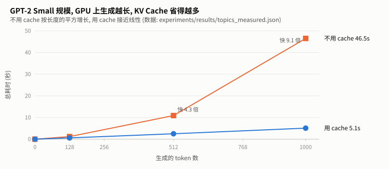

**图 12** 上表画成曲线。**怎么读**: 橙线 (不用 cache) 越往右越陡, 是一条向上弯的抛物线; 蓝线 (用 cache) 几乎是直线。两条线之间的差距随长度迅速拉大, 加速比从 1.8 倍涨到 9.1 倍。


**教训**: 优化之前先搞清楚瓶颈在哪。同一个优化, 在不同的模型规模、不同的硬件上收益可以从 1.1 倍到 9 倍。

### 16.7 代价: 显存

缓存要存每一层、每个位置的 K 和 V:

```math
\text{KV Cache 大小} = 2 \times L \times S \times C \times (\text{每个数的字节数}) \times B
```

($`L`$ 层数, $`S`$ 序列长度, $`C`$ 维度, $`B`$ batch。开头的 2 是 K 和 V 各一份。)

| 模型 | 设置 | KV Cache |
|---|---|---|
| GPT-2 Small | $`L=12,\ C=768,\ S=1024`$, fp32, 1 条 | 72 MB |
| LLaMA-2 7B | $`L=32,\ C=4096,\ S=4096`$, fp16, 1 条 | **2 GB** |

7B 模型一条 4096 长度的对话, 光缓存就要 2GB, 同时服务几十个用户就是几十 GB。这正是 GQA、MLA 这些注意力变体被发明出来的原因: 它们让多个注意力头**共用**同一份 K、V, 把缓存成倍缩小。详见 [A4-modern-small-model 第 2.3 节](../modern-small-model/TUTORIAL.md)。

---

## 17. 专题 B · 梯度推导: 训练信号从哪来

### 17.1 一句话

> 交叉熵对 logits 的梯度就是"预测概率减去正确答案", 简单到可以心算; 而 softmax 一旦饱和, 梯度就传不过去。

### 17.2 softmax + 交叉熵的梯度: $`p - y`$

单个位置, logits 为 $`z`$, 正确答案为 $`y`$。把第 8.2 节的 loss 展开:

```math
\mathcal{L} = -\ln \frac{e^{z_y}}{\sum_j e^{z_j}} = -z_y + \ln \sum_j e^{z_j}
```

对任意一个 $`z_i`$ 求偏导。第一项只有当 $`i = y`$ 时才有贡献; 第二项用链式法则:

```math
\frac{\partial \mathcal{L}}{\partial z_i} = -\mathbb{1}[i = y] + \frac{e^{z_i}}{\sum_j e^{z_j}} = p_i - \mathbb{1}[i = y]
```

写成向量就是 $`\nabla_z \mathcal{L} = p - e_y`$, 其中 $`e_y`$ 是正确答案的 one-hot 向量。

**怎么理解**: 梯度下降是沿着梯度的**反方向**走。于是:
- 正确答案的 logit 被**推高**, 推多少取决于 $`1 - p_y`$, 也就是"还差多少才完全确定";
- 每个错误答案的 logit 被**压低**, 压多少等于模型给它的概率 $`p_i`$。越是"错得自信"的答案, 被压得越狠。

实测 (65 个类别, 用 autograd 和公式各算一遍):

```
autograd 与 p - onehot 的最大差异: 7.45e-09
正确答案位置的梯度 = p_y - 1 = -0.9990  (p_y = 0.0010)
梯度各分量之和 = 1.19e-07  (恒为 0)
```

**梯度之和恒为 0**: $`\sum_i p_i = 1`$, 减去 one-hot 的 1, 正好是 0。直观上, 给正确答案加多少分, 就从错误答案那里一共扣掉多少分。

> 💡 这也解释了第 8.3 节的初始 loss 自检: 初始时 $`p \approx 1/V`$ 均匀分布, 每个位置的梯度都很"温和", 训练能平稳起步。
> 如果初始化太大、模型一上来就"错得很自信", 某些 $`p_i`$ 接近 1, 梯度会很大, 训练初期容易震荡。

### 17.3 softmax 的雅可比矩阵

注意力里的 softmax 后面接的不是交叉熵, 所以要单独看 softmax 本身怎么传梯度。对 $`p = \mathrm{softmax}(z)`$:

```math
\frac{\partial p_i}{\partial z_j} = p_i\,(\mathbb{1}[i=j] - p_j) \qquad\Longrightarrow\qquad J = \mathrm{diag}(p) - p\,p^\top
```

(推导: 对 $`p_i = e^{z_i} / \sum_k e^{z_k}`$ 用商的求导法则, $`i = j`$ 和 $`i \ne j`$ 两种情况分别算, 合并后就是上式。)

关键在于: **当 $`p`$ 接近 one-hot 时, $`J`$ 的每一项都趋于 0。** 设 $`p_a \approx 1`$、其余 $`\approx 0`$, 则对角线 $`p_i(1 - p_i)`$ 和非对角线 $`-p_i p_j`$ 全都 $`\approx 0`$。实测把同一组输入逐步放大:

```
输入 × 1    p = [0.09, 0.2447, 0.6652]   max|J| = 2.23e-01
输入 × 4    p = [0.0003, 0.018, 0.9817]   max|J| = 1.80e-02
输入 × 8    p = [0.0, 0.0003, 0.9997]     max|J| = 3.35e-04
输入 × 16   p = [0.0, 0.0, 1.0]           max|J| = 1.19e-07
```

放大 16 倍后, 梯度缩小到原来的约百万分之一。

### 17.4 回到注意力: 不除以 √d_k 会怎样

第 5.4 节说不缩放会让 softmax 饱和。现在可以精确地测量它的后果。单头注意力, 随机 Q、K、V, 序列长度 32, 各 200 次:

```
d_k   方式      平均最大权重  有效梯度位置   饱和行   饱和行梯度   其余行梯度
16    ÷√d_k         0.162       90.1%       0.0%        —        0.8378
16    不缩放        0.624       30.9%       2.9%     0.0127      0.8715
64    ÷√d_k         0.165       90.4%       0.0%        —        1.7160
64    不缩放        0.819       15.6%      24.0%     0.0088      1.1564
256   ÷√d_k         0.165       90.3%       0.0%        —        3.4916
256   不缩放        0.906       10.0%      51.7%     0.0014      1.8908
```

(饱和行: 最大注意力权重 > 0.99 的行。有效梯度位置: 梯度超过该行最大梯度 1% 的位置占比。)

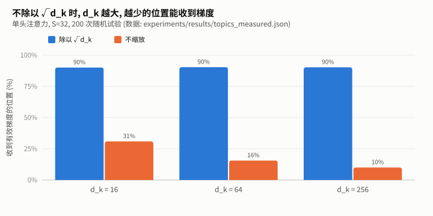

**图 13** 上表"有效梯度位置"一列的柱状图。**怎么读**: 蓝柱 (除以 $`\sqrt{d_k}`$) 在三种维度下都稳定在 90% 左右, 也就是说几乎所有位置都能收到梯度、都能被学习; 橙柱 (不缩放) 随 $`d_k`$ 增大从 31% 降到 10%: 维度越大, 梯度越集中到极少数位置上。

三个发现:


1. **缩放后, 行为与 $`d_k`$ 无关**: 平均最大权重稳定在 0.16 左右, 90% 的位置都能收到梯度。这正是除以 $`\sqrt{d_k}`$ 的目的。
2. **不缩放时, $`d_k`$ 越大越糟**: $`d_k=256`$ 时一半以上的行已经饱和, 而这些行收到的梯度 (0.0014) 只有其余行 (1.89) 的约 **1/1300**。这些行的注意力模式基本学不动了。
3. **梯度集中到极少数位置**: 只有 10% 的位置能收到有效梯度, 模型只能强化"已经最受关注的那一个", 没法学着把注意力挪到别处。

> ⚠️ **一个容易误判的地方**: 如果你测的是"对 Q 的总梯度范数", 会发现不缩放时它反而**更大**
> (本实验的早期版本就踩了这个坑)。因为 $`\partial(q \cdot k)/\partial q = k`$, 不缩放时链式法则里乘的是没有缩小的 $`k`$, 把 softmax 那一段的衰减掩盖了。
> 所以诊断饱和问题时, 要看**穿过 softmax 那一步的梯度**, 以及梯度**分布在多少个位置上**, 而不是只看一个总范数。

---

## 18. 专题 C · 数值格式: fp32 / fp16 / bf16 与混合精度

### 18.1 一句话

> 16 位浮点数只有 32 位的一半, 省一半显存、快很多, 代价是要么范围不够 (fp16), 要么精度不够 (bf16); 混合精度训练就是在两者之间做取舍。

### 18.2 浮点数的结构

一个浮点数由三部分组成: 符号位 $`s`$、指数 $`e`$、尾数 $`f`$:

```math
x = (-1)^s \times 2^{\,e - \text{bias}} \times (1.f)_2
```

- **指数位数决定范围**: 能表示多大、多小的数。
- **尾数位数决定精度**: 相邻两个可表示的数之间隔多远。

实测三种格式 (`torch.finfo`):

```
格式   位分配 (符号+指数+尾数)    最大值      最小正规数    eps (1 之后的间距)
fp32   1 + 8 + 23             3.403e+38    1.175e-38       1.192e-07
fp16   1 + 5 + 10             6.55e+04     6.104e-05       0.0009766
bf16   1 + 8 + 7              3.39e+38     1.175e-38       0.007812
```

**bf16 的设计思路**: 直接把 fp32 的尾数砍掉 16 位, 指数原样保留。所以 bf16 的范围和 fp32 一样大, 但精度很粗: 1 和下一个可表示数之间差 $`2^{-7} \approx 0.0078`$。fp16 正好相反: 精度好一些 ($`2^{-10}`$), 但最大只能表示 65504。

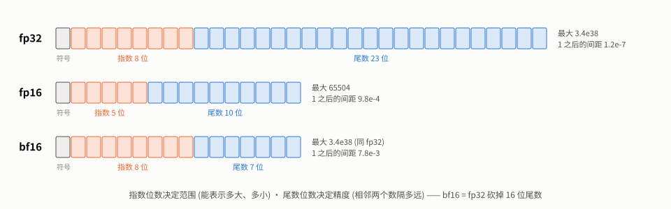

**图 14** **怎么读**: 每个小格是 1 位, 灰色是符号位, 橙色是指数位, 蓝色是尾数位。橙色越多, 能表示的数越大、越小 (范围); 蓝色越多, 相邻两个数挨得越近 (精度)。对比下面两行: fp16 把位数分给了尾数 (10 位), 指数只剩 5 位, 所以最大只到 65504; bf16 保留了和 fp32 一样的 8 位指数, 代价是尾数只剩 7 位。


### 18.3 三类数值事故 (实测)

```
fp32:  70000 存进来 = 70000    1e-8 存进来 = 1e-08       1 + 0.001 = 1.001000
fp16:  70000 存进来 = inf      1e-8 存进来 = 0           1 + 0.001 = 1.000977
bf16:  70000 存进来 = 70144    1e-8 存进来 = 1.001e-08   1 + 0.001 = 1.000000
```

| 事故 | 现象 | 谁会中招 | 在训练里意味着 |
|---|---|---|---|
| **上溢** | 超过最大值变成 `inf` | fp16 (最大 65504) | 某个激活或 loss 一大, 就变 inf, 接着变 NaN |
| **下溢** | 太小的数变成 0 | fp16 | 小梯度直接消失, 对应参数不再更新 |
| **吞掉** | 大数加小数, 小数被舍入掉 | bf16 最严重, fp16 也有 | 参数更新量太小, 加上去等于没加 |

"吞掉"最隐蔽。参数 = 1.0, 每步加上 $`\eta \cdot g = 10^{-4}`$, 加 1000 步, 理论结果是 1.1:

```
fp32: 1.100017
fp16: 1.000000
bf16: 1.000000
```

16 位格式下, 1000 步更新**全部丢失**。原因: 1.0 附近相邻两个可表示数的间距是 eps (bf16 为 0.0078), 加上的量小于间距的一半, 舍入后就回到原值。

### 18.4 混合精度: 计算用 16 位, 参数用 32 位

上面的实验直接说明了为什么不能"全部用 16 位训练": 参数更新会被吞掉。所以混合精度训练的做法是:

| | 精度 | 原因 |
|---|---|---|
| 矩阵乘法等大部分计算 | 16 位 | 占时间和激活显存的大头, 对精度不敏感 |
| **参数本身 (主权重)** | **32 位** | 每步的更新量很小, 16 位会吞掉 |
| 优化器状态 ($`m, v`$) | 32 位 | 同上, 而且 $`v`$ 是梯度的平方, 范围很大 |
| loss、softmax、LayerNorm 的统计量 | 32 位 | 涉及求和与指数, 容易溢出或丢精度 |

`torch.autocast` 自动帮你做"哪些操作用 16 位、哪些保持 32 位"的选择。本项目 `--amp` 就是这种模式。

### 18.5 loss scaling: 救 fp16 的下溢

fp16 能表示的最小正规数是 $`6 \times 10^{-5}`$ (更小的数用"非正规数"表示, 精度越来越差, 小于约 $`3 \times 10^{-8}`$ 就直接变 0)。而深层网络的很多梯度比这个还小。

办法很简单: 反向传播之前先把 loss 乘一个大数 $`s`$ (比如 $`2^{16} = 65536`$), 所有梯度就跟着放大 $`s`$ 倍, 落进 fp16 能精确表示的范围; 更新参数之前再除回来。实测:

```
  真实梯度   直接转 fp16    误差     ×65536 后转 fp16 再还原    误差
     1e-08           0   100.0%                      1e-08    0.0%
     3e-08    5.96e-08    98.7%                      3e-08    0.0%
     2e-07    1.79e-07    10.6%                      2e-07    0.0%
     5e-06    5.01e-06     0.1%                      5e-06    0.0%
     0.001       0.001     0.0%                      0.001    0.0%
```

这就是第 10.3 节 `scaler.scale(loss)` 和 `scaler.unscale_(optimizer)` 在做的事。`GradScaler` 还会自动调整 $`s`$: 一旦发现梯度里出现 inf (放大过头了), 就跳过这一步并把 $`s`$ 减半。

**bf16 不需要 loss scaling**: 它的指数和 fp32 一样有 8 位, 最小正规数也是 $`10^{-38}`$ 量级, 不存在下溢问题 (见 18.3 节, $`10^{-8}`$ 存进 bf16 完好无损)。

### 18.6 复现 QLoRA 那次崩溃

[C2-tool-finetune](../../post-training/tool-finetune/) 刚搭起来时, 用 `fp16=True` 训练直接崩溃。当时只知道"换成 bf16 就好了", 现在可以把它精确复现出来 ([precision.py](experiments/precision.py) 第 4 部分):

```python
model = torch.nn.Linear(16, 16).cuda().to(torch.bfloat16)    # 参数本身是 bf16
scaler = torch.amp.GradScaler("cuda")                         # 为 fp16 设计的 loss scaler
...
scaler.unscale_(opt)
```

```
NotImplementedError: "_amp_foreach_non_finite_check_and_unscale_cuda" not implemented for 'BFloat16'
改用 bf16 autocast、去掉 scaler 后: 正常完成一步更新
```

和当时的报错**一字不差**。能确定的根因:
1. `fp16=True` 会启用 `GradScaler`。它是为"fp32 参数 + fp16 计算"设计的。
2. `GradScaler` 在 `unscale_` 时用一个专门的 CUDA 内核检查梯度里有没有 inf, 这个内核**没有 bf16 版本**。
3. 只要交给它的梯度里有 bf16 张量, 第一次 `unscale_` 就会崩溃。

至于当时的梯度为什么会是 bf16, 有一个很可能的解释 (未单独验证): 旧版 `train.py` 的 `--bf16` 参数默认开启而且关不掉,
所以传 `--fp16` 时两者同时生效, 4 位量化层的计算精度被设成了 bf16。这个参数问题已在仓库整理时修复 (现在两者互斥)。

**规则**:
- 参数是 fp32、计算用 fp16 → 需要 `GradScaler` (本项目 `--amp` 就是这种, 所以能正常跑)。
- 参数或计算是 bf16 → **不要**用 `GradScaler`。bf16 本来就不会下溢, 也不需要它。

---

## 19. 专题 D · FlashAttention: 不把 S×S 矩阵写进显存

### 19.1 一句话

> 注意力分数矩阵是 $`S \times S`$ 的, 序列一长就塞不进显存; FlashAttention 把它切成小块, 在芯片上的高速缓存里边算边丢, 从头到尾不把完整矩阵写进显存。

### 19.2 手写注意力的显存问题

`model.py` 的写法会显式算出分数矩阵, 形状是 $`(B, H, S, S)`$。以 $`B=4,\ H=8,\ S=4096`$、bf16 为例:

```math
4 \times 8 \times 4096 \times 4096 \times 2\ \text{字节} = 1\ \text{GB}
```

而且这不是唯一的一份: 掩码后的分数、softmax 之后的权重, 反向传播还要保留它们。序列长度翻倍, 这些矩阵就变成 4 倍。

### 19.3 核心技巧: 分块计算 softmax (online softmax)

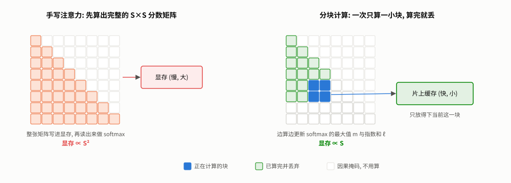

**图 15** **怎么读**: 两边都是 8×8 的注意力分数矩阵 (右上角是因果掩码, 不用算)。左边手写实现: 先把整个下三角 (橙色) 全部算出来, 写进显存, 再读出来做 softmax, 显存占用 ∝ $`S^2`$。右边分块实现: 每次只把一小块 (深蓝, 2×2) 搬进片上的高速缓存算完, 然后丢掉 (绿色是已经算完丢掉的), 片上缓存只需要放得下一块, 显存占用 ∝ $`S`$。难点在于 softmax 需要整行的信息, 下面的 online softmax 就是为了解决它。

难点在 softmax: 它的分母要对**整行**求和, 看起来必须先拿到整行才能算。FlashAttention 用的技巧是**边看边修正**: 维护"目前见过的最大值 $`m`$"和"按 $`m`$ 折算的指数和 $`\ell`$", 每看到一块新数据就更新:

```math
m_{\text{new}} = \max\big(m,\ \max(x_{\text{块}})\big), \qquad
\ell_{\text{new}} = \ell \cdot e^{\,m - m_{\text{new}}} + \sum_{x \in \text{块}} e^{\,x - m_{\text{new}}}
```

最大值变大时, 之前累加的和要乘以 $`e^{m - m_{\text{new}}}`$ 折算到新的基准上。全部看完后, $`\mathrm{softmax}(x)_i = e^{x_i - m} / \ell`$。可以直接验证:

```python
import math, torch
torch.manual_seed(0)
x = torch.randn(10) * 5
m, l = -math.inf, 0.0                     # 目前见过的最大值, 以及按这个最大值折算的指数和
for chunk in x.split(3):                  # 每次只看 3 个数, 不需要整行同时在内存里
    m_new = max(m, chunk.max().item())
    l = l * math.exp(m - m_new) + torch.exp(chunk - m_new).sum().item()
    m = m_new
p = torch.exp(x - m) / l
print(f"分块计算与一次性 softmax 的最大差异: {(p - torch.softmax(x, 0)).abs().max():.2e}")
# 输出: 分块计算与一次性 softmax 的最大差异: 1.19e-07
```

输出 $`V`$ 的加权和也可以用同样的方式边算边修正。于是整个注意力可以按块计算, 每块只需要 $`O(\text{块大小}^2)`$ 的临时空间。反向传播时不保存大矩阵, 而是**重新算一遍**: 多花一点计算, 换来显存从 $`O(S^2)`$ 降到 $`O(S)`$。

**为什么还能更快?** 计算量其实没有减少 (反向还多算了一遍)。快的原因是 GPU 上**读写显存比计算慢得多**。手写版本要把 $`S \times S`$ 的矩阵在显存里写入、读出好几遍; 分块版本把数据留在芯片上的高速缓存 (SRAM) 里算完, 显存读写大幅减少。

### 19.4 本机实测

PyTorch 的 `F.scaled_dot_product_attention` 内置了几种实现 ("后端"), 会自动挑一个能用的。[flash_attention.py](experiments/flash_attention.py) 逐个强制指定, 看本机实际能用哪些:

```
torch 2.11.0+cu128, GPU NVIDIA GeForce RTX 5060 Laptop GPU
FLASH          不可用: No available kernel. Aborting execution.
MEM_EFFICIENT  可用
MATH           可用
```

**FLASH 后端在本机不可用。** PyTorch 的 Windows 版本没有编译 FlashAttention 内核。**MEM_EFFICIENT** 是另一套同样基于分块和 online softmax 的实现 (源自 xFormers), 思路一致, 在本机可用。**MATH** 是普通的逐步计算, 用来兜底。

数值一致性 (与 `model.py` 的手写写法对比):

```
fp32:  MEM_EFFICIENT 1.55e-06    MATH 4.77e-07
bf16:  MEM_EFFICIENT 1.56e-02    MATH 1.56e-02
```

fp32 下差异在 $`10^{-6}`$ 量级, 说明算法等价。bf16 下的 0.0156 与 bf16 本身的精度 (1 附近相邻两数间距 0.0078) 在同一量级, 是格式的精度极限, 不是实现的问题。

前向 + 反向, $`B=4,\ H=8,\ d_k=64`$, bf16, 耗时与额外峰值显存:

```
S        手写                  MEM_EFFICIENT          MATH
512      1.37ms     64MB       0.66ms     14MB        3.57ms    140MB
1024     9.49ms    257MB       2.93ms     28MB       17.73ms    536MB
2048    40.06ms   1028MB       9.24ms     57MB      103.07ms   2096MB
4096   216.81ms   4112MB      39.71ms    113MB      724.05ms   8288MB
8192      显存不足            133.73ms    226MB          显存不足
```

- **显存**: 手写版本每次 S 翻倍, 显存约变成 4 倍 (64 → 257 → 1028 → 4112MB), 是平方增长; MEM_EFFICIENT 每次约翻倍 (14 → 28 → 57 → 113 → 226MB), 是线性增长。到 8192 时手写版本已经放不下, MEM_EFFICIENT 只用了 226MB。

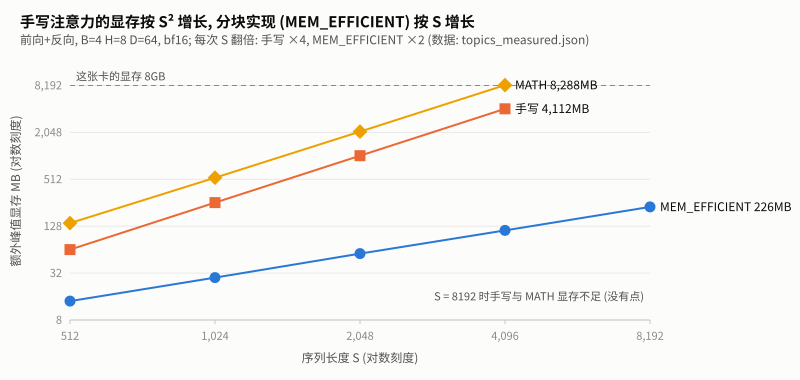

**图 16** 上表显存部分的图形版, 两个轴都是对数刻度。**怎么读**: 对数坐标下, 平方增长和线性增长都是直线, 区别在**斜率**: 手写和 MATH 的线每向右一格 (S 翻倍) 上升两格 (显存 ×4), MEM_EFFICIENT 只上升一格 (显存 ×2)。虚线是这张卡的 8GB 显存, 手写和 MATH 在 S=4096 时已经顶到附近, 所以 S=8192 时没有点。

- **速度**: MEM_EFFICIENT 比手写快 2~5 倍, 而且序列越长优势越大。
- **MATH 后端更慢、更占显存**, 在 4096 时峰值 8288MB, 超过了这张卡 8GB 的物理显存。推测是 Windows 驱动把超出的部分放到了系统内存 (NVIDIA 驱动的"系统内存回退"功能), 这也会让它特别慢。这一点没有进一步验证。

### 19.5 用到本项目里

`model.py` 的手写注意力可以直接换成一行:

```python
attn_out = F.scaled_dot_product_attention(q, k, v, is_causal=True,
                                          dropout_p=self.attn_dropout.p if self.training else 0.0)
```

`is_causal=True` 会在内部处理因果掩码, 不再需要 `self.mask` 这个 buffer。留作练习 (第 21 节): 替换后用 `kv_cache.py` 的等价性检查思路, 验证输出与原实现一致。

---

## 20. 专题 E · 显存与算力账本: 8GB 能训多大的模型

### 20.1 一句话

> 训练时显存 = 静态部分 (参数、梯度、优化器状态, 约 16 字节/参数) + 激活 (随 batch 和序列长度增长); 计算量约为每个 token $`6N`$ 次浮点运算。

### 20.2 静态显存: 每个参数 16 字节

用 fp32 + AdamW 训练时, 每个参数要存 4 份:

| 内容 | 字节 |
|---|---|
| 参数本身 | 4 |
| 梯度 | 4 |
| AdamW 的 $`m`$ (一阶矩) | 4 |
| AdamW 的 $`v`$ (二阶矩) | 4 |
| **合计** | **16** |

实测 (做完一步训练后的显存占用):

```
配置                参数量        预测        实测
micro             834,432      12.7MB      30.2MB
6层384维        10,770,816     164.3MB     169.8MB
GPT-2 Small    123,849,984    1889.8MB    1901.1MB
```

模型越大, 预测越准: GPT-2 Small 只差 0.6%。

micro 多出的约 17MB 是什么? 逐步拆开测量: 建好模型后是 3.4MB (参数 3.2MB + 掩码 buffer 0.25MB), **反向传播之后多出了 17MB**, 远超梯度应占的 3.2MB。把 cuBLAS (矩阵乘法库) 的工作空间调小再测:

```
CUBLAS_WORKSPACE_CONFIG=(默认):  参数和梯度之外多出 17.57MB
CUBLAS_WORKSPACE_CONFIG=:16:8:  参数和梯度之外多出 0.69MB
```

所以多出来的是 **cuBLAS 的工作空间**: 一块固定大小的临时内存, 与模型大小无关。大模型时可以忽略, 小模型时就显得很明显。

### 20.3 激活显存: 随 batch 线性增长

反向传播需要用到前向时的中间结果 (每一层的输入、注意力权重、FFN 的中间值等), 它们在前向时就得存下来。GPT-2 Small, `block_size=256`:

```
batch      峰值       激活    激活/样本
1        2442MB     524MB      524MB
2        2711MB     793MB      397MB
4        3432MB    1514MB      378MB
8        4941MB    3023MB      378MB
16       7966MB    6049MB      378MB
```

- batch ≥ 4 后, 每个样本稳定占 **378MB**, 是静态部分 (1.9GB) 的约 1/5。batch=16 时激活达到 6GB, 已经是静态部分的 3 倍多。
- batch=1 时每样本更多, 是因为有一部分临时空间与 batch 无关。
- 其中一个大头是输出层: 每个样本的 logits 是 $`256 \times 50257 \times 4`$ 字节 = **49MB**, 计算交叉熵时还会产生同样大小的中间结果。词表越大, 这部分越大。
- 8GB 显存下, 这个配置的 batch 最大约为 16 (峰值 7966MB)。

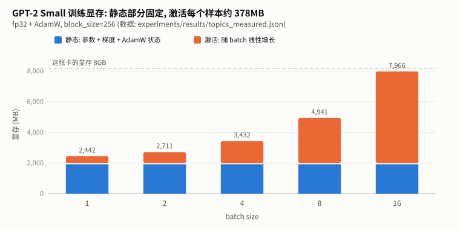

**图 17** **怎么读**: 每根柱子是一个 batch 大小下的峰值显存, 蓝色是静态部分 (参数、梯度、AdamW 状态, 与 batch 无关, 约 1.9GB), 橙色是激活。蓝色部分一样高, 橙色部分随 batch 翻倍而翻倍; batch=16 时柱顶 (7966MB) 已经贴近 8GB 虚线。(这组实验里蓝色部分是 1918MB, 比 20.2 节静态表的 1901MB 多约 17MB, 两者是同一脚本里两次独立的测量。)


### 20.4 算力: 每个 token 约 6N 次浮点运算

一个 $`(m \times n)`$ 的矩阵乘以长度为 $`n`$ 的向量, 要做 $`m \times n`$ 次乘法和差不多同样多次加法, 也就是约 $`2 \times`$ 参数量次浮点运算。所以:

```math
\text{前向} \approx 2N, \qquad \text{反向} \approx 4N, \qquad \text{合计} \approx 6N \ \text{次 / token}
```

反向是前向的 2 倍, 因为每个矩阵乘法要算两个梯度: 对输入的梯度 (传给上一层) 和对权重的梯度 (用来更新), 各需要一次同样规模的矩阵乘法。(这个估算忽略了注意力分数 $`QK^\top`$ 这一项, 序列不太长时它占比很小。)

实测吞吐 (fp32, batch=8):

```
配置            tokens/s     达到的 TFLOPS
micro            151,606       0.76
6层384维          33,566       2.17
GPT-2 Small        3,244       2.41
```

micro 只达到 0.76 TFLOPS, 是因为矩阵太小, 喂不饱 GPU (和专题 A 里"小模型时 GPU 都在等启动"是同一个原因)。模型变大后利用率上升。开启 bf16 混合精度通常还能明显提速, 因为 GPU 的 16 位矩阵运算单元 (Tensor Core) 比 32 位快得多; 具体快多少本节没有实测。

**用它来估算训练时间**: Tiny Shakespeare 训练集约 100 万字符。GPT-2 Small 规模以每秒 3244 个 token 计算, 字符级训练跑一个 epoch 约需 $`1{,}003{,}854 / 3244 \approx 310`$ 秒, 约 5 分钟。

### 20.5 8GB 能训多大的模型

只算静态部分, fp32 + AdamW:

```math
\frac{8\ \text{GB}}{16\ \text{字节/参数}} \approx 5 \times 10^8 = 5\ \text{亿参数}
```

这是连激活都没算的理论上限, 实际能从头训练的规模在 1~3 亿参数。可 [C2-tool-finetune](../../post-training/tool-finetune/) 却能在同一张卡上微调 15 亿参数的模型, 秘诀就在于绕开了上面这张账单:

- 原模型参数**冻结**, 不需要梯度和优化器状态, 并且量化成 4 位, 每个参数只占约 0.5 字节: 15 亿 × 0.5 字节 ≈ 0.75GB。
- 只训练额外加上的、很小的 LoRA 参数 (通常不到总量的 1%), 只有这部分需要 16 字节/参数。

这就是下一个项目要讲的内容。

---

## 21. 延伸专题练习

### 练习 6: 换成 PyTorch 的融合注意力 (对应专题 D)

把 `CausalSelfAttention.forward` 里的手写注意力换成 `F.scaled_dot_product_attention`, 并验证在 `model.eval()` 下输出与原实现一致 (误差 < 1e-5)。

<details>
<summary>参考写法与验证结果</summary>

```python
def forward(self, x):
    B, S, C = x.shape
    q, k, v = self.c_attn(x).split(C, dim=-1)
    q, k, v = (t.view(B, S, self.n_heads, self.d_k).transpose(1, 2) for t in (q, k, v))
    out = F.scaled_dot_product_attention(
        q, k, v, is_causal=True,
        dropout_p=self.attn_dropout.p if self.training else 0.0,
    )
    return self.resid_dropout(self.c_proj(out.transpose(1, 2).contiguous().view(B, S, C)))
```

验证方法: 同一个模型、同一个输入, 替换前后各算一次 logits。本机实测最大差异 `1.79e-07`。

**一个附带的发现**: 原实现在 `__init__` 里定义了 `self.attn_dropout`, 但 `forward` 里**从来没有用到它**,
所以原模型训练时注意力权重上其实没有 dropout。上面的写法通过 `dropout_p` 把它真正用上了, 这会改变训练行为
(eval 模式下没有区别, 所以等价性检查仍然通过)。这类"定义了但没用上"的模块不会报错, 只能靠读代码发现。
</details>

### 练习 7: 算一算 KV Cache (对应专题 A)

micro 配置 ($`L=4,\ C=128`$, `block_size=256`), fp32, 生成一条满长度的序列, KV Cache 占多少显存?

<details>
<summary>答案</summary>

```math
2 \times L \times S \times C \times 4\ \text{字节} = 2 \times 4 \times 256 \times 128 \times 4 = 1{,}048{,}576\ \text{字节} = 1\ \text{MB}
```

和 16.7 节的 7B 模型 (2GB) 相比微不足道。KV Cache 的显存问题只在大模型、长上下文、多用户并发时才会出现。
</details>

### 练习 8: 为什么 logits 整体加一个常数, loss 不变 (对应专题 B)

把某个位置的所有 logits 都加上 100, 交叉熵 loss 会变吗? 这和"梯度各分量之和恒为 0"有什么关系?

<details>
<summary>答案</summary>

不变。softmax 的分子分母同时乘以 $`e^{100}`$, 约掉了:

```math
\frac{e^{z_i + c}}{\sum_j e^{z_j + c}} = \frac{e^{c} \cdot e^{z_i}}{e^{c} \cdot \sum_j e^{z_j}} = \frac{e^{z_i}}{\sum_j e^{z_j}}
```

实测: 加 100 前后 loss 分别为 `1.435891` 和 `1.435889`, 差异来自浮点舍入。

两者是同一件事的两面: loss 沿着"所有分量一起增大"的方向不变, 所以梯度在这个方向上的分量 (也就是所有分量之和) 必须为 0。
实际实现里, 正是利用这个性质先减去最大值再算 $`e^{z}`$, 避免数值溢出 (专题 D 的 online softmax 也用了同一招)。
</details>

### 练习 9: 8GB 能不能训 GPT-2 Medium (对应专题 E)

GPT-2 Medium 有 354,823,168 个参数 (本项目实测, 已含权重绑定)。用 fp32 + AdamW, 在 8GB 显存上能训练吗?

<details>
<summary>答案</summary>

静态部分: $`16 \times 354{,}823{,}168 \approx 5.68 \times 10^9`$ 字节, 约 5.3GB (按 $`2^{30}`$ 字节为 1GB 计)。
再加上 cuBLAS 工作空间等固定开销, 留给激活的只剩 2GB 多一点。

GPT-2 Small 在 `block_size=256` 时每个样本的激活约 378MB (专题 E)。Medium 层数是 2 倍、维度是 4/3 倍,
粗略估计每个样本的激活接近 1GB。所以 **batch 只能取 1~2, 勉强能跑**, 实际可行性需要实测。

验证方法: 在 [memory_compute.py](experiments/memory_compute.py) 的 `CONFIGS` 里加入 Medium 配置再运行。
如果显存不够, 常见的办法是: bf16 混合精度 (激活减半)、梯度检查点 (不存激活, 反向时重算)、或者换用只存 8 位优化器状态的优化器。
</details>

### 练习 10: 把 KV Cache 集成进 `generate()` (② 接口级)

给 `GPT` 加一个 `generate(..., use_cache=True)` 选项。只给验收标准, 实现细节自己设计:

1. 固定随机种子, `use_cache=True` 与 `False` 生成的文字**完全相同**;
2. CPU 上用 6 层 384 维的配置生成 255 个 token, 有 cache 比无 cache 快 2 倍以上;
3. 生成长度超过 `block_size` 时不报错 (提示: 缓存也要截断, 想一想截断后位置编码该怎么处理)。

第 3 条有一个容易忽略的陷阱。卡住了可以按 ROADMAP 里约定的分级提示来问。
