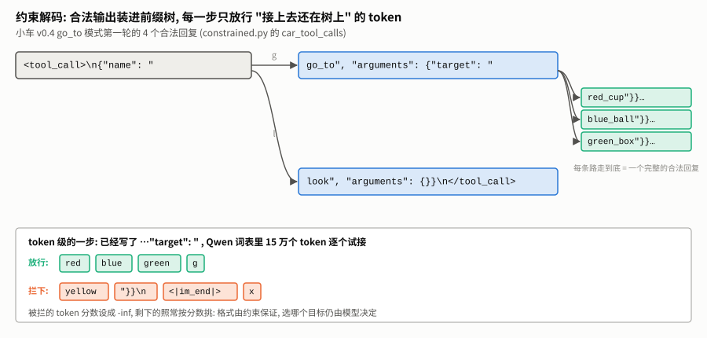
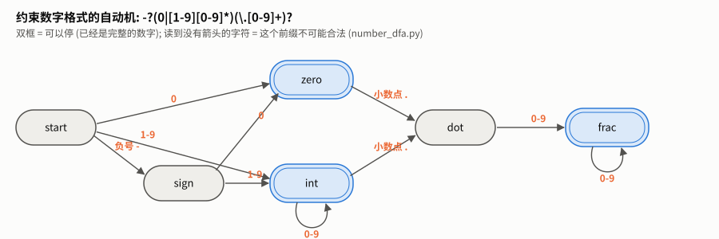

# 结构化输出讲义 — 让模型只能写出合法的东西

> 知识库 · 大语言模型 · 第 7 单元。所有数字都在作者的笔记本上实测 (只用 CPU), 命令和结果文件见每节末尾。
> 一句话: **每一步, 把 "接上去之后就不可能再合法" 的 token 的分数设成 -∞。** 不合法的路被堵死, 模型只能在合法的路里挑。格式由约束保证, 写什么仍由模型决定。

## 目录

- [0. 阅读指南](#0-阅读指南)
- [1. 问题: 格式错一个字, 小车就不动](#1-问题-格式错一个字-小车就不动)
- [2. 最直接的约束: 把合法输出全部列出来](#2-最直接的约束-把合法输出全部列出来)
- [3. 在真实模型上: 约束把格式错误降到 0](#3-在真实模型上-约束把格式错误降到-0)
- [4. 从字符到 token: 真正难的地方](#4-从字符到-token-真正难的地方)
- [5. 列不完的时候: 自动机与文法](#5-列不完的时候-自动机与文法)
- [6. 约束管不了什么](#6-约束管不了什么)
- [7. 练习](#7-练习)
- [8. 延伸资源](#8-延伸资源)

---

## 0. 阅读指南

### 0.1 这个单元在仓库里的位置

| | |
|---|---|
| 领域 | 知识库 · 大语言模型 ([目录](../README.md)) |
| 用到它的地方 | 小车 [v0.4 听懂文字](../../../projects/car/v0.4-text-commands/TUTORIAL.md): go_to 模式里 12/30 局 "没动", 都是模型把工具调用写成了普通文字; 项目 [推理服务](../../../projects/serving/README.md): 推理引擎的结构化输出功能 |
| 相邻单元 | 上游 [chat-template](../chat-template/TUTORIAL.md) (工具调用长什么样)、[decoding](../decoding/TUTORIAL.md) (每一步怎么从分数里挑 token, 本单元在那条流水线上多加一步); 下游 Agent 领域的 tool-calling |

### 0.2 需要先知道什么

1. **模型每一步给每个 token 打分, 解码从中挑一个**; 分数设成 -∞ 的 token 概率为 0, 永远不会被挑中。读 [decoding 讲义第 1、4 节](../decoding/TUTORIAL.md#1-问题-一串分数-挑一个)。
2. **Qwen 的工具调用格式**: `<tool_call>\n{"name": ..., "arguments": {...}}\n</tool_call>`。读 [chat-template 讲义第 7.2 节](../chat-template/TUTORIAL.md#72-模型写出调用)。

### 0.3 文件和命令

```
structured-output/
├── constrained.py        前缀树、token 级的放行集合、小车的 4 个合法工具调用 (只用标准库)
├── number_dfa.py         约束数字格式的自动机 (练习 3 的参考答案)
├── experiments/
│   ├── structured_experiments.py   第 2、3 节的数字
│   └── results/
├── figures/              配图与生成脚本
└── exercises/            三道练习 + 验收测试
```

| 想做什么 | 需要什么 | 命令 |
|---|---|---|
| 第 2 节的小实验、做练习 | 只要 Python 3.8+ | `python experiments/structured_experiments.py --only-toy`; `cd exercises && python -m pytest test_ex1.py -q` |
| 第 3 节在 Qwen 上的实验 | `transformers` + 模型 (0.5B 约 1 GB、1.5B 约 3 GB, 下载办法见 [v0.4 讲义第 1 节](../../../projects/car/v0.4-text-commands/TUTORIAL.md#1-准备环境)); 只用 CPU | `python experiments/structured_experiments.py` (0.5B 约 2 分钟; 1.5B 用 bf16, 约 10 分钟) |

---

## 1. 问题: 格式错一个字, 小车就不动

小车 v0.4 的 go_to 模式里, Qwen2.5-1.5B 有 12/30 局 "没动"。逐局看, 模型其实知道该做什么, 只是写成了这样:

```
"go_to target:red_cup"
```

而程序要的是:

```
<tool_call>
{"name": "go_to", "arguments": {"target": "red_cup"}}
</tool_call>
```

差了标签和 JSON, 解析器认不出来, 小车就不动。[decoding 讲义第 8.3 节](../decoding/TUTORIAL.md#83-在真实模型和小车上) 查出了一部分原因 (模型自带的重复惩罚压低了 `<tool_call>`), 关掉惩罚后降到 4 局。但剩下的 4 局, 以及换个模型、换个提示词还会出现的别的写法, 靠调参数是堵不完的。

已经试过的办法是 v0.4 讲义第 6 节的 "强制调用": 替模型写好开头的 `<tool_call>\n`, 把 "没动" 降到了 0。它只管住了开头; 本单元把这个思路推到底: **每一个 token 都只能在合法的范围里挑**。

---

## 2. 最直接的约束: 把合法输出全部列出来

小车 go_to 模式第一轮的合法回复只有 4 个: `go_to` 加三个目标之一, 或者 `look`。把它们装进一棵**前缀树** (每个节点是 "写到这里了", 每条边是 "下一个字符"):



生成时每一步问前缀树: 目前写的文字后面, 还能接哪些字符? 不能接的, 分数设成 -∞:

```python
trie = Trie(car_tool_calls())
trie.allowed_next_chars('<tool_call>\n{"name": "')     # {'g', 'l'}: go_to 或 look
```

先在 [decoding 单元的 ToyLM](../decoding/toy_lm.py) 上试: 一个只读过莎士比亚的字符级模型, 完全不懂 JSON。不加约束, 它写的是 `I withe the the the …`; 加了约束 (`--only-toy`), 实测碰到两件事:

1. **约束不能凭空造出模型写不出的字符。** ToyLM 的词表是莎士比亚里出现过的 65 个字符, 里面没有 `" / < > _ { }`。合法输出里的这些字符它根本没有 token 可写, 只能把它们从合法输出里删掉再约束。真实模型也一样: 约束只能在词表能表达的范围里挑。Qwen 的词表是字节级的, 任何字符都写得出来, 所以不会碰到这个问题。
2. **格式保证了, 写哪一个仍由模型决定。** ToyLM 选了 `look`。把 4 个合法输出在它眼里的总对数概率算出来: look 的 -145, 三个 go_to 在 -188 到 -202 之间。look 最短, 每多一个字符就多乘一个小于 1 的概率, 所以最短的总分最高。这和 [decoding 第 7 节](../decoding/TUTORIAL.md#7-束搜索-总分更高-照样转圈) 束搜索偏爱短输出是同一个原因。

---

## 3. 在真实模型上: 约束把格式错误降到 0

用 v0.4 go_to 模式的 6 条指令, 在**会出问题的设置** (Qwen 自带的重复惩罚 1.1) 下对比 (`structured_experiments.py`, CPU):

| 模型 | 设置 | 合法的工具调用 | 目标正确 | 约束每一步多花 |
|---|---|---|---|---|
| 0.5B | 不加约束 | 6/6 | 6/6 | — |
| 0.5B | 加约束 | 6/6 | 6/6 | 41 ms |
| 1.5B | 不加约束 | **3/6** | 3/6 | — |
| 1.5B | 加约束 | **6/6** | **6/6** | 49 ms |
| 1.5B | 加约束, 关掉重复惩罚 | 6/6 | 6/6 | 46 ms |

1.5B 不加约束时, 3 条写成了普通文字 (`"go_to target:red_cup"`、`"go_to blue_ball"`、`"go_to green_box"`), 和小车评测里看到的一样。另外有 1 条写了 JSON 但没有 `<tool_call>` 标签, agent-loop 的解析器能认出这种 "裸 JSON" ([llm.py](../../agent/agent-loop/llm.py) 的 `parse_qwen_output`), 算作合法。

加约束后, 1.5B 的 6 条全部写成了带标签的标准工具调用, 目标全对, **重复惩罚开着也一样**。不加约束时写成普通文字的那 3 条, 模型其实选对了目标, 只是格式错了; 约束把格式堵死之后, 它在合法的路里挑出了同一个目标。

**约束的代价**: 每一步要把词表里 15 万个 token 逐个试接一遍, 纯 Python 实现约 41~49 毫秒。它和模型本身算一个 token 的时间相比占多大比例, 本单元没有单独测; 真实的推理引擎会把这一步预先编译、并行计算 (第 5.2 节)。

这里只测了第一轮回复。把约束接进 v0.4 的完整评测 (30 个任务、多轮对话), 成功率会怎样, **没有数据**: 要用显卡跑, 留到下一次。

---

## 4. 从字符到 token: 真正难的地方

### 4.1 一个 token 可能跨过好几个边界

ToyLM 一次写一个字符, 约束很简单。真实模型一次写一个 token, 而 Qwen 把上面那个工具调用切成 21 个 token:

```
<tool_call> | \n | {" | name | ": |  " | go | _to | ", |  " | arguments | ": |  {" | target | ": |  " | red | _c | up | "}}\n | </tool_call>
```

倒数第二个 token `"}}\n` 一口气写了引号、两个右括号和换行, 跨过了 "值结束、对象结束、外层对象结束、换行" 四个边界。所以 token 级的约束不能 "看下一个字符合不合法", 而要**把整个 token 接上去, 看结果还在不在树上** (`constrained.py` 的 `allowed_token_ids`):

```python
node = trie.walk(text)                                     # 先走到 "已经写了的文字" 对应的节点
ok = {i for i, s in enumerate(vocab) if s and trie.walk(s, node) is not None}
if "" in node:                                             # 已经是完整的合法输出: 允许停
    ok.add(eos_id)
```

### 4.2 同一段文字有好几种切法

`<tool_call>` 在 Qwen 里是一个专门的 token (见 [chat-template 第 6.1 节](../chat-template/TUTORIAL.md#61-它们在词表的最末尾)), 但普通 token `<`、`tool`、`_call`、`>` 拼起来也是同样的字符串。按 "接上去的字符串在不在树上" 来判, 两种切法都放行。模型训练时见过的是前一种; 如果它在约束下走了后一种 (不常见的切法), 后面写得好不好就很难说了。本单元的实验没有检查模型实际走的是哪种切法。一种稳妥的做法是只允许 "标准切法", 或者干脆替模型把这类固定部分写好 (就像 v0.4 的强制调用)。

### 4.3 前缀合法, 不等于写得完

练习 2 的测试里有一个故意做小的词表: 它有 `{"`、`name`, 也有单独的 `"`, 但没有单独的 `:`。模型如果写出 `{"name` 再接一个单独的 `"`, 文字仍然是合法前缀; 可是下一步需要 `: "`, 词表里没有能接上的 token, 走进了死胡同。

所以约束解码除了问 "还在不在树上", 严格说还要问 "从这里还能不能走到终点"。字节级 BPE 的词表 (Qwen、GPT 系列都是) 包含每一个单字节, 总有办法一个字符一个字符写完, 不会卡死; 自己设计词表、或者用别的分词方式时, 要专门检查这一点。

---

## 5. 列不完的时候: 自动机与文法

小车第一轮的合法回复只有 4 个, 可以全部列出来。但 `walk(distance_m)` 的参数是一个数字, 合法的数字有无穷多个, 列不完。

### 5.1 有限自动机

办法是画一台**有限自动机**: 几个 "状态", 读到一个字符就按规则跳到下一个状态; 跳不过去, 说明这个前缀已经不可能变成合法输出。下面这台约束数字格式 `-?(0|[1-9][0-9]*)(\.[0-9]+)?` (`number_dfa.py`, 练习 3):



约束解码只需要问它三件事, 和前缀树完全一样: 这个前缀还能不能变合法 (`is_prefix`)、它本身是不是完整的 (`is_complete`)、下一个字符可以是什么 (`allowed_next_chars`)。前缀树其实就是一台特殊的自动机。

正则表达式都能变成这样一台自动机; JSON 的嵌套括号要再加一个栈 (文法), 原理相同: **合法输出由一台机器描述, 每一步只放行机器接受的 token**。

### 5.2 真实系统怎么做

| 做法 | 说明 |
|---|---|
| 预先编译 | 本单元每一步都把 15 万个 token 试一遍 (41 ms 起); 成熟的实现会提前把 "每个状态下哪些 token 合法" 算好、存起来, 生成时直接查表 |
| 支持的约束种类 | 正则、JSON Schema、文法 (EBNF)。例如 DeepSeek 开源的推理框架 DeepInfer 把 "结构化输出: 正则、JSON Schema、EBNF 文法" 列为一项功能 (见 [前沿雷达](../../frontier/radar.md)) |
| API 里的对应 | 云端模型的 "强制调用工具" (`tool_choice="required"`, agent-loop 的 [llm.py](../../agent/agent-loop/llm.py) 里用过) 和 "严格的 JSON 输出" 选项, 背后是同一类技术; 各家具体怎么实现, 本单元没有核实 |

---

## 6. 约束管不了什么

1. **内容对不对。** 约束只保证 "是 4 个合法回复之一", 不保证选对目标。第 2 节的 ToyLM 加了约束, 选的是最短的 look, 不是指令要的那个。
2. **该不该调用工具。** 小车第一轮应该调用工具; 但在多轮对话的后面, 模型有时应该直接回答 "已经到了"。如果每一轮都强制必须是工具调用, 它就永远停不下来。约束要和 Agent 循环的逻辑配合: 哪一轮约束、约束成什么样。
3. **模型的理解。** 约束会把模型 "推" 到它原本不想走的路上。第 4.2 节说的不常见切法就是一个例子: 格式对了, 后面的内容可能因此变差。所以约束越少越好, 能用提示词和训练解决的, 不要全靠约束。

---

## 7. 练习

### 7.1 动手写代码 (三级递进)

| 级别 | 练习 | 验收 |
|---|---|---|
| ① 填空 | `ex1_trie_fill.py`: 补全前缀树的四个方法 | 随机字符串集合上和参考实现一致 |
| ② 接口 | `ex2_token_mask.py`: 写 token 级的放行集合 (跨边界的 token、空 token、停止 token) | 小词表和随机词表上和参考实现一致; 能复现第 4.3 节的死胡同 |
| ③ 白纸 | `ex3_number_blank.py`: 不用 re 模块, 手写约束数字格式的自动机 | 所有长度 ≤ 4 的字符串 (约 2.3 万个) 和正则逐个核对 |

```bash
cd library/llm/structured-output/exercises
python -m pytest test_ex1.py -q
```

只需要 Python 和 pytest。提示规则: 卡住了可以要提示, 按 "方向 → 哪一行 → 代码" 分级给, 每次只升一级。

### 7.2 思考题

1. 第 3 节约束每一步要 40 多毫秒。小车的合法回复只有 4 个, 能不能不试 15 万个 token, 只试 "树上下一步可能出现的那几个字符开头的 token"? 写出来测一测快多少。
2. 第 4.3 节的死胡同: 写一个函数, 判断 "从当前节点出发, 用这个词表还能不能走到某个完整的合法输出"。
3. 第 6.2 节: 小车多轮对话里, 哪几轮应该加约束? 约束成什么样? (提示: 想想 go_to 返回 "没能到达" 之后, 模型该做什么。)
4. 把 `walk(distance_m)` 的参数约束成 "-1 到 1 之间的数字"。用自动机能表达 "范围" 吗? 如果不能, 范围检查该放在哪里? (对照 agent-loop 的安全层。)

---

## 8. 延伸资源

- Hugging Face transformers 的 `generate(prefix_allowed_tokens_fn=...)`: 本单元第 3 节用它把放行集合接进生成。
- DeepSeek, [DeepInfer](https://github.com/deepseek-ai/DeepInfer): 生产推理框架里的结构化输出 (正则、JSON Schema、EBNF)。
- 知识库 [decoding](../decoding/TUTORIAL.md): 本单元是解码流水线上多加的一步。

---

*上一单元: [decoding](../decoding/TUTORIAL.md); 下一单元: local-inference 本地推理 (规划中)。*
