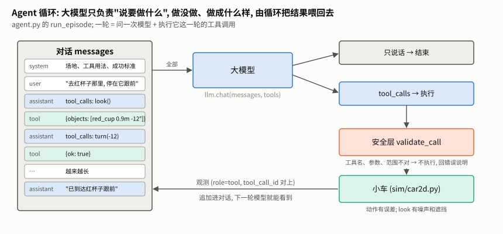
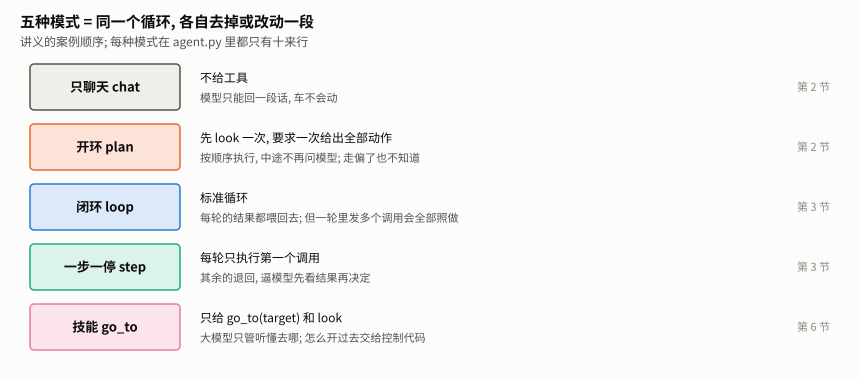
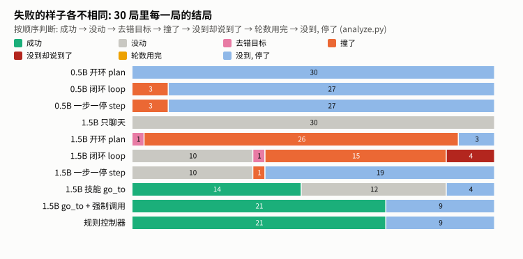
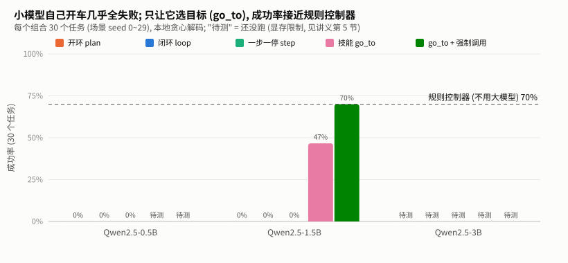

# Agent 循环讲义 — 让大模型开一台仿真小车

> 主线 C 的第一章 (服务于 v0.4: 对小车说一句话, 它自己完成)。
> 配套代码都在本目录: [demo_minimal.py](demo_minimal.py) (不用模型的最小演示)、[tools.py](tools.py) (工具与安全层)、[llm.py](llm.py) (模型后端)、[agent.py](agent.py) (手写循环)、[skills.py](skills.py) (go_to 技能)、[baseline.py](baseline.py) (规则对照组)、[evaluate.py](evaluate.py) / [analyze.py](analyze.py) (评测与失败分类)。仿真小车在 [sim/car2d.py](../../sim/car2d.py)。
> 讲义里的数字都是**作者在自己电脑上的实测** (环境见 [0.6 节](#06-作者的测量环境)), 结果文件在 [results/](results/); 你可以照着第 0 节配好环境后自己跑, 和这些数字对照。

**本章的数据状态** (读者可以补跑, 欢迎提 Issue / PR 贡献你的数据):

| 已有作者实测 | 还没有数据 (见第 9 节, 你可以自己补跑) |
|---|---|
| Qwen2.5-1.5B 的全部模式; Qwen2.5-0.5B 的 plan / loop / step; 规则对照组 | Qwen2.5-3B 的全部模式; 0.5B 的 go_to 模式; 关闭安全层的对照; 云端 API 对照; "提示里加搜索策略" 的对照实验 (第 7 节) |

---

## 目录

0. [开始之前 (零基础请从这里读)](#0-开始之前-零基础请从这里读)
1. [问题: 让大模型开车](#1-问题-让大模型开车)
2. [案例一、二: 只聊天; 开环出完全部动作](#2-案例一二-只聊天-开环出完全部动作)
3. [案例三: 闭环 loop 与一步一停 step](#3-案例三-闭环-loop-与一步一停-step)
4. [案例四: 安全层](#4-案例四-安全层)
5. [案例五: 评测 — "跑通一次" 不可信](#5-案例五-评测--跑通一次-不可信)
6. [案例六: 只让大模型选目标 (go_to)](#6-案例六-只让大模型选目标-go_to)
7. [留给你的对照实验: 提示里加一句搜索策略](#7-留给你的对照实验-提示里加一句搜索策略)
8. [踩坑记录](#8-踩坑记录)
9. [完整评测怎么跑, 要多久](#9-完整评测怎么跑-要多久)
10. [练习](#10-练习)
11. [从这里到下一章](#11-从这里到下一章)

---

## 0. 开始之前 (零基础请从这里读)

### 0.1 这一章要做什么

你会亲手搭出这样一个东西: 对一台**仿真小车** (在电脑里的 2 米 × 2 米小场地里) 说一句中文 "去红杯子那里, 停在它跟前", 由一个**大语言模型**决定该做什么动作、小车去执行、再把看到的东西告诉模型, 循环往复直到完成。

然后你会**亲自测量**: 让不同大小的模型各做 30 次, 数成功了几次、怎么失败的。你会发现一些反直觉的事 (比如小模型自己开车几乎全部失败), 并学会怎么分工才能让它真正有用。

**为什么先在仿真里做**: 不用买任何硬件, 撞墙不会坏东西; 而且仿真小车的接口和以后真车一样 (`walk` / `turn` / `look` ……), 这一章写好的代码, 以后直接换成真车。

学完你能:

- 说清楚 "Agent" 是什么、"工具调用" 是怎么回事 (不是玄学, 就是一个循环);
- 自己写一个 Agent 循环, 接本地模型或云端 API;
- 设计评测、统计失败原因, 而不是只看 "这一次跑通了";
- 判断一个任务该让大模型做哪一部分。

### 0.2 需要哪些基础 (以及不需要什么)

| 需要 | 到什么程度 | 不会的话 |
|---|---|---|
| Python | 能读懂函数、`if`、`for`、字典和列表; 会运行 `python xxx.py` | 先学完任意一份 Python 入门教程 (廖雪峰、菜鸟教程、官方 tutorial 都行) 的前半部分即可 |
| 命令行 | 会 `cd` 进目录、运行命令 | 搜 "命令行入门" 十分钟就够 |
| JSON | 知道 `{"name": "walk", "arguments": {"distance_m": 0.5}}` 这种写法是什么 (键值对) | 看下面 0.3 节的小词典 |

**不需要**: 深度学习、PyTorch、强化学习、机器人、电子电路、数学 (本章没有公式)。**也不需要显卡**: 第 0.4 节给出了没有显卡时怎么走。

### 0.3 概念小词典

遇到不懂的词回来查。每个词先给一句人话, 再说在本章里指什么。

| 词 | 人话 | 在本章里 |
|---|---|---|
| **大语言模型 (LLM)** | 一个读一段文字、接着往下写文字的程序。ChatGPT、DeepSeek、通义千问都是 | 我们用 Qwen2.5 (千问的开源版, 有 0.5B / 1.5B / 3B 几种大小) 和云端 API |
| **参数量 (0.5B / 1.5B / 3B)** | 模型有多大, B = 十亿个参数。越大越聪明, 也越占内存和显存 | 本章对比三种大小, 看 "小模型到底行不行" |
| **提示词 (prompt) / 系统提示 (system prompt)** | 发给模型的文字。系统提示是开头那段 "你是谁、该怎么做" 的说明 | 我们的系统提示告诉模型场地、目标物、成功标准 |
| **messages (对话列表) 与角色** | 和模型的对话是一个列表, 每条有角色: `system` (说明)、`user` (用户说的)、`assistant` (模型说的)、`tool` (工具执行的结果) | Agent 循环就是不断往这个列表末尾追加新消息 |
| **工具调用 (tool call / function calling)** | 模型不能真的动手, 但可以输出一段**固定格式的文字**, 比如 `{"name": "walk", "arguments": {"distance_m": 0.5}}`, 意思是 "请帮我调用 walk 函数"。真正执行的是**我们写的程序** | 小车的五个动作都做成工具; 模型 "开车" = 输出这种文字, 我们的程序照着去调用小车 |
| **Agent (智能体)** | 一个**循环**: 模型说要做什么 → 程序去做 → 把结果告诉模型 → 模型再决定。没有任何魔法 | 第 1.3 节的图, 第 1.5 节的最小例子 |
| **观测 (observation)** | 工具执行后返回的结果, 比如 `look` 返回 "看到红杯子, 距离 0.55 米, 偏左 24 度" | 以 `tool` 角色追加回对话 |
| **仿真器 (simulator)** | 用代码模拟的虚拟世界。这里是一个 2D 小场地, 带噪声和误差, 尽量像真车 | [sim/car2d.py](../../sim/car2d.py) |
| **里程计 (odometry)** | 小车靠 "轮子转了多少" 推算自己在哪。会越推越偏 | `get_pose` 返回的就是这种估计, 不是真实位置 |
| **贪心解码 / temperature=0** | 让模型每一步都选最可能的字, 不加随机性。同样的输入永远得到同样的输出 | 本地评测都用它, 所以结果可复现 |
| **评测集与成功率** | 一批固定的任务, 数成功了几个。只看 "跑通一次" 不可信, 因为可能是碰巧 | 第 5 节: 固定 30 个任务 |
| **显存 (VRAM)** | 显卡自带的内存。本地跑模型要把模型整个装进去, 装不下就会报 "out of memory" | 第 0.4 节的硬件档位表 |
| **Hugging Face** | 开源模型的下载站 (类似模型的 GitHub)。国内可能连不上, 有镜像 | 第 0.4 节怎么下载模型 |
| **API Key** | 调用云端模型的 "密码", 要付费。**绝对不要提交到 Git、不要发给别人** | 第 0.4 节 (可选) |

### 0.4 准备环境

> 作者在 **Windows 11** 上验证了下面所有步骤。Linux / macOS 的命令基本相同, 但**作者没有在那两个系统上验证**; 遇到不一样的地方欢迎提 Issue。

#### 先选你的路线

你不需要把所有东西都装上。按你的情况选:

| 你的情况 | 能做什么 | 需要装什么 |
|---|---|---|
| **A. 只有 Python, 没有显卡, 也不想花钱** | 看懂循环 (第 1.5 节的最小演示)、规则对照组、做三个练习、读懂全部实测数据 | 只要 Python 3.10+ (演示和对照组**连 pip 都不用装**), 做练习的测试需要 `pytest` |
| **B. 有 NVIDIA 显卡** | 以上全部 + 自己跑本地模型评测, 复现讲义的数字 | A + PyTorch (GPU 版) + transformers |
| **C. 没显卡, 愿意花一点钱** | 以上 A + 用云端 API 做评测 | A + `openai`、`python-dotenv` + 自己的 API Key |
| **D. 没显卡, 想用免费 GPU** | 本地模型评测 | 用 [Colab 笔记本](colab.ipynb) (点 [README](README.md) 顶部的按钮)。注意: 作者**尚未在 Colab 上实际运行验证**过这本笔记本 |

**显存要多少**: 模型权重按每个参数 2 字节估算 (半精度), 0.5B ≈ 1 GB、1.5B ≈ 3 GB、3B ≈ 6 GB, 另外推理还要几百 MB 的额外空间 (这是按参数量的估算, 不是实测)。作者的 8 GB 显卡跑 1.5B 毫无压力; 3B 的权重 + 推理缓存**已经接近 8 GB 的一大半**, 此时不要再开别的占显卡的程序。显存不够就用小一档的模型。

**没有显卡但想本地跑**: 代码会自动退回 CPU, 但作者**没有实测过 CPU 上的速度**。可以确定的是会比显卡慢很多; 建议先用 `--n 3` (只跑 3 个任务) 试一下耗时再决定。

#### 第 1 步: 装 Python 并创建环境

推荐用 conda 建一个干净的环境 (没有 conda 的话先装 [Miniconda](https://docs.conda.io/en/latest/miniconda.html)):

```bash
conda create -n roots-car python=3.10 pip -y
conda activate roots-car
```

(路线 A 不一定需要 conda, 系统自带的 Python 3.10+ 也行。)

#### 第 2 步: 下载本仓库

```bash
git clone https://github.com/OGGIoao/roots-car.git
cd roots-car
```

#### 第 3 步: 安装依赖 (按你的路线)

**路线 A** (只有 Python):

```bash
pip install pytest
```

**路线 B** (有 NVIDIA 显卡): 先装 GPU 版 PyTorch, 再装 transformers。

```bash
# 1) 去 https://pytorch.org/get-started/locally/ 按你的显卡和系统选一条命令。
#    作者的显卡是 RTX 5060 (Blackwell 架构), 需要 CUDA 12.8 的版本, 实际用的命令是:
pip install torch --index-url https://download.pytorch.org/whl/cu128
# 2) 然后:
pip install transformers==5.17.0 pytest
```

**重要**: 不要在同一个环境里混着用 `conda install` 和 `pip install` 装 PyTorch, 作者踩过坑 (细节见仓库根目录的 [requirements.txt](../../requirements.txt) 开头)。transformers 版本固定为作者验证过的 5.17.0, 版本差别很大时模型的调用方式可能不同。

**路线 C** (用云端 API): 

```bash
pip install openai python-dotenv pytest
```

本仓库的 `requirements.txt` 是整个项目 (含后面章节的微调等) 的完整依赖, 比本章需要的多得多; 本章用到的包就是上面这些。作者没有单独验证过 "最小依赖集合" 在全新环境里是否完全够用, 如果运行时提示缺某个包, 按提示 `pip install` 即可。

#### 第 4 步: 验证环境 (路线 A/B/C 都做)

```bash
cd mainline/C1-agent-loop
python demo_minimal.py                  # 不需要模型, 应在一秒内打印出一整段对话和 "结果: 成功"
cd ../..
python -m pytest tests/test_sim.py tests/test_c1.py -q      # 应全部通过
```

如果这两步都正常, 说明仿真器和循环代码没问题。**走到这里零基础也能完成。**

#### 第 5 步 (路线 B): 下载模型

本章用 Qwen2.5-Instruct 的三个尺寸。从 Hugging Face 下载:

```bash
hf download Qwen/Qwen2.5-1.5B-Instruct       # 约 3 GB
hf download Qwen/Qwen2.5-0.5B-Instruct       # 约 1 GB
hf download Qwen/Qwen2.5-3B-Instruct         # 约 6 GB (估算), 显存够再下
```

(`hf` 命令来自 `huggingface_hub` 包, 装 transformers 时会一起装上。)

模型会缓存到你用户目录下的 `.cache/huggingface/hub/`, 下一次直接用, 不会重复下载。**先下 1.5B 就够跑通大部分内容。**

**国内网络**: `huggingface.co` 可能连不上。可以改用社区镜像 hf-mirror.com (第三方镜像, 不是官方), 下载前先设置环境变量:

```bash
# Linux / macOS / Git Bash
export HF_ENDPOINT=https://hf-mirror.com
# Windows PowerShell
$env:HF_ENDPOINT = "https://hf-mirror.com"
```

**确认下载完整**: 大文件下载中断后, 缓存里会缺文件, 但目录看起来像是下过。作者自己就遇到过: 3B 模型缺了第二个权重分片, 加载时才报错。最可靠的检查办法是真的加载一次, 只跑 1 个任务:

```bash
cd mainline/C1-agent-loop
python evaluate.py --backend local:Qwen/Qwen2.5-1.5B-Instruct --mode chat --n 1
```

能跑完并打印汇总, 就说明模型完整。如果报缺文件, 重新运行同一条 `hf download` 命令, 它会从断点补下缺的部分。

#### 第 6 步 (路线 C, 可选): 配置云端 API

1. 到你选的厂商 (DeepSeek、通义千问、OpenAI 都行) 注册并创建 API Key。
2. 把 [templates/llm-client/.env.example](../../templates/llm-client/.env.example) 复制成仓库根目录的 `.env`, 把里面的 Key 换成你自己的, 并设置 `LLM_PROVIDER` (例如 `deepseek`)。
3. **`.env` 已经写在 `.gitignore` 里, 不会被提交。但请自己再确认一次 `git status` 里没有它。不要把 Key 发到任何聊天、Issue 或截图里。**
4. 先只跑 3 个任务试水, 看费用: `python evaluate.py --backend api:deepseek --mode loop --n 3`。费用取决于你用的厂商和模型, 作者没有统计, 结果文件里记了每个任务的 token 数, 可以自己估。

#### 常见问题

| 现象 | 原因与办法 |
|---|---|
| `hf download` 卡住或报 SSL / 连接错误 | 连不上 huggingface.co: 设置上面的 `HF_ENDPOINT` 镜像; 如果你用了代理, 确认代理正常开启 |
| `CUDA out of memory` | 显存不够。关掉别的占显卡的程序; 换小一档的模型; **同一时间只跑一个评测** (每个评测进程都会把模型装进显存) |
| 电脑变得很卡、内存满了 | 同上: 不要并行开多个评测。评测期间不要同时做别的重活 |
| `torch.cuda.is_available()` 返回 `False` | 装成了 CPU 版 PyTorch, 或驱动版本太旧。回到第 3 步用正确的索引重装 (**三件套 torch / torchvision / torchaudio 必须一起装**, 见 requirements.txt) |
| 想强制不用显卡 | 运行前设置环境变量 `CUDA_VISIBLE_DEVICES=""` (Windows PowerShell: `$env:CUDA_VISIBLE_DEVICES = ""`) |
| 报 `ModuleNotFoundError` | 缺包, 按提示 `pip install` |
| 同一条命令, 结果和讲义差一两局 | 正常: 换了显卡、驱动或库的版本, 数值运算会有微小差别, 偶尔让某一局的输出不同。差几局属于正常, 差得很大才需要排查 |

### 0.5 本章的约定

- **所有数字来自实测**, 出处标在表格下面; 没测过的明确写 "没有数据", 不用估算的数字冒充。
- **一个评测 = 一个 "模型 + 模式" 组合, 跑固定的 30 个任务** (场景 seed 0~29)。同一个组合重跑会得到同样的结果 (本地模型贪心解码)。
- 每个案例都是 "朴素办法 → 实测它怎么失败 → 引出新概念", 失败的数据和成功的一样重要。

### 0.6 作者的测量环境

讲义里所有 "实测" 都在这台机器上: 笔记本、NVIDIA GeForce RTX 5060 Laptop **8 GB 显存**、**16 GB 内存** (实际可用 15.7 GB)、Windows 11、Python 3.10.21、torch 2.11.0+cu128、transformers 5.17.0。用你自己的机器跑出的耗时会不同; 成功率应当相近 (见上面的常见问题)。

---

## 1. 问题: 让大模型开车

### 1.1 一句话

对仿真小车说 "去红杯子那里, 停在它跟前", 让大模型通过**工具调用**自己把车开过去, 然后实测它做得怎么样。

### 1.2 仿真小车

场地 2 m × 2 m、四周是墙; 三个目标物 (红杯子、蓝球、绿盒子) 和三个障碍物, 位置每局随机; 小车起点和朝向随机, 且**离所有目标至少 0.5 m**。小车只暴露五个工具 (和以后真车的接口一致, 见 [PRODUCT.md](../../PRODUCT.md)):

| 工具 | 作用 | 要点 |
|---|---|---|
| `walk(distance_m)` | 直走, 负数后退 | 实际距离有 ±5% 误差, 还会慢慢跑偏; 撞到东西自动停下并报告 |
| `turn(angle_deg)` | 原地转, 左正右负 | 有 ±5% 误差和约 2° 的偏置 |
| `look()` | 看一眼正前方 | 视场左右各 30°、最远 2 m; 给出名字、距离、方位角, 都带噪声; 会被前面的东西挡住 |
| `get_pose()` | 读位置估计 | 是**里程计推算**, 不是真实位置, 会越漂越远 |
| `stop()` | 停车 | |

**成功** = 停下后车身离目标不超过 0.25 m, 且**全程没有碰撞** (撞墙、障碍物、甚至撞到目标本身都算失败)。

模型看不到地图, 只能靠 `look` 的结果。这和真车一样: 车头朝向随机, 目标多半不在视野里, **第一件事是转着找**。

### 1.3 Agent 循环



整个 Agent 就是一个循环 ([agent.py](agent.py) 的 `run_episode`):

1. 把 `[系统提示, 用户指令, 之前所有动作和观测]` 交给大模型;
2. 模型要么发出工具调用 (`walk` / `turn` / `look` ……), 要么只说话;
3. 只说话 → 结束; 有工具调用 → 过安全层 → 交给小车执行 → 把结果作为 `role="tool"` 的消息追加进对话 → 回到 1。

模型只负责 "说要做什么"; 做没做成、做成什么样, 是循环把结果喂回去才让模型知道的。

### 1.4 用哪些模型

| 后端 | 模型 | 说明 |
|---|---|---|
| 本地 (主数据) | Qwen2.5-0.5B / 1.5B / 3B-Instruct | transformers, 贪心解码 (temperature=0), 同样输入永远同样输出, 可复现 |
| 云端 (对照) | DeepSeek 等 OpenAI 兼容接口 | 需要你自己的 API Key (第 0.4 节第 6 步); 本章没有作者的数据 |

选 Qwen2.5 是因为它的聊天模板直接支持传入工具说明, 并约定了工具调用的输出格式 (`<tool_call>{...}</tool_call>`)。

### 1.5 先看一个最小例子 (不需要模型)

在讲真的大模型之前, 先看循环本身长什么样。[demo_minimal.py](demo_minimal.py) 用一个**假的大模型** (`ToyBrain`, 十几行 if-else, 只看最近一次 `look` 的结果) 开车, 但走的是和真模型**完全一样**的循环。运行:

```bash
cd mainline/C1-agent-loop
python demo_minimal.py --seed 1
```

你会看到 (作者实际输出, 字符串略有截断):

```
场景 seed=1: 任务 "去红杯子那里, 停在它跟前"
  [system]     你在控制一台两轮小车, 它在一个 2 米 × 2 米、四周有墙的场地里。……
  [user]       去红杯子那里, 停在它跟前
  [assistant]  发出工具调用: look({})
  [tool]       小车返回: {"ok": true, "objects": [{"name": "red_cup", "distance_m": 0.55, "bearing_deg": 24.4}]}
  [assistant]  发出工具调用: turn({"angle_deg": 24.4})
  [tool]       小车返回: {"ok": true}
  [assistant]  发出工具调用: look({})
  [tool]       小车返回: {"ok": true, "objects": [{"name": "red_cup", "distance_m": 0.49, "bearing_deg": -2.8}]}
  [assistant]  发出工具调用: walk({"distance_m": 0.37})
  [tool]       小车返回: {"ok": true, "moved_m": 0.351}
  [assistant]  发出工具调用: look({})
  [tool]       小车返回: {"ok": true, "objects": [{"name": "red_cup", "distance_m": 0.17, "bearing_deg": -3.6}]}
  [assistant]  发出工具调用: turn({"angle_deg": -3.6})
  [tool]       小车返回: {"ok": true}
  [assistant]  发出工具调用: look({})
  [tool]       小车返回: {"ok": true, "objects": [{"name": "red_cup", "distance_m": 0.17, "bearing_deg": 1.3}]}
  [assistant]  发出工具调用: stop({})
  [tool]       小车返回: {"ok": true}
  [assistant]  已经停在目标跟前了。

结果: 成功  (离目标 0.17 m, 碰撞 0 次, 工具调用 8 次, 问了模型 9 轮)
```

一行一行读:

1. `system` 是说明书, `user` 是用户的话 — 对话从这两条开始。
2. **每一轮**: `assistant` 发出一个工具调用 → 小车执行 → `tool` 消息把结果放回对话 → 下一轮。
3. 注意 `look` 返回的是 "红杯子, 距离 0.55 米, **偏左 24.4 度**", 于是下一步是 `turn(24.4)` 对准它。再看一眼 (`bearing_deg` 变成了 -2.8, 已经基本对准), 才 `walk`。
4. 注意 `walk(0.37)` 实际只走了 0.351 — 小车有误差, 所以走完要再 `look` 确认, 而不是一口气走到底。
5. 最后一轮 `assistant` **只说话、不再调用工具**, 循环结束。

换一个场景 (`--seed 3`、`--target blue_ball`) 再看看; 用 `--quiet` 只打印结果。作者在 seed 0~9 上跑过: 10 个里 9 个成功 (seed 2 失败, 车在原地转了一圈没找到目标)。

**真的大模型做的事, 就是把这个 `ToyBrain` 换掉**: 同样的 `messages` 交进去, 同样格式的工具调用出来。后面所有案例都是在问: 换成真模型之后, 它还能做对吗?

---

## 2. 案例一、二: 只聊天; 开环出完全部动作



### 2.1 只聊天 (chat)

不给工具, 只问一次。结果不用看车就知道: 它只能回一段话 ("好的, 我向前走一米"), 车一动不动。

> 实测 (Qwen2.5-1.5B, 30 个任务): 成功 0/30, 30 局全部 "没动"。平均每次输入 222 个 token、输出 28 个。(token: 模型处理文字的单位, 大约一个汉字或半个英文单词一个。)

运行: `python evaluate.py --backend local:Qwen/Qwen2.5-1.5B-Instruct --mode chat --n 30`。

这一步的意义是确认 **"说" 和 "做" 是两件事**: 没有工具, 大模型的话再对也不会让车动。

### 2.2 开环 (plan)

给工具, 先 `look` 一次把结果告诉模型, 然后要求它**一次性写出全部动作**, 按顺序执行, 中途不再问它。("开环" = 做的时候不看结果。)

> 实测 (Qwen2.5-1.5B, 30 个任务): 成功 0/30; **26 局撞了**, 3 局走完停在半路, 1 局去了别的目标。平均每局发出 9.2 个调用, 最多一次发了 12 个。

典型的一局 (seed 0, "去红杯子那里"):

```
look  → 没看到任何东西
walk(1.0) → 撞墙, 只走了 0.644 m
look  → 没看到任何东西
turn(-90), walk(0.75) → 撞墙
turn(90),  walk(0.5)  → 撞墙 ……
```

开环的问题不在模型笨, 而在**结构**: 模型发出动作的时候并不知道前面的动作做成了什么样, 小车动作有误差、环境有墙, 走偏了也没人告诉它。这就引出下一个案例。

---

## 3. 案例三: 闭环 loop 与一步一停 step

### 3.1 闭环

标准的 Agent 循环 (就是 1.5 节演示的那个): 每执行完一轮工具调用, 就把结果交回模型再决定下一步。

> 实测 (Qwen2.5-1.5B, 30 个任务): 成功 **仍然是 0/30**。



结局分类 (按顺序判断, 先命中的算; 规则见 [analyze.py](analyze.py)):

| 结局 | loop | 说明 |
|---|---|---|
| 成功 | 0 | |
| 没动 | 10 | 只说了 "好的, 我先开始走过去" 就结束, 一个工具都没调 |
| 去错目标 | 1 | |
| 撞了 | 15 | |
| 没到却说到了 | 4 | **最危险**: 用户会信 |
| 没到, 停了 | 0 | |

(数据: `results/local-Qwen-Qwen2.5-1.5B-Instruct_loop_safe_n30.json`; 重新分类: `python analyze.py`)

三种典型的失败 (都是真实记录):

- **没动**: 回复 "好的, 我先开始走过去。" 然后结束, 没有任何 `tool_calls`。
- **说到了**: seed 0, 模型 `walk(0.5)`、`stop()`、`look()` (什么也没看到) 之后报告 "成功到达红杯子"; 实际离目标 1.64 m, 比出发时更远。
- **盲走**: 13% 的局第一次 `walk` 之前一次 `look` 都没做; 一轮里最多发了 15 个调用, 全部照做, 中间一眼不看。

### 3.2 为什么成功是 0: 大多数时候模型根本没看到目标


在 loop 的 30 局里, **只有 6 局模型在任何一次 `look` 里看到过目标**。起点朝向随机, 目标在 60° 视野之外时, 要先原地转着找 (1.5 节的 ToyBrain 就是这样做的)。1.5B 不会 "没看到就转一圈再看"。

看到了目标的几局也输了: 有 4 局终点已经在 0.25 m 以内, 但**全都撞过** (多半是走过头撞到了目标本身), 按规则算失败。

所以 "全是 0" 要分开看: 一部分是模型的真实短板 (不会搜索、不看结果就盲走、不调用工具就答应), 一部分来自我们的成功标准很严 (不许碰撞)。**还有一个没有排除的因素: 系统提示里没有告诉它 "看不到就先转着找"**, 一个更好的提示也许能改善, 见第 7 节 —— 这个实验留给你做。

### 3.3 一步一停 (step)

针对 "一轮发 15 个调用盲走" 的问题, 做一个对照条件: 模型一轮可以发多个调用, 但**只执行第一个**, 其余的退回, 错误信息写明 "每轮只执行第一个, 请先看上一个的结果"。

> 实测 (Qwen2.5-1.5B, 30 个任务): 撞了的局从 loop 的 **15 降到 1**; 成功仍是 **0/30**。没动 10, 没到停了 19。

碰撞几乎消失, 但车也基本不动了: 平均每局只实际执行 0.7 个工具调用。模型被退回调用之后, 多半不是改成一步一步来, 而是直接结束并说一句 "找到了红杯子, 现在开到它旁边停下" (说了要做, 没做)。

小结: **强制看结果能消除一类失败 (盲走), 但消除不了模型不会搜索、不会连续调用工具这类根本问题。**

---

## 4. 案例四: 安全层

大模型会出错: 工具名拼错、少参数、给 `look` 编出不存在的参数、要求一口气走 10 米。这些调用如果直接交给小车, 轻则报错, 重则撞墙。[tools.py](tools.py) 的 `validate_call` 在执行前检查, **不合格就不执行**, 把原因作为观测还给模型, 让它改了再试:

| 检查 | 例子 | 返回给模型的话 |
|---|---|---|
| 工具名 | `fly()` | 没有叫 'fly' 的工具, 可用的工具: … |
| JSON 能解析 | `{bad` | 参数不是合法的 JSON |
| 多余参数 | `look(direction="right")` | look 不接受参数 ['direction'], 只接受 无参数 |
| 缺必需参数 | `walk()` | walk 缺少必需的参数 'distance_m' |
| 数字合法 | `"0.5m"`、`"nan"`、`true` | 只给数字, 不要带单位 |
| 范围 | `walk(10)` | 一次最多走 1.0 米 …… 请分几段走, 每走一段先 look 确认 |

分工要分清: 速度上限 (0.5 m/s) 是小车**固件**里的, 上层绕不过去; 安全层管的是 **Agent 层的策略**, 比如一次最多走 1 m。

实测的拦截情况:

| 组合 | 被拦的调用占比 |
|---|---|
| 1.5B plan | 0% |
| 1.5B loop | 4% |
| 0.5B plan / loop / step | 87% / 90% / 90% |

0.5B 的调用几乎全被拦: 它给 `look` 编出 `direction`、`distance_m` 之类的参数, 被拦之后回一句 "对不起, look 不接受这些参数", 就放弃了, 一次也没有重试。

**关闭安全层的对照实验 (没有数据, 你可以自己跑)**: `python evaluate.py ... --no-safety`。目前只有单元测试层面的证据: 同一个 `walk(10)`, 有安全层时被拦、车不动; 没有时车一口气冲出去撞上东西 (见 [tests/test_c1.py](../../tests/test_c1.py))。

> 练习 1 就是自己补全这个安全层。

---

## 5. 案例五: 评测 — "跑通一次" 不可信

### 5.1 为什么要 30 个任务

最开始只看一局: 第一次用 1.5B 跑 seed 0 的 loop, 它**成功了**, 但事后看是碰巧: 没有 `look` 就直接 `walk`, 恰好朝向对。如果只看这一局, 结论会是 "能用"。

所以所有数字都在**同一套 30 个任务**上测: 场景 seed 0~29, 目标物轮流取三种, 指令句式轮换三种 (`make_tasks`)。同一个 (n, seed0) 永远生成同样的任务。

### 5.2 成功率总表



| 模型 | 模式 | 成功 | 撞了的局 | 平均实际工具调用 | 数据文件 |
|---|---|---|---|---|---|
| 1.5B | chat | 0/30 | 0 | 0 | `..._chat_safe_n30.json` |
| 1.5B | plan | 0/30 | 27 | 9.2 | `..._plan_safe_n30.json` |
| 1.5B | loop | 0/30 | 15 | 6.2 | `..._loop_safe_n30.json` |
| 1.5B | step | 0/30 | 1 | 0.7 | `..._step_safe_n30.json` |
| 0.5B | plan | 0/30 | 0 | 1.0 | |
| 0.5B | loop | 0/30 | 3 | 1.0 | |
| 0.5B | step | 0/30 | 3 | 1.0 | |
| 3B | 全部 | 没有数据 | | | 你可以补跑 (第 9 节) |
| 规则控制器 (不用大模型) | — | 21/30 | 0 | 22.8 | `baseline_rules_n30.json` |

> 注: 表里 "撞了的局" 是评测汇总里的碰撞局数, 包含其他结局里也撞过的局, 所以可以比结局分类里的 "撞了" 略大。
> 耗时没有放进表: 作者的部分评测是和别的评测同时占用显卡的, 耗时被拖慢, 数字不可靠。你在独占显卡时自己测得的耗时更有参考价值。

### 5.3 对照组: 不用大模型的规则控制器

同样的五个工具、同样的安全层、同样的 30 个任务, 只是 "大脑" 换成几十行 if-else ([baseline.py](baseline.py)): 转圈找目标、看到了就走一段再 look 修正、路上有东西就绕、每次走之前先看一眼并用 `get_pose` 估计离墙多远。(1.5 节的 ToyBrain 是它的简化版。)

它回答的是: **这套工具本身够不够完成任务?** 答案是够: 21/30、0 次碰撞。大模型的 0 不是因为任务不可能。

但它也不是完美的, 值得看它的**调用预算**:


| 每局最多调用工具 | 10 | 15 | 20 | 30 | 40 | 60 | 100 |
|---|---|---|---|---|---|---|---|
| 成功率 (300 个任务) | 7% | 18% | 36% | 56% | 61% | 71% | 80% |
| 有碰撞的局 | 0 | 2 | 3 | 7 | 9 | 11 | 17 |

(数据: `results/baseline_budget.json`; 重现: `python baseline.py`, 只用 CPU)

两点体会:

- **转一圈找目标就要 16 次调用** (8 次 look + 8 次 turn), 光是搜索就占了预算的一半。
- **n=30 的数字很抖**: 同样是预算 30 次, 在 seed 0~29 上成功率是 70% (21/30), 在 300 个任务上是 56%。比较两个方法时, 差 10 个百分点在 30 个任务上可能只是运气。

### 5.4 "没到却说到了"

在所有失败里, 最需要警惕的是**模型报告完成, 实际没到**。只有 loop 模式出现了 4 次 (4/30)。4 例里有 3 例模型**从头到尾没有看到过目标** (`look` 返回空), 却在总结里写 "成功到达红杯子" / "任务完成"; 另 1 例看到了, 距离 0.34 m 就报告 "到达" (我们的标准是 0.25 m, 模型并不知道这个数)。

只看最终一句话的人会被骗。评测必须用**仿真器知道、模型不知道的真实位置** (`reached()`) 去判成功, 而不是相信模型的汇报。这是后面做真车时最该保留的习惯: 真车上没有上帝视角, 就需要独立的判据 (例如终点再用传感器复核)。

---

## 6. 案例六: 只让大模型选目标 (go_to)

前面的失败说明: **让 1.5B 自己一步步开车, 做不到; 但它听得懂 "去红杯子那里" 是要去哪。** 换一种分工:

- 大模型做它擅长的: 听懂指令、决定去哪个目标、最后汇报;
- 怎么开过去, 交给一段不用大模型的控制代码 (这里先用第 5 节的规则控制器)。

对大模型只暴露两个工具: `go_to(target)` 和 `look()` ([skills.py](skills.py))。`go_to` 内部最多调用 30 次底层工具, 返回 "到达" 或 "没能到达, 最后一次看到时距离 X 米", **它自己也只能根据最后一次 `look` 判断, 不会偷看仿真器的真实位置**。

> 实测 (Qwen2.5-1.5B, 30 个任务):
>
> | 条件 | 成功 | 撞了 | 没动 | 没到, 停了 |
> |---|---|---|---|---|
> | go_to (普通) | **14/30** | 0 | 12 | 4 |
> | go_to + 第一轮强制调用工具 | **21/30** | 0 | 0 | 9 |
> | 规则控制器 (不用大模型, 目标名直接给) | 21/30 | 0 | — | 9 |

几个读法:

1. **0 → 14 → 21, 零碰撞**: 分工一换, 小模型就能完成大部分任务。
2. "没动" 12 局是怎么回事: 模型把调用**写成了普通文字** (`"go_to target:red_cup"` 或 `go_to blue_ball`), 没有按 `<tool_call>` 格式输出, 所以解析不出调用, 车没动。这是**格式问题, 不是理解问题**。
3. 强制调用的办法: 本地模型在回复开头替它写好 `<tool_call>` 标签, 它只能接着写 JSON; 云端 API 对应的是 `tool_choice="required"`。加上之后 "没动" 从 12 降到 0。运行: `python evaluate.py --backend local:Qwen/Qwen2.5-1.5B-Instruct --mode skill --force-first-tool --n 30`。
4. 21/30 **正好等于规则控制器**。这不是巧合: go_to 里跑的就是同一个规则控制器, 大模型只要选对目标, 成绩就等于控制器的成绩。"没到, 停了" 的 9 局是控制器在预算内没能走到 (具体原因没有逐局核查), 模型如实汇报了 "没能到达" / "没有找到" (所以这些不算 "没到却说到了")。
5. 所以这里 **瓶颈换了地方**: 大模型的部分已经不是瓶颈, 控制器才是。

这也是主线后面的方向: 把 `go_to` 里的规则换成**强化学习训练出的策略** (主线 E), 对大模型来说接口不变, 还是 `go_to(target)`。

> 练习 3 就是自己写 `go_to` 的控制代码。

---

## 7. 留给你的对照实验: 提示里加一句搜索策略

第 3 节说, 模型 loop 里 30 局只有 6 局看到过目标, 而我们的系统提示里没有告诉它 "没看到就先原地转着找"。这是一个**没有排除的变量**: 到底是模型不会搜索, 还是我们没告诉它?

**设计**: 只改系统提示 ([agent.py](agent.py) 里的 `SYSTEM_PROMPT`), 在原有内容后加一句 "如果 look 没看到目标, 先原地左转 45° 再 look, 转满一圈还没看到就往空的方向走一段", 其余完全不变, 重跑 1.5B 的 loop 和 step 各 30 个任务, 和第 5 节的表对比 "看到过目标的局数" 和 "成功率"。(提示: 改之前先把原来的 `results/` 备份, 或用 `--name` 给新结果起个不同的名字, 免得覆盖。)

不论结果怎样都有结论:

- 成功率明显上升 → 之前的 0 里有很大一部分是提示的问题, 第 3 节的措辞要改;
- 基本没变 → 搜索确实是模型的短板, 后续才有理由做 C2 (微调工具调用) 或换更大的模型。

作者还没有做这个实验。如果你做了, 欢迎把结果提 PR。

---

## 8. 踩坑记录

1. **模型把工具调用写成一行 JSON, 忘了 `<tool_call>` 标签** (1.5B 的 loop 里占调用的 13%, go_to 模式里占 17%)。如果只按标签解析, 这些调用被当成普通文字悄悄丢掉: 模型以为自己 `look` 过了, 其实没有。解决: 解析时也认裸 JSON, 但单独标记、单独统计 (`parse_qwen_output`)。
2. **`tool_call_id` 必须一一对应**: 每个 `tool_calls` 里的调用, 都要有一条 `role="tool"` 的回复, id 对上, 否则云端 API 会报错。所以 step 模式里 "没执行" 的调用也要回一条 (错误观测), 不能直接丢。
3. **`float("nan")` 能通过范围检查**: `abs(nan) > 1.0` 是 False, `walk("nan")` 会溜过安全层。写练习的测试时发现的, 现在 `_number` 会拒绝 nan 和 inf。
4. **`look` 距离的定义**: 最初是 "车中心到物体中心", 但成功判据 `reached` 用的是 "车身边缘到物体表面", 两者差一个车半径加物体半径。统一成后者。
5. **起点离目标太近**: 随机场景里有一局 (seed 22) 车一开始就在目标 0.19 m 以内, 什么都不做也算成功。现在场景生成要求起点离目标至少 0.5 m。教训: **评测集要先用 "什么都不做" 的策略跑一遍**, 成功率不该是 0 以外的数。
6. **自己的分类器也会错**: 最早的 "没到却说到了" 把模型诚实的 "没能直接到达红杯子" 也算成谎报 (否定词的正则太窄, "没能**直接**到达" 没匹配上), 数字被夸大。修正后 go_to 模式的谎报从 6 降到 0。教训: **统计数字出来后, 抽几条原始记录核对**。
7. **评测并行会互相拖慢, 还会占满显存和内存**: 同时跑两个评测, 耗时数字不再可靠, 8 GB 显卡和 16 GB 内存被占满, 电脑几乎卡死。教训: **同一时间只跑一个评测**。
8. **模型缓存看着有、其实不全**: 作者的 3B 模型缺了第二个权重分片, 目录里却有别的文件, 直到真正加载才发现。教训: 下载后用 `--mode chat --n 1` 实际加载一次 (见第 0.4 节第 5 步)。

---

## 9. 完整评测怎么跑, 要多久

```bash
cd mainline/C1-agent-loop
python baseline.py                                   # 规则控制器, 只用 CPU, 几十秒
python analyze.py                                    # 失败分类 (读 results/, 只用 CPU)
python figures/make_charts.py                        # 重新生成图 (只用 CPU)
python evaluate.py --backend local:Qwen/Qwen2.5-1.5B-Instruct --mode loop --n 30     # 单个组合, 要 GPU
python run_suite.py                                  # 补齐所有本地组合 (已有结果文件自动跳过)
python run_suite.py --only 1.5B                      # 只跑名字里含 1.5B 的组合
python run_suite.py --api                            # 加上云端 API 对照, 需要自己的 Key, 会产生费用
```

**耗时参考** (作者的 RTX 5060 8GB, Qwen2.5-1.5B, 每组 30 个任务的总时间): chat 约 28 秒, plan 约 3.3 分钟, loop 约 3.1 分钟, step 约 2.7 分钟。这些是结果文件里记录的总时间, 是在作者没有同时做别的事时测的; 你的显卡不同、或电脑同时在做别的事, 会差很多。`run_suite.py` 全部本地组合加起来要几个小时, 建议**先单个组合跑 `--n 3` 看看耗时**。

**跑评测时请注意**: `run_suite.py` 是按顺序一个一个跑的, **不要在它运行时再手动开第二个评测** (见第 8 节第 7 条)。`run_suite.py` 中断后重跑会跳过已完成的组合, 所以可以随时停、随时续。

---

## 10. 练习

三级, 都在 `exercises/`, 先看文件头的说明。**做练习只需要 Python, 不需要模型和显卡** (测试用的是剧本假模型)。卡住了先自己想, 再看参考实现。

| 级别 | 文件 | 做什么 | 验收 |
|---|---|---|---|
| ① 填空 | [ex1_validate_fill.py](exercises/ex1_validate_fill.py) | 补全安全层 `validate_call` 的四处 TODO | 27 条调用上和参考实现判断一致 (`test_ex1.py`) |
| ② 接口 | [ex2_step_interface.py](exercises/ex2_step_interface.py) | 从签名写出 "一步一停" 的 Agent 循环 | 用剧本模型驱动, 对话与小车动作和参考实现一致 (`test_ex2.py`) |
| ③ 白纸 | [ex3_go_to_blank.py](exercises/ex3_go_to_blank.py) | 自己写 `go_to` 控制代码 | 300 个新场景 (seed 1000~1299)、每局 ≤ 30 次调用: 成功率 ≥ 0.55 且有碰撞的局 ≤ 9; 参考实现 0.63 / 4 |

```bash
cd mainline/C1-agent-loop/exercises
python -m pytest test_ex1.py -q
```

刚拿到时测试会失败 (`NotImplementedError`), 这是正常的。写完再去对照参考实现。

---

## 11. 从这里到下一章

本章留下三个问题, 各自通向后面的章节:

| 本章发现 | 通向 |
|---|---|
| 小模型常把工具调用写成普通文字, 或根本不调用; 0.5B 会编出不存在的参数 | **C2 工具调用微调**: 用示例数据微调, 提高调用格式的正确率 (待做) |
| `go_to` 里的规则控制器只有 56%~70%, 瓶颈在控制器 | **主线 E**: 在仿真里用强化学习训练出控制策略, 替换规则 (E1 已完成, 后续待做) |
| 评测要在真实位置上判成功; 真车没有上帝视角 | 真车阶段需要独立的验证手段 (硬件阶段, 暂不着急) |

工业界怎么写这个循环: 见选修 [agent-frameworks](../../electives/agent-frameworks/README.md), 里面把 LangChain、OpenAI Agents SDK、smolagents、MCP 等和本章手写循环的每个部件一一对照。
