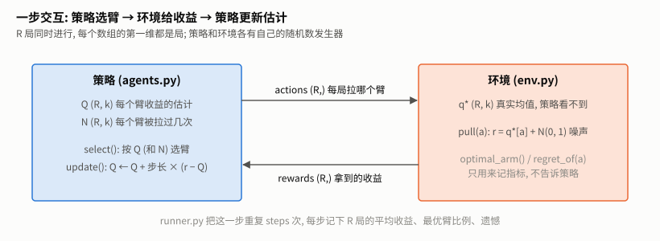
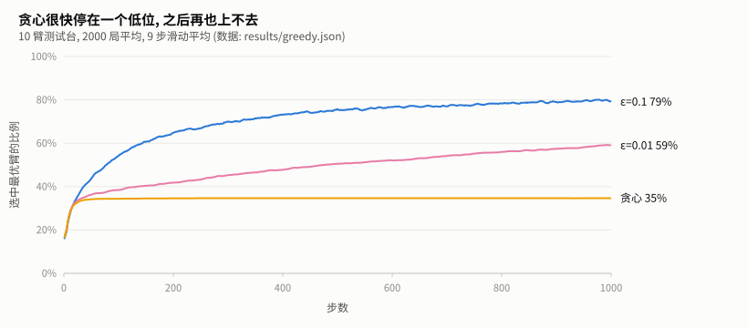
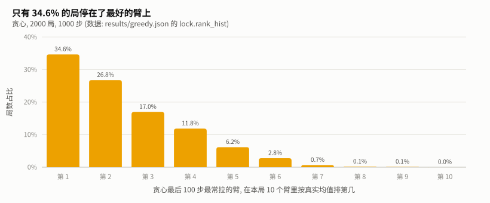
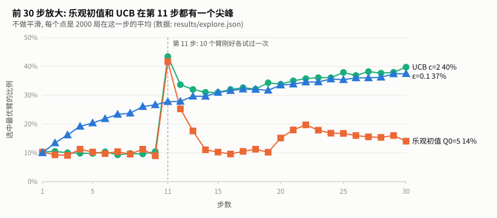
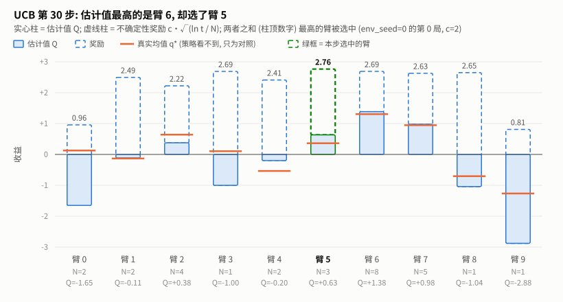
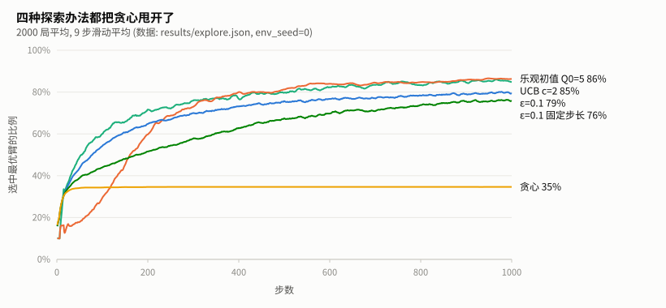
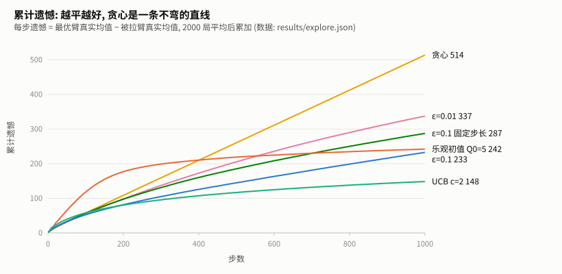
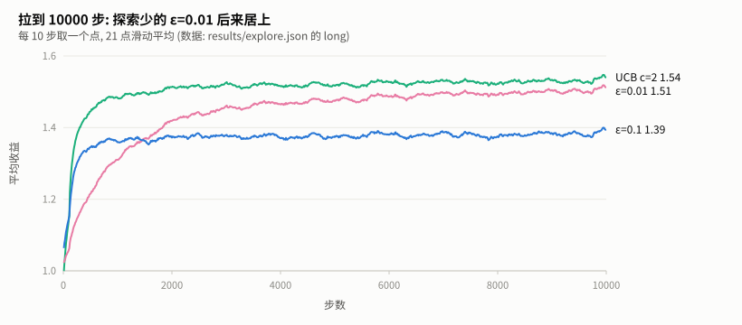
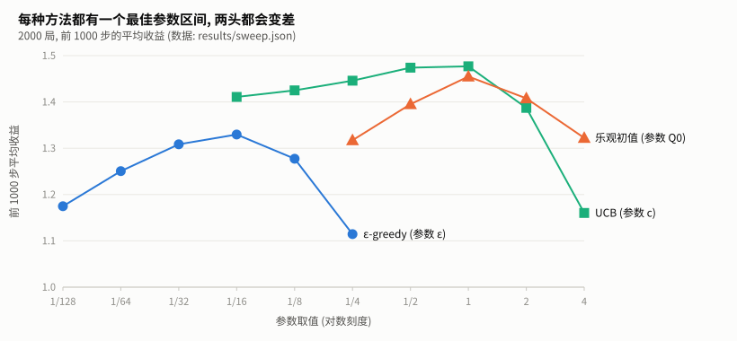
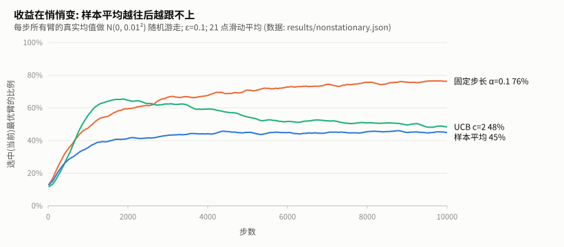

# 老虎机讲义 — 探索与利用

> 具身线总图: [electives/quadruped/README.md](../../electives/quadruped/README.md) 的 **R0 ①**。
> 配套代码: [env.py](env.py) (测试台)、[agents.py](agents.py) (三种策略)、[runner.py](runner.py) (统一跑法与指标)、[experiments/](experiments/) (四个实验)。
> 讲义里所有数字都是本机实测, 出处标在每张表下面; 重跑实验后用 `figures/make_charts.py` 重新生成图。

---

## 目录

1. [问题: 十台老虎机](#1-问题-十台老虎机)
2. [测试台与交互循环](#2-测试台与交互循环)
3. [估计一个臂值多少: 样本平均与增量更新](#3-估计一个臂值多少-样本平均与增量更新)
4. [朴素办法: 贪心, 看它怎么失败](#4-朴素办法-贪心-看它怎么失败)
5. [引出概念: 探索 — ε-greedy 与乐观初始值](#5-引出概念-探索--ε-greedy-与乐观初始值)
6. [UCB: 按不确定性去探索](#6-ucb-按不确定性去探索)
7. [对照实验: 六种方法放在同一台机器上](#7-对照实验-六种方法放在同一台机器上)
8. [改一处会怎样: 收益在悄悄变](#8-改一处会怎样-收益在悄悄变)
9. [踩坑记录](#9-踩坑记录)
10. [练习](#10-练习)
11. [从这里到下一个案例](#11-从这里到下一个案例)
12. [延伸资源](#12-延伸资源)

**前置**: 会用 numpy 的数组索引 (`Q[rows, actions]` 这种两个数组一起索引的写法)。不需要任何 RL 基础。

**运行环境**: 只用 numpy, 不需要新装依赖。所有实验加起来本机约 1 分钟。

```bash
cd mainline/E1-bandit
python env.py                          # 看一台机器长什么样
python experiments/greedy_fails.py     # 第 4 节
python experiments/explore.py          # 第 5~7 节
python experiments/sweep.py            # 第 7 节
python experiments/nonstationary.py    # 第 8 节
python figures/make_charts.py          # 由 results/ 重新生成数据图
python figures/make_diagrams.py        # 结构图
```

---

## 1. 问题: 十台老虎机

### 1.1 一句话

> 你面前有 10 个拉杆, 每个拉杆平均能给多少钱你不知道, 只能一次次拉了看。总共拉 1000 次, 怎么拉才能赚得最多?

### 1.2 为什么具身线从这里开始

具身智能最后要做的是"机器人看着画面、听着指令、输出关节动作"。那是强化学习 (RL) 最复杂的样子。老虎机是它最简单的样子, 只保留了一个核心难点:

| | 监督学习 | 老虎机 | 后面的案例 (FrozenLake、CartPole、机械臂) |
|---|---|---|---|
| 有没有标准答案 | 有, 每个样本都告诉你"应该输出什么" | **没有**, 只告诉你"你选的那个得了几分" | 没有 |
| 有没有状态 | — | **没有**, 每一步面对的都是同一台机器 | 有, 这一步的动作会改变下一步的处境 |
| 难点 | 拟合 | **探索与利用**: 继续拉目前最好的那个, 还是去试试别的? | 探索与利用 + 状态 + 延迟奖励 |

"只告诉你选的那个得了几分"这一点, 在后面每个案例里都会出现: 机械臂往左推了一下, 环境只会说"离目标近了 0.3", 不会告诉你"其实应该往右推"。不知道别的动作会怎样, 就必须**花一些机会去试**。老虎机把这个问题单独拎出来, 让它清楚到可以测量。

### 1.3 这个案例的路线

```
贪心 ──失败──→ ε-greedy ──→ 乐观初始值 ──→ UCB
只拉当前最好的   偶尔随机试一下   开头先把每个都试够   哪个最没把握就试哪个
                                                   │
                         改一处: 收益会变 ──→ 固定步长
```

---

## 2. 测试台与交互循环

### 2.1 一句话

> 为了让结论不靠运气, 一次开 2000 台独立抽出来的机器 (2000 局), 每台拉 1000 次, 所有指标都是 2000 局的平均。

### 2.2 一台机器长什么样

这是 Sutton & Barto 第 2 章的 "10 臂测试台":

```math
q_*(a) \sim \mathcal{N}(0,\,1),\quad a = 0,1,\dots,9 \qquad\qquad R_t \mid A_t = a \;\sim\; \mathcal{N}\big(q_*(a),\,1\big)
```

- $`q_*(a)`$: 第 $`a`$ 个臂的**真实平均收益**, 开局时从标准正态分布里抽一次, 之后不再变 (第 8 节会让它变)。玩家看不到它。
- $`R_t`$: 第 $`t`$ 步拉了臂 $`A_t`$ 之后拿到的收益 = 真实均值 + 标准差为 1 的噪声。

噪声和臂之间的差距是同一个量级, 这正是难点所在。`python env.py` 打印第 0 局:

```
第 0 局的真实收益 q*(a):
  臂 0: +0.126
  臂 1: -0.132
  臂 2: +0.640
  臂 3: +0.105
  臂 4: -0.536
  臂 5: +0.362
  臂 6: +1.304
  臂 7: +0.947
  臂 8: -0.704
  臂 9: -1.265
最优臂: 6
连拉 5 次臂 0 的收益: -0.50 +0.17 -2.20 -0.09 -1.12
```

臂 0 的真实均值是 **+0.126**, 但连拉 5 次的收益有 4 次是负的, 平均 −0.75。只看这 5 次, 你会以为它是个很差的臂。

在 2000 局上测量 (env_seed=0): 最优臂的真实均值平均是 **1.535**, 最优臂和第二好的臂平均只差 **0.525**, 只有噪声标准差的一半。

### 2.3 一步交互与数组形状



**怎么读**: 左边是策略, 它只知道自己的估计 Q 和计数 N; 右边是环境, 只有它知道真实均值 q*。两者之间只传两样东西: 策略告诉环境"每局拉哪个臂" (actions), 环境回一个"每局拿到多少" (rewards)。所有数组的第一维都是局数 R = 2000, 所以 2000 局是一起算的, 不用写 Python 循环。

环境的拉杆函数 ([env.py](env.py)):

```python
    def pull(self, actions):
        """每局拉一个臂。actions: (R,) 整数 → 收益 (R,)。"""
        rows = np.arange(self.n_runs)
        # 收益 = 这一局被拉的那个臂的真实均值 + N(0, 1) 噪声
        rewards = self.q_star[rows, actions] + self.rng.standard_normal(self.n_runs)
        if self.nonstationary:
            # 拉完之后, 所有臂的真实均值都漂一点 (玩家不知道它们在变)
            self.q_star += self.walk_std * self.rng.standard_normal(self.q_star.shape)
        return rewards
```

`self.q_star[rows, actions]` 是本文最常见的写法: `rows = [0, 1, ..., R-1]`, `actions = [a_0, a_1, ..., a_{R-1}]`, 两个数组一起索引, 取出的是 `[q_star[0, a_0], q_star[1, a_1], ...]`, 也就是"每一局被拉的那个臂"。

**环境和策略各有一个随机数发生器**。换一种策略时, 环境用同一个 `env_seed`, 2000 台机器的 q* 完全相同, 比较才公平 ([tests/test_bandit.py](../../tests/test_bandit.py) 有一条测试专门检查这一点)。

### 2.4 三个指标

[runner.py](runner.py) 每一步记三样东西, 都是 2000 局的平均:

| 指标 | 定义 | 为什么要它 |
|---|---|---|
| 平均收益 | 这一步实际拿到的 $`R_t`$ | 最直接, 但混着噪声 |
| 最优臂比例 | 这一步拉到最优臂的局所占的比例 | 不受噪声影响, 直接看"找没找到" |
| 累计遗憾 | 每步遗憾按步累加 | 衡量**整个过程**浪费了多少 |

每一步的遗憾 (regret):

```math
\text{regret}_t = \max_a q_*(a) \;-\; q_*(A_t)
```

用的是**真实均值**而不是实际收益: 拉到最优臂时遗憾恰好为 0, 不会因为噪声变成负数, 曲线更平滑。这需要环境知道 q*, 所以它只用来**记指标**, 永远不交给策略。

最优臂比例和累计遗憾考的东西不一样: 前者只看最后有没有找到, 后者还要看找的过程付出了多少代价。第 7 节会看到, 两个方法的"最后找到"一样好, 遗憾却可以差 60%。

---

## 3. 估计一个臂值多少: 样本平均与增量更新

### 3.1 一句话

> 一个臂值多少, 最自然的估计就是它到目前为止所有收益的平均值; 不用把收益都存下来, 每来一个新收益改一下旧平均就行。

### 3.2 样本平均

臂 $`a`$ 被拉了 $`n`$ 次, 拿到收益 $`R_1, \dots, R_n`$ (只算这个臂的), 估计值是

```math
Q_n(a) = \frac{R_1 + R_2 + \cdots + R_n}{n}
```

按大数定律, $`n \to \infty`$ 时它收敛到 $`q_*(a)`$。问题在 $`n`$ 很小的时候: 2.2 节的臂 0, 前 5 次的样本平均依次是

| 第 n 次 | 1 | 2 | 3 | 4 | 5 |
|---|---|---|---|---|---|
| 收益 | −0.498 | +0.167 | −2.199 | −0.093 | −1.120 |
| 样本平均 $`Q_n`$ | −0.498 | −0.165 | −0.843 | −0.656 | −0.749 |

真实值是 +0.126, 5 次之后估计还差 0.87。**估计会错, 而且错得不小**, 这是第 4 节贪心失败的根源。

### 3.3 增量更新

把第 $`n`$ 次的平均写成第 $`n-1`$ 次的平均加一个修正:

```math
Q_n = \frac{1}{n}\sum_{i=1}^{n} R_i = \frac{1}{n}\Big((n-1)\,Q_{n-1} + R_n\Big) = Q_{n-1} + \frac{1}{n}\big(R_n - Q_{n-1}\big)
```

逐项看:

- $`R_n - Q_{n-1}`$: **误差**, 新收益比旧估计高了多少;
- $`\frac{1}{n}`$: **步长**, 往误差方向挪多少。拉得越多, 每个新收益的影响越小;
- 整体形式 "新估计 = 旧估计 + 步长 × (目标 − 旧估计)" 在 RL 里到处都是。第 ② 个案例的 Q-learning 就是这个式子, 只是把"目标"换成了"这一步的收益 + 下一个状态的估计值"。

代码 ([agents.py](agents.py) 的 `EpsilonGreedy.update`):

```python
    def update(self, actions, rewards):
        rows = np.arange(len(actions))
        self.N[rows, actions] += 1
        # 增量更新: 新估计 = 旧估计 + 步长 × (新收益 − 旧估计)   (讲义 3.3 节)
        # 步长取 1/N 时, 结果恰好等于这个臂所有收益的平均值
        step = 1.0 / self.N[rows, actions] if self.alpha is None else self.alpha
        self.Q[rows, actions] += step * (rewards - self.Q[rows, actions])
```

逐行:

1. `rows` 与 `actions` 一起索引, 只动每局被拉的那一个臂, 其他 9 个臂不变;
2. **先**给计数加 1, **再**算步长, 所以第 1 次更新的步长是 1/1 = 1, $`Q_1 = 0 + 1 \times (R_1 - 0) = R_1`$, 初始值被完全覆盖 (这一点第 5 节会用到);
3. `alpha` 不是 None 时步长固定, 留到第 8 节讲。

**动手验证**: [练习 1](exercises/ex1_epsilon_fill.py) 的 `test_sample_average_equals_plain_mean` 检查增量更新的结果和 `np.mean` 一致 (误差 < 1e-12)。

---

## 4. 朴素办法: 贪心, 看它怎么失败

### 4.1 一句话

> 每次都拉当前估计最高的臂。听上去很合理, 实测 2000 局里只有 35% 最后停在最优臂上。

### 4.2 写法

贪心就是 ε = 0 的 ε-greedy (下一节讲), 每一步:

```math
A_t = \arg\max_a Q_t(a)
```

所有估计初始为 0, 第一步所有臂并列, 随机选一个 (为什么要随机, 见 9.1 节)。

### 4.3 看它失败

`python experiments/greedy_fails.py`:

```
greedy     {'reward_last': 1.03, 'optimal_last': 0.346, 'regret_total': 513.6, 'locked_frac': 0.653}
eps=0.01   {'reward_last': 1.307, 'optimal_last': 0.583, 'regret_total': 337.2, 'locked_frac': 0.3795}
eps=0.1    {'reward_last': 1.367, 'optimal_last': 0.795, 'regret_total': 232.6, 'locked_frac': 0.0395}
贪心最后停在第几好的臂 (1..10): [693, 535, 339, 237, 123, 55, 13, 3, 2, 0]
最后一次换臂: 中位数第 3 步, 90% 分位第 15 步; 前 10 步内就定下来的局占 82.7%
```

(`reward_last` / `optimal_last`: 最后 100 步的平均收益 / 最优臂比例; `regret_total`: 1000 步的累计遗憾; `locked_frac`: 最后 100 步里一次都没拉到最优臂的局所占比例。)



**怎么读**: 三条线一开始几乎重合, 二三十步之后分开。贪心 (黄) 在约 30 步内升到 34% 左右就**变成一条水平线**, 后面 900 多步一点没涨; ε=0.1 (蓝) 和 ε=0.01 (粉) 一直在缓慢上升。水平线的意思是: 每一局都已经认定了一个臂, 不会再变。

| 步数 | 10 | 100 | 1000 |
|---|---|---|---|
| 贪心 | 27.2% | 34.4% | 34.7% |
| ε=0.01 | 27.5% | 38.5% | 59.2% |
| ε=0.1 | 26.7% | 55.0% | 79.2% |

(数据: results/greedy.json, 单步的值, 不平滑。)

### 4.4 锁死在哪, 锁得多早



**怎么读**: 横轴是"贪心最后停的那个臂, 在这一局里按真实均值排第几", 纵轴是局数占比。只有 34.6% 停在第 1 (最优), 26.8% 停在第 2, 剩下近四成停在第 3 名或更差。停在次优臂上的局, 平均每步比最优臂少 **0.774**。

| 排名 | 1 | 2 | 3 | 4 | 5 | 6 | 7 | 8 | 9 | 10 |
|---|---|---|---|---|---|---|---|---|---|---|
| 局数 | 693 | 535 | 339 | 237 | 123 | 55 | 13 | 3 | 2 | 0 |

锁死发生得极早: **一半的局在第 3 步之后就再也没换过臂**, 82.7% 的局在前 10 步内定下来。更极端的统计: 2000 局里有 **609 局 (30%) 在 1000 步里只试过一个臂**, 平均每局只试过 3.2 个臂。

### 4.5 为什么会这样: 一个具体的局

第 3 局 (env_seed=0) 的真实均值:

| 臂 | 0 | 1 | 2 | 3 | 4 | 5 | 6 | 7 | 8 | 9 |
|---|---|---|---|---|---|---|---|---|---|---|
| q* | −1.01 | −0.21 | −0.16 | 0.54 | 0.21 | 0.36 | −0.65 | −0.13 | 0.78 | **1.49** |

贪心第 1 步随机选中了臂 3, 拿到 +1.12。这时臂 3 的估计是 1.12, 其他 9 个臂还是初始值 0, 于是第 2 步还拉臂 3; 只要它的样本平均一直大于 0 (它的真实均值是 0.54, 平均值掉到 0 以下的机会很小), 别的臂就永远没有机会。1000 步结束时:

```
Q = [0, 0, 0, 0.56, 0, 0, 0, 0, 0, 0]       N = [0, 0, 0, 1000, 0, 0, 0, 0, 0, 0]
```

真实均值 1.49 的臂 9 一次都没被拉过。

**失败的机制**: 贪心只会更新它拉过的臂。一个没拉过的臂 (或者运气差被低估的臂, 像 2.2 节的臂 0) 的估计永远停在那里, 没有任何机制去纠正它。**被低估的臂得不到纠正的机会**, 这就是探索要解决的问题。

> 注意一个反直觉的地方: 贪心在前 10 步的最优臂比例 (27.2%) 比 ε=0.1 (26.7%) 还高。只看短期, 贪心不吃亏; 探索的好处要过几十步才显现。

---

## 5. 引出概念: 探索 — ε-greedy 与乐观初始值

### 5.1 一句话

> 想纠正估计, 就得去拉那些"看起来不是最好"的臂。最简单的办法: 每一步以一个小概率 ε 随机拉一个。

### 5.2 ε-greedy

```math
A_t = \begin{cases} \arg\max_a Q_t(a) & \text{以概率 } 1-\varepsilon \quad(\text{利用}) \\ \text{均匀随机的一个臂} & \text{以概率 } \varepsilon \quad(\text{探索}) \end{cases}
```

代码 ([agents.py](agents.py)):

```python
    def select(self):
        R, k = self.Q.shape
        explore = self.rng.random(R) < self.eps                     # (R,) 这一局本步是否探索
        random_arm = self.rng.integers(k, size=R)                   # (R,) 探索时拉的臂
        greedy_arm = argmax_random_tie(self.Q, self.rng)            # (R,) 利用时拉的臂
        return np.where(explore, random_arm, greedy_arm)
```

逐行:

1. `explore`: 每局抽一个 [0,1) 的数, 小于 ε 的局这一步探索。ε=0.1 时约 200 局探索、1800 局利用;
2. `random_arm` 和 `greedy_arm` **两个都算**, 再用 `np.where` 按 `explore` 逐局挑。这样写比按局分支简单, 代价是多抽了一些随机数;
3. 随机数的使用顺序是固定的 (先 explore, 再 random_arm, 最后打破平局)。[练习 1](exercises/ex1_epsilon_fill.py) 要求和参考实现逐步相同, 靠的就是这个顺序。

**为什么能修好 4.5 节的问题**: 每个臂每一步都至少有 $`\varepsilon / k`$ 的概率被拉到。ε=0.1、k=10 时是 1%, 1000 步里每个臂期望被"顺带"拉 10 次, 被低估的臂迟早会被纠正。

**代价**: 探索永远不停。就算已经确定了最优臂, 仍有 ε 的步数在乱拉。ε=0.1 时最优臂比例的上限是 $`(1-\varepsilon) + \varepsilon/k = 91\%`$。

ε 取多大是一个取舍 (4.3 节的表):

- ε=0.1 探索得快, 100 步就到 55%, 但上限只有 91%;
- ε=0.01 探索得慢, 1000 步时才到 59%, 但上限是 99.1%。7.3 节会看到, 拉得足够久它会反超。

### 5.3 乐观初始值

另一个思路: 不加随机, 而是把所有臂的初始估计设得**远高于**任何真实均值, 比如 $`Q_0 = 5`$ (真实均值基本在 −3 到 3 之间)。

直觉: 每个臂"看上去"都很好, 拉了之后才发现"没那么好", 估计往下掉, 于是去拉还没被"失望"过的别的臂。**贪心的选择规则不变, 探索来自初始值**。

这里要配固定步长 $`\alpha = 0.1`$ (Sutton & Barto 图 2.3 的设置)。原因在 3.3 节第 2 点: 样本平均第 1 次更新的步长是 1, 初始值立刻被完全覆盖, 乐观只能维持一步。固定步长下初始值是慢慢被"冲淡"的:

```math
Q_1 = Q_0 + 0.1\,(R_1 - Q_0) = 0.9 \times 5 + 0.1\,R_1 = 4.5 + 0.1\,R_1
```

拉一次之后估计约 4.5, 仍然比没拉过的臂 (5) 低, 所以**前 10 步一定是 10 个臂各拉一次**。

### 5.4 第 11 步的尖峰



**怎么读**: 不做平滑, 每个点是 2000 局在这一步的平均。乐观初始值 (橙) 前 10 步一直在 10% 左右 (10 个臂轮流, 恰好 1/10 的局拉到最优臂), 第 11 步突然跳到 **41.7%**, 第 12 步掉到 25.3%, 第 14 步回到 11%。UCB (绿) 也有同样的尖峰, 原因相同, 第 6 节讲。

尖峰可以用 5.3 节的式子完整解释:

1. 第 11 步: 每个臂都拉过一次, 估计都是 $`4.5 + 0.1 R_1`$, 谁的第一次收益 $`R_1`$ 最大谁就被选中。最优臂的 $`R_1`$ 最大的概率远高于 1/10, 所以 41.7% 的局选中了它;
2. 第 12 步: 刚被选中的臂又更新了一次, $`Q_2 = 0.9 Q_1 + 0.1 R_2 = 4.05 + 0.09 R_1 + 0.1 R_2`$, 比其他臂 (约 $`4.5 + 0.1 R_1`$) 低了约 0.45, 除非 $`R_2`$ 大得离谱 (要大过 4 左右), 这一步都会去拉别的臂。**最好的臂反而被"冷落"**;
3. 之后每个臂都轮流被拉第二次、第三次, 估计一起往下降到真实值附近, 才开始真正分出高低。

所以乐观初始值的探索是**一次性的、集中在开头的**: 前几十步几乎全在系统地试, 之后基本是纯贪心。

| 步数 | 1 | 5 | 10 | 11 | 12 | 13 | 14 | 15 |
|---|---|---|---|---|---|---|---|---|
| 乐观初值 Q0=5 | 10.3% | 10.3% | 9.0% | **41.7%** | 25.3% | 17.6% | 11.1% | 10.3% |
| UCB c=2 | 10.3% | 9.8% | 10.5% | **43.4%** | 33.7% | 32.0% | 31.0% | 31.0% |
| ε=0.1 | 10.0% | 20.4% | 26.7% | 27.8% | 27.9% | 29.7% | 29.6% | 31.0% |

(数据: results/explore.json, env_seed=0。)

**局限**: 只在开头探索, 意味着环境一旦变了它就无能为力 (第 8 节), 而且 $`Q_0`$ 要多大取决于收益的量级, 换个问题就得重新调。

---

## 6. UCB: 按不确定性去探索

### 6.1 一句话

> ε-greedy 探索时是闭着眼随便拉; UCB 拉"估计值加上不确定性"最高的臂: 拉得少的臂没把握, 给它加分。

### 6.2 公式

```math
A_t = \arg\max_a \left[\, Q_t(a) + c\,\sqrt{\frac{\ln t}{N_t(a)}} \,\right]
```

逐项:

- $`Q_t(a)`$: 估计值, 负责**利用**;
- $`\sqrt{\ln t / N_t(a)}`$: 不确定性奖励, 负责**探索**。分母 $`N_t(a)`$ 是这个臂被拉过的次数: 拉得越多, 越有把握, 奖励越小;
- 分子 $`\ln t`$ 随总步数缓慢增长: 一个臂如果很久没被拉, 它的奖励会慢慢涨回来, 所以不会被永远放弃 (这正是 4.5 节贪心缺的东西);
- $`c`$ 控制探索的力度, 本文默认 $`c = 2`$;
- 没被拉过的臂 ($`N = 0`$) 奖励视为无穷大, 所以前 $`k`$ 步每个臂各试一次。

名字的来历: 加上奖励之后的值, 可以理解为"这个臂的真实均值**最多**可能有多高" (置信区间的上界, Upper Confidence Bound)。原始论文 (Auer et al. 2002) 用的是 $`\sqrt{2 \ln t / N}`$, 对应 $`c = \sqrt 2`$; 这里沿用 Sutton & Barto 的写法, 把 $`c`$ 当作可调参数。

### 6.3 代码

```python
    def select(self):
        self.t += 1
        untried = self.N == 0                                        # (R, k)
        # N=0 的位置会除以 0 (t=1 时 ln 1 = 0, 还是 0/0), 结果被下一行的 np.where 覆盖, 不影响选择
        with np.errstate(divide="ignore", invalid="ignore"):
            bonus = self.c * np.sqrt(np.log(self.t) / self.N)        # (R, k) 不确定性奖励
        scores = np.where(untried, np.inf, self.Q + bonus)
        return argmax_random_tie(scores, self.rng)
```

逐行:

1. `self.t += 1`: 先加再用, 第一次 select 时 $`t = 1`$。所有局同步前进, 所以 $`t`$ 是一个数, 不是数组;
2. `bonus`: 对整个 (R, k) 数组一次算完。N=0 的位置会出现除以 0, 第 4 行用 `np.where` 把这些位置换成无穷大, 所以计算结果被丢掉, 只需要压住警告 (9.2 节记了这里踩的坑);
3. 更新和样本平均完全一样, 不再贴。

### 6.4 一个真实的决策



**怎么读**: 这是 env_seed=0 的第 0 局 (就是 2.2 节那台机器) 在第 30 步的真实状态, 由 `figures/make_diagrams.py` 现场跑出来。实心柱是估计值 Q, 虚线柱是奖励, 柱顶数字是两者之和; 橙色短横线是真实均值 (策略看不到)。

- 估计值最高的是臂 6 (Q = 1.38, 已经拉了 8 次), 它也确实是最优臂;
- 但 UCB 选了**臂 5** (Q = 0.63, 只拉了 3 次): 它的奖励 2.13 比臂 6 的 1.30 大得多, 总分 2.76 > 2.69;
- 臂 3、8、9 只拉过 1 次, 奖励最大 (3.69), 但估计值太低 (−1.00、−1.04、−2.88), 总分没赢;
- 臂 0 被严重低估 (Q = −1.65, 真实值 +0.13), 只拉了 2 次。它的奖励会随 $`\ln t`$ 慢慢增长, 迟早会被再拉一次。

UCB 的探索是**有方向的**: 它不会去试估计很低、又已经有点把握的臂, 而是去试"有可能比当前最好的还好"的臂。

### 6.5 第 11 步的尖峰, UCB 版

前 10 步每个臂各拉一次, 之后所有臂的 $`N = 1`$、奖励相同 ($`2\sqrt{\ln 11} = 3.10`$), 第 11 步就是比谁的第一次收益最大, 和乐观初始值一样, 43.4% 选中最优臂。第 12 步被选中的臂 $`N = 2`$, 奖励降到 $`2\sqrt{\ln 12 / 2} = 2.23`$, 其他臂还是 $`2\sqrt{\ln 12} = 3.15`$, 所以这一步多半去拉别的臂。和乐观初始值的区别是: UCB 的曲线掉下来后停在 31% 左右, 没有掉回 10% (5.4 节的表), 因为它对估计高的臂的偏好是一直保持的。

---

## 7. 对照实验: 六种方法放在同一台机器上

`python experiments/explore.py`, 每种方法在 3 套机器 (env_seed = 0, 1, 2) 上各跑 2000 局 × 1000 步。

### 7.1 结果

| 方法 | 最后 100 步最优臂比例 | 最后 100 步平均收益 | 1000 步总遗憾 | 锁死比例 |
|---|---|---|---|---|
| 贪心 | 34.9% (34.4~35.8) | 1.023 | 521.9 (513.6~533.1) | 65.0% |
| ε=0.01 | 58.8% (58.3~59.0) | 1.304 | 347.1 (337.2~352.6) | 37.3% |
| ε=0.1 | 79.8% (79.5~80.0) | 1.366 | 235.4 (232.6~237.2) | 4.3% |
| ε=0.1, 固定步长 0.1 | 76.0% (75.1~77.1) | 1.351 | 289.9 (287.3~294.9) | 4.3% |
| 乐观初值 Q0=5 | 85.7% (84.6~86.4) | **1.499** | 241.8 (241.2~242.3) | 9.1% |
| UCB c=2 | 85.5% (85.1~86.1) | 1.487 | **148.2** (147.9~148.4) | **0.6%** |

(数据: results/explore.json 的 summary; 括号里是 3 套机器的最小~最大值; 锁死比例 = 最后 100 步一次都没拉到最优臂的局所占比例。最优臂的真实均值平均约 1.54, 是平均收益的天花板。)

**先看噪声**: 换一套机器, 同一方法的最优臂比例最多差 2 个百分点, 总遗憾最多差 20; 方法之间的差距是几十个百分点、几百的遗憾, **远大于噪声**。这一点和 LLM 线的注意力实验不同 (那边几种注意力的差距基本在种子噪声之内), 这里的结论是可靠的。



**怎么读**: 绿 (UCB) 一开始上升最快; 橙 (乐观初值) 前 100 步比谁都低 (在系统地把每个臂试够), 之后一路追上, 约 350 步起和 UCB 并列第一; 蓝 (ε=0.1) 和深绿 (ε=0.1 固定步长) 一直上升但被 91% 的上限压着; 黄 (贪心) 是条水平线。

### 7.2 最后找到 ≠ 过程不浪费



**怎么读**: 曲线的斜率就是每一步的平均遗憾, **越平越好**。贪心是一条几乎笔直的线: 它锁死之后每一步都在固定地亏。乐观初值 (橙) 的形状最特别: 前 150 步冲得最快 (系统地试每个臂, 包括很差的臂, 代价很大), 之后变得几乎和 UCB 一样平。

最优臂比例上, 乐观初值和 UCB 几乎一样 (85.7% 对 85.5%); 总遗憾上, 乐观初值是 UCB 的 **1.63 倍** (241.8 对 148.2)。多出来的几乎全在开头: 前 150 步乐观初值已经累计了 154.8, UCB 只有 70.5, 这 84 的差距占了 1000 步总差距 (94) 的约 90%。**两个指标考的是不同的东西**: [练习 3](exercises/ex3_blank.py) 的验收线就同时卡这两条。

还有一组对照: "ε=0.1 固定步长" 是乐观初值的对照组 (同样的固定步长, 初值改成 0, 用 ε 探索)。它比乐观初值差了约 10 个百分点, 说明乐观初值的好处确实来自"初值", 而不是来自固定步长。

### 7.3 拉得更久: 短期赢家不一定是长期赢家



**怎么读**: 拉到 10000 步。ε=0.1 (蓝) 很快升到 1.38 附近就平了, 被 91% 的上限卡住; ε=0.01 (粉) 涨得慢, 但大约在第 1600 步超过 ε=0.1 (按每 250 步的平均收益比, 1500~1750 这一段第一次领先), 最后到 1.51; UCB (绿) 始终最高。

| 10000 步 | 最后 1000 步最优臂比例 | 最后 1000 步平均收益 | 总遗憾 |
|---|---|---|---|
| ε=0.1 | 86.7% | 1.379 | 1652.5 |
| ε=0.01 | 86.6% | 1.500 | 940.1 |
| UCB c=2 | **95.6%** | **1.529** | **274.9** |

(数据: results/explore.json 的 long; 最优臂比例在第 1000 / 2000 / 5000 / 10000 步: ε=0.1 为 79.2% / 82.5% / 86.1% / 87.8%, ε=0.01 为 59.2% / 71.7% / 81.7% / 86.7%, UCB 为 84.9% / 89.7% / 92.9% / 95.3%。)

一个容易看错的细节: 最后 1000 步, ε=0.1 和 ε=0.01 的最优臂比例几乎一样 (86.7% 对 86.6%), 平均收益却差了 0.12。原因是 ε=0.1 有 10% 的步数在随机乱拉, 随机拉到的臂平均收益约为 0 (q* 的均值是 0)。**ε 的代价不只是"找得慢", 还有"找到了也要一直交学费"**。

### 7.4 每种方法对自己的参数有多敏感

`python experiments/sweep.py`, 指标是前 1000 步的平均收益 (即 Sutton & Barto 图 2.6 的画法)。



**怎么读**: 横轴是参数取值 (对数刻度, 每格翻一倍), 三种方法各扫自己的参数。每条线都是"倒 U 形": 参数太小探索不够, 太大探索过度。线越平, 方法越不挑参数。

| ε-greedy | ε = 1/128 | 1/64 | 1/32 | 1/16 | 1/8 | 1/4 |
|---|---|---|---|---|---|---|
| 平均收益 | 1.175 | 1.251 | 1.309 | **1.330** | 1.277 | 1.115 |

| UCB | c = 1/16 | 1/8 | 1/4 | 1/2 | 1 | 2 | 4 |
|---|---|---|---|---|---|---|---|
| 平均收益 | 1.411 | 1.425 | 1.446 | 1.474 | **1.477** | 1.387 | 1.160 |

| 乐观初值 | Q0 = 1/4 | 1/2 | 1 | 2 | 4 |
|---|---|---|---|---|---|
| 平均收益 | 1.317 | 1.395 | **1.455** | 1.408 | 1.322 |

(数据: results/sweep.json。)

三个观察:

1. **UCB 最好的几个点都比 ε-greedy 最好的点高** (1.477 对 1.330), 而且 c 从 1/16 到 1 一路都在 1.41 以上, 很宽容;
2. 本文默认的 **c = 2 并不是最优**, c = 1 更好 (1.477 对 1.387)。c = 2 是沿用 Sutton & Barto 的设置, 在这个测试台上偏大。这是实测出来的, 不是"教科书参数一定最好";
3. 乐观初值在 Q0 = 1 时最好, 比 7.1 节用的 Q0 = 5 好得多 (Q0 = 4 时只有 1.322)。"乐观"只需要高过真实值一点, 太乐观会在开头浪费太多步。

---

## 8. 改一处会怎样: 收益在悄悄变

### 8.1 改了什么

真实世界里, "哪个动作最好"会变: 机械臂的电机老化、地面的摩擦变了、用户的口味变了。把环境改成**非平稳**: 10 个臂的真实均值都从 0 出发, 每一步各自做一步随机游走

```math
q_*(a) \leftarrow q_*(a) + \mathcal{N}(0,\, 0.01^2)
```

(Sutton & Barto 练习 2.5。) 在 [env.py](env.py) 里就是 `nonstationary=True`, 对应 2.3 节 `pull` 里的那个 `if`。

### 8.2 样本平均的问题

样本平均给每个历史收益的权重都是 $`1/n`$: 第 1 次和第 10000 次一样重要。环境在变时, 很久以前的收益已经过时了, 却还占着同样的分量。拉了 5000 次之后, 一个新收益只能把估计挪动 1/5000。

### 8.3 固定步长

把步长固定为 $`\alpha`$, 展开增量更新:

```math
Q_n = (1-\alpha)^n Q_0 + \sum_{i=1}^{n} \alpha\,(1-\alpha)^{n-i} R_i
```

第 $`i`$ 次收益的权重是 $`\alpha (1-\alpha)^{n-i}`$: 越旧的收益权重越小, 按 $`1-\alpha`$ 的幂衰减。$`\alpha = 0.1`$ 时, 10 步前的收益权重只剩最新收益的 $`0.9^{10} \approx 35\%`$, 50 步前只剩 0.5%。所以它**一直在跟踪最近的收益**。代码就是 3.3 节 `update` 里 `alpha` 不为 None 的那个分支。

### 8.4 实测

`python experiments/nonstationary.py`, ε = 0.1, 2000 局 × 10000 步:



**怎么读**: 纵轴是"拉到**当前**最优臂的比例"。固定步长 (橙) 一路升到 76%; 样本平均 (蓝) 在 2000 步左右就停在 40% 出头, 再也上不去; UCB (绿) 一开始最快, 在约 1900 步达到 65% 的峰值, **之后一路往下掉**, 最后 48%。

| 方法 | 最后 1000 步最优臂比例 | 最后 1000 步平均收益 | 总遗憾 | 锁死比例 |
|---|---|---|---|---|
| ε=0.1 样本平均 | 45.0% | 1.059 | 3209.9 | 17.3% |
| ε=0.1 固定步长 0.1 | **75.9%** | **1.327** | **1526.1** | 2.2% |
| UCB c=2 (样本平均) | 49.0% | 1.170 | 1961.9 | 46.8% |

(数据: results/nonstationary.json。)

UCB 的曲线最值得看: 前期它是最好的, 后期却比固定步长差一大截, 锁死比例高达 46.8%。原因有两层: 它的估计用的是样本平均, 有 8.2 节的毛病; 它的奖励 $`\sqrt{\ln t / N}`$ 在 N 很大时增长极慢, 一个被拉了几千次的臂, 就算它已经变差了, UCB 也"很有把握"地继续拉它。**UCB 的"把握"建立在"环境不变"的假设上**, 假设一破, 把握就成了固执。

这个"改一处"引出的问题: 第 6 节 UCB 在平稳环境下全面胜出, 换一个假设就不再成立。**没有在所有环境下都最好的探索方法**, 后面所有案例里都会遇到同样的取舍。

---

## 9. 踩坑记录

### 9.1 打破平局: 担心的问题, 实测几乎没有影响

**写法上的考虑**: 开局时所有 Q 都是 0, `np.argmax` 遇到并列永远返回下标最小的那个, 每一局都会先拉臂 0。参考实现因此写了 `argmax_random_tie`, 在并列者里随机选。

**实测** (`experiments/greedy_fails.py` 的第 3 组), 先在 env_seed=0 上:

| 贪心的平局打破方式 | 最后 100 步最优臂比例 | 总遗憾 | 锁死比例 |
|---|---|---|---|
| 并列时随机选 (参考实现) | 34.6% | 513.6 | 65.3% |
| 直接 np.argmax | 37.0% | 504.6 | 63.0% |

直接 argmax 反而好了 2.4 个百分点。只看这一行很容易下结论"随机打破平局有害", 所以又在 **20 套新机器** (env_seed 100~119) 上逐套比较: argmax 平均只好 **0.45 个百分点**, 标准误 0.37, 20 套里 argmax 更好的有 11 套、更差的 9 套。**没有真实差别**, env_seed=0 上的 2.4 个百分点是偶然。

这也符合理论: 这个测试台的 10 个臂是独立同分布抽出来的, 臂的编号和它好不好没有关系, "总是先拉臂 0"在分布上等价于"随机先拉一个"。(顺带一个教训: 2000 局平均的最优臂比例本身有约 1 个百分点的抽样误差 $`\sqrt{0.35 \times 0.65 / 2000} \approx 1.1\%`$, 两个方法只差 2 个百分点时, 一套机器说明不了问题。)

**为什么仍然要随机打破**: 一旦编号有含义 (比如把动作按某种顺序排列, 或者臂 0 恰好是"不动"这种特殊动作), 固定的偏好就会变成系统性偏差, 而且很难被发现。随机打破平局的成本只是多抽一组随机数。这里如实记录: 这是一个**防御性**的写法, 在本测试台上测不出它的好处。

### 9.2 UCB 第一步的警告

**现象**: 第一版 UCB 只写了 `np.errstate(divide="ignore")`, 跑起来仍然报

```
RuntimeWarning: invalid value encountered in divide
```

**原因**: 第 1 步 $`t = 1`$, $`\ln 1 = 0`$, 没拉过的臂 $`N = 0`$, 算出来是 $`0/0`$。numpy 把 "非零 / 0" 归为 `divide` (得到 inf), 把 "0 / 0" 归为 `invalid` (得到 nan), 是两种不同的警告。之后的步数 $`\ln t > 0`$, 只剩 `divide`, 所以只在第一步出现。

**为什么当时没发现**: 结果是对的 (nan 被 `np.where` 换成了 inf), 只是多了一行警告; 而且只在第 1 步出现一次, 很容易当成无关输出忽略掉。现在两种都压住, 并在注释里写清楚原因。

### 9.3 `conda run` 打印中文时崩溃

**现象**: 用 `conda run -n roots-car python env.py` 运行, conda 自己报 `UnicodeEncodeError: 'gbk' codec can't encode character`, 脚本的输出一行都没打印出来。

**原因**: `conda run` 会捕获子进程的输出, 再用控制台的编码 (中文 Windows 是 GBK) 重新打印; 子进程按 UTF-8 输出的中文和特殊符号经过这一转手就出错了。出错的是 conda, 不是脚本。

**解决**: 先 `conda activate roots-car` 再直接 `python ...`; 或者直接调用环境里的 python, 并设置 `PYTHONIOENCODING=utf-8`。

### 9.4 画 UCB 图时负的估计值"消失"了

**现象**: 第一版图 5 里, Q 为负的臂 (0、3、8、9) 看不到实心柱。

**原因**: 先画了 Q 的实心柱 (0 到 Q), 再画奖励的虚线框 (Q 到 Q + 奖励)。Q 为负时虚线框会跨过 0 点, 完整盖住实心柱, 而虚线框填的是背景色。

**为什么当时没发现**: Q 为正的臂两者不重叠, 图看起来是对的; 只有渲染出来逐个臂看才会发现。这也是 ROADMAP 要求"每张图都要渲染出来亲眼检查"的原因。现在改为先画虚线框、后画实心柱。

---

## 10. 练习

三级递进, 判定标准由测试给出。做练习时卡住了可以要提示, 按"方向 → 哪一行 → 代码"分级给, 每次只升一级。

```bash
cd mainline/E1-bandit/exercises
python -m pytest test_ex1.py -q
```

| 练习 | 级别 | 给出 | 自己写 | 验收 |
|---|---|---|---|---|
| [ex1_epsilon_fill.py](exercises/ex1_epsilon_fill.py) | ① 填空 | 完整的类, `select` 与 `update` 留 TODO | 两个函数体 | 4 种配置下与参考实现**逐步相同**; 增量更新等于 `np.mean` |
| [ex2_ucb_interface.py](exercises/ex2_ucb_interface.py) | ② 接口 | 类签名 + 测试 | 整个 UCB | 形状; 前 k 步每个臂各试一次; 给定状态下按公式选臂; 测试台上最优臂比例 ≥ 0.80、总遗憾 ≤ 170 |
| [ex3_blank.py](exercises/ex3_blank.py) | ③ 白纸 | 一句验收标准 | 任意策略 | 3 套新机器 (env_seed 10~12) 上最优臂比例 ≥ 0.80 **且** 总遗憾 ≤ 200 |

关于练习 3 的验收线: 参考实现里, ε=0.1 的最优臂比例刚好压线 (0.80) 但遗憾超标 (约 233), 乐观初值 Q0=5 比例够但遗憾超标 (约 242), UCB c=2 能过 (0.85 / 148)。7.4 节的扫参结果也是一条线索。

<details>
<summary>练习 1 的思路 (先自己写, 写不出来再看)</summary>

- `select`: 按注释的顺序抽三次随机数, 最后用 `np.where(explore, random_arm, greedy_arm)` 组合。测试报"第 1 步就不同", 几乎一定是随机数的调用顺序或次数不对 (比如只在探索的局才抽 `random_arm`)。
- `update`: 先 `self.N[rows, actions] += 1`, 再算步长。顺序反了的话, 第 1 次更新会除以 0。
- 参考写法见 [agents.py](agents.py) 的 `EpsilonGreedy`。

</details>

<details>
<summary>练习 3 的方向 (不是答案)</summary>

两条验收线分别要求"最后找得到"和"找的过程不浪费"。第 7 节的表里只有一种方法同时满足两条, 但它的参数不一定是最优的; 也可以想想能不能把乐观初值的"开头系统地试"和 ε 的"随时可以纠正"结合起来, 或者让 ε 随时间变小。

</details>

---

## 11. 从这里到下一个案例

老虎机刻意去掉了"状态": 每一步面对的都是同一台机器, 这一步拉哪个臂不会影响下一步的处境。下一个案例 **② FrozenLake (冰面迷宫)** 把状态加回来: 你站在冰面的某一格, 往哪走会决定下一步站在哪, 掉进冰窟窿就结束, 走到终点才有奖励。老虎机的方法会在那里失败, 因为它不知道"现在这一步虽然没有奖励, 但离终点更近了"。

这个案例里学到的东西在后面怎么用:

| 这里学到的 | 后面在哪里再出现 |
|---|---|
| 增量更新 "旧估计 + 步长 × (目标 − 旧估计)" | ② Q-learning 的更新式, 目标换成"收益 + 下一状态的估计" |
| ε-greedy | ② ③ 的默认探索方式 |
| 固定步长跟踪变化 | 所有用神经网络的方法 (学习率就是固定步长) |
| "估计会被噪声骗, 被低估的选项得不到纠正" | ③ 策略梯度要用 baseline 降方差; ④ PPO 要限制更新幅度 |
| 遗憾: 过程的代价, 不只是最终结果 | R2 SAC 讨论样本效率时的核心问题 |

和 LLM 线的联系: InstructGPT 论文 (Ouyang et al. 2022) 在描述 RLHF 时, 把环境写成一个 "bandit environment": 给一个提示, 模型回一段话, 拿到一个奖励分数, 这一轮就结束。每一个提示就像一台新机器 (这叫"上下文老虎机", contextual bandit), 每一种可能的回答就是一个臂。汇合点 ⓐ 做后训练时会回到这个视角。

---

## 12. 延伸资源

- Sutton & Barto, *Reinforcement Learning: An Introduction* (第 2 版, 2018), 第 2 章。本文的测试台、乐观初始值、参数扫描都沿用这一章的设置, 可以对照它的图 2.2、2.3、2.4、2.6 看本文的实测结果。
- Auer, Cesa-Bianchi & Fischer, *Finite-time Analysis of the Multiarmed Bandit Problem* (Machine Learning, 2002)。UCB1 的原始论文, 证明了它的遗憾随步数按 $`\ln t`$ 增长。
- Lattimore & Szepesvári, *Bandit Algorithms* (2020)。想把遗憾的理论学扎实时读, 不是本文的前置。
