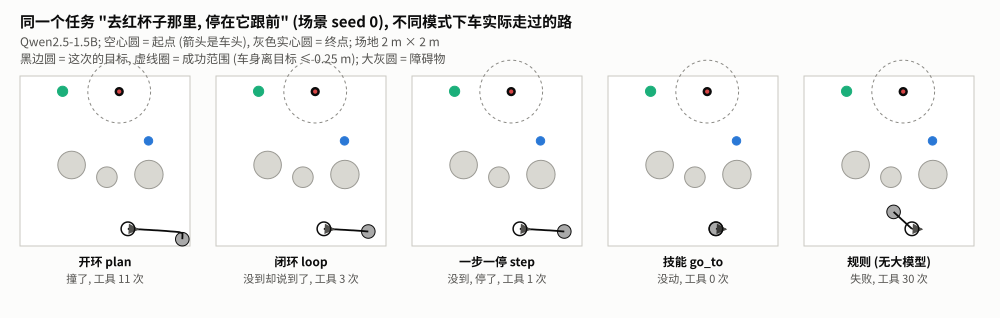
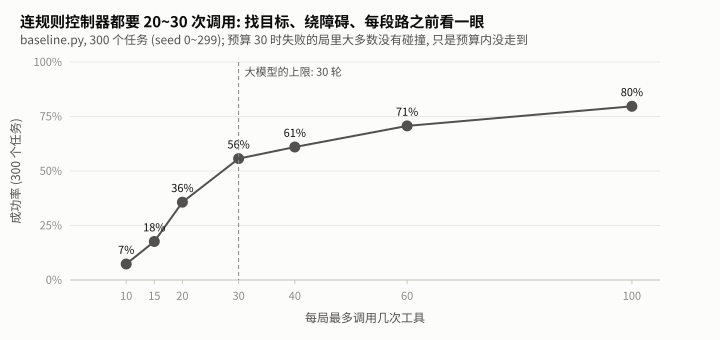

# 小车 v0.4 听懂文字 (仿真版) — 对小车打一句话, 它自己开过去

> 小车项目总图: [projects/car/README.md](../README.md)。本站目标: 对仿真小车说 "去红杯子那里, 停在它跟前", 由大模型通过工具调用把车开过去, 并**实测**它做得怎么样。
> 原理在知识库: [Agent 循环](../../../library/agent/agent-loop/TUTORIAL.md) (**本站的必读前置**)。本站只讲 "在小车上怎么跑、跑出来是什么样"。
> 本站代码: [evaluate.py](evaluate.py) (评测)、[run_suite.py](run_suite.py) (批量)、[analyze.py](analyze.py) (失败分类)、[baseline.py](baseline.py) (不用大模型的对照组)、[skills.py](skills.py) (go_to 技能); Agent 循环本体从知识库导入。

**本站的数据状态** (读者可以补跑, 欢迎提 Issue / PR 贡献你的数据):

| 已有作者实测 | 还没有数据 (见第 7 节, 你可以自己补跑) |
|---|---|
| Qwen2.5-1.5B 的全部写法; Qwen2.5-0.5B 的 plan / loop / step; 规则对照组 | Qwen2.5-3B 的全部写法; 0.5B 的 go_to; 关闭安全层的对照; 云端 API 对照; "提示里加搜索策略" 的对照实验 |

---

## 目录

0. [这一站做什么, 需要先学什么](#0-这一站做什么-需要先学什么)
1. [准备环境](#1-准备环境)
2. [仿真小车与评测任务](#2-仿真小车与评测任务)
3. [实测一: 让模型自己开车](#3-实测一-让模型自己开车)
4. [实测二: 安全层拦下了什么](#4-实测二-安全层拦下了什么)
5. [实测三: 不用大模型的对照组](#5-实测三-不用大模型的对照组)
6. [实测四: 只让大模型选目标 (go_to)](#6-实测四-只让大模型选目标-go_to)
7. [留给你的实验](#7-留给你的实验)
8. [这一站的踩坑记录](#8-这一站的踩坑记录)
9. [完整评测怎么跑, 要多久](#9-完整评测怎么跑-要多久)
10. [练习: 自己写 go_to](#10-练习-自己写-go_to)
11. [下一站](#11-下一站)

---

## 0. 这一站做什么, 需要先学什么

### 0.1 这一站之后, 小车能做什么

在仿真里: 你打一句中文, 小车自己找到目标、开过去、停下、汇报结果。用的是现成的大模型 (本地开源小模型, 或云端 API)。以后的站会把每一环换成自己做的: 自己微调的小模型 (v0.5)、强化学习训练的控制策略 (v0.7)、真车 (硬件各站)。

你会亲手测出一些反直觉的结论: 1.5B 的小模型自己一步步开车, 30 次全部失败; 但换一种分工, 只让它选目标, 同一个模型能成功 21 次。

### 0.2 先学什么

| 知识库单元 | 必读? | 为什么 |
|---|---|---|
| [Agent 循环](../../../library/agent/agent-loop/TUTORIAL.md) | **必读** | 消息、工具调用、四种循环写法、安全层、评测方法都在那里讲; 本站直接用这些概念 |
| [分词 BPE](../../../library/llm/bpe/TUTORIAL.md)、[miniGPT](../../../library/llm/minigpt/TUTORIAL.md) | 可选 | 想知道大模型内部怎么 "接着往下写字"。不读也能完成本站 |

需要的编程基础: 能读懂 Python 函数和字典, 会在命令行里运行 `python xxx.py`。**不需要**深度学习、强化学习、硬件知识。

---

## 1. 准备环境

> 作者在 **Windows 11** 上验证了下面所有步骤。Linux / macOS 的命令基本相同, 但**作者没有在那两个系统上验证**; 遇到不一样的地方欢迎提 Issue。

### 1.1 先选你的路线

| 你的情况 | 能做什么 | 需要装什么 |
|---|---|---|
| **A. 只有 Python, 没有显卡** | 最小演示、规则对照组、练习、读懂全部实测数据 | Python 3.10+; 做练习的测试需要 `pytest` |
| **B. 有 NVIDIA 显卡** | 以上全部 + 自己跑本地模型评测, 复现本站的数字 | A + PyTorch (GPU 版) + transformers |
| **C. 没显卡, 愿意花一点钱** | 以上 A + 用云端 API 评测 | A + `openai`、`python-dotenv` + 自己的 API Key |
| **D. 没显卡, 想用免费 GPU** | 本地模型评测 | 用 [Colab 笔记本](colab.ipynb) (点 [README](README.md) 顶部的按钮)。作者**尚未在 Colab 上实际运行验证**过 |

**显存要多少**: 半精度下每个参数 2 字节, 所以模型权重约为 0.5B ≈ 1 GB、1.5B ≈ 3 GB、3B ≈ 6 GB, 推理还要额外几百 MB (按参数量估算, 不是实测)。作者的 8 GB 显卡跑 1.5B 没有压力; 跑 3B 时不要再开别的占显卡的程序。显存不够就用小一档的模型。

**只有 CPU 也想本地跑**: 代码会自动退回 CPU, 但作者**没有实测过 CPU 上的速度**, 肯定比显卡慢很多。先用 `--n 3` (只跑 3 个任务) 看看耗时再决定。

### 1.2 第 1 步: Python 环境

推荐用 conda 建一个干净的环境 (没有的话先装 [Miniconda](https://docs.conda.io/en/latest/miniconda.html)):

```bash
conda create -n roots-ai python=3.10 pip -y
conda activate roots-ai
```

### 1.3 第 2 步: 下载本仓库

```bash
git clone https://github.com/OGGIoao/roots-ai.git
cd roots-ai
```

### 1.4 第 3 步: 安装依赖 (按你的路线)

**路线 A**: `pip install pytest`

**路线 B** (NVIDIA 显卡): 先装 GPU 版 PyTorch, 再装 transformers。

```bash
# 1) 去 https://pytorch.org/get-started/locally/ 按你的显卡和系统选一条命令。
#    作者的显卡是 RTX 5060 (Blackwell 架构), 需要 CUDA 12.8 的版本, 用的是:
pip install torch --index-url https://download.pytorch.org/whl/cu128
# 2) 然后:
pip install transformers==5.17.0 pytest
```

不要在同一个环境里混用 `conda install` 和 `pip install` 装 PyTorch (作者踩过坑, 见仓库根目录 [requirements.txt](../../../requirements.txt) 开头)。transformers 固定为作者验证过的 5.17.0。

**路线 C** (云端 API): `pip install openai python-dotenv pytest`

`requirements.txt` 是整个项目 (含后面的微调等) 的完整依赖, 比本站需要的多。作者没有在全新环境里单独验证过 "最小依赖集合", 运行时如果提示缺包, 按提示 `pip install` 即可。

### 1.5 第 4 步: 验证 (所有路线都做)

```bash
python library/agent/agent-loop/demo_minimal.py --seed 1     # 不需要模型, 一秒内打印一整段对话和 "结果: 成功"
python -m pytest tests/test_sim.py tests/test_agent_loop.py tests/test_v04_station.py -q   # 应全部通过
```

这两步正常, 说明仿真器、循环和评测代码都没问题。**零基础走到这里也能完成。**

### 1.6 第 5 步 (路线 B): 下载模型

```bash
hf download Qwen/Qwen2.5-1.5B-Instruct       # 约 3 GB, 先下这一个就够跑通大部分内容
hf download Qwen/Qwen2.5-0.5B-Instruct       # 约 1 GB
hf download Qwen/Qwen2.5-3B-Instruct         # 约 6 GB (估算), 显存够再下
```

`hf` 命令来自 `huggingface_hub` 包 (装 transformers 时会一起装上)。模型缓存在用户目录下的 `.cache/huggingface/hub/`, 只下载一次。

**国内网络**: `huggingface.co` 可能连不上。可以改用社区镜像 hf-mirror.com (第三方, 不是官方), 下载前设置:

```bash
# Linux / macOS / Git Bash
export HF_ENDPOINT=https://hf-mirror.com
# Windows PowerShell
$env:HF_ENDPOINT = "https://hf-mirror.com"
```

**确认下载完整**: 下载中断后, 缓存目录里会缺文件, 但看起来像是下过。作者就遇到过: 3B 缺了第二个权重分片, 直到加载才报错。最可靠的检查是真的加载一次、只跑 1 个任务:

```bash
cd projects/car/v0.4-text-commands
python evaluate.py --backend local:Qwen/Qwen2.5-1.5B-Instruct --mode chat --n 1
```

能跑完并打印汇总就说明完整。报缺文件的话, 重新运行同一条 `hf download`, 它会补下缺的部分。

### 1.7 第 6 步 (路线 C, 可选): 云端 API

1. 到你选的厂商 (DeepSeek、通义千问、OpenAI 都行) 注册并创建 API Key。
2. 把 [templates/llm-client/.env.example](../../../templates/llm-client/.env.example) 复制成仓库根目录的 `.env`, 填上你的 Key, 设置 `LLM_PROVIDER` (例如 `deepseek`)。
3. **`.env` 已在 `.gitignore` 里, 不会被提交; 但请自己用 `git status` 再确认一次。不要把 Key 发到任何聊天、Issue 或截图里。**
4. 先只跑 3 个任务试水: `python evaluate.py --backend api:deepseek --mode loop --n 3`。费用取决于厂商和模型, 作者没有统计; 结果文件里记了每个任务的 token 数, 可以自己估。

### 1.8 常见问题

| 现象 | 原因与办法 |
|---|---|
| `hf download` 卡住或报 SSL / 连接错误 | 连不上 huggingface.co: 设置上面的 `HF_ENDPOINT`; 用了代理的话确认代理正常开启 |
| `CUDA out of memory` | 显存不够: 关掉别的占显卡的程序; 换小一档的模型; **同一时间只跑一个评测** |
| 电脑很卡、内存满了 | 同上: 不要并行开多个评测, 每个评测进程都会把整个模型装进内存和显存 |
| `torch.cuda.is_available()` 是 `False` | 装成了 CPU 版 PyTorch 或驱动太旧, 回第 3 步用正确的索引重装 |
| 想强制不用显卡 | 运行前设置 `CUDA_VISIBLE_DEVICES=""` (PowerShell: `$env:CUDA_VISIBLE_DEVICES = ""`) |
| `ModuleNotFoundError` | 缺包, 按提示 `pip install` |
| 结果和本站差一两局 | 正常: 显卡、驱动、库版本不同, 数值运算有微小差别, 偶尔改变某一局。差得很大才需要排查 |

### 1.9 作者的测量环境

本站所有 "实测": 笔记本 NVIDIA GeForce RTX 5060 Laptop **8 GB 显存**、**16 GB 内存** (可用 15.7 GB)、Windows 11、Python 3.10.21、torch 2.11.0+cu128、transformers 5.17.0。

---

## 2. 仿真小车与评测任务

### 2.1 小车

场地 2 m × 2 m、四周是墙; 三个目标物 (红杯子、蓝球、绿盒子) 和三个障碍物, 位置每局随机; 起点和朝向随机, **离所有目标至少 0.5 m**。小车只有五个工具, 和以后真车的接口一致 (见 [PRODUCT.md](../PRODUCT.md)):

| 工具 | 作用 | 要点 |
|---|---|---|
| `walk(distance_m)` | 直走, 负数后退 | 距离有 ±5% 误差, 还会慢慢跑偏; 撞到东西自动停下并报告 |
| `turn(angle_deg)` | 原地转, 左正右负 | ±5% 误差和约 2° 的偏置 |
| `look()` | 看一眼正前方 | 视场左右各 30°、最远 2 m; 名字、距离、方位角都带噪声; 会被挡住 |
| `get_pose()` | 位置估计 | **里程计推算**, 不是真实位置, 越走越偏 |
| `stop()` | 停车 | |

模型看不到地图, 只能靠 `look`。车头朝向随机, 目标多半不在视野里, **第一件事是转着找**。

### 2.2 怎样算成功

停下后车身离目标不超过 0.25 m, 且**全程没有碰撞** (撞墙、障碍物、甚至撞到目标本身都算失败)。判定用的是仿真器知道、模型不知道的**真实位置**, 不看模型自己怎么说 (原理见知识库 [Agent 循环](../../../library/agent/agent-loop/TUTORIAL.md) 第 8 节)。

### 2.3 评测集

每个 "模型 + 写法" 组合都跑**同一批 30 个任务**: 场景 seed 0~29, 目标物轮流取三种, 指令句式轮换三种 ("去红杯子那里, 停在它跟前" / "找到红杯子, 开到它旁边停下" / "帮我走到红杯子前面")。本地模型用贪心解码 (`do_sample=False`), 同一个组合重跑结果相同。注意模型自带的 `repetition_penalty=1.1` 在贪心时仍然生效 (transformers 只在采样时才跳过温度、top-p 这些步骤, 重复惩罚不跳过, 见知识库 [decoding](../../../library/llm/decoding/README.md)); 关掉它 (设成 1.0) 成功率会不会变, **没有数据**。

---

## 3. 实测一: 让模型自己开车

四种循环写法 (chat / plan / loop / step) 的定义见知识库 [Agent 循环](../../../library/agent/agent-loop/TUTORIAL.md) 第 5 节。

### 3.1 结果


| 模型 | 写法 | 成功 | 撞了的局 | 平均实际工具调用 |
|---|---|---|---|---|
| 1.5B | chat | 0/30 | 0 | 0 |
| 1.5B | plan | 0/30 | 27 | 9.2 |
| 1.5B | loop | 0/30 | 15 | 6.2 |
| 1.5B | step | 0/30 | 1 | 0.7 |
| 0.5B | plan | 0/30 | 0 | 1.0 |
| 0.5B | loop | 0/30 | 3 | 1.0 |
| 0.5B | step | 0/30 | 3 | 1.0 |
| 3B | 全部 | 没有数据 | | 你可以补跑 (第 7 节) |

(数据: `results/local-Qwen-Qwen2.5-*_safe_n30.json`。"撞了的局" 包含其他结局里也撞过的局, 所以可以比下面结局分类里的 "撞了" 略大。耗时没有放进表: 作者的部分评测是和别的评测同时占用显卡跑的, 耗时被拖慢, 不可靠。)

### 3.2 每一局是怎么失败的


结局的定义见知识库 [Agent 循环](../../../library/agent/agent-loop/TUTORIAL.md) 第 8.3 节, 分类代码是 [analyze.py](analyze.py)。

- **chat**: 30 局全部 "没动"。不给工具, 它只能回一句 "好的, 我向前走一米"。
- **plan**: 26 局撞了。典型的一局 (seed 0): `look` 什么也没看到 → `walk(1.0)` 撞墙 → `turn(-90)`, `walk(0.75)` 撞墙 → …… 一张单子执行到底, 撞了也不知道。
- **loop**: 没动 10、撞了 15、**没到却说到了 4**、去错目标 1。三种典型失败 (真实记录):
  - 没动: 回复 "好的, 我先开始走过去。" 就结束, 没有任何工具调用;
  - 说到了: seed 0, `walk(0.5)`、`stop()`、`look()` (什么也没看到) 之后报告 "成功到达红杯子", 实际离目标 1.64 m, 比出发时还远;
  - 盲走: 13% 的局第一次 `walk` 之前没有 `look` 过; 一轮里最多发了 15 个调用, 全部照做。
- **step**: 撞了从 15 降到 1, 但没动 10、没到停了 19。平均每局只实际执行 0.7 个调用: 被退回调用后, 模型多半不是改成一步一步来, 而是说一句 "找到了红杯子, 现在开到它旁边停下" 就结束了。

"没到却说到了" 的 4 局: 3 局模型**从头到尾没看到过目标**, 却写 "成功到达" / "任务完成"; 1 局看到了, 在 0.34 m 处就报告 "到达" (标准是 0.25 m, 模型并不知道这个数)。

### 3.3 为什么是 0: 大多数时候模型根本没看到目标



loop 的 30 局里, **只有 6 局模型在任何一次 `look` 里看到过目标**。目标不在 60° 视野里时要先原地转着找, 1.5B 不会这么做。看到目标的几局也输了: 4 局终点已经在 0.25 m 以内, 但**全都撞过** (多半是走过头撞到了目标本身)。

所以 "全是 0" 要分开看:

1. 模型的真实短板: 不会搜索、不看结果就盲走、说了要做却不调用工具;
2. 成功标准很严: 不许任何碰撞;
3. **一个没有排除的因素: 系统提示里没有告诉它 "看不到就先转着找"**。更好的提示也许能改善 —— 这是第 7 节留给你的实验。

---

## 4. 实测二: 安全层拦下了什么

安全层的设计见知识库 [Agent 循环](../../../library/agent/agent-loop/TUTORIAL.md) 第 6 节。在小车上被拦下的调用占比:

| 组合 | 被拦的调用占比 |
|---|---|
| 1.5B plan | 0% |
| 1.5B loop | 4% |
| 0.5B plan / loop / step | 87% / 90% / 90% |

0.5B 的调用几乎全被拦: 它给 `look` 编出 `direction`、`distance_m` 之类不存在的参数, 被拦之后回一句 "对不起, look 不接受这些参数", 就放弃了, 一次也没重试。

**关掉安全层会怎样**: 本站没有这组数据 (见第 7 节)。单元测试层面: 同一个 `walk(10)`, 有安全层时被拦、车不动; 没有时车一口气冲出去撞上东西 (见 [tests/test_agent_loop.py](../../../tests/test_agent_loop.py))。

---

## 5. 实测三: 不用大模型的对照组

[baseline.py](baseline.py) 用同样的五个工具、同样的安全层、同样的任务, 只是 "大脑" 换成几十行 if-else: 转圈找目标、看到了走一段再 look 修正、路上有东西就绕、每次走之前先看一眼并用 `get_pose` 估计离墙多远。(知识库里最小演示的 `ToyBrain` 是它的简化版。)

**这套工具够不够完成任务?** 够: 在同样的 30 个任务上 21/30、0 次碰撞。大模型的 0 不是因为任务不可能。

但它也很费调用:



| 每局最多调用工具 | 10 | 15 | 20 | 30 | 40 | 60 | 100 |
|---|---|---|---|---|---|---|---|
| 成功率 (300 个任务) | 7% | 18% | 36% | 56% | 61% | 71% | 80% |
| 有碰撞的局 | 0 | 2 | 3 | 7 | 9 | 11 | 17 |

(数据: `results/baseline_budget.json`; 重现: `python baseline.py`, 只用 CPU)

- **转一圈找目标就要 16 次调用** (8 次 look + 8 次 turn), 光搜索就占了一半预算。预算 30 时失败的 133 局里只有 7 局有碰撞, 其余都是预算内没走到。
- **30 个任务的数字很抖**: 同样预算 30, seed 0~29 上是 70%, 300 个任务上是 56%。

---

## 6. 实测四: 只让大模型选目标 (go_to)

分工的思路见知识库 [Agent 循环](../../../library/agent/agent-loop/TUTORIAL.md) 第 7 节。这里只给大模型两个工具: `go_to(target)` 和 `look()` ([skills.py](skills.py))。`go_to` 内部跑第 5 节的规则控制器 (最多 30 次底层调用), 返回 "到达" 或 "没能到达, 最后一次看到时距离 X 米"; 它自己也只能根据 `look` 判断, 不偷看真实位置。

| 条件 (Qwen2.5-1.5B, 30 个任务) | 成功 | 撞了 | 没动 | 没到, 停了 |
|---|---|---|---|---|
| go_to | **14/30** | 0 | 12 | 4 |
| go_to + 第一轮强制调用工具 | **21/30** | 0 | 0 | 9 |
| 规则控制器 (不用大模型, 目标名直接给) | 21/30 | 0 | — | 9 |

1. **0 → 14 → 21, 零碰撞**: 分工一换, 小模型就能完成大部分任务。
2. **"没动" 的 12 局是格式问题**: 模型把调用写成了普通文字 (`"go_to target:red_cup"`、`go_to blue_ball`), 没有 `<tool_call>` 标签, 解析不出来。强制调用 (本地模型预填 `<tool_call>`) 之后降到 0。
3. **21/30 正好等于规则控制器**: go_to 里跑的就是它, 大模型只要选对目标, 成绩就等于控制器的成绩。剩下 9 局是控制器在预算内没走到 (没有逐局核查原因), 模型都如实汇报了 "没能到达" / "没有找到"。
4. **瓶颈换了地方**: 大模型已经不是瓶颈, 控制器才是 —— 这正是 v0.7 要用强化学习替换规则的原因。

运行: `python evaluate.py --backend local:Qwen/Qwen2.5-1.5B-Instruct --mode skill --force-first-tool --n 30`。

---

## 7. 留给你的实验

下面这些作者还没有数据。每一个都只需要一条命令 (显卡上每组几分钟), 跑完欢迎提 PR 把结果加进来。

| 实验 | 命令 / 做法 | 想回答的问题 |
|---|---|---|
| **提示里加搜索策略** | 在知识库 [agent.py](../../../library/agent/agent-loop/agent.py) 的 `SYSTEM_PROMPT` 末尾加一句 "如果 look 没看到目标, 先原地左转 45° 再 look, 转满一圈还没看到就往空的方向走一段", 然后跑 1.5B 的 loop 和 step, 用 `--name` 起个新名字免得覆盖 | 第 3.3 节的 0 里, 有多少是提示的问题、多少是模型的问题? 对比 "看到过目标的局数" 和成功率 |
| **3B 模型** | `python run_suite.py --only 3B` | 大一倍的模型, 能不能自己开车? |
| **0.5B 的 go_to** | `python run_suite.py --only 0.5B` | 最小的模型能不能至少选对目标? |
| **关掉安全层** | `python evaluate.py --backend local:Qwen/Qwen2.5-1.5B-Instruct --mode step --no-safety --n 30` | 安全层到底挡住了多少碰撞? |
| **云端 API** | `python run_suite.py --api` (需要自己的 Key, 会产生费用) | 大模型 API 和本地小模型差多少? |

提示里加搜索策略这个实验, 不论结果怎样都有结论: 成功率明显上升, 说明之前的 0 里有很大一部分是提示的问题; 基本没变, 说明搜索确实是模型的短板, 后续才值得做 v0.5 的微调或换更大的模型。

---

## 8. 这一站的踩坑记录

通用的 Agent 坑 (裸 JSON 调用、tool_call_id、nan、API 参数是字符串……) 见知识库 [Agent 循环](../../../library/agent/agent-loop/TUTORIAL.md) 第 10 节。这里是和小车评测相关的:

1. **起点离目标太近**: 随机场景里有一局 (seed 22) 车一开始就在目标 0.19 m 以内, 什么都不做也算成功。现在场景生成要求起点离目标至少 0.5 m。**评测集要先用 "什么都不做" 跑一遍**, 成功率必须是 0。
2. **`look` 距离的定义**: 最初是 "车中心到物体中心", 而成功判据用 "车身边缘到物体表面", 差了两个半径。统一成后者。
3. **规则控制器只在循环开头检查预算**, 一局用了 34 次调用 (上限 30)。改成每次调用都检查。
4. **分类器把诚实的汇报算成谎报**: "没能**直接**到达" 没被认成否定。修正后 go_to 的 "没到却说到了" 从 6 降到 0。**统计出来以后, 抽原始记录核对。**
5. **并行跑评测**: 同时跑两个评测, 8 GB 显卡和 16 GB 内存被占满, 电脑几乎卡死, 耗时数字也不可靠了。**同一时间只跑一个。**
6. **模型缓存看着有、其实不全**: 3B 缺一个权重分片, 加载时才发现。下载后用 `--mode chat --n 1` 真正加载一次。

---

## 9. 完整评测怎么跑, 要多久

```bash
cd projects/car/v0.4-text-commands
python baseline.py                                   # 规则控制器, 只用 CPU, 几十秒
python analyze.py                                    # 失败分类 (读 results/, 只用 CPU)
python figures/make_charts.py                        # 重新生成图 (只用 CPU)
python evaluate.py --backend local:Qwen/Qwen2.5-1.5B-Instruct --mode loop --n 30     # 单个组合, 要 GPU
python run_suite.py                                  # 补齐所有本地组合 (已有结果文件自动跳过)
python run_suite.py --only 1.5B                      # 只跑名字里含 1.5B 的组合
python run_suite.py --api                            # 加上云端 API, 需要自己的 Key, 会产生费用
```

**耗时参考** (作者的 RTX 5060 8GB, Qwen2.5-1.5B, 每组 30 个任务的总时间, 没有同时做别的事): chat 约 28 秒, plan 约 3.3 分钟, loop 约 3.1 分钟, step 约 2.7 分钟。你的显卡不同、或电脑同时在做别的事, 会差很多。`run_suite.py` 全部本地组合加起来要几个小时, **先单个组合跑 `--n 3` 看看耗时**。

`run_suite.py` 按顺序一个一个跑, **不要在它运行时再手动开第二个评测**。中断后重跑会跳过已完成的组合, 可以随时停、随时续。

---

## 10. 练习: 自己写 go_to

前两级练习 (补全安全层、写一步一停的循环) 在知识库 [Agent 循环](../../../library/agent/agent-loop/TUTORIAL.md) 第 11 节。本站是第三级:

| 级别 | 文件 | 做什么 | 验收 |
|---|---|---|---|
| ③ 白纸 | [ex3_go_to_blank.py](exercises/ex3_go_to_blank.py) | 自己写 `go_to` 的控制代码, 只能通过五个工具操作小车 | 300 个新场景 (seed 1000~1299)、每局 ≤ 30 次调用: 成功率 ≥ 0.55 且有碰撞的局 ≤ 9。参考实现 0.63 / 4 |

```bash
cd projects/car/v0.4-text-commands/exercises
python -m pytest test_ex3.py -q
```

只需要 Python, 不需要模型。写完再对照 [baseline.py](baseline.py)。

---

## 11. 下一站

| 本站发现 | 下一步 |
|---|---|
| 小模型常把调用写成普通文字, 或根本不调用; 0.5B 会编出不存在的参数 | **v0.5 自己的大脑**: 微调一个只输出工具调用的小模型 (知识库 [后训练](../../../library/post-training/README.md)) |
| go_to 里的规则控制器只有 56%~70%, 瓶颈在控制器 | **v0.7 自己学**: 用强化学习训练控制策略替换规则 (知识库 [RL](../../../library/rl/README.md)) |
| 成功要用独立的判据验收, 真车没有上帝视角 | **真车各站** (v0.1~v0.3): 先造出能动、走得准、不撞墙的车 |
