# BPE 分词器讲义 — 从 256 个字节到一张词表

> 本讲义配合 [tokenizer.py](tokenizer.py)、[train.py](train.py)、[data.py](data.py) 阅读。
> 讲义里**所有数字、分词结果和日志都是在测量平台 (见根目录 README) 实际跑出来的**, 不是从别处抄来的示意值:
> 示例出自 [experiments/examples.py](experiments/examples.py), 主流模型的数据出自 [experiments/tokenizer_anatomy.py](experiments/tokenizer_anatomy.py),
> 结果文件都在 [experiments/results/](experiments/results/)。你照着跑, 应该看到完全相同的结果 (BPE 训练没有随机性)。

---

## 目录

**第一部分 · 读懂这份代码**

0. [阅读指南](#0-阅读指南)
1. [全景: 分词器在 LLM 里做什么](#1-全景-分词器在-llm-里做什么)
2. [为什么是"子词", 为什么从"字节"开始](#2-为什么是子词-为什么从字节开始)
3. [训练过程图解: 三个手算得出来的例子](#3-训练过程图解-三个手算得出来的例子)
4. [tokenizer.py 逐行拆解](#4-tokenizerpy-逐行拆解)
5. [在莎士比亚上真实训练一次](#5-在莎士比亚上真实训练一次)
6. [预分词: 合并不许跨越的边界](#6-预分词-合并不许跨越的边界)
7. [编码: 按 rank 贪心合并](#7-编码-按-rank-贪心合并)
8. [解码: 只需要 vocab](#8-解码-只需要-vocab)
9. [压缩率: 词表越大越好吗](#9-压缩率-词表越大越好吗)
10. [BPE、WordPiece、Unigram 三种子词算法](#10-bpewordpieceunigram-三种子词算法)
11. [中文: 字节级 BPE 的软肋](#11-中文-字节级-bpe-的软肋)
12. [从教学实现到工业分词器: 差在哪](#12-从教学实现到工业分词器-差在哪)
13. [本项目踩坑记录汇总](#13-本项目踩坑记录汇总)
14. [练习](#14-练习)
15. [延伸学习资源](#15-延伸学习资源)

**第二部分 · 延伸专题** (每个专题的数字都出自 [experiments/](experiments/) 里的脚本)

16. [专题 A · 编码知识: 从字符到字节](#16-专题-a--编码知识-从字符到字节)
17. [专题 B · 正则表达式与预分词](#17-专题-b--正则表达式与预分词)
18. [专题 C · 初始词表: 256 个字节全景](#18-专题-c--初始词表-256-个字节全景)
19. [专题 D · 主流分词器解剖](#19-专题-d--主流分词器解剖)
20. [专题 E · 信息论视角: 熵、压缩与 loss](#20-专题-e--信息论视角-熵压缩与-loss)
21. [延伸专题练习](#21-延伸专题练习)

---

# 第一部分 · 读懂这份代码

## 0. 阅读指南

### 0.1 这个项目在整个仓库里的位置

LLM 的第一道工序是把文字变成整数。后面所有项目 (Transformer、miniGPT、微调) 吃进去的都是这一串整数,
所以分词器做得好不好, 直接决定了模型"一次能看多少字"、"中文贵不贵"、"数字算不算得对"。

本项目从零实现**字节级 BPE** (GPT-2 起被广泛采用的方案), 一共不到 400 行, 没有任何第三方依赖。

### 0.2 文件和命令

| 文件 | 内容 | 读多久 |
|---|---|---|
| [tokenizer.py](tokenizer.py) | BPE 核心: `train` / `encode` / `decode` | 40 分钟 |
| [train.py](train.py) | 训练入口: 训练 → 演示 → 压缩率 → 保存 | 10 分钟 |
| [data.py](data.py) | 语料 (TinyShakespeare, 入库在 `data/`) | 5 分钟 |
| [modern_tokenizers.py](modern_tokenizers.py) | tiktoken / SentencePiece / HuggingFace 的动手演示 | 第 19 节 |
| [information_theory.py](information_theory.py) | 熵、交叉熵、Huffman 与分词效率 | 第 20 节 |
| [experiments/](experiments/) | 本讲义所有数字和图的来源 | 按需 |

```bash
cd projects/llm-bpe-tokenizer
python train.py                    # 默认: 莎士比亚, 词表 500, 约 15 秒
python train.py --vocab_size 1000  # 更大词表 (写到 tokenizer_shakespeare_1000.json, 不覆盖入库的 tokenizer.json)
python experiments/examples.py fast   # 重新生成讲义里的全部示例 (约 1 分钟)
```

### 0.3 怎么读

- **第一遍**: 读第 1~3 节, 然后跑一次 `python train.py`, 对照第 5 节看懂每一行日志。约 1 小时。
- **第二遍**: 打开 `tokenizer.py`, 跟着第 4、6、7、8 节逐行读, 把每节「动手验证」里的代码贴进 Python 跑。约 3 小时。
- **第三遍**: 做第 14 节的三道练习, 不看参考实现。
- 第二部分的专题按兴趣读; 其中专题 A (编码知识) 如果你对 `0x41`、`U+0041` 这类写法不熟, **建议先读**。

### 0.4 记号约定

| 记号 | 含义 |
|---|---|
| `␣` | 图里的空格 (空格本身看不见) |
| `↵` 或 `\n` | 换行 |
| `E4 BD A0` | 十六进制写的字节, 通常是"半个汉字"这类不能单独显示的字节 |
| $`V`$ | 词表大小 (vocab size) |
| $`M`$ | 合并次数, $`M = V - 256`$ |
| rank | 一条合并规则学到的先后次序; 本实现直接用新 token 的 ID 表示 |

---

## 1. 全景: 分词器在 LLM 里做什么

**一句话**: BPE 训练 = 反复把语料里**出现次数最多的相邻一对 token** 合并成一个新 token, 直到词表达到目标大小。
编码时按同样的先后次序把这些合并重放一遍; 解码时把每个 token 代表的字节拼回去。

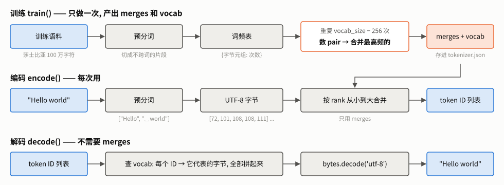

**图 1** BPE 做的三件事。**怎么读**: 从上往下三行。**训练** (只做一次) 的产物是两张表: `merges` 记录"哪两个 token 合成了哪个新 token",
`vocab` 记录"每个 token 代表哪些字节"; 两张表一起存进 `tokenizer.json`。**编码** (每次用) 只需要 `merges`: 先预分词、
转成字节, 再按学到的先后次序合并。**解码** 只需要 `vocab`: 查表、拼字节、按 UTF-8 解码。三者的输入输出形状都写在方框里, 后面第 4~8 节逐个展开。

BPE (Byte Pair Encoding) 原本是 Gage 在 1994 年提出的一种数据压缩算法; Sennrich 等人 2016 年把它用到机器翻译的分词上,
GPT-2 (2019) 把起点从"字符"换成"字节", 就是本项目实现的**字节级 BPE**。

---

## 2. 为什么是"子词", 为什么从"字节"开始

### 2.1 三种切分粒度

模型只认整数。把文本切成什么单位再编号, 有三种选择:

| 方案 | 词表大小 | 好处 | 致命问题 |
|---|---|---|---|
| 字符级 | 几十 ~ 几千 | 不会遇到没见过的单位 | 序列很长; 注意力的计算量随长度平方增长 |
| 词级 | 几万 ~ 几十万 | 序列短 | 没见过的词只能变成 `<UNK>`; 词表随语料无限膨胀 |
| **子词级 (BPE 等)** | 几百 ~ 几十万, 自己定 | 常见词完整, 罕见词拆成片段 | 需要训练; 切法不总是符合人的直觉 |

子词的效果用我们自己训练的分词器 (莎士比亚, 词表 500) 和 GPT-2 (词表 50257) 对比最直观 (实测, 出自 `examples.json` 的 `words`):

| 输入 | 我们的 (500) | GPT-2 (50257) |
|---|---|---|
| `" the"` | `␣the` (1 个) | `␣the` (1 个) |
| `"the"` (前面没空格) | `t` `he` (2 个) | `the` (1 个) |
| `"Hello"` | `H` `ell` `o` | `Hello` |
| `"unbelievable"` | 11 个: `u` `n` `b` `e` `l` `i` `e` `v` `a` `b` `le` | `un` `bel` `iev` `able` |
| `" unbelievable"` | 11 个 | `␣unbelievable` (1 个) |
| `"xyzabc"` | 6 个单字节 | `xy` `z` `abc` |

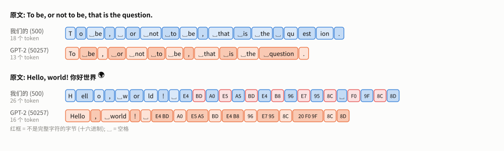

**图 2** 两句话在我们的分词器 (蓝, 词表 500) 和 GPT-2 (橙, 词表 50257) 下的切法, 每个方块是一个 token, 深浅交替只为分清边界。**怎么读**: 先数个数: 第一句 18 vs 13, 第二句 26 vs 16。
第一句的差别全在 `question`: 我们切成 `␣` `qu` `est` `ion`, GPT-2 是一个 `␣question`。第二句的红框是"不完整的字节": 我们把每个汉字和 emoji 都拆成单字节 (`E4` `BD` `A0`), GPT-2 把"你"切成 `E4 BD` + `A0` 两段,
还出现了 `20 F0 9F` 这种"空格 + 半个 emoji"的 token。字节级分词器的 token 不必是完整的字符。

两点观察:

1. **同一个词, 前面有没有空格是两个不同的 token** (`" the"` vs `"the"`)。这是预分词把空格挂在词前面造成的, 第 6 节细讲。
2. 词表 500 的分词器只学到了莎士比亚里最高频的片段, 罕见词基本退回到单字节; GPT-2 的词表大 100 倍, 连 `" unbelievable"` 都是一个 token。
   "常见词完整, 罕见词拆碎"在两者身上都成立, 只是"常见"的门槛不同。

### 2.2 为什么从字节开始

我们的初始词表就是 256 个字节值 (0~255)。任何文本先按 UTF-8 编码成字节, 每个字节必然在 0~255 之内, 所以:

- **不存在未知字符**: 中文、emoji、代码、乱码, 最差也能退回到单字节编码, 永远不需要 `<UNK>`;
- **代价**: 一个汉字占 3 个字节。如果训练语料里没有中文, 一个汉字就要 3 个 token (第 11 节实测)。

并不是所有模型都这么做。第 19 节读了 12 个模型官方仓库里的 `tokenizer.json`, 实际情况是:

| 做法 | 实测到的模型 |
|---|---|
| 字节级 BPE + 正则预分词 | GPT-2、phi-2、phi-4、Qwen2.5、DeepSeek-V3、GLM-4.5、gpt-oss |
| 在字符上做 BPE, 不认识的字符**退回字节** (byte_fallback) | Mistral-7B、Phi-3-mini |
| WordPiece (从字符开始, 不认识的变 `[UNK]`) | BERT |
| Unigram (不认识的变 `<unk>`) | T5 |

旧版讲义里"所有主流 LLM 都用字节级 BPE"的说法是错的; 但"最终都能处理任意字节"在今天的主流 LLM 上基本成立 (要么字节级, 要么有字节回退)。

---

## 3. 训练过程图解: 三个手算得出来的例子

下面三个例子都很小, 可以用纸笔算; 每一轮的结果都是用 `tokenizer.py` 自己的函数实际跑出来的 (`examples.py` 里的 `trace_train`)。

### 3.1 最小的例子: low / lower / lowest

先跳过预分词, 直接给定三个词, 各出现 1 次。用 $`c(w)`$ 表示词 $`w`$ 出现的次数, 一对相邻 token $`(a, b)`$ 的频率是:

```math
f(a, b) = \sum_{w} c(w) \cdot \#\{\, i : w_i = a,\ w_{i+1} = b \,\}
```

也就是"把每个词里这对 token 出现的次数, 乘上这个词的出现次数, 再全部加起来"。

| 轮次 | 最高频的几对 | 选中 | 合并后 |
|---|---|---|---|
| 1 | `l+o`=3, `o+w`=3, `w+e`=2, `e+r`=1 | `l+o` → `lo` (ID 256) | `lo w` / `lo w e r` / `lo w e s t` |
| 2 | `lo+w`=3, `w+e`=2, ... | `lo+w` → `low` (257) | `low` / `low e r` / `low e s t` |
| 3 | `low+e`=2, `e+r`=1, `e+s`=1, `s+t`=1 | `low+e` → `lowe` (258) | `low` / `lowe r` / `lowe s t` |
| 4 | `s+t`=1, `lowe+r`=1, `lowe+s`=1 | `s+t` → `st` (259) | `low` / `lowe r` / `lowe st` |

**三个细节**:

- 第 1 轮 `l+o` 和 `o+w` 并列 3 次。代码规定频率相同时选 **ID 更小**的那对: `l`=108 < `o`=111, 所以选 `l+o`。这条规则让训练结果完全确定 (第 4.2 节)。
- 第 3 轮合并出的是 `lowe` 而不是 `we`: 第 2 轮之后 `w` 已经并进了 `low`, 不存在单独的 `w` 了。旧版讲义在这里写成了 `we`, 是错的。
- 第 4 轮三对都是 1 次, 比较 ID: `s`=115 和 `t`=116 都是单字节, 而 `lowe`=258 更大, 所以选 `s+t`。

### 3.2 词频的作用: Sennrich 论文里的例子

把每个词的出现次数考虑进来: `low`×5、`lower`×2、`newest`×6、`widest`×3 (Sennrich 等 2016 论文里的经典例子)。

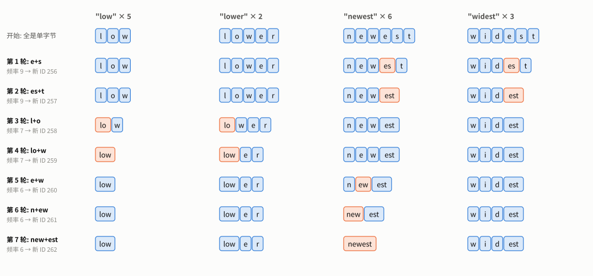

**图 3** 前 7 轮合并, 每行是一轮之后四个词的样子, 橙色是这一轮新合并出的 token。**怎么读**: 先看左边一列: 第 1 轮选 `e+s`, 频率 9,
是因为 `es` 同时出现在 `newest` (6 次) 和 `widest` (3 次) 里, 6+3=9; 它压过了在 `low` (5 次) 和 `lower` (2 次) 里出现的 `l+o` (5+2=7)。
**出现次数多的词说了算**: `newest` 虽然只是一个词, 但它出现 6 次, 所以第 5~7 轮把它一路合并成了一个完整的 token, 而只出现 3 次的 `widest` 到第 7 轮还是 4 段。
第 8~10 轮 (图里没画) `widest` 也合成了一个 token, 依次是 `d+est`、`i+dest`、`w+idest`, 频率都是 3。

### 3.3 重叠的 pair: abababd 与 aaaa

| 轮次 | 序列 | 统计到的频率 | 选中 | 实际替换 |
|---|---|---|---|---|
| 1 | `a b a b a b d` | `a+b`=3, `b+a`=2, `b+d`=1 | `a+b` → `ab` (256) | 3 处 |
| 2 | `ab ab ab d` | `ab+ab`=**2**, `ab+d`=1 | `ab+ab` → `abab` (257) | **1 处** |
| 3 | `abab ab d` | `ab+d`=1, `abab+ab`=1 | `ab+d` → `abd` (258) | 1 处 |
| 4 | `abab abd` | `abab+abd`=1 | → `abababd` (259) | 1 处 |

注意第 2 轮: `ab ab ab` 里 `(ab, ab)` 在位置 0-1 和 1-2 各出现一次, **统计**是 2 次; 但合并是从左到右进行的, 位置 0-1 合并后,
位置 1 已经被用掉了, 所以**实际只能替换 1 处**。更极端的是 `aaaa`: `(a, a)` 统计 3 次, 实际替换 2 处, 得到 `aa aa`。

这就是 `_get_pair_freqs` 注释里说的"重叠的 pair 会被重复计数": 统计频率在少数情况下偏高。它不影响正确性
(合并规则仍然是确定的), 只是选中的 pair 可能不是"真正能替换最多次"的那个。GPT-2 和 HuggingFace 的实现也是这样数的。

第 3 轮又是并列 (都是 1 次): 比较第一个 ID, `ab`=256 < `abab`=257, 所以选 `ab+d`。

### 3.4 真正调用 train() 时: 空格也是词的一部分

上面三个例子都跳过了预分词。如果直接 `tok.train("low lower lowest", 260)`, 预分词先把文本切成 `["low", " lower", " lowest"]`
(空格挂在后面的词上, 第 6 节), 学到的 4 条合并是 `lo`、`low`、**`␣low`**、**`␣lowe`**: 带空格的 `" low"` 是一个独立的 token。

---

## 4. tokenizer.py 逐行拆解

本节的代码块都是从 `tokenizer.py` 原样摘出来的 (只省略了日志打印), 行内注释也是源码里的。

### 4.1 `__init__`: 两张表

```python
# tokenizer.py
        self.vocab: dict[int, bytes] = {i: bytes([i]) for i in range(256)}
        self.merges: dict[tuple[int, int], int] = {}
```

| 表 | 键 → 值 | 例子 (莎士比亚, 词表 500) |
|---|---|---|
| `vocab` | ID → 这个 token 代表的字节 | `vocab[65] = b'A'`, `vocab[266] = b' the'` |
| `merges` | (左 ID, 右 ID) → 新 ID | `merges[(256, 257)] = 266`, 即 `" t" + "he" → " the"` |

`merges` 的值同时就是 **rank**: 新 ID 按学到的顺序分配 (256, 257, ...), 所以 ID 越小越早学到, 编码时越优先。
Python 3.7 起 `dict` 保持插入顺序, 遍历 `merges` 的顺序就是学到的顺序, `save` 时直接按这个顺序写出。

### 4.2 `train`: 训练主循环

```python
# tokenizer.py
        num_merges = vocab_size - 256                      # 每次合并新增 1 个 token
        pretokens = self._pretokenize(text)
        word_freqs: dict[tuple[int, ...], int] = defaultdict(int)
        for token in pretokens:
            byte_ids = tuple(token.encode("utf-8"))  # str → UTF-8 字节 → ID 元组 (元组才能当 dict 的键)
            word_freqs[byte_ids] += 1
        for merge_idx in range(num_merges):
            pair_freqs = self._get_pair_freqs(word_freqs)
            if not pair_freqs:                             # 每个词都只剩 1 个 token 了
                break
            best_pair = max(pair_freqs, key=lambda p: (pair_freqs[p], -p[0], -p[1]))
            best_freq = pair_freqs[best_pair]
            new_id = 256 + merge_idx
            self.merges[best_pair] = new_id
            self.vocab[new_id] = self.vocab[best_pair[0]] + self.vocab[best_pair[1]]
            word_freqs = self._apply_merge_to_freqs(best_pair, new_id, word_freqs)
```

逐行看:

1. **`num_merges = vocab_size - 256`**: 每合并一次词表加 1, 所以 $`M = V - 256`$。
2. **预分词 + 词频表**: 莎士比亚训练集预分词后有 182,499 个片段, 但只有 **25,117 种**。同一个词只存一份, 记下次数,
   后面统计 pair 时乘上次数。这让每轮扫描的工作量从 18 万降到 2.5 万 (第 5 节)。
   `"low"` 出现 5 次 → `{(108, 111, 119): 5}`。
3. **`if not pair_freqs: break`**: 每个词都已经合成一个 token 时, 没有任何 pair 可数, 训练**提前结束**, 词表会小于 `vocab_size` (第 18.5 节有实例)。
4. **`max(..., key=lambda p: (pair_freqs[p], -p[0], -p[1]))`**: 选频率最高的 pair; Python 比较元组时逐个元素比, 所以频率相同时比 `-p[0]`
   (第一个 ID 越小, 取负后越大), 再相同比 `-p[1]`。写成公式:

```math
(a^*, b^*) = \arg\max_{(a,b)} \big(f(a,b),\ -a,\ -b\big) \quad \text{(按字典序比较)}
```

   这条 tie-break 规则让训练**完全确定**: 同样的语料、同样的词表大小, 永远得到同一张 `merges`。
5. **`vocab[new_id] = vocab[a] + vocab[b]`**: 新 token 的字节就是两个父 token 的字节拼起来, 例如 `b' t' + b'he' = b' the'`。
6. **`_apply_merge_to_freqs`**: 把词频表里所有出现这对 pair 的地方换成新 ID。词变短了, 相邻关系变了, 所以下一轮必须重新统计。

### 4.3 `_get_pair_freqs`: 数 pair (整个训练的瓶颈)

```python
# tokenizer.py
        pair_freqs: dict[tuple[int, int], int] = defaultdict(int)
        for word_ids, freq in word_freqs.items():
            for i in range(len(word_ids) - 1):
                pair = (word_ids[i], word_ids[i + 1])
                pair_freqs[pair] += freq                   # 加的是这个词出现的次数, 不是 1
        return pair_freqs
```

就是 3.1 节那个求和公式的直接翻译。每一轮都要把**所有不同的词**完整扫一遍, 工作量是

```math
\text{每轮代价} \propto \sum_{w \in \text{不同的词}} (\,|w| - 1\,)
```

$`|w|`$ 是这个词当前的 token 数。它几乎不随轮次变化 (词只会越变越短, 但变化很慢), 所以总训练时间大约正比于合并次数 $`M`$: 实测每次合并约 46 毫秒 (第 5.4 节)。
工业实现只更新"包含被合并 pair 的那些词", 不再全量重扫 (第 12 节, 也是练习 ③)。

### 4.4 `_apply_merge_to_freqs` 与 `_merge_pair_in_sequence`: 执行一次合并

```python
# tokenizer.py
        new_word_freqs: dict[tuple[int, ...], int] = {}
        for word_ids, freq in word_freqs.items():
            new_ids = _merge_pair_in_sequence(word_ids, pair, new_id)
            # 不同的词合并后不会变成同一个序列 (合并可逆), 所以这里直接赋值, 不需要累加
            new_word_freqs[new_ids] = freq
        return new_word_freqs
```

```python
# tokenizer.py
    result: list[int] = []
    i = 0
    while i < len(ids):
        if i < len(ids) - 1 and ids[i] == pair[0] and ids[i + 1] == pair[1]:
            result.append(new_id)
            i += 2                                         # 跳过已被合并的两个位置
        else:
            result.append(ids[i])
            i += 1
    return tuple(result)
```

从左到右扫描: 当前位置和下一个位置恰好是要合并的 pair, 就写入新 ID 并跳过两格; 否则原样抄一个、前进一格。
重叠时"先到先得": `(97, 97, 97)` 合并 `(97, 97)` 得到 `(256, 97)`, 这就是 3.3 节"统计 2 次、只替换 1 处"的来源。

**为什么可以直接赋值不累加?** 合并是可逆的: 新 ID 唯一对应那一对, 把它展开就能还原原序列。所以两个不同的词合并后不可能变成同一个序列, 不会发生键冲突。

### 4.5 `encode` 与 `_encode_chunk`

```python
# tokenizer.py
        pretokens = self._pretokenize(text)
        result: list[int] = []
        for token in pretokens:
            byte_ids = list(token.encode("utf-8"))     # 例: " the" → [32, 116, 104, 101]
            merged = self._encode_chunk(byte_ids)
            result.extend(merged)
        return result
```

```python
# tokenizer.py
        while len(ids) >= 2:
            best_pair = None
            best_rank = float("inf")
            for i in range(len(ids) - 1):
                pair = (ids[i], ids[i + 1])
                if pair in self.merges:
                    rank = self.merges[pair]  # new_id 即 rank
                    if rank < best_rank:
                        best_rank = rank
                        best_pair = pair
            if best_pair is None:
                break  # 没有可用合并了，结束
            new_id = self.merges[best_pair]
            ids = list(_merge_pair_in_sequence(tuple(ids), best_pair, new_id))
        return ids
```

编码对每个预分词片段**独立**进行: 在当前序列的所有相邻对里, 找出在 `merges` 里且 rank 最小的那一对, 合并, 重复, 直到没有任何相邻对在 `merges` 里。第 7 节用真实例子走一遍。

### 4.6 `decode`

```python
# tokenizer.py
        raw_bytes = b"".join(self.vocab[i] for i in ids)
        return raw_bytes.decode("utf-8", errors="replace")
```

两行: 查表拼字节, 再按 UTF-8 解码。`errors="replace"` 让不合法的字节序列变成 `�` 而不是抛异常, 第 8 节讲它什么时候会触发。

### 4.7 `save` / `load`

```python
# tokenizer.py
        data = {
            "vocab": {str(k): list(v) for k, v in self.vocab.items()},
            "merges": [[a, b, c] for (a, b), c in self.merges.items()],
        }
```

字节存成整数列表而不是字符串, 因为很多 token 不是合法的 UTF-8 (例如半个汉字 `b'\xe4'`), 没法写成 JSON 字符串。
`load` 时 JSON 的键只能是字符串, 所以要 `int(k)` 转回来。

> **动手验证**
> ```python
> from tokenizer import BPETokenizer
> t = BPETokenizer()
> t.train("low lower lowest", 260, verbose=False)
> print(t._pretokenize("low lower lowest"))   # ['low', ' lower', ' lowest']
> print([t.vocab[i] for i in t.merges.values()])   # [b'lo', b'low', b' low', b' lowe']
> ```

---

## 5. 在莎士比亚上真实训练一次

### 5.1 日志逐行读

`python train.py` 的完整输出 (本机实测, 只截取训练部分):

```
[数据] 语料大小：1,115,394 字符 / 1,115,394 字节
[数据] 训练集：1,003,854 字符 / 验证集：111,540 字符

[训练] 语料 pre-token 统计：182,499 个（25,117 种）
[训练] 目标：244 次合并，词表 256 → 500
-------------------------------------------------------
  合并 #  24/244： (101, 115) →   279  'es'  (频率=4748)
  合并 #  48/244： (111, 109) →   303  'om'  (频率=3238)
  合并 #  72/244： ( 99, 104) →   327  'ch'  (频率=1786)
  合并 #  96/244： ( 39, 100) →   351  "'d"  (频率=1325)
  合并 # 120/244： ( 10,  83) →   375  '\nS'  (频率=1075)
  合并 # 144/244： (282, 111) →   399  ' no'  (频率=861)
  合并 # 168/244： (117, 115) →   423  'us'  (频率=689)
  合并 # 192/244： ( 10,  89) →   447  '\nY'  (频率=597)
  合并 # 216/244： (304, 384) →   471  ' good'  (频率=533)
  合并 # 240/244： ( 32,  71) →   495  ' G'  (频率=469)
-------------------------------------------------------
[训练完成] 词表大小：500

[耗时] 训练用时 14.9 秒
```

- 字符数等于字节数: TinyShakespeare 全是 ASCII, 每个字符 1 字节。
- 每 24 次合并 (总数的 10%) 打印一行: `(左 ID, 右 ID) → 新 ID  新 token  (频率)`。频率从几千一路降到几百。
- `'\nS'`、`'\nY'`: **换行 + 大写字母**成了 token。莎士比亚剧本每行台词以换行开头、首字母大写, 预分词又把换行挂在了后面的词上 (第 6 节), 于是 `\n` 和下一行的首字母天天相邻。
  整张词表里以 `\n` 开头的 token 有 20 个, 包括 `'\n\n'`、`'\nThe'`、`'\nAnd'`、`'\nBut'`、`'\nThat'`。这是**语料的指纹**: 换一份语料, 这些 token 就不会出现。
- `"'d"` 是 `'` 和 `d` 的合并: 莎士比亚大量使用 `call'd`、`belov'd` 这类省略写法。

### 5.2 前 30 条合并

| ID | 合并 | ID | 合并 | ID | 合并 |
|---|---|---|---|---|---|
| 256 | `␣` + `t` | 266 | `␣t` + `he` = `␣the` | 276 | `o` + `n` |
| 257 | `h` + `e` | 267 | `n` + `d` | 277 | `␣` + `d` |
| 258 | `␣` + `a` | 268 | `␣` + `b` | 278 | `␣` + `c` |
| 259 | `o` + `u` | 269 | `i` + `s` | 279 | `e` + `s` |
| 260 | `␣` + `s` | 270 | `o` + `r` | 280 | `␣` + `l` |
| 261 | `␣` + `m` | 271 | `\n` + `\n` | 281 | `e` + `n` |
| 262 | `i` + `n` | 272 | `␣` + `f` | 282 | `␣` + `n` |
| 263 | `␣` + `w` | 273 | `e` + `r` | 283 | `␣` + `y` |
| 264 | `r` + `e` | 274 | `l` + `l` | 284 | `a` + `r` |
| 265 | `h` + `a` | 275 | `i` + `t` | 285 | `␣t` + `h` |

前 30 条里有 12 条是"空格 + 首字母": 英文里最常见的相邻对就是"空格后面跟一个词的开头"。第 11 条就合成了完整的 `␣the`。

### 5.3 一个 token 是怎么长出来的

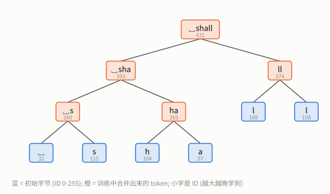

**图 4** 词表 500 里最长的 token 是 `␣shall` (ID 431, 6 字节)。**怎么读**: 从下往上看, 底层蓝色是初始字节, 每个橙色节点是一次合并, 小字是 ID。
`␣`+`s` 在第 5 次合并 (ID 260) 就学到了, `h`+`a` 是第 10 次 (265), `l`+`l` 是第 19 次 (274); 直到第 138 次 (393) 才有 `␣sha`, 第 176 次 (431) 才有 `␣shall`。
**一个长 token 的每一个"前缀片段"都必须先成为 token**, 所以长 token 都出现在训练后期。词表 500 里新 token 的长度分布: 2 字节 122 个、3 字节 81 个、4 字节 26 个、5 字节 14 个、6 字节 1 个。

### 5.4 合并频率与训练耗时

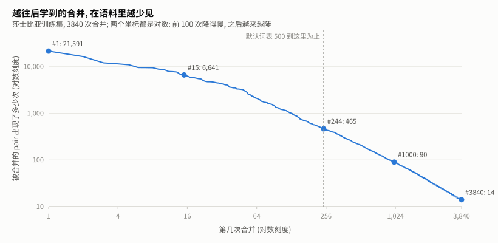

**图 5** 继续训练到词表 4096 (共 3840 次合并), 记录每次被合并的 pair 在语料里出现了多少次。**怎么读**: 横轴第几次合并, 纵轴频率, 两轴都是对数。
第 1 次合并的 `␣t` 出现 21,591 次; 到第 244 次 (默认词表 500 到此为止) 只剩 465 次; 到第 3840 次只剩 14 次。
越往后学到的 token 越罕见, 每个新 token 能省下的 token 数也越少, 这就是第 9 节"压缩率越来越难降"的原因。

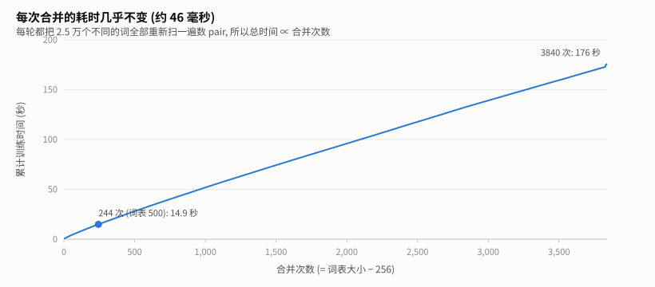

**图 6** 累计训练时间随合并次数的变化。**怎么读**: 几乎是一条直线, 斜率约 46 毫秒/次: 第 4.3 节说过, 每轮都要把 2.5 万个不同的词全扫一遍,
这个工作量几乎不随轮次变化。词表 500 (244 次) 用 14.9 秒, 4096 (3840 次) 用 176 秒。照这个斜率粗略外推, 训练 5 万词表要 40 分钟左右; 工业实现用增量更新避免了全量重扫。

> **动手验证**: 训练到 4096 再只保留前 $`k`$ 条合并, 与直接训练到 $`256+k`$ **完全相同** (BPE 每一步只依赖之前的结果)。
> `examples.py sweep` 就是这样一次训练得到所有词表大小的, 并且逐条核对了前 244 条与 `train(vocab_size=500)` 一致。

---

## 6. 预分词: 合并不许跨越的边界

### 6.1 为什么要预分词

预分词先把文本切成片段, **合并只在片段内部发生**。不做预分词会怎样?

- 训练会学到横跨两个词的 token, 例如 `"e t"` (`the time` 里 `e` 和 `t` 相邻)、`"of the"`。同一个词跟不同的邻居组合, 会产生大量只出现在特定搭配里的 token, 浪费词表;
- 整篇语料是一个几百万字节的长序列, 不能"同一个词只存一份", 每轮都得扫全文, 慢得多。

旧版讲义说预分词是为了"防止 The 和 the 合并到一起", 这是错的: `The` 和 `the` 的字节本来就不同, 跟预分词无关。

### 6.2 我们的实现

```python
# tokenizer.py
        tokens = re.findall(r"\S+|\s+", text)
        result: list[str] = []
        pending_space = ""
        for t in tokens:
            if re.match(r"^\s+$", t):
                pending_space = t
            else:
                result.append(pending_space + t)
                pending_space = ""
        if pending_space:
            result.append(pending_space)
        return result
```

先用 `\S+|\s+` 把文本切成"连续非空白"和"连续空白"交替的片段, 再把每段空白**挂到后面那个词的开头**; 文本末尾剩下的空白单独成一段。实测:

| 输入 | 预分词结果 |
|---|---|
| `"Hello world"` | `Hello` `␣world` |
| `" foo  bar"` | `␣foo` `␣␣bar` |
| `"line1\nline2\n"` | `line1` `\nline2` `\n` |
| `"It's 2026, hello world!"` | `It's` `␣2026,` `␣hello` `␣world!` |

注意最后一行: 标点和数字都**粘在词上** (`␣2026,`、`␣world!`), 换行也挂在后面的词上 (`\nline2`)。这就是 5.1 节 `'\nS'` 的来源。
旧版讲义写成 `"line1\n"` (换行挂在前面), 与代码不符。

### 6.3 与 GPT-2 的差别

GPT-2 用一条更细的正则 (专题 B 逐个分支拆解), 同一句话切成 `It` `'s` `␣2026` `,` `␣hello` `␣world` `!`:
缩写、数字、标点都单独成段。差别的后果:

- 我们的分词器会学到 `s,` 这类"词尾 + 标点"的 token (第 7.2 节的 `mathematics,` 就切出了 `s,`), GPT-2 不会;
- 我们把连续空格整体挂在词前 (`␣␣bar`), GPT-2 会拆成 `␣` + `␣bar`, 让 `␣bar` 和单空格时的 token 一致。

**为什么空格挂在前面?** 这样 `" the"` 是一个整体, 一个 token 就同时表达了"这里有个词边界"和"这个词是 the"。代价是 `"the"` 和 `" the"` 成了两个 token (第 2.1 节)。

---

## 7. 编码: 按 rank 贪心合并

### 7.1 走一遍真实例子

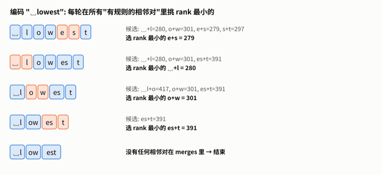

**图 7** 用莎士比亚词表 500 编码 `" lowest"`。**怎么读**: 每行是一轮。左边是当前的 token 序列, 橙色是这一轮被合并的一对; 右边列出所有"在 merges 里"的相邻对和它们的 rank。
第 1 轮有 4 个候选, `e+s` 的 rank 279 最小, 先合并它; 第 2 轮 `␣+l` (280) 最小; ……; 第 5 轮没有任何相邻对在 `merges` 里, 结束。
结果 `␣l` `ow` `est` 是 3 个 token。注意合并的**顺序**和字符的左右位置无关, 只看 rank。

同样的方法编码 `"Hello"` 只有 2 轮: 先 `l+l` (274), 再 `e+ll` (427), 结果 `H` `ell` `o`。旧版讲义里那条 `He → Hel → Hell → Hello` 的合并链是虚构的, 这张词表里根本没有 `He`。

### 7.2 贪心不是最少 token

rank 小的先合并, 是**贪心**的: 它不保证切出的 token 数最少。用同一张词表 (500), 对验证集前 1 万字节的每个预分词片段, 再用动态规划求"token 数最少的切法", 实测对比:

| 切法 | token 总数 |
|---|---|
| BPE 贪心 (`_encode_chunk`) | 5,026 |
| 同一词表下的最少切法 | 4,984 |

只多 0.8%。差别出在这样的词上:

| 片段 | BPE 的切法 | 最少只需 |
|---|---|---|
| `␣house,` | `␣h` `ou` `se` `,` (4) | 3 |
| `␣present` | `␣p` `re` `s` `ent` (4) | 3 |
| `␣mathematics,` | `␣m` `at` `he` `m` `at` `ic` `s,` (7) | 6 |

既然更少的切法存在, 为什么不用? 因为**模型是在 BPE 的切法上训练的**。同一个词, 训练时总被切成 `␣h ou se`, 推理时就必须也这样切,
换成"更省"的切法反而是模型没见过的输入。分词器的首要要求是**确定、一致**, 其次才是短。

### 7.3 "选 rank 最小" = "按学到的顺序重放"

另一种写法是: 按 `merges` 的顺序, 把每条规则依次在序列上应用一遍。两种写法结果相同吗? 在整个验证集的 20,154 个预分词片段上逐个比对: **全部相同**。
直觉上, 一条 rank 为 $`r`$ 的规则 $`(a, b)`$ 要想用上, $`a`$ 和 $`b`$ 本身必须先被造出来, 而造它们的规则 rank 都比 $`r`$ 小, 所以不会出现"顺序颠倒"。
"选最小 rank"的写法只需扫描当前序列里实际出现的 pair, 而"顺序重放"每个片段都要过一遍全部规则, 词表大时慢得多。

### 7.4 复杂度

设片段长度 $`L`$ (字节数)。每轮扫描 $`O(L)`$, 每轮至少合并一处所以最多 $`L-1`$ 轮, 最坏 $`O(L^2)`$。
预分词把片段控制在一个词的长度, $`L`$ 通常不到 10, 所以实际上很快: 编码 111,540 字符的验证集用 0.16 秒 (HuggingFace 的 Rust 版 GPT-2 分词器 0.04 秒)。
如果**不做**预分词, 一整篇文章就是一个片段, $`L^2`$ 会变得不可接受: 这是预分词的另一个好处。

---

## 8. 解码: 只需要 vocab

### 8.1 为什么不需要 merges

每个 token 记着自己代表的字节, 把它们按顺序拼起来就是原文的 UTF-8 字节, 合并的历史无关紧要。
所以 `decode` 只有两行, 而且**对任何编码结果都能无损还原**: 在整个验证集上 `decode(encode(x)) == x` 实测成立。

### 8.2 `errors="replace"` 什么时候触发

单独解码一个不完整的字节序列, 例如"你"的第一个字节 `0xE4`:

```python
>>> tok.decode([0xE4])
'�'
>>> tok.decode([228, 189, 160])        # "你" 的三个字节
'你'
>>> [tok.decode([b]) for b in [228, 189, 160]]   # 一个一个解码
['�', '�', '�']
```

**真实的坑: 流式输出**。LLM 生成时一次吐一个 token, 如果每吐一个就单独 `decode` 一次再打印, 汉字和 emoji 会变成一串 `�`:
它们的字节可能分散在好几个 token 里 (第 11 节, GPT-2 把"你"切成 `E4 BD` + `A0`)。正确做法是把字节攒起来, 只输出已经完整的字符。这是练习 ② 的内容。

---

## 9. 压缩率: 词表越大越好吗

### 9.1 定义

```math
\text{压缩率} = \frac{\text{token 数}}{\text{原始字节数}}, \qquad \text{每个 token 平均字节数} = \frac{1}{\text{压缩率}}
```

越低越好: 同样的文本用的 token 越少, 模型一次能看的内容越多, 生成越快。不做任何合并时压缩率是 1。

### 9.2 实测: 压缩率随词表大小的变化

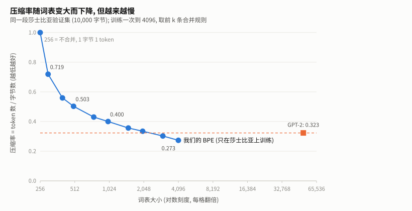

**图 8** 在同一段验证集 (前 10,000 字节) 上, 不同词表大小的压缩率。**怎么读**: 横轴对数刻度, 每格词表翻一倍。
从 256 到 500 (翻一倍不到), 压缩率从 1.0 降到 0.503; 从 2048 到 4096 (同样翻一倍), 只从 0.335 降到 0.273。**每翻一倍, 收益越来越小**, 原因就是图 5: 后学到的 token 越来越罕见。
橙色虚线是 GPT-2 官方分词器在同一段文本上的 0.323。

| 词表 | 300 | 400 | 500 | 750 | 1000 | 1500 | 2000 | 3000 | 4096 | GPT-2 (50257) |
|---|---|---|---|---|---|---|---|---|---|---|
| 压缩率 | 0.719 | 0.559 | 0.503 | 0.430 | 0.400 | 0.356 | 0.335 | 0.303 | 0.273 | 0.323 |

一个反直觉的结果: **词表 3000 时我们就比 GPT-2 好了**。不是因为我们的分词器更高明, 而是因为它只在莎士比亚上训练, 测的也是莎士比亚:
它的每一个 token 都是为这种文本准备的; GPT-2 的 5 万词表要覆盖网页、代码、各种语言, 分给莎士比亚式英文的只是一小部分。
**压缩率永远是"某个分词器在某类文本上"的压缩率**, 离开文本谈压缩率没有意义。旧版讲义里"GPT-4 约 0.25"这类不注明文本的数字, 已全部删除。

### 9.3 词表变大的代价

词表不能无限大, 因为:

- **Embedding 和输出层随词表线性增长**: 参数量 $`V \times d`$。GPT-2 small 的 $`d = 768`$, 词表这一项就是 $`50257 \times 768 = 38{,}597{,}376`$ 个参数, 占全部 1.24 亿的 31%。
  词表 500 时只有 38.4 万。
- **罕见 token 学不好**: 第 3840 个 token 在百万字符的训练集里只出现 14 次 (图 5), 模型几乎见不到它。
- **用不满**: 用词表 500 编码整个验证集 (11 万字符), 实际用到了 300 个不同的 token; GPT-2 用到了 3,999 个, 只占它词表的 8%。
  这不是 GPT-2 不好, 而是一段莎士比亚本来就用不到它为代码和其它语言准备的 token。旧版讲义"利用率应 > 90%"的说法没有依据, 已删除。

### 9.4 不同分词器的 loss 不能直接比

模型的 loss 是**每个 token** 的平均交叉熵 (以 e 为底的 nats)。分词器不同, 同一段文本的 token 数不同, 每个 token 的 loss 自然不可比。
要比较, 先换算成**每字节多少比特** (bits per byte):

```math
\text{bpb} = \frac{\mathcal{L}_{\text{token}}}{\ln 2} \times \frac{N_{\text{token}}}{N_{\text{byte}}}
= \frac{\mathcal{L}_{\text{token}}}{\ln 2} \times \text{压缩率}
```

例: 两个模型 loss 都是 3.0, 一个用压缩率 0.5 的分词器, 一个用 0.3 的, 换算后分别是 $`3.0/0.693 \times 0.5 = 2.16`$ 和 $`1.30`$ bit/字节: 后者实际上好得多。

---

## 10. BPE、WordPiece、Unigram 三种子词算法

| | BPE (本项目) | WordPiece | Unigram |
|---|---|---|---|
| 代表 (第 19 节实测) | GPT-2、Qwen2.5、DeepSeek-V3、Mistral 等 | BERT | T5 |
| 训练方向 | 自底向上: 不断合并 | 自底向上: 不断合并 | 自顶向下: 从大候选集里不断删除 |
| 初始单位 | 字节 (或字符 + 字节回退) | **字符** | 大量候选子串 |
| 选择依据 | 频率最高的 pair | 合并后似然提升最大的 pair | 删掉后似然损失最小的 token |
| 编码 | 按 rank 重放合并 | 从左到右最长匹配 | Viterbi 求概率最大的切法 |
| 没见过的字符 | 退回字节, 不会未知 | `[UNK]` | `<unk>` (除非开了字节回退) |

**WordPiece 的打分**: 合并 $`(a, b)`$ 的分数是

```math
\text{score}(a, b) = \frac{f(a, b)}{f(a)\, f(b)}
```

两个各自很常见的部分凑在一起, 分数并不高; 优先合并"一起出现远比各自出现更频繁"的组合。WordPiece 用 `##` 标记"词中间的片段", 例如 `tokenization` → `token` `##ization`。
旧版讲义说 WordPiece "从字节开始", 不对: 它从字符开始, 所以英文 BERT 遇到汉字会输出 `[UNK]` (第 19 节实测: 193 字符的中文切出 183 个 token, 其中 123 个是 `[UNK]`)。

**Unigram 的模型**: 每个 token 有一个概率 $`p(t)`$, 一种切法 $`x = (t_1, \dots, t_k)`$ 的概率是 $`P(x) = \prod_i p(t_i)`$, 编码时用 Viterbi 动态规划找概率最大的切法。
训练从一个很大的候选集开始, 反复删掉"删了以后整体似然下降最少"的 token。它天然能给出多种切法及其概率 (可用于训练时随机换切法做正则化, 见 Kudo 2018)。
T5 的词表里汉字很少, 实测一段 193 字的中文被切成 32 个 token, 其中 11 个是 `<unk>`: 很多连续的不认识的汉字被并成**一个** `<unk>`, 信息直接丢了。

---

## 11. 中文: 字节级 BPE 的软肋

### 11.1 英文语料训练的分词器遇到中文

一个常用汉字在 UTF-8 里占 3 个字节。用莎士比亚训练的词表 500 编码一段 193 字的中文 (自写, 539 字节): **539 个 token**, 一个字节一个 token, 一个合并都用不上。
每个汉字 3 个 token, 同样内容的序列长度是英文的好几倍, 注意力的计算量按长度平方增长。

### 11.2 在中文上训练会怎样: 合并跨过了汉字边界

旧版讲义建议"在 `"你好世界" * 100` 上训练试试", 实测结果很能说明问题:

- 这段文本没有空格, 预分词后是**一个** 1200 字节的片段;
- 只合并了 19 次训练就提前结束了: 整个片段已经合成了**一个 1200 字节的 token**;
- 再编码 `"你好"`:

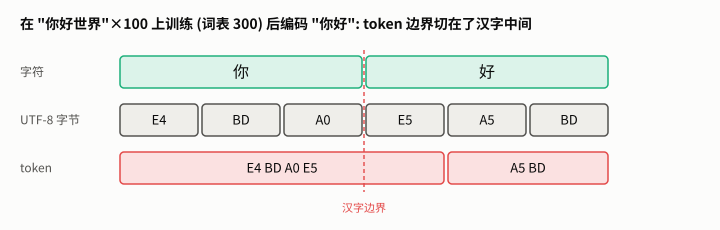

**图 9** 编码 `"你好"` 的结果。**怎么读**: 第一行是两个汉字, 第二行是它们的 6 个 UTF-8 字节, 第三行是分词结果。
第一个 token 是 `E4 BD A0 E5`: "你"的 3 个字节**加上"好"的第 1 个字节**; 第二个 token 是"好"剩下的 2 个字节。
BPE 只看字节, 不知道哪里是汉字的边界, 只要两个字节经常相邻, 它就会合并。

用自写的那段 193 字中文 (标点后有空格, 预分词成 11 段) 训练到词表 400, 学到的 144 个 token 里有 **115 个不是合法的 UTF-8**: 都是"半个汉字"或"一个半汉字"。
这些 token 单独解码会变成 `�`, 也是流式输出乱码的来源之一 (第 8.2 节)。

### 11.3 工业界的做法

| 做法 | 实测例子 (第 19 节) |
|---|---|
| 大量中文语料 + 大词表, 让常用字和词都成为完整 token | Qwen2.5 (15 万词表): 每 token 1.46 字; DeepSeek-V3: 1.64 字 |
| 预分词时把中文单独成段, 避免中文和标点、数字粘在一起 | DeepSeek-V3 的第二条正则就是 `[一-龥぀-ゟ゠-ヿ]+` (连续的中日文字符) |
| 在字符上做 BPE, 词表外的字符退回字节 | Mistral-7B: 几乎每个汉字一个 token (1.01 字/token) |
| 什么都不做 | GPT-2: 0.51 字/token, 常见汉字也要 2 个 token ("你" = `E4 BD` + `A0`) |

---

## 12. 从教学实现到工业分词器: 差在哪

| | 本项目 | 工业实现 (GPT-2 / tiktoken / HuggingFace tokenizers) |
|---|---|---|
| 预分词 | `\S+\|\s+`, 空白挂在词前 | 细粒度的 Unicode 正则, 拆开缩写、数字、标点 (专题 B) |
| 词表 | 500 | 5 万 ~ 20 万 (实测: GPT-2 50,257, Qwen2.5 151,665, gpt-oss 200,019) |
| 训练语料 | 100 万字符的莎士比亚 | 数百 GB 的多语言文本 |
| 训练算法 | 每轮全量重新统计 pair | 增量更新: 记录每个 pair 出现在哪些词里, 合并后只更新这些词; 用堆取最大值 |
| 特殊 token | 无 | `<\|endoftext\|>`、对话模板用的标记等, 不参与合并, 编码时整体匹配 |
| 编码速度 | 纯 Python, 11 万字符 0.16 秒 | Rust 实现, 同样文本 0.04 秒 (HuggingFace GPT-2) |
| 字节的显示 | 直接用字节 | GPT-2 把 256 个字节映射成可打印字符 (空格 → `Ġ`) 再处理, 所以 HF 里看到 `Ġthe` |

增量更新的做法可以直接看 HuggingFace tokenizers 的训练器源码
([trainers/bpe/mod.rs](https://github.com/huggingface/tokenizers/blob/main/tokenizers/tk-train/src/trainers/bpe/mod.rs)):
它维护 `where_to_update` (pair → 包含它的词) 和一个堆。算法与我们**等价**, 只是快; 练习 ③ 要你自己实现这个加速, 并保证结果与 `train()` 逐条相同。

---

## 13. 本项目踩坑记录汇总

| 坑 | 现象 | 原因 | 处理 |
|---|---|---|---|
| 静默退回小语料 | 下载失败时 `--source shakespeare` 悄悄改用 3KB 的内置样例训练, 日志看不出来 | `data.py` 捕获异常后自动换语料 | 改为直接报错; 离线演示必须显式写 `--source sample` |
| 覆盖入库的 `tokenizer.json` | 换个词表大小跑一次, 入库的默认产物就被改掉 | `train.py` 总是写同一个文件 | 只有"莎士比亚 + 词表 500"写 `tokenizer.json`, 其它写 `tokenizer_<来源>_<词表>.json` |
| Windows 控制台崩溃 | 训练跑完后打印 ✅ 时抛 `UnicodeEncodeError: 'gbk'` | 控制台默认 GBK | `train.py` 开头把 stdout 改成 UTF-8 |
| SentencePiece 演示训练失败 | 报词表大小的错, 开大开小都不行 | `byte_fallback` 要求至少 ~292 个片段, 而 24 行的演示语料只能产出 ~56 次合并 | 加厚演示语料, 词表定为 300 |
| 日志被换行切断 | 合并 `'\nS'` 时日志断成两行 | 直接打印了含换行的字符串 | 改用 `repr` 打印 |
| 讲义示例与代码不符 | 旧版讲义里的 `Hello` 合并链、`line1\n` 预分词结果、低频词切法都是想象的 | 示例是手写的 | 所有示例改由 `experiments/examples.py` 实际运行生成 |
| 逐 token 解码乱码 | 流式打印汉字变成 `�` | 一个汉字的字节分在多个 token 里 | 攒够完整字符再输出 (练习 ②) |
| 正则加注释后失效 | 多行带注释的 GPT-2 正则只匹配出 `'s` | 没加 `VERBOSE`; 加了又因空格被忽略而报错 | 专题 B, 17.4 节 |

---

## 14. 练习

### 14.1 动手写代码 (三级递进)

练习文件在 [exercises/](exercises/), 每道都配了验收测试, 测试通过就是做对了。卡住了可以要提示, 按"方向 → 哪一行 → 代码"分级给, 每次只升一级。

| 级别 | 练习 | 给你什么 | 验收 |
|---|---|---|---|
| ① 填空 | [ex1_bpe_fill.py](exercises/ex1_bpe_fill.py): 补全 BPE 的四个核心步骤 | 完整的类, 四处 `TODO` | 与 `tokenizer.py` 学到的 merges 逐条相同, 编码结果相同 |
| ② 接口 | [ex2_stream_decode.py](exercises/ex2_stream_decode.py): 流式解码器 | 只有类的签名 | 逐个喂 token, 拼起来等于整体解码; 中途从不输出 `�` |
| ③ 白纸 | [ex3_fast_train.py](exercises/ex3_fast_train.py): 增量更新的快速训练 | 只有验收标准 | merges 与 `train()` 逐条相同, 且至少快 3 倍 |

```bash
cd projects/llm-bpe-tokenizer/exercises
python -m pytest test_ex1.py -q     # 一道一道来
```

### 14.2 思考题

<details>
<summary><b>1.</b> 词表 300 和 1000 的分词器编码同一段莎士比亚, token 数差多少? 差距为什么不是 1000/300 倍?</summary>

实测 (第 9.2 节): 7,192 vs 4,000, 比值约 1.8。词表大 3.3 倍, token 只少了 44%, 因为后学到的 token 越来越罕见 (图 5), 每个新 token 能省的越来越少。
</details>

<details>
<summary><b>2.</b> <code>"hello"</code> 和 <code>" hello"</code> 在我们的分词器里分别切成什么? 为什么不同?</summary>

`he` `ll` `o` 和 `␣he` `ll` `o`。预分词把空格挂在词前, 两者的字节序列不同 (`" hello"` 多一个 32), 合并规则分别作用。`␣he` 是一个 token, 因为"空格 + 词首"是英文里最常见的组合 (第 5.2 节)。
</details>

<details>
<summary><b>3.</b> 莎士比亚语料里几乎没有阿拉伯数字。编码 <code>"2026年"</code> 得到几个 token?</summary>

7 个: `2` `0` `2` `6` 各一个, "年"的 3 个字节 `E5` `B9` `B4` 各一个。没有学到数字和汉字的合并, 全部退回单字节。对比 GPT-2: `20` `26` `E5 B9` `B4`, 4 个。
</details>

<details>
<summary><b>4.</b> 第 3.3 节 <code>aaaa</code> 的第 1 轮, <code>(a, a)</code> 统计频率 3, 实际只替换 2 处。能不能构造一个例子, 让"统计频率最高"的 pair 实际替换次数反而比第二名少?</summary>

可以。语料 `aaa` ×10 加上 `bc` ×15: `(a,a)` 统计 20 次 (每个 `aaa` 数 2 次), `(b,c)` 15 次, 所以选 `(a,a)`; 但它实际只能替换 10 处 (每个 `aaa` 只能换 1 处), 少于 `(b,c)` 的 15 处。
这说明 BPE 按"统计频率"选并不等于按"能省多少 token"选。它只是个启发式, 不影响确定性和正确性。
</details>

<details>
<summary><b>5.</b> 为什么 <code>_apply_merge_to_freqs</code> 里写 <code>new_word_freqs[new_ids] = freq</code> 而不需要 <code>+=</code>?</summary>

合并是可逆的: 新 ID 唯一对应一对 ID, 展开就能还原。所以两个不同的词合并后不可能变成同一个元组, 不会有键冲突 (第 4.4 节)。
</details>

<details>
<summary><b>6.</b> 一个模型用我们的词表 500 训练, loss 是 2.0; 另一个用 GPT-2 分词器, loss 是 2.8。只看这些, 能说前者更好吗? 用第 9.4 节的公式换算。</summary>

不能直接比。换算成 bit/字节: $`2.0/0.693 \times 0.503 = 1.45`$, $`2.8/0.693 \times 0.323 = 1.31`$。后者每字节的不确定性更低, 反而更好。
</details>

---

## 15. 延伸学习资源

链接都在 2026-10-20 检查过可以打开 (YouTube 在本机网络下无法访问, 未能核验)。

**论文**

| 论文 | 说明 |
|---|---|
| [Sennrich et al. 2016, Neural Machine Translation of Rare Words with Subword Units](https://arxiv.org/abs/1508.07909) | 把 BPE 引入 NLP; 第 3.2 节的例子出自这里 |
| [Radford et al. 2019, GPT-2 论文](https://cdn.openai.com/better-language-models/language_models_are_unsupervised_multitask_learners.pdf) | 2.2 节讲字节级 BPE 的动机 |
| [Kudo & Richardson 2018, SentencePiece](https://arxiv.org/abs/1808.06226) | 不依赖预分词、语言无关的分词框架 |
| [Kudo 2018, Subword Regularization](https://arxiv.org/abs/1804.10959) | Unigram 分词模型 |
| [Provilkov et al. 2020, BPE-Dropout](https://arxiv.org/abs/1910.13267) | 训练时随机跳过合并, 让模型见到多种切法 |
| [Clark et al. 2022, CANINE](https://arxiv.org/abs/2103.06874) | 不用分词器, 直接在字符上建模 |
| [Pagnoni et al. 2024, Byte Latent Transformer](https://arxiv.org/abs/2412.09871) | 不用固定词表, 按内容动态地把字节分成块 |

**代码**

| 项目 | 说明 |
|---|---|
| [karpathy/minbpe](https://github.com/karpathy/minbpe) | 与本项目最接近的极简实现, 也有 GPT-4 正则版本 |
| [openai/gpt-2 的 encoder.py](https://github.com/openai/gpt-2/blob/master/src/encoder.py) | GPT-2 原版的预分词正则和字节到字符的映射 |
| [openai/tiktoken](https://github.com/openai/tiktoken) | OpenAI 的 Rust 实现 |
| [huggingface/tokenizers](https://github.com/huggingface/tokenizers) | BPE / WordPiece / Unigram 的 Rust 实现, 训练器支持增量更新 |
| [google/sentencepiece](https://github.com/google/sentencepiece) | SentencePiece |

**教程与课程**

| 资源 | 说明 |
|---|---|
| [Karpathy: Let's build the GPT Tokenizer](https://www.youtube.com/watch?v=zduSFxRajkE) | 2 小时视频, 从零写 BPE |
| [HuggingFace LLM Course 第 6 章: BPE](https://huggingface.co/learn/llm-course/chapter6/5) / [WordPiece](https://huggingface.co/learn/llm-course/chapter6/6) / [Unigram](https://huggingface.co/learn/llm-course/chapter6/7) | 三种算法各有一节, 带可运行的代码 |
| [Stanford CS336](https://stanford-cs336.github.io/spring2025/) | 作业 1 包含从零手写 BPE 分词器 |
| [Wikipedia: Byte pair encoding](https://en.wikipedia.org/wiki/Byte_pair_encoding) | 原始压缩算法 |
| [Tiktokenizer](https://tiktokenizer.vercel.app/) | 在线看各种分词器怎么切一段文本 |
| [regex101](https://regex101.com/) | 在线调试正则 (选 PCRE 风格可以用 `\p{L}`) |

---

# 第二部分 · 延伸专题

## 16. 专题 A · 编码知识: 从字符到字节

### 16.1 先看懂记号: 0x41、U+0041、01000001

同一个数有不同的写法。以"字符 A 的编号是 65"为例:

| 写法 | 进制 | 说明 |
|---|---|---|
| `65` | 十进制 | 日常写法 |
| `0b01000001` | 二进制 | 计算机内部的样子 (Python 用 `0b` 前缀) |
| `0x41` | 十六进制 | 编程最常用, `0x` 前缀 |

```math
65 = 6\times 10 + 5 = 4\times 16 + 1 = 2^6 + 2^0
```

**为什么爱用十六进制?** 1 个字节 = 8 个二进制位, 4 个二进制位正好是 1 个十六进制位, 所以**一个字节永远是两位十六进制** (`0x00`~`0xFF`), 一眼就能看出字节边界:

```
0100 0001
  4    1    →  0x41
```

| 十进制 | 十六进制 | 二进制 |
|---|---|---|
| 0 | 0x00 | 0000 0000 |
| 10 | 0x0A | 0000 1010 |
| 15 | 0x0F | 0000 1111 |
| 16 | 0x10 | 0001 0000 |
| 65 | 0x41 | 0100 0001 |
| 128 | 0x80 | 1000 0000 |
| 255 | 0xFF | 1111 1111 |

**`0x` 和 `U+` 不是一回事**:

| 记号 | 指什么 | 例子 |
|---|---|---|
| `U+4F60` | Unicode 给字符分配的编号 (**码点**), 与怎么存储无关 | "你"的码点 |
| `0xE4 0xBD 0xA0` | 按 UTF-8 编码后**实际存储的字节** | "你"的 3 个字节 |

ASCII 字符的码点和 UTF-8 字节恰好数值相同 (`A` = U+0041 = `0x41`), 是 UTF-8 故意设计成兼容 ASCII 的结果; 其它字符两者完全不同。

```python
>>> hex(65), int("41", 16), bin(65)
('0x41', 65, '0b1000001')
>>> ord("你"), hex(ord("你"))          # 码点
(20320, '0x4f60')
>>> list("你".encode("utf-8"))         # UTF-8 字节
[228, 189, 160]
```

### 16.2 ASCII → Unicode → UTF-8

- **ASCII (1963)**: 7 位, 128 个字符, 英文字母、数字、标点、控制字符。存储时一个字符一个字节, 最高位为 0。
- **Unicode**: 给全世界所有字符编号, 码点范围 U+0000 ~ U+10FFFF。只规定编号, 不规定怎么存。
- **UTF-8** (Ken Thompson 和 Rob Pike 设计, [RFC 3629](https://datatracker.ietf.org/doc/html/rfc3629)): 把码点变成 1~4 个字节的变长编码。

| 码点范围 | 字节数 | 字节模板 | 典型字符 |
|---|---|---|---|
| U+0000 ~ U+007F | 1 | `0xxxxxxx` | ASCII |
| U+0080 ~ U+07FF | 2 | `110xxxxx 10xxxxxx` | `é`、`ñ`、希腊、西里尔字母 |
| U+0800 ~ U+FFFF | 3 | `1110xxxx 10xxxxxx 10xxxxxx` | 常用汉字 |
| U+10000 ~ U+10FFFF | 4 | `11110xxx 10xxxxxx 10xxxxxx 10xxxxxx` | emoji、生僻字 |

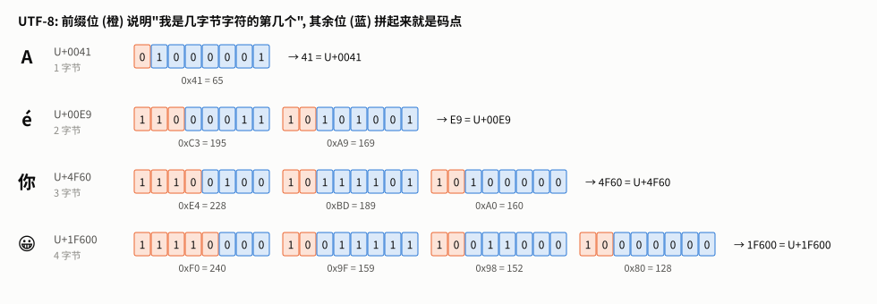

**图 10** 四个字符的 UTF-8 字节, 逐位展开。**怎么读**: 每个格子是一位。橙色是**前缀位**: 首字节开头有几个 1 就表示一共几个字节 (`1110` = 3 字节), 后续字节一律以 `10` 开头。
蓝色是**数据位**: 把所有蓝色位按顺序拼起来, 就是码点的二进制。以"你"为例, 3 个字节的数据位分别是 `0100`、`111101`、`100000`, 拼起来是 `0100 1111 0110 0000` = `0x4F60`。

写成公式, 3 字节字符的码点是:

```math
\text{cp} = (b_0 \,\&\, \texttt{0x0F}) \ll 12 \;\;|\;\; (b_1 \,\&\, \texttt{0x3F}) \ll 6 \;\;|\;\; (b_2 \,\&\, \texttt{0x3F})
```

`& 0x0F` 取首字节的低 4 位, `& 0x3F` 取续字节的低 6 位, `<<` 左移到正确的位置。代入 `E4 BD A0`: $`4 \ll 12 \,|\, 61 \ll 6 \,|\, 32 = 16384 + 3904 + 32 = 20320`$ = U+4F60。

**这个设计对 BPE 意味着什么**:

- 英文 1 字节 1 个初始 token, 汉字 3 个, emoji 4 个;
- 续字节 (`10xxxxxx`, 即 128~191) 永远不会出现在字符开头, 所以从任意位置都能找到字符边界: 往回跳过所有续字节即可。练习 ② 的流式解码就靠这个性质。

### 16.3 编码与解码全链路

以 `"Hello world"` 为例 (莎士比亚词表 500, 实测):

```
"Hello world"
   │ 预分词
   ▼
["Hello", " world"]
   │ UTF-8
   ▼
[72, 101, 108, 108, 111]   [32, 119, 111, 114, 108, 100]
   │ 每段独立按 rank 合并
   ▼
[72, 427, 111]             [263, 270, 316]
 H   ell  o                 ␣w   or   ld
   │ 拼接
   ▼
[72, 427, 111, 263, 270, 316]          6 个 token, 原文 11 字节
```

解码是反过来查 `vocab`: `vocab[72]=b'H'`, `vocab[427]=b'ell'`, ……, 拼成 `b'Hello world'` 再 UTF-8 解码。

### 16.4 编码的边界情况

```python
>>> tok.encode("")
[]
>>> tok.decode([])
''
>>> BPETokenizer().encode("Hello 你好")      # 还没训练: 没有任何合并, 就是 UTF-8 字节
[72, 101, 108, 108, 111, 32, 228, 189, 160, 229, 165, 189]
```

最后一个例子: `"Hello 你好"` 是 5 + 1 + 6 = 12 字节, 未训练的分词器给出 12 个 token。字节级分词器在训练之前也是一个能用的 (只是很低效的) 分词器。

---

## 17. 专题 B · 正则表达式与预分词

### 17.1 我们代码里的两处正则

```python
# tokenizer.py
        tokens = re.findall(r"\S+|\s+", text)
            if re.match(r"^\s+$", t):
```

| 正则 | 含义 |
|---|---|
| `\S+` | 一个或多个**非**空白字符 (一个"词", 含标点) |
| `\s+` | 一个或多个空白 (空格、换行、制表符) |
| `\|` | 或 |
| `^\s+$` | 从头到尾全是空白 |

`re.findall(r"\S+|\s+", "Hello  world\n")` 的结果是 `['Hello', '  ', 'world', '\n']`: 两类字符互补, 每个位置恰好命中其中一个分支, 所以两个分支谁写在前面都一样。

### 17.2 语法速查

| 语法 | 含义 | 例子 |
|---|---|---|
| `.` | 任意字符 (默认不含换行) | `h.t` 匹配 `hat`、`h7t` |
| `\d` `\w` `\s` | 数字 / 单词字符 / 空白 | Python 3 的 `re` 里 `\w` **包含汉字** (Unicode 模式) |
| `\S` `\W` `\D` | 上面三个的反面 | |
| `[abc]` `[^abc]` `[a-z]` | 字符集合 / 排除 / 范围 | `[^0-9]` |
| `*` `+` `?` | 0 次以上 / 1 次以上 / 0 或 1 次 | `colou?r` |
| `{n}` `{n,m}` | 恰好 n 次 / n 到 m 次 | `\d{1,3}` |
| `(?:...)` | 分组但不捕获 | `(?:ab)+` |
| `(?i:...)` | 这一段不区分大小写 | `(?i:'s)` 匹配 `'s` 和 `'S` |
| `(?=...)` `(?!...)` | 后面是 / 后面不是 (不消耗字符) | `\s+(?!\S)` |
| `\p{L}` `\p{N}` | Unicode 字母 / 数字 (需要 `regex` 库) | `\p{L}+` 匹配 `你好`、`café` |
| `\p{Lu}` `\p{Ll}` | 大写 / 小写字母 | gpt-oss 用它们区分大小写 |

`re` 和第三方 `regex` 库的关键差别: 只有 `regex` 支持 `\p{...}` 这类 Unicode 属性。GPT-2 原版代码用的就是 `regex`。
旧版讲义说"`\w` 不含中文", 在 Python 3 里不对: `re.findall(r"\w+", "你好")` 返回 `['你好']`; 但 `\w` 也包含数字和下划线, 不能代替"只要字母"的 `\p{L}`。

### 17.3 GPT-2 的预分词正则

```
's|'t|'re|'ve|'m|'ll|'d| ?\p{L}+| ?\p{N}+| ?[^\s\p{L}\p{N}]+|\s+(?!\S)|\s+
```

按 `|` 分成 7 种分支, 从左到右尝试, 第一个能匹配的胜出:

| 分支 | 匹配什么 | 例子 |
|---|---|---|
| `'s\|'t\|'re\|'ve\|'m\|'ll\|'d` | 英文缩写后缀 | `It's` → `It` + `'s` |
| ` ?\p{L}+` | 可选的一个空格 + 连续字母 | `␣hello`、`你好` (汉字也是 `\p{L}`) |
| ` ?\p{N}+` | 可选空格 + 连续数字 | `␣2026` |
| ` ?[^\s\p{L}\p{N}]+` | 可选空格 + 连续"非空白非字母非数字" (标点、符号、emoji) | `,`、`!!!`、`(` |
| `\s+(?!\S)` | 连续空白, 但**后面不能紧跟非空白** | 行尾空格、文末换行 |
| `\s+` | 兜底: 其它空白 | |

**第 5 个分支最难懂**, 看实测: `"Hello  world  "` (两个空格) 被切成 `Hello` `␣` `␣world` `␣␣`。
中间两个空格: 第 5 分支想吞掉两个, 但吞完后面紧跟 `w`, `(?!\S)` 失败; 正则回溯成只吞一个空格, 这时后面是另一个空格, 断言成功, 于是第一个空格单独成段, 第二个空格留给 `␣world`。
效果是: **无论前面有几个空格, 词前面最多挂一个空格**, `␣world` 永远是同一个 token。末尾的两个空格后面是文本结尾, 整体成段。

实测 GPT-2 正则 (`regex` 库) 与 HuggingFace 版 GPT-2 分词器的预分词结果, 在 7 个测试句上**完全一致**。

| 输入 | GPT-2 正则的切法 |
|---|---|
| `It's 2026, hello world!` | `It` `'s` `␣2026` `,` `␣hello` `␣world` `!` |
| `我 爱 Python 3.12` | `我` `␣爱` `␣Python` `␣3` `.` `12` |
| `line1\nline2\n` | `line` `1` `\n` `line` `2` `\n` |
| `I'M HERE, they'RE` | `I` `'` `M` `␣HERE` `,` `␣they` `'` `RE` |

最后一行暴露了 GPT-2 的一个缺陷: 缩写分支区分大小写, `'M`、`'RE` 匹配不上, 撇号被单独切出来。后来的模型都改成了 `(?i:...)`。

### 17.4 坑: 给正则加注释

旧版讲义把 GPT-2 的正则写成多行、每行带 `#` 注释的样子, 实测这样写是**错的**:

| 写法 | 在 `It's 2026, hello world!` 上的结果 |
|---|---|
| 多行带注释, 不加任何 flag | `["'s"]`: 注释和换行都被当成了要匹配的字面字符, 几乎什么都匹配不上 |
| 同样的字符串, 加 `regex.VERBOSE` | 报错 `nothing to repeat at position 24`: VERBOSE 模式会**忽略空格**, ` ?` 变成了孤零零的 `?` |
| 单行原样 | `It` `'s` `␣2026` `,` `␣hello` `␣world` `!` ✓ |

要在 VERBOSE 模式下写这个正则, 必须把有意义的空格写成 `\ ` 或 `[ ]`。最稳妥的做法是像 GPT-2 原版一样写成一行。

### 17.5 现代模型的预分词正则

下面的正则都是从各模型官方 `tokenizer.json` 里读出来的 (第 19 节), 不是转述。phi-4 和 GLM-4.5 用的是同一条:

```
(?i:'s|'t|'re|'ve|'m|'ll|'d)|[^\r\n\p{L}\p{N}]?\p{L}+|\p{N}{1,3}| ?[^\s\p{L}\p{N}]+[\r\n]*|\s*[\r\n]+|\s+(?!\S)|\s+
```

和 GPT-2 比, 改了四处:

1. `(?i:...)`: 缩写不区分大小写;
2. `[^\r\n\p{L}\p{N}]?\p{L}+`: 字母前面可以挂**任意一个非字母非数字非换行的字符** (不只是空格), 所以 `(a` 是一段;
3. `\p{N}{1,3}`: 数字**最多 3 位一段**, `1234567` → `123` `456` `7`;
4. ` ?[^\s\p{L}\p{N}]+[\r\n]*` 和 `\s*[\r\n]+`: 换行跟着标点走, 或者单独成段。

Qwen2.5 的区别只有一处: `\p{N}` 不带 `{1,3}`, **每个数字单独一段**。DeepSeek-V3 串联了 3 条正则, 第一条 `\p{N}{1,3}`, 第二条 `[一-龥぀-ゟ゠-ヿ]+` 把连续的中日文字符切成一段。

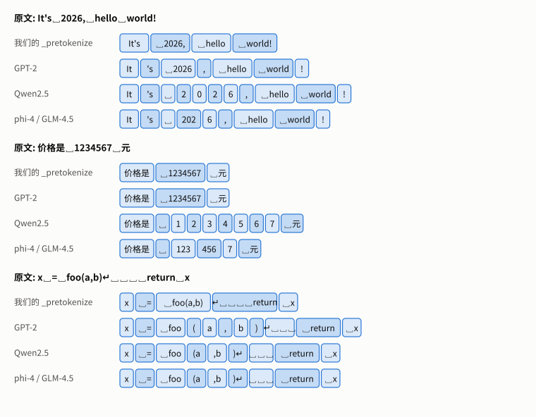

**图 11** 三句话在四种预分词下的切法 (每段用深浅交替的颜色区分)。**怎么读**: 先看数字: 我们和 GPT-2 都把 `1234567` 当成一段, Qwen2.5 拆成 7 个单字, phi-4/GLM 按 3 位一组。
再看代码那一句: 我们的实现把 `foo(a,b)` 整体当一段、把换行和缩进挂在 `return` 上; GPT-2 把每个标点拆开; Qwen2.5 和 phi-4 让 `(` 挂在 `a` 前、换行跟着 `)`。

**数字为什么要拆?** 如果 `1234567` 整体参与合并, 词表里会出现大量没有规律的数字片段 (`123`、`2345`、`67`……), 同一个数在不同上下文里切法不一样, 模型很难学会算术。
固定每 1 位或每 3 位一段, 数字的 token 就只有 10 个或 1000 个, 切法也完全规则。

### 17.6 调试与自查

- 用 `regex.findall(pattern, text)` 直接看切分结果, 比 `match` / `search` 直观;
- 在 [regex101](https://regex101.com/) 上逐步看匹配过程;
- 回溯灾难: `(a+)+b` 这类嵌套量词在长串上会指数级变慢, 预分词正则必须避免。

读完这一节应该能回答: GPT-2 正则 `\s+(?!\S)` 为什么让 `␣world` 前只挂一个空格? `(?i:...)` 修复了什么? `\p{N}{1,3}` 和 `\p{N}` 对 `"2026"` 分别切成什么? (答: `202` `6` 和 `2` `0` `2` `6`。)

---

## 18. 专题 C · 初始词表: 256 个字节全景

### 18.1 一行代码建好的词表

```python
# tokenizer.py
        self.vocab: dict[int, bytes] = {i: bytes([i]) for i in range(256)}
```

ID 就是字节值本身: `vocab[65] = b'A'`, `vocab[10] = b'\n'`, `vocab[228] = b'\xe4'`。

### 18.2 256 个字节在 UTF-8 里的角色

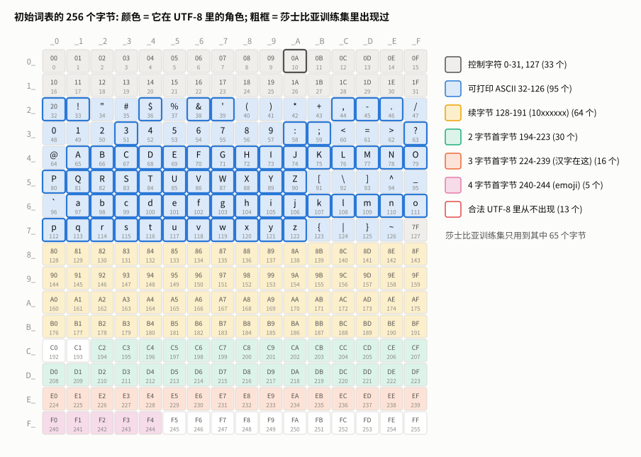

**图 12** 16×16 的格子, 第 $`i`$ 行第 $`j`$ 列是字节 `0x`$`ij`$ (下方小字是十进制)。颜色是这个字节在 UTF-8 里的角色, 粗框表示它在莎士比亚训练集里出现过。
**怎么读**: 上半部分 (0~127) 是 ASCII, 灰色控制字符和蓝色可打印字符; 下半部分 (128~255) 全是多字节字符的组成部分。
粗框全在上半部分: 莎士比亚全是 ASCII, 只用到了 65 个不同的字节 (含换行 `0A`)。另外的 191 个字节在这份语料里一次都没出现, 它们的 token 嵌入在训练语言模型时也永远得不到更新。

| 区域 | 字节 | 个数 | 作用 |
|---|---|---|---|
| 控制字符 | 0~31, 127 | 33 | 换行 `0A`、制表 `09`、回车 `0D` 最常见 |
| 可打印 ASCII | 32~126 | 95 | 空格 (32)、数字 (48~57)、大写 (65~90)、小写 (97~122)、标点 |
| 续字节 | 128~191 | 64 | 多字节字符的第 2~4 个字节, 形如 `10xxxxxx` |
| 2 字节首字节 | 194~223 | 30 | 拉丁扩展、希腊、西里尔字母等 |
| 3 字节首字节 | 224~239 | 16 | 汉字、日文、韩文等 (U+0800~U+FFFF) |
| 4 字节首字节 | 240~244 | 5 | emoji、生僻字 |
| **从不出现** | 192、193、245~255 | 13 | 合法的 UTF-8 里不会出现 |

**为什么有 13 个字节从不出现?** 这是实测出来的: 把全部合法码点 (U+0000~U+10FFFF, 去掉代理区) 编码一遍, 统计出现过的字节, 正好缺这 13 个。

- `0xC0`、`0xC1`: 用它们做首字节编码出的码点都小于 U+0080, 本应只用 1 个字节表示, UTF-8 禁止这种"超长编码";
- `0xF5`~`0xFF`: 首字节 `0xF5` 及以上会编码出大于 U+10FFFF 的码点, 超出 Unicode 范围。

旧版讲义写"4 字节首字节 240~247", 不对, 应为 240~244。

### 18.3 记住几个锚点

| 字节 | 字符 | 规律 |
|---|---|---|
| 10 | `\n` | 换行 |
| 32 | 空格 | 预分词时挂在词前 |
| 48 | `0` | `'0'` ~ `'9'` 是 48~57 |
| 65 | `A` | `'A'` ~ `'Z'` 是 65~90 |
| 97 | `a` | 小写 = 大写 + 32 (二进制只差一位) |
| 228 | `0xE4` | 很多常用汉字 (U+4000~U+4FFF) 的首字节, 例如"你" |

### 18.4 四个结论

1. **不会有未知字符**: 任何文本的 UTF-8 字节都在 0~255 之内。
2. **所有 token 都由这 256 个原子拼成**: 图 4 的合并树最底层永远是它们。
3. **语言之间天生不平等**: 英文 1 字节/字符, 中文 3 字节/字符。没有足够的中文合并规则, 中文的序列长度就是英文的好几倍 (第 11 节)。
4. **解码正确与否不依赖合并**: 即使"你"的 3 个字节从没被合并过, `decode([228, 189, 160])` 仍然是"你"。

### 18.5 实战: 提前结束的训练

```python
>>> t = BPETokenizer()
>>> t.train("Hello hello hello", 300)
...
[!] 语料已无可合并的 pair，在第 6 次合并时提前结束
[训练完成] 词表大小：262
```

目标词表 300, 实际只有 262。预分词得到 `Hello`、`␣hello`、`␣hello` 三段, 依次学到 `el`、`lo`、`ello`、`␣h`、`␣hello`、`Hello` 6 条合并之后, 每段都只剩一个 token, 没有 pair 可数了。
旧版讲义说这里会得到 300 个 token, 不对。

---

## 19. 专题 D · 主流分词器解剖

### 19.1 方法

[experiments/tokenizer_anatomy.py](experiments/tokenizer_anatomy.py) 从 HuggingFace 下载 14 个模型官方仓库里的 `tokenizer.json` (只下载分词器文件, 不下载权重), 读出:
算法、词表大小、预分词方式 (含正则)、是否字节回退、规范化方式; 再在同一段英文 (莎士比亚验证集前 1 万字节) 和同一段中文 (自写 193 字) 上实测 token 数、未知 token 数、能否无损还原。
两个 Llama 仓库需要登录授权 (gated), 没能读取。`python modern_tokenizers.py` 会打印这张表。

### 19.2 结果

| 模型 | 算法 | 词表 | 预分词 | 字节回退 | 英文 字节/token | 中文 字/token |
|---|---|---|---|---|---|---|
| GPT-2 | BPE | 50,257 | ByteLevel (GPT-2 正则) | — | 3.10 | 0.51 |
| BERT-base-uncased | WordPiece | 30,522 | BertPreTokenizer | — | (转小写, 不可还原) | 123 个 `[UNK]` |
| BERT-base-chinese | WordPiece | 21,128 | BertPreTokenizer | — | 406 个 `[UNK]` | 1.05 |
| T5-small | Unigram | 32,100 | Metaspace | — | 3.20 | 11 个 `<unk>` |
| Mistral-7B | BPE | 32,000 | Metaspace | 是 | 2.93 | 1.01 |
| phi-2 | BPE | 50,295 | ByteLevel | 否 | 3.10 | 0.51 |
| Phi-3-mini | BPE | 32,011 | 无 (规范化时把空格换成 `▁`) | 是 | 2.91 | 0.78 |
| phi-4 | BPE | 100,352 | 正则 + ByteLevel | 否 | 3.60 | 0.95 |
| Qwen2.5 | BPE | 151,665 | 正则 + ByteLevel | 否 | 3.60 | 1.46 |
| DeepSeek-V3 | BPE | 128,815 | 3 条正则 + ByteLevel | 否 | 3.59 | 1.64 |
| GLM-4.5 | BPE | 151,365 | 正则 + ByteLevel | 否 | 3.60 | 1.56 |
| gpt-oss | BPE | 200,019 | 正则 + ByteLevel | 否 | 3.65 | 1.27 |

几个值得注意的点:

- **phi-2 的分词器就是 GPT-2 的** (效率完全相同), phi-4 换成了新的 10 万词表 (英文与 Qwen2.5 一样都是 2,780 个 token)。
- **SentencePiece 风格** (Mistral、Phi-3): 没有正则预分词, 空格变成 `▁` 当作普通字符参与合并; 词表外的字符用 `<0xE8>` 这样的字节 token 表示。实测 Phi-3 遇到"词"字时输出 `<0xE8>` `<0xAF>` `<0x8D>` 三个字节 token。
- gpt-oss 的分词器 (o200k 系列) 用 `\p{Lu}` / `\p{Ll}` 区分大小写字母: 一段是"若干大写 + 若干小写", 所以实测 `camelCase` → `camel` `Case`, `getHTTPResponse` → `get` `HTTPResponse`; 但 `HTTPServer` 仍是一整段 (大写串后面直接接小写, 符合同一个模式)。

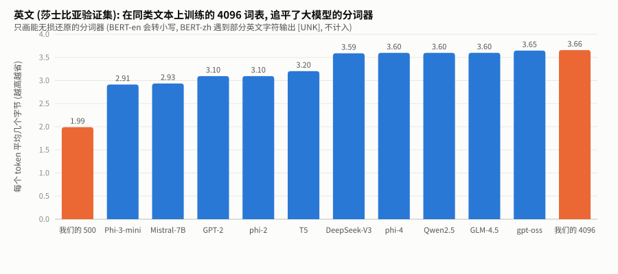

**图 13** 同一段英文 (莎士比亚验证集前 1 万字节), 每个 token 平均几个字节, 越高越省。**怎么读**: 蓝色是各家官方分词器, 橙色是我们的。
大词表的现代分词器 (phi-4、Qwen2.5、GLM-4.5、DeepSeek-V3、gpt-oss) 都在 3.6 左右, 32K 词表的 Mistral/Phi-3 不到 3.0。
我们的 4096 词表达到 3.66, 和 gpt-oss 持平: 同第 9.2 节, 这是"在同类文本上训练"的优势, 不代表它在别的文本上也这么好。

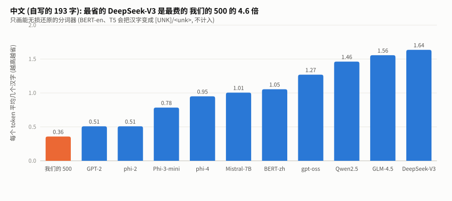

**图 14** 同一段中文 (193 字), 每个 token 平均几个汉字。**怎么读**: 差距比英文大得多。最左边的我们 (0.36) 和 GPT-2 (0.51) 每个汉字要 2~3 个 token;
中间的 Mistral 和 BERT-zh 约一字一 token; 右边的中文模型 (Qwen2.5、GLM-4.5、DeepSeek-V3) 每个 token 平均 1.5 个字以上, 它们的词表里有大量完整的中文词。
英文差距不到 1.3 倍, 中文差距 3 倍以上: **分词器决定了一个模型用中文有多"贵"**。

### 19.3 GPT-2 的 `Ġ` 是什么

在 HuggingFace 里看 GPT-2 的 token, 会看到 `Ġthe`、`ä½` 这样的字符串。GPT-2 先把 256 个字节一一映射成 256 个**可打印**的 Unicode 字符 (可打印 ASCII 保持不变, 空格 → `Ġ`, 其它字节映射到 U+0100 起的字符),
再在这些字符上做 BPE。这样词表文件可以存成普通的 JSON 字符串。本项目直接在字节上做, 把字节存成整数列表 (第 4.7 节), 不需要这层映射。
`examples.py` 里的 `_byte_decoder()` 实现了它的逆映射。

---

## 20. 专题 E · 信息论视角: 熵、压缩与 loss

[information_theory.py](information_theory.py) 演示熵、交叉熵、KL 散度、Huffman 编码。这里只讲和分词直接相关的一点。

### 20.1 一元字符熵

把文本里的字符当作独立抽取, 字符 $`x`$ 的频率是 $`p(x)`$, 一元熵是:

```math
H = -\sum_x p(x) \log_2 p(x) \quad \text{(bit / 字符)}
```

它是"每个字符**独立地**用一个码表示"时, 平均码长的下界 (Huffman 编码可以逼近它)。莎士比亚验证集前 1 万字符实测 $`H = 4.814`$ bit/字符。

### 20.2 分词能"打破"这个下界

把"每个 token 用 $`\log_2 V`$ 位的定长编号存储"作为分词器的代价, 定义效率 = (一元熵 × 字符数) / (token 数 × $`\log_2 V`$), 实测:

| 方法 | token 数 | 每 token 比特 | 总比特 | 效率 |
|---|---|---|---|---|
| 字符级 | 10,000 | 5.9 | 58,826 | 0.818 |
| 词级 (只算这段文本里出现的词) | 1,828 | 9.7 | 17,662 | 2.726 |
| 我们的 BPE (500) | 5,026 | 9.0 | 45,062 | 1.068 |
| GPT-2 (50257) | 3,231 | 15.6 | 50,459 | 0.954 |

效率大于 1, 并不违反信息论: 一元熵只是"逐字符独立编码"的下界。BPE 和词级把常见的**字符组合**当成一个符号, 利用了字符之间的相关性 (`t` 后面很可能是 `h`), 当然能低于它。
旧版代码注释里"tokenizer 的压缩率不可能低于熵"的说法, 混淆了这两件事, 已改正。

文本真正的下界是考虑了全部上下文的**熵率**, 要用语言模型去估: 这正是第 9.4 节 bpb 的含义。语言模型的 loss 越低, 它对文本的"压缩"就越接近熵率。

---

## 21. 延伸专题练习

<details>
<summary><b>1.</b> 手算 "é" (U+00E9) 的 UTF-8 字节, 再用 Python 验证。</summary>

U+00E9 在 U+0080~U+07FF 之间, 用 2 字节模板 `110xxxxx 10xxxxxx`。`0xE9` = `000 1110 1001` (11 位), 前 5 位 `00011` 填进首字节 → `11000011` = `0xC3`, 后 6 位 `101001` 填进续字节 → `10101001` = `0xA9`。
`"é".encode("utf-8")` 返回 `b'\xc3\xa9'`。
</details>

<details>
<summary><b>2.</b> 一个字节流里看到字节 <code>0xBD</code>, 它可能是一个字符的开头吗? 看到 <code>0xC0</code> 呢?</summary>

`0xBD` = `10111101`, 以 `10` 开头, 是续字节, 不可能是开头。`0xC0` 在合法的 UTF-8 里根本不会出现 (超长编码, 18.2 节); 见到它说明数据不是合法的 UTF-8。
</details>

<details>
<summary><b>3.</b> 用 GPT-2 正则和 Qwen2.5 正则分别切 <code>"I've 100 apples"</code>, 结果有什么不同? 先手推, 再用 <code>regex.findall</code> 验证。</summary>

GPT-2: `I` `'ve` `␣100` `␣apples` (`␣100` 是一段, 数字前可以挂空格)。Qwen2.5: `I` `'ve` `␣` `1` `0` `0` `␣apples`: 数字分支 `\p{N}` 不允许挂空格, 空格只能单独成段, 每个数字各一段。
</details>

<details>
<summary><b>4.</b> 为什么 GPT-2 的分词器在中文上 (0.51 字/token) 比我们的 (0.36) 好, 尽管它也是字节级、也没专门为中文设计?</summary>

GPT-2 的训练语料 (WebText) 里有少量中文, 5 万词表里学到了一些常见汉字的字节合并 (例如"的"是一个 token, "你"是 `E4 BD` + `A0` 两个); 我们的语料里一个中文字节都没有, 所以中文完全退回单字节。
</details>

<details>
<summary><b>5.</b> 第 20.2 节词级的效率高达 2.7, 为什么实际中没人用纯词级分词?</summary>

那个数字只把这段文本里出现过的 810 个词当作词表。真实的词级分词器要覆盖所有可能出现的词, 词表巨大 (每个 token 的比特数随之上升), 而且遇到没见过的词只能输出 `<UNK>`, 信息直接丢失。
</details>
